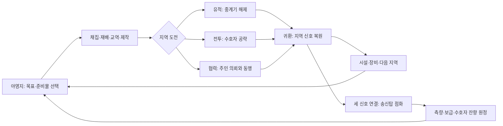

# 첫 신호 — 0.9.0 베타 후보의 플레이 설계

## 방향과 조사

FERAL의 정체성은 **살아 있는 복셀 환경에서 탐험·직접 조립·공동체 협력으로 성장하는 샌드박스 RPG**다. 0.8.0까지의 개별 시스템을 하나의 완주 가능한 캠페인으로 묶는다. 장기 비전 전체가 완성됐다는 선언은 하지 않는다.

2026-10-17 공식 자료 조사:

- [Valheim 개발사 FAQ](https://www.valheimgame.com/faq/): 지역마다 환경·자원·제작·보스를 연결한다. FERAL은 지역별 준비와 귀환의 리듬을 참고하되 보스를 기술의 필수 관문으로 만들지 않는다.
- [Subnautica 개발사의 제작 트리 개편 설명](https://unknownworlds.com/en/news/new-loot-system-tech-tree-design): 필요한 재료의 획득처가 명확해야 하고, 중간 재료는 실제 선택을 늘려야 한다. FERAL은 재료 안내와 재생 가능한 공급 경로를 연결하고, 목적 없는 재료 단계는 늘리지 않는다.
- [Core Keeper 공식 배급 페이지](https://store.steampowered.com/app/1621690/Core_Keeper/): 탐험·기지·생태·성장·강적이 연결되는 샌드박스 구조를 참고했다. FERAL에서는 자신이 복구한 신호망과 농업·정비 시설이 다음 원정을 지원한다.

이 자료들은 설계의 참고이며 다른 게임의 자산·세계관·수치·진행 정책을 복제하지 않는다.

### UI 사례 비교와 적용

- [Minecraft 공식 조작 안내](https://www.minecraft.net/en-us/article/minecraft-controls), [공식 터치 배치 도해](https://education.minecraft.net/content/dam/education-edition/software-downloads/MCEDU%20Movement%20Control%20Guide.pdf): 하단 아이템 핫바, 좌우 이동/행동 분리, 화면 드래그 시점 회전, 직접 대상 사용, 사용자 설정 가능성을 확인했다. FERAL의 9칸 핫바·36칸 인벤토리·누른 채 시점 회전은 유지하며 여정 버튼도 기존 HUD 편집기에 포함한다.
- [Terraria 개발사의 UI 개선 설명](https://terraria.org/news/terraria-1-3-user-interface-upgrades): 아이콘의 선택 상태, 글자 대비, 반복 조작 단축이 중요하다. FERAL은 제작 아이콘 아래 이름을 표시하고 검색·제작 가능 필터·구체적인 부족 재료 표시를 추가한다. 이미 갖춘 슬롯 기반 이동과 별도 스크롤 영역을 유지한다.
- 목표 화면은 고정 테두리와 닫기 버튼, 내부 스크롤을 사용한다. 목표·야영지·신호망·원정 네 하위 화면으로 나눠 긴 단일 페이지를 줄인다. 현재 목표는 좌측의 작은 HUD에서 열며 중앙 조준 영역은 비워 둔다.
- 버튼이 DOM에 존재하는지만 검사하지 않는다. 뷰포트·스크롤 클리핑·실제 좌표의 최상위 요소를 확인한 뒤 터치하며, 작은 화면에서 스와이프가 버튼 위에서도 이어지는지 확인한다.

### 미학적 분석과 그래픽 방향

[Minecraft의 Vibrant Visuals 공식 소개](https://www.minecraft.net/en-us/article/minecraft-vibrant-visuals)는 블록 형태를 유지하면서 방향성 빛·그림자·거리감을 개선한다. Valheim FAQ가 설명하는 저해상도 형상과 현대적 조명의 조합도 참고했다. 단순히 픽셀 수를 늘리는 대신, 가까운 면의 재질과 물체의 실루엣·그림자·먼 공간의 색이 각각 다른 역할을 갖도록 한다.

| 관찰한 시각 원칙 | 기존 문제 | FERAL에 적용 |
|---|---|---|
| 단순한 형상 + 재질 구분 | 평평한 단색 면이 흙/돌/나무에서 비슷하게 보임 | 1m당 16 표본의 원본 절차적 표면, 나뭇결·나이테·풀 경계·석재 이음·광석 입자. 반 칸/큰 면에 연속 적용 |
| 빛으로 형태와 깊이 표현 | 바닥과 물체의 접점·거리 구분 부족 | 거친 표면 조명, 따뜻한 방향광과 차가운 환경광, 국소 그림자, 하늘과 안개를 같은 색조로 연결 |
| 장면의 색을 UI에도 연결 | 플랫폼별 기호와 무거운 카드 테두리 혼재 | 짙은 청록 패널·황동 선택선·밝은 글자·민트 신호, 얇은 테두리와 고정 헤더, 직접 그린 동일 선 굵기 SVG |
| 역할이 실루엣에 드러남 | 주민·채집물·수호자 구분이 글자에 의존 | 주민 눈/팔/직업 소품, 열매 덤불·꽃·잔해·결정 형태, 수호자 뿔/갑주/지느러미 |
| 아이콘과 글자의 계층 | 작은 그림만 보고 제작법을 찾아야 함 | 슬롯 이름, 구체적인 재료 안내, 일정한 행동 아이콘과 월드 선택 삽화 |

월드 정보창은 조명에 의해 글자가 어두워지지 않도록 하고 기존 원근·렌더 우선순위를 유지한다. 수면은 겹치는 반투명 큐브 면 대신 표면 메시와 작은 물결 조명을 사용한다. 광선 추적·화면 공간 반사·볼류메트릭 안개 구현을 뜻하지 않는다. 낮음은 그림자 없음/DPR 최대 1, 균형은 1024 그림자/DPR 최대 1.5, 높음은 2048/DPR 최대 2다. 그림자 범위는 플레이어 주변으로 제한한다. 기존 청크 병합과 생명체 인스턴싱을 유지하며 외부 텍스처 다운로드는 없다.

다른 게임의 이미지·텍스처·아이콘을 가져오지 않았다. 실제 화면에서 조명과 텍스트 대비, 세로/가로 터치 접근을 검증하며 소프트웨어 GPU의 프레임 시간을 휴대폰 성능으로 해석하지 않는다.

## 핵심 순환

분 단위 행동은 채집·채굴·전투·재배, 한 원정은 준비→이동→도전→귀환, 캠페인은 출발지 성장→세 신호→첫 신호 전송이다. 캠페인 완료 이후에도 기존 샌드박스와 세 종류 원정이 지속된다. 소요 시간은 플레이 방식에 따라 달라지며 실측 없이 특정 플레이 시간을 보장하지 않는다.

## 구체적인 콘텐츠와 선택

| 구간 | 플레이어의 목표 | 실제 결과 |
|---|---|---|
| 첫 보급 | 채집 지점 3곳 사용 | 식량·연구 보상, 재료 획득법 학습 |
| 돌아올 곳 | 출발지 텃밭 건설·첫 수확 | 두 밭에서 반복 농사, 씨앗을 돌려받음 |
| 이웃의 이름 | 주민 의뢰 1건 또는 지원 2회 | 교역·평판·동맹으로 이어지는 접점 |
| 꺼진 신호 | 탐사/전투/협력 중 한 경로 | 지역 신호탑 점등 |
| 세 개의 목소리 | 숲·구릉·해안 신호 복원 | 출발지·동쪽·북쪽에서 운에 관계없이 접근 |
| 첫 신호 | 출발지 3시설 + 합금 8·연구 6 | 송신탑 점등, 완료 기록·보상, 반복 원정 해금 |

목표 달성 보상은 한 번만 수령한다. 이미 진행한 행동도 조건에 맞으면 인정한다. 이 순서를 강제로 잠그지 않는다.

시설은 지역별로 저장된다. 텃밭은 씨앗 1개로 90초 열매 또는 120초 약초를 재배하며 수확 시 씨앗 2·섬유 2를 함께 얻는다. 활동 시간만 진행되고 앱 종료·메뉴 일시정지는 성장 시간을 진행하지 않는다. 다른 지역을 탐험하는 동안은 자란다. 가방이 가득 차면 작물·보상은 사라지지 않는다.

취사장 휴식은 식량 1개로 완전 회복하고 180초간 피해 10% 감소를 제공한다. 정비소는 합금 1·원목 1로 소지한 모든 장비의 내구도를 각각 60 회복한다. 야채 스튜는 이동 중 같은 방어 효과, 강장제는 60초간 초당 체력 0.8 회복을 제공한다. 효과의 시간은 누적되지 않고 새로 갱신된다. 식물 수지 제작으로 사냥 없는 기계·약품 제작도 가능하다.

신호 복원은 해당 지역 야영지에서 다음 중 하나:

- 탐사: 유적 보상 회수 + 유적 핵 1·합금 4·결정 4.
- 전투: 수호자 격파 + 유적 핵 1·합금 2.
- 협력: 지역 주민 의뢰 2건 + 지역 집단 동맹 + 식량 6·목재 8·연구 4.

복원 경로는 지역별로 섞어 사용할 수 있다. 모든 지역에서 협력으로 진행할 수도 있다. 기존 보스 처치·유적 회수·의뢰 완료 기록도 인정한다. 새로운 시설 건설이 기존 사용자 지형을 덮어쓰지 않는다. 새 지역에만 지역별 유적·투기장 구조 변형을 생성한다.

## 전투와 반복 원정

숲 수호자는 내려찍기와 고리, 구릉 수호자는 돌진과 십자 분쇄, 해안 수호자는 고리와 삼중 낙하를 사용한다. 공격 예고의 도형과 피격 계산은 같은 정의를 읽는다. 고리의 안쪽은 안전하며 돌진·십자는 옆이나 대각선으로 피한다. 체력 40% 미만이면 공격 사이의 여유가 짧아진다. 비행은 지면 공격을 피하지만 낙하는 피해야 한다.

첫 신호 완료 후 복원한 야영지에서:

| 원정 | 해야 할 행동 | 반복 보상 |
|---|---|---|
| 측량 | 마을·유적·둥지의 표석 3곳을 직접 사용하고 귀환 | 연구 6·결정 6·유적 핵 1 |
| 보급 | 첫 마을에 식량 6·약품 2·목재 8 전달 후 귀환 | 합금 10·연구 4·유적 핵 1 |
| 수호자 잔향 | 강화 수호자 격파 후 귀환 | 합금 8·연구 8·유적 핵 2 |

원정은 지역별 1개씩 진행한다. 다른 지역에 갔다 돌아와도 보존된다. 보상 수령 뒤 60초, 포기 뒤 30초 후 재출발한다. 원정 수호자는 기존 수호자 보상과 별도이고 난도는 최대 5회까지 상승한다. 사망 시 소지품·시설·진행을 보존하고 기존 경험 페널티로 야영지에 돌아온다.

## 이번 베타 후보의 통과 기준

1. 빈 가방에서 실제 채집·채굴·제작·교역으로 캠페인의 모든 소모 재료를 마련할 수 있다. 지급 아이템만으로 통과시키지 않는다.
2. 새 원정에서 여섯 목표와 세 경로를 거쳐 송신탑을 점화하고, 세 반복 원정을 각각 끝낼 수 있다. 한 번만 지급하는 보상의 중복 지급이 없다.
3. 농업·원정·신호·전투 중 저장과 재실행, 지역 왕복, 사망·가방 포화가 진행을 막거나 자원을 지우지 않는다. 0.8.0 저장을 읽을 수 있다.
4. 360×640, 390×844, 640×360, 900×412, 1280×720에서 새 UI의 모든 행동에 스크롤로 접근한다. 화면 밖 요소를 강제로 클릭한 성공은 인정하지 않는다.
5. 기존 채굴 손상 보존·주민/유적 상호작용·재료 접근성·이동 자세·터치 드래그·기계 물리 검사를 통과한다.
6. APK와 서명 업데이트를 빌드하고 공개 배포의 서명·해시·버전·파일을 검증한다.

이 자동 검증을 통과한 결과를 **콘텐츠가 완주 가능한 베타 후보**로 구분한다. 실제 Android 장시간 플레이·발열·프레임 안정성·사람의 이해도와 난도 평가를 수행하지 않았다면 일반 사용자 대상 베타 품질을 확인했다고 표현하지 않는다. 무중단 무한 월드, 개인별 주민 경제·전쟁, 대규모 저장 확장은 여전히 장기 범위다. 구현·측정 결과는 `verification/0.9.0.md`에 기록한다.
