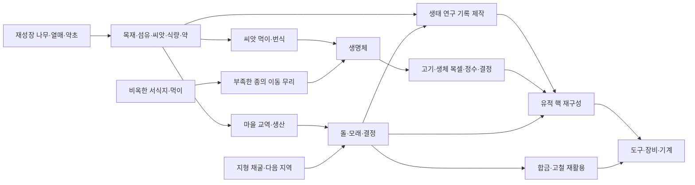

# 0.8.0 — 손상·상호작용·획득 순환

게임 800, 네이티브/최소 네이티브 303, 저장 스키마 2. 기존 섬과 개척 원정의 채굴에 손상 보존을 적용한다. 주민·유적·새 채집 지점은 개척 원정 콘텐츠다.

## 파손은 월드 상태

0.5m 셀마다 재질과 파손 비율을 저장한다. 조준을 옮기거나 시간이 지나도 감소하지 않는다. 도구와 작업 크기를 바꿔도 이미 손상된 셀의 비율은 남는다. 1m/2m 범위는 포함된 각 셀에 작업량을 나누며, 돌·흙·광석이 섞여 있으면 각자의 재질 강도를 사용한다. 먼저 100%가 된 셀부터 사라지고 그 셀의 자원만 드롭한다.

저장 재실행·지역 왕복 후에도 손상이 남는다. 블록을 파괴하거나 다른 재질로 교체할 때 해당 셀의 손상만 지운다. 지형의 화재·산성 변화도 같은 교체 경로를 따른다. 기반암 바닥과 용암에는 진행도가 쌓이지 않는다. 별도의 시간 기반 자동 복구는 없다. 조준 정보창에서 저장된 파손 비율을 확인한다.

## 눈앞의 대상을 사용

- 주민·수호자·유적 핵·중계기·채집물은 그려진 복셀 형상을 조준한다. 실제로 가까운 생명체/조립체/월드 물체가 우선하고 지형에 막힌 대상은 사용할 수 없다.
- 주민은 4m 안의 플레이어를 바라본다. 주민을 조준하고 **사용 / R**하면 보급 담당·약초사·정비사의 대화와 해당 마을을 먼저 표시한다. 교역·지원·의뢰는 마을 12m 안에서 가능하다.
- 동물은 3.5m 안에서 사용하여 관찰한다. 지역·종별 첫 관찰은 연구 기록 2와 경험 5. 씨앗은 기존 먹이·번식, 회복약은 HP 30 치료에 쓰인다. 사라진 부위는 재생하지 않는다.
- 회전 핵을 공격해 지형을 캐는 대신 사용 안내를 보여준다. 수호자는 장착 무기의 실제 사거리로 공격한다.
- 대상이 없는 사용 입력은 지도를 강제로 열지 않는다. 지도는 지도 버튼으로 연다. 마을·야영지·차량 근처의 R 접근 경로도 유지한다.

## 발견·채집·의뢰·제작

지역당 14개 채집 지점: 야영지와 두 마을에 맹아 나무·들열매·은잎 약초·옛 기계 잔해 각각 1개, 유적에 공명 결정 군집 2개. 기존 저장에도 같은 위치로 생긴다. 채집은 사용 버튼으로 하고 가방이 가득 차면 자원을 소모하지 않는다.

| 대상 | 획득 | 다시 얻기 |
| --- | --- | --- |
| 맹아 나무 | 원목 4, 섬유 2, 씨앗 1 | 활성 플레이 300초 후 재성장 |
| 들열매 덤불 | 열매 3, 씨앗 1 | 180초 후 재성장 |
| 은잎 약초 | 약초 2, 섬유 1 | 240초 후 재성장 |
| 기계 잔해 | 고철 3 | 지점당 한 번, 다음 지역 또는 합금 분해 |
| 결정 군집 | 결정 3 | 지점당 한 번, 광석/청금딱정/마을 교역으로 추가 확보 |

마을마다 **공동 식탁**(열매 6), **야전 치료소**(약초 4·생체 복셀 2), **정착지 수리**(고철 6) 의뢰를 한 번씩 완료할 수 있다. 각 의뢰는 물자 보상과 평판 8·경험 15를 주며, 적대 중에는 먼저 화해해야 한다. 지급에 필요한 가방 공간까지 확인한 다음 재료·완료 기록을 함께 반영한다.

유적은 씨앗 보관소·바람 관측소·동력 중계소 3종 중 지역 시드로 정한다. 주변 주황색 중계기 세 개를 각각 사용하면 방어장이 해제되고, 가운데 회전 핵을 사용해 연구 6·결정 4·합금 3·유적 핵 1과 유적별 보너스를 회수한다. 활성 방어장 안에서는 피해를 받지만 가만히 기다리는 것만으로 해제되지는 않는다. 해제한 중계기와 보상 회수 여부는 저장된다. 이전 버전의 해제 진도 2.5라면 두 중계기가 해제된 상태와 기존 수치로 이전하고 마지막 중계기를 사용하면 완료된다.

공명 곡괭이는 유적 핵 1·합금 8·결정 6으로 제작한다. 돌·광석 효율 6배, 내구도 520. 기존 슬롯·장착·소모·수리 규칙을 사용한다.

## 자원이 막히지 않는 경로

시작 지급품은 획득 경로로 계산하지 않는다. 기본 도구를 잃은 뒤에도 빈손으로 채굴·공격할 수 있고 나무 곡괭이와 기본 펄스를 다시 제작할 수 있다.

- 흙: 지형 채굴 또는 섬유 3·씨앗 1을 퇴비 흙 4로 제작.
- 목재·섬유·씨앗: 지형/식생과 맹아 나무·덤불 재성장. 목재는 원목 가공, 씨앗은 섬유 제작도 가능.
- 돌·모래: 지형 채굴 또는 식량 2를 돌 8·모래 4로 교역. 교역은 마을 돌 재고 12를 소비하며 마을은 30초마다 돌 2를 생산한다.
- 결정: 광석 채굴·청금딱정 드롭·원목 교역. 연구/합금 제작의 광물 재료다.
- 생체 복셀·정수·고기: 사냥과 부위 손상. 초식종은 씨앗을 먹여 번식한다. 90초마다 생존 개체가 2마리 미만인 종은 비옥한 풀밭에서 이동 무리로 복구될 수 있다. 플레이어 16m 밖, 식생 0.4·영양 0.2 이상, 물에 잠기지 않은 빈 서식지만 사용하고 식생·영양을 소모한다. 포식자는 초식종이 4마리 이상일 때만 들어온다. 불모지에서는 생성하지 않는다.
- 연구 기록: 발견·관찰·지원·의뢰·유적 외에도 약초 2·섬유 4·결정 1로 기록 2를 반복 제작.
- 유적 핵: 유적·수호자 외에도 정수 8·결정 12·연구 기록 6으로 재구성. 보스 처치가 유일한 기술 진입 경로가 아니다.
- 고철↔합금: 고철 3·원목 1 → 합금 3, 합금 2 → 고철 2. 원목을 소비하여 순환하며 금속을 증식하지 않는다.

가방의 아이템 설명과 제작법의 **재료 얻는 곳**에 실제 채굴 매핑·드롭·채집·제작 정의에서 만든 안내를 보여준다. 재료 추가 시 획득 규칙이 빠지면 자동 검사가 실패한다.

## 검증의 범위

`acquisition-loop.test.js`는 두 모드의 획득 그래프에서 선행 연구와 재료 의존을 검사한다. 개척 원정 아이템 44종·제작법 47개가 접근 가능해야 한다. 이어 각 제작법을 빈 인벤토리에서 출발하여 실제 채굴, 채집 재성장, 생명체 드롭, 선행 연구 제작, 최종 제작으로 실행한다. 필요한 재료를 테스트가 임의로 지급하지 않는다. 각 제작법은 독립된 빈 가방 시나리오이며, 한 플레이에서 전 제작법을 해금한 시간 측정은 아니다.

브라우저 검증은 터치 버튼으로 채굴 중단·저장 재실행, 주민 대화·의뢰 전달, 채집, 유적 해제·회수, 동물 관찰·먹이·치료를 실행한다. 메뉴 안의 화면 밖 버튼은 실제 스와이프로 노출한 뒤 좌표를 확인해 탭한다. 지역 왕복 후 손상·진행 복원도 별도로 확인한다.

지역 전환형 월드, 간이 주민 대화·순찰·공동체 생산이라는 기존 범위는 유지한다. 이주 무리는 세밀한 월드 밖 이동을 계산하는 개체가 아니라 서식 조건에 따른 개체수 복구 규칙이다. 장기 경제 균형·개인별 NPC 계획 AI·Android 실기기 장시간 성능을 완료했다는 의미는 아니다.
