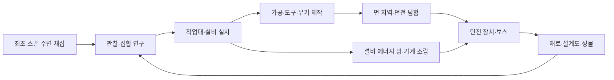
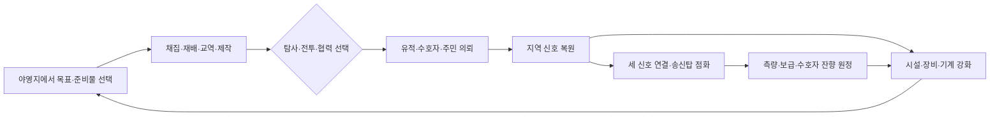

# FERAL 진행 현황 — 게임 0.11.0

> 작성일: 2026-10-17 · 기준: 공개 배포 게임 0.11.0 / Android 앱 0.3.3
>
> 구현·검증·배포 기록을 모은 현황 문서다. 장기 방향은 [게임 비전](GAME-VISION.md), 전체 완료 기준은 [구현 Goal](IMPLEMENTATION-GOAL.md), 요구사항별 근거는 [구현 추적표](content/IMPLEMENTATION-STATUS.md), 버전별 변경은 [CHANGELOG](../CHANGELOG.md)를 참조한다.

## 1. 현재 어디까지 왔는가

**기존 캠페인·물리 샌드박스 위에, 기획 데이터와 복셀 모델 119개를 실제로 플레이할 수 있는 ‘콘텐츠 탐험’ 월드를 추가해 공개 배포한 단계다.** 게임 0.11.0은 [PR #16](https://github.com/Modopi/feral-voxel-sandbox/pull/16)으로 main에 병합됐고 APK·게임 업데이트가 모두 게시됐다.

현재 게임은 두 층으로 나뉜다.

- **기존 월드 유형(0.10.x까지):** 기본 섬, 기계 시험장, 개척 원정. 첫 신호 캠페인, 실제 아이템 인벤토리, 직접 기계 조립·공기역학, 외피/골격 손상, 지형의 독립 물체화와 운반을 포함한다. 아이템 47종·제작법 51개.
- **콘텐츠 탐험(0.11.0 신규):** 무한 청크 지형, 8환경·34종 생명체, 12건축물(던전 8)·8보스와 9~10티어 변형 4종, 39연구·142제작법·27설비, 재료형 무기, 위치·포트별 에너지 망, 신앙·시련, 사망 회수와 압축 저장을 하나의 런타임에 연결했다.

**[구현 Goal](IMPLEMENTATION-GOAL.md) 전체는 아직 진행 중이다.** 0.11.0은 중간 배포다. 기능 코드와 모델 검사는 대부분 갖췄지만, 새 월드에서 정상 입력만으로 보스까지 이어지는 화면 완주, 장거리 무한 월드의 메모리 상한, Android 실기기 성능·생명주기 검증이 남아 있다. 배포 채널 이름 `stable`은 이 품질 평가와 별개다.

## 2. 월드 유형과 진입

| 월드 유형 | 진입 | 주요 내용 | 상세 |
| --- | --- | --- | --- |
| 기본 섬 | 내 월드 → 기본 맵 | 160×160m 섬, 반 칸 채굴·건축, 생태·유체·화학 | [README](../README.md#세계와-시뮬레이션) |
| 기계 시험장 | 내 월드 → 기계 베타 맵 | 7×3×7 격자 조립·주행 시험 | [기계 구조](MACHINE-ARCHITECTURE.md) |
| 개척 원정 | 내 월드 → 새 월드 → 개척 원정 | 첫 신호 캠페인, 지역 전환, 기계·비행, 운반·물리 샌드박스 | [첫 신호](FIRST-SIGNAL.md), [구조 샌드박스](STRUCTURAL-SANDBOX.md) |
| **콘텐츠 탐험** | 내 월드 → 새 월드 → 콘텐츠 탐험 | 무한 청크, 설계 생명체·던전·보스, 연구·제작·설비·기계·에너지 | [콘텐츠 위키](content/README.md), [추적표](content/IMPLEMENTATION-STATUS.md) |

기존 월드와 저장은 그대로 유지한다. 기존 저장에서 새 콘텐츠를 이용하려면 콘텐츠 탐험 월드를 새로 만든다.

## 3. 콘텐츠 탐험 구현 현황 (0.11.0)

‘모델 검사’는 자동 테스트로 규칙·수지·저장을 확인한 것, ‘화면 확인’은 실제 브라우저 UI와 입력으로 확인한 것이다. 준비된 자원·연구 상태에서 확인한 화면 검사는 정상 성장 완주의 증거로 세지 않는다.

| Goal 영역 | 구현된 것 | 화면 확인 | 남은 검증·과제 |
| --- | --- | --- | --- |
| 1. 월드·환경·탐험 | (0,0) 최초 스폰, 거리 난도, 8환경·33블록, 증분 청크 생성·저장, 고난도 국소 구역 | 채집 위치·청크 렌더 | 장거리 왕복의 메모리·프레임 실측, 방문 지역 이력의 분할 저장 |
| 2. 엔티티·생태 | 34종 모델·행동·부위 손상·드롭, 칼로리·피격 유예·자연회복, 무기생명 수리, 2시간 생태·활성 상한 | 야외 개체 표시·전투 | 보존 개체의 무한 누적 메모리 제한, 실제 장시간 생태 관찰 |
| 3. 건축물·던전·보스 | 12건축물·84방 배치·파괴·영속, 8던전 고유 장치, 8보스·24페이즈·32기술, T9/T10 변형 4종, 영구 기관 파손 | 뿌리 저택 장치 인양·개방, 보스 피해·차폐 | 나머지 7개 장치의 화면 완주, 보스 회피·실전 난도 |
| 4. 성장·연구·제작 | 10티어·31재료·네 분야 연구, 39연구·142제작법·27설비, 도구 마모·교체 | 채집 → 돌 곡괭이 → 목재 가공, 작업대 설치·무기 제작 | 정상 입력만으로 고티어까지 이어지는 화면 완주 |
| 5. 자유 제작·물리·에너지 | 기계 SDK 조립·손상·수리·저장, 부력, 6에너지 수지, 고정 설비 위치·포트별 전력망, 설비→기계 충전, 전기 투사기 | 기계 4칸·차폐벽 12칸 조립, 충전·유료 발사·차폐·저장 재개 | 실물 배선·주행 완주, 에너지→재질 반응의 실전 연결 |
| 6. 생활·공동체·회수 | 공동체 거래·기여, 신앙 가입·의뢰·제단 시련, 사망 시 전체 소지품 현장 보존과 10m 요정 회수 | 신앙 가입·납품·시련·재보상 방지 | 사망 회수의 실제 화면 조작 완주 |
| 7. 시각·조작·연동 | 119개 모델 런타임 연결, 무기 외형·재질 표면, 터치 조작, 두 세대 압축 저장·worker 자동 저장 | 3개 화면 크기 터치·제작 스크롤·메뉴·저장 재접속 | Android 실기기 표시·성능·생명주기 |

정확한 근거와 실행 기록은 [구현 추적표](content/IMPLEMENTATION-STATUS.md)와 [0.11.0 검증 기록](../verification/0.11.0.md)에 있다.

### 전투·사망 규칙의 변경

0.11.0부터 외피 공격도 전체 HP를 줄이고 HP 소진으로 사망한다. 골격·기관 파손은 HP와 별도로 해당 행동을 제한한다. 관통·충격 전달로 내부 부위를 노릴 수 있으며 기존 개척 원정의 무기에도 적용한다. 규칙은 [전투 HP 규칙](content/COMBAT-HP-RULES.md)에 있다.

## 4. 기존 월드 유형 구현 현황 (0.10.x)

| 영역 | 현재 가능한 것 | 범위·주의점 / 상세 문서 |
| --- | --- | --- |
| 월드·탐험 | 시드 기반 지역, 숲·구릉·해안, 마을·유적·수호자, 지역별 상태 보존 | 개척 원정은 지역 전환 방식. [개척 원정](FRONTIER-PROTOTYPE.md) |
| 핵심 캠페인 | 여섯 목표, 세 지역 신호 복원, 송신탑 점화, 측량·보급·수호자 잔향 원정 | 탐사·전투·협력 경로를 지역별로 혼합 가능. [첫 신호](FIRST-SIGNAL.md) |
| 생태·자원 | 세 동물 종의 섭식·포식·번식·이주, 채집물 재성장·두 작물 재배 | 교역·재활용 등 대체 경로 포함. [자원 순환](PERSISTENT-WORLD-AND-LOOPS.md) |
| 인벤토리·제작 | 총 36칸, 이동·분할·합치기·교환, 장비·수리, 제작 검색·필터·획득처 안내 | [인벤토리](SURVIVAL-INTERFACE.md) |
| UI·모바일 | 지형 위에 보이는 월드 정보창, 내부 스크롤, 좌우손·가로세로 배치 편집 | [월드 UI](WORLD-SPACE-UI.md), [편집기](UI-EDITOR.md) |
| 기계·비행 | 0.5m 면 부착 조립, 차체·모터·바퀴·포탑·회전익·고정익, 손상·수리·분리·저장 | 게임용 공기역학 모델. [기계 물리](STRUCTURAL-PHYSICS.md) |
| 지형·물체 | 연결이 끊긴 지형의 강체 전환, 잡기·끌기·밀기·던지기, 운반 집게, 고정·재료 부착 | [구조 샌드박스](STRUCTURAL-SANDBOX.md) |
| 신체·충격 | 외피/골격 분리, 관절 단절에 따른 행동 변화, 질량 기반 낙하·충돌 피해 | 동물과 인물형 훈련체에 적용. 일반 주민·플레이어 전신 적용은 남음 |
| 그래픽 | 지형별 절차적 표면, 주야 조명·그림자·수면, 1/32m 정밀 인물, 3D 캐릭터 미리보기 | [복셀 캐릭터](VOXEL-CHARACTERS.md) |

렌더러는 **Three.js**, 기계·분리 물체·콘텐츠 탐험의 강체 물리는 **Rapier**를 사용한다. 대상 정보는 3D 월드 UI이며, 가방·메뉴·조작 버튼은 HTML 기반 게임 UI를 유지한다.

## 5. 플레이 루프

### 콘텐츠 탐험

발견 보상은 성장을 가속하지만 필수가 아니다. 자동 검사는 빈 가방에서 실제 채집 노드·채집 시간·도구 마모·연구 샘플·제작 입력·생산 에너지를 소비해 39연구·27설비·31재료·10단계 장구에 도달하는 경로를 확인했다. 이 검사는 좌표 없는 경제 모델이며 실제 걷기·설비 배치·배선·전투를 대신하지 않는다.

### 첫 신호 캠페인 (개척 원정)

### 물리 샌드박스 (개척 원정)

**지지대 자르기 → 남은 덩어리 분리 → 잡고 끌기·밀기 → 다리·장애물·짐으로 활용 → 고정·재료 부착 → 다시 절단·수리**의 순환이다. 아이템은 실제 파괴한 셀에서만 지급해 물체와 자원이 중복되지 않는다. 조작은 [구조 샌드박스](STRUCTURAL-SANDBOX.md)를 참조한다.

## 6. 코드 구조

| 책임 | 주요 코드 | 역할 |
| --- | --- | --- |
| 콘텐츠 탐험 진입·화면 | [content-runtime/entry.js](../app/src/main/assets/content-runtime/entry.js), [runtime.js](../app/src/main/assets/content-runtime/runtime.js), [scene.js](../app/src/main/assets/content-runtime/scene.js) | 입력·패널·프레임 루프, 시스템 조립, 장면 생성 |
| 월드·생명체·던전·보스 | [atlas.js](../app/src/main/assets/content-runtime/atlas.js), [creatures.js](../app/src/main/assets/content-runtime/creatures.js), [dungeons.js](../app/src/main/assets/content-runtime/dungeons.js), [dungeon-devices.js](../app/src/main/assets/content-runtime/dungeon-devices.js), [bosses.js](../app/src/main/assets/content-runtime/bosses.js) | 청크 생성, 생태, 던전 배치·장치, 보스 페이즈·기술 |
| 성장·장비·기계·에너지 | [progression.js](../app/src/main/assets/content-runtime/progression.js), [armaments.js](../app/src/main/assets/content-runtime/armaments.js), [machines.js](../app/src/main/assets/content-runtime/machines.js), [fixture-energy.js](../app/src/main/assets/content-runtime/fixture-energy.js), [placements.js](../app/src/main/assets/content-runtime/placements.js) | 연구·제작·사망 회수, 무기, 기계 SDK, 설비 전력망, 설치 |
| 신앙·공동체·재질 반응 | [faith.js](../app/src/main/assets/content-runtime/faith.js), [community.js](../app/src/main/assets/content-runtime/community.js), [material-effects.js](../app/src/main/assets/content-runtime/material-effects.js) | 의뢰·시련 원장, 공동체 거래, 에너지→피해·물성 |
| 콘텐츠 저장 | [save.js](../app/src/main/assets/content-runtime/save.js), [autosave.js](../app/src/main/assets/content-runtime/autosave.js), [save-worker.js](../app/src/main/assets/content-runtime/save-worker.js) | 두 세대 압축 저장, 작업 스레드 자동 저장 |
| 생성 콘텐츠 | `content-runtime/*.generated.js`, [build-runtime-content.mjs](../tools/build-runtime-content.mjs) | `design/content/` 원본 6문서와 119개 모델의 불변 패키징 |
| 지역·캠페인 (개척 원정) | [frontier/model.js](../app/src/main/assets/frontier/model.js), [campaign.js](../app/src/main/assets/frontier/campaign.js), [frontier/view.js](../app/src/main/assets/frontier/view.js) | 지역 상태, 진행 조건, 화면 연결 |
| 소지품·신체·물체 | [inventory.js](../app/src/main/assets/inventory.js), [structural-body.js](../app/src/main/assets/structural-body.js), [loose-voxels.js](../app/src/main/assets/loose-voxels.js), [impact.js](../app/src/main/assets/impact.js) | 아이템·제작, 외피/골격, 독립 물체, 충격 피해 |
| 복셀 제작 도구 | [design/assets/author.html](../design/assets/author.html), [generators/](../design/assets/generators) | 모든 신규 복셀 에셋의 필수 제작 경로. [규칙](VOXEL-ASSET-RULES.md) |
| 버전·배포 | [version.json](../version.json), [배포 워크플로](../.github/workflows/release.yml), [제작 하네스](../.github/workflows/voxel-assets.yml) | 앱/게임 버전 분리, 검사·빌드·공개 게시 |

상태·규칙·표현을 나누는 방향으로 모듈을 확장했다. 콘텐츠 탐험과 기존 월드 유형은 같은 앱 안의 별도 진입점이며, 하나의 범용 엔티티 엔진으로 통합한 단계는 아니다.

## 7. 검증과 공개 배포

### 0.11.0에서 확인된 결과

| 항목 | 근거와 결과 |
| --- | --- |
| 단위·회귀 검사 | 로컬 **495개 통과, 실패 0**. 이후 안착 접촉 수정은 물리·조립·배치 46개와 접촉 회귀 1개로 확인하고, 병합 커밋에서 GitHub CI가 전체를 다시 실행해 통과 |
| 복셀 에셋 | 119개 SDK 모델, Khronos glTF Validator 오류·경고 0, 131개 렌더 해시 일치. 제작 하네스 Actions 성공 |
| 정상 입력 경로 | 보존된 초기 저장에서 채집 → 돌 곡괭이 → 목재 가공 → 메뉴 저장 → 재접속. [보고서](../verification/screenshots/expedition-browser-report.json) |
| 전 구간 비용 | 빈 상태에서 39연구·27설비·31재료·10단계 장구와 저장 복원. [보고서](../verification/expedition-progression/0.11.0-report.json) |
| 준비된 상태의 화면 검사 | 무기 제작·장착·보스 피해·마모, 신앙 의뢰·시련, 뿌리 저택 장치, 기계 충전·발사·차폐. [추가 화면 검사](../verification/expedition-additions/README.md) |
| 터치 | 390×844·844×390·360×640에서 레이아웃·제작 스크롤·시점·조이스틱·메뉴·저장 재접속. [보고서](../verification/expedition-touch/report.json) |
| 저장 | 7,392,216글자 상태를 동기·worker 각 3회 저장해 완전 동일 복원, 두 세대 합계 1,191,002글자 |
| 빌드 | APK 빌드, 118개 게임 자산과 서명 업데이트 파일 바이트 일치, ZIP 2,781,642바이트·해제 11,469,147바이트 |
| 공개 게시 | [배포 Actions #21](https://github.com/Modopi/feral-voxel-sandbox/actions/runs/39052235767) 성공. Release·stable·불변 패키지 SHA256 일치, 카탈로그 기존 15개 항목 불변. [게시 결과](../verification/0.11.0.md#공개-게시-결과) |

브라우저 결과는 Chromium/SwiftShader 측정이며 실제 Android의 프레임·메모리·발열 측정이 아니다. 휴대폰 앱에서 0.11.0을 적용·재시작한 결과도 아직 확인하지 않았다.

### 설치·업데이트 기준

| 항목 | 값 |
| --- | --- |
| 공개 저장소 | [Modopi/feral-voxel-sandbox](https://github.com/Modopi/feral-voxel-sandbox) |
| 게임 / 코드 | **0.11.0 / 1100** |
| Android 앱 / 최소 앱 | **0.3.3 / 303** |
| 저장 스키마 / 채널 | **2 / stable** (콘텐츠 탐험 저장은 자체 schema 1) |
| 게임 릴리스 기준 커밋 | `9740e38840a841da2c33e5bd0853ca6ba7623ded` ([PR #16](https://github.com/Modopi/feral-voxel-sandbox/pull/16)) |
| 공개 릴리스 | [v0.11.0](https://github.com/Modopi/feral-voxel-sandbox/releases/tag/v0.11.0) · 2026-10-17 17:13 UTC 게시 |

앱 0.3.3 사용자는 **메뉴 → 업데이트 → 지금 확인 → 저장 후 적용**, 버전을 고정한 사용자는 **게임 버전 → 0.11.0**을 선택한다. 처음 설치하거나 앱 0.3.2 이하라면 릴리스의 `Feral-0.3.3-android.apk`를 기존 앱 위에 설치한다. 수동 버전 전환은 빌드별 저장을 분리하며 처음 선택한 빌드는 새 저장으로 시작한다. 상세한 적용·복구 범위는 [배포 안내](RELEASING.md)를 따른다.

## 8. 주요 개발 이력

| 단계 | 변화 |
| --- | --- |
| 0.2.x~0.3.x | 반 칸 편집·드롭·제작·생태, 독립 월드와 기계 시험장, 서명 업데이트·게임 버전 선택 |
| 0.4.x | 개척 원정·지역 이동·성장·주민 경제·유적/수호자, 무기·도구·사망 규칙 구체화 |
| 0.5.x | 공개 저장소 대응, 실제 아이템 인벤토리, 월드 정보창, 게임 창 디자인·HUD 편집 |
| 0.6.0 | 월드에서 직접 기계 조립, Rapier 강체와 구조 손상·분리 |
| 0.7.0~0.7.2 | 공기역학·이동 자세·실패 버전 재시도, UI 렌더 우선순위·점프·버튼 드래그·스크롤 접근 수정 |
| 0.8.0 | 채굴 손상 영속화, 주민/유적 조준·사용 수정, 콘텐츠와 자원 재획득 경로 확장 |
| 0.9.0 | 첫 신호 캠페인·농업·시설·반복 원정, 재질·조명·UI 시각 체계 개편 |
| 0.9.1 | 정밀 복셀 인물·종별 동물 디자인, 관절 애니메이션·3D 캐릭터 미리보기 |
| 0.10.0 | 외피/골격 분리, 지형의 독립 물체화, 질량 기반 운반과 공통 충격 피해, 작업장 콘텐츠 |
| 0.10.1 | 콘텐츠 위키·데이터, 복셀 제작 SDK·편집기와 필수 검사 하네스 (플레이는 0.10.0과 동일) |
| 0.11.0 | 콘텐츠 탐험 월드: 무한 청크·생명체·던전·보스·연구·제작·설비·기계·에너지·신앙·사망 회수, 전체 HP 전투, 압축 저장 |

## 9. 남은 과제와 다음 우선순위

**아래는 [구현 Goal](IMPLEMENTATION-GOAL.md)의 완료 조건에서 도출한 제안이며, 구현 완료 내역이나 확정 일정이 아니다.**

| 우선순위 | 과제 | 완료를 판단할 증거 |
| --- | --- | --- |
| 1 | 구현된 기능 중 화면에서 접근·확인하기 어려운 경로를 실제 UI로 연결 | 각 기능을 일반 입력으로 사용하는 화면 검사와 저장 재개 |
| 1 | 새 콘텐츠 탐험 월드에서 정상 입력만으로 보스까지 진행 | 자원 지급 없이 채집→연구→제작→장비·기계→던전·보스의 브라우저 완주 기록 |
| 1 | 실제 Android에서 설치·업데이트·장시간 플레이 | 기기·SoC·RAM·OS/WebView, 30분·2시간 세션의 p50/p95 프레임, 메모리 증가, 열 제한, 백그라운드 복귀·프로세스 종료 후 저장 복원 |
| 2 | 무한 월드의 장거리 메모리 상한 | 방문 이력·보존 개체의 분할 저장 또는 상한 정책과 장거리 왕복 측정 |
| 2 | 나머지 던전 장치 7종과 보스 회피의 화면 완주 | 장치별 실제 조작·보상·저장 재개, 보스 예고·회피·차폐의 실전 기록 |
| 2 | 실물 설비 배선·기계 주행 완주, 에너지→재질 반응의 전투 연결 | 실제 배치·포트 연결·충전·주행과 채널별 피해·물성 변화 확인 |
| 3 | 일반 주민·플레이어의 구조 손상, NPC 자율 활동 확대 | 이동·전투·치료·사망·저장 규칙 정의와 기존 규칙과의 일관성 검사 |

현재 1m 유체는 반 칸 틈을 정밀하게 흐르지 않으며, 연성체·전신 관절 래그돌은 구현하지 않았다. 공기역학·충격·부력은 게임용 근사 모델이다. APK의 공유 시험 서명 키는 정식 운영 키와 구분하며 교체·이전 정책은 별도로 정해야 한다. 자세한 제약은 [배포 안내](RELEASING.md)에 있다.
