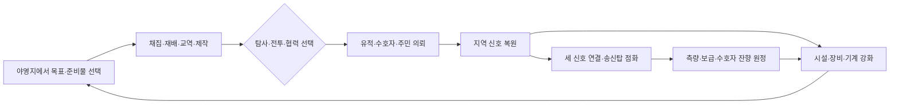
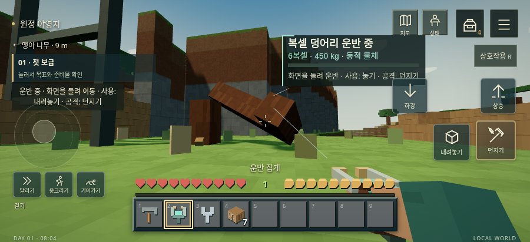
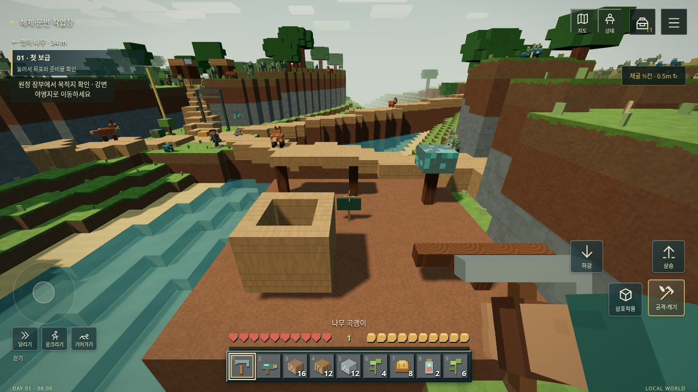

# FERAL 진행 현황 — 게임 0.10.0

> 작성일: 2026-10-17 · 기준: 공개 배포 게임 0.10.0 / Android 앱 0.3.3
>
> 구현·검증·배포 기록을 모은 현황 문서다. 장기 방향은 [게임 비전](GAME-VISION.md), 버전별 변경은 [CHANGELOG](../CHANGELOG.md)를 참조한다.

> 배포 후속: 게임 **0.10.1 / 1001**이 게시됐다. 제작 도구·설계 에셋 작업을 기록한 릴리스이며 아래 0.10.0 플레이 구현 범위는 동일하다. 최신 설치 링크는 [README](../README.md#설치업데이트)를 참조한다.

## 1. 현재 어디까지 왔는가

**탐험·제작·주민 협력으로 완주하는 캠페인과, 지형을 잘라 물체로 옮기고 다시 조립하는 물리 샌드박스가 함께 동작하는 단계다.** 게임 0.10.0은 공개 저장소의 main에 병합됐고 APK·게임 업데이트 모두 게시됐다.

초기 섬과 기계 시험장에서 시작해 개척 원정, 실제 아이템 인벤토리, 모바일 조작, 직접 기계 조립, 공기역학, 자원 순환, 첫 신호 캠페인, 정밀 복셀 캐릭터, 내부 골격과 독립 복셀 물체까지 확장했다. 현재 개척 원정의 아이템 정의는 **47종**, 제작법은 **51개**다.

자동 검증상 캠페인 완주와 주요 상호작용은 확인했다. 다만 실제 Android의 장시간 성능·조작감·콘텐츠 난도 검증은 남아 있어, **콘텐츠 완주가 가능한 베타 후보**로 보는 것이 현재 근거에 맞다. 장기 기획 전체의 완성이나 Minecraft·Teardown과 동등한 완성도를 확인한 상태는 아니다. 배포 채널 이름 `stable`도 이 품질 평가와는 별개다.

## 2. 유지할 방향과 현재 선택

| 방향 | 현재 구현에 반영한 내용 |
| --- | --- |
| 탐험·개인 성장·제작·공동체의 연결 | 지역 자원을 장비·시설·기계에 쓰고, 탐사·전투·협력 중 경로를 골라 신호를 복원한다. |
| 익숙한 인벤토리와 모바일 조작 | 9칸 아이템 핫바, 27칸 보관함, 공격/사용 분리, 버튼을 누른 채 시점 회전, UI 배치 편집을 제공한다. |
| 월드에 남는 손상 | 조준이 끊기거나 도구를 바꿔도 반 칸별 파손도를 보존한다. 저장·재실행·지역 왕복도 포함한다. |
| 형태와 기능의 연결 | 물체는 연결 구조로 분리되고, 동물은 외피와 내부 골격을 구분해 골격 단절부터 기능이 달라진다. |
| 재료를 직접 다루는 제작 | 월드의 면에 부품을 붙이고, 분리된 복셀 덩어리를 잡고 끌고 밀고 고정·확장한다. |
| 현실성보다 조합 가능한 재미 | 질량·충격·공기역학을 반영하되 운반 힘 보조, 안전 낙하 구간, 바퀴 완충을 둔다. |
| 재획득 가능한 자원 | 재성장·재배·교역·재활용·연구·반복 원정을 연결하고 초기 지급품 없는 획득 경로를 검사한다. |

렌더러는 **Three.js**, 기계와 분리 물체의 강체 물리는 **Rapier**를 사용한다. Babylon.js로 이식하지 않았다. 대상 정보는 3D 월드 UI이며, 가방·메뉴·조작 버튼은 HTML 기반 게임 UI를 유지한다. 모든 UI를 3D 캔버스로 옮긴 상태는 아니다.

## 3. 구현 현황

| 영역 | 현재 가능한 것 | 범위·주의점 / 상세 문서 |
| --- | --- | --- |
| 월드·탐험 | 시드 기반 지역, 숲·구릉·해안, 마을·유적·수호자, 지역별 상태 보존 | 지역 전환 방식. 무중단 무한 월드는 아님. [개척 원정](FRONTIER-PROTOTYPE.md) |
| 성장·전투 | 체력·포만·경험·장비·연구, 근접/원거리 무기, 내구도·수리, 수호자 공격 예고 | 장비·기술의 대체 획득 경로 제공. [전투와 도구](COMBAT-AND-TOOLS.md) |
| 핵심 캠페인 | 여섯 목표, 세 지역 신호 복원, 송신탑 점화, 측량·보급·수호자 잔향 원정 | 탐사·전투·협력 경로를 지역별로 혼합 가능. [첫 신호](FIRST-SIGNAL.md) |
| 생태·자원 | 세 동물 종의 섭식·포식·번식·이주, 관찰·먹이·치료, 채집물 재성장·두 작물 재배 | 모든 광맥이 다시 자라는 방식은 아니며 교역·재활용 등 대체 경로 포함. [자원 순환](PERSISTENT-WORLD-AND-LOOPS.md) |
| 주민·공동체 | 보급 담당·약초사·정비사 대화, 교역·의뢰, 생산·소비·재고, 평판·동맹·대립 | 지역 단위 규칙이며 개인별 자율 산업·도시·전쟁 시뮬레이션은 미완료 |
| 인벤토리·제작 | 총 36칸, 이동·분할·합치기·교환, 장비·수리, 제작 검색·가능 필터·재료 획득처 안내 | 가방 포화 시 보상/초과분 보관. [인벤토리](SURVIVAL-INTERFACE.md) |
| UI·모바일 | 원근을 유지하며 지형 위에 보이는 월드 정보창, 내부 스크롤, 좌우손·가로세로 배치 편집 | 실제 좌표 탭·스와이프를 브라우저에서 확인. [월드 UI](WORLD-SPACE-UI.md), [편집기](UI-EDITOR.md) |
| 이동 | 걷기·달리기·웅크리기·기어가기, 낮은 천장 아래 일어서기 제한, 약 1.3m 점프 | 버튼 홀드와 같은 손가락 시점 드래그 동시 지원. [이동·공기역학](AERODYNAMICS-AND-MOVEMENT.md) |
| 기계·비행 | 0.5m 면 부착 조립, 차체·모터·바퀴·포탑·회전익·고정익 부품, 손상·수리·분리·저장 | 양력·항력·받음각·실속·조종면을 구현한 게임용 모델. [기계 물리](STRUCTURAL-PHYSICS.md) |
| 지형·물체 | 기본 0.5m 편집, 연결이 끊긴 지형의 강체 전환, 추가 절단·쌓기·재부착·고정 | 대형 덩어리의 최종 메시/충돌체 생성 비용은 추가 최적화 필요. [구조 샌드박스](STRUCTURAL-SANDBOX.md) |
| 신체·충격 | 외피/골격 분리, 관절 단절에 따른 행동 변화, 낙하·충돌 피해의 공통 처리 | 해부학적 피해는 동물과 인물형 훈련체에 적용. 일반 주민·플레이어 전신 적용은 남음 |
| 그래픽 | 지형별 절차적 표면, 주야 조명·그림자·수면, 역할별 인물과 동물 실루엣, 회전 가능한 3D 미리보기 | 인물 모델링 단위 1/32m. 동물 디테일도 파손 셀에 귀속. [복셀 캐릭터](VOXEL-CHARACTERS.md) |
| 저장·배포 | 공개 APK/업데이트, 전체 패키지 서명·해시 검증, 시작 실패 복구·명시적 재시도, 버전별 저장 | 앱 0.3.3 필요. 휴대폰 생명주기·복구 실기기 검증은 별도. [배포 안내](RELEASING.md) |

## 4. 플레이 루프

### 탐험과 성장

### 물리 샌드박스

**지지대 자르기 → 남은 덩어리 분리 → 잡고 끌기·밀기 → 다리·장애물·짐으로 활용 → 고정·재료 부착 → 다시 절단·수리**가 현재 추가된 순환이다. 분리 시 원래 형태와 재질·부분 손상을 유지하며, 아이템은 실제 파괴한 셀에서만 지급해 물체와 자원이 중복되지 않게 한다.

### 자원 재획득

목재·식량·약초는 재성장/농업, 광물·기계 재료는 교역/재활용, 지식·유적 핵은 관찰/의뢰/재구성/반복 원정 등으로 연결한다. 현재 자동 검증은 **초기 지급품 없이 각 아이템에 도달하는 경로가 존재함**과 캠페인 재료 마련을 확인한다. 모든 자원의 수급 속도·소모량·재미가 장시간 플레이에서 균형 잡혔다는 뜻은 아니다.

## 5. 가장 최근 변경: 0.10.0

### 외피와 내부 골격

동물의 겉 복셀만 제거하면 그 이유만으로 HP나 다리 기능을 잃지 않는다. 노출된 내부 골격을 완전히 끊었을 때 절뚝거림·기어가기·이동 불가가 발생한다. 생존 노드나 중심부 연결을 잃으면 죽고, 굶주림·화상·산 등 기존 생리적 사망도 유지한다.

야영지의 **구조 훈련체 `(81, 89)`**에 인물형 외피·골격·사지 분리·사용 버튼 재조립을 적용했다. 일반 주민과 주인공의 전신 손상을 같은 방식으로 전환한 것은 아니며, 떨어진 사지는 임시 시각 조각이다. 전신 관절 래그돌은 미구현이다.

### 분리된 복셀과 운반

지형의 6면 연결을 검사해 기반층과 분리된 부분을 독립 물체로 바꾼다. 차량·지면과 같은 물리 월드에서 충돌하고 플레이어도 올라설 수 있다. 빈 공간은 충돌·조준에서도 빈 공간으로 유지한다. 형태·손상·위치·회전·속도·고정 상태를 저장한다.

| 상황/아이템 | 사용 버튼 | 공격 버튼 |
| --- | --- | --- |
| 빈 손 | 가까운 물체 잡기·끌기 | 밀기 |
| 일반 도구 | 가까운 물체 잡기·끌기 | 조준한 복셀 깎기 |
| 운반 집게 | 더 먼 물체 잡기, 운반 힘 보조 | 밀기 |
| 물체를 잡은 상태 | 내려놓기 | 밀어 던지기 |
| 조립 렌치 | 고정·해제 | 복셀 깎기 |
| 건축 재료 | 물체에 반 칸 붙이기 | 복셀 깎기 |

운반 집게는 **원목 2 + 섬유 2 + 광석 결정 1**로 제작한다. 무거울수록 이동·던지기가 느려지고 들어 올릴 수 없는 물체는 바닥에서 끌린다. 맨손에도 게임적 힘 보정을 적용한다.

새로 생성하는 지역의 **해체·운반 작업장 `(94, 102)`**에는 가대교·광석 추·빈 상자·긴 원목이 있다. 기존 지역은 건축물 보존을 위해 재생성하지 않는다. 기존 지역에서도 새 물리 기능을 사용할 수 있으며 작업장 배치는 새 지역에서 확인할 수 있다.

### 낙하와 충돌 피해

물체의 유효 질량·접촉 방향의 상대 속도·재질로 충격을 계산해 지형, 분리 물체, 차량, 플레이어, 동물에 전달한다. 동물은 외피의 충격 흡수 후 남은 에너지로 골격 피해를 받는다. 정지 접촉과 일반 점프에는 피해가 없으며, 같은 충돌의 여러 접촉점이 중복 피해를 주지 않도록 처리한다.

## 6. 코드 구조

| 책임 | 주요 코드 | 역할 |
| --- | --- | --- |
| 지역·성장·공동체·캠페인 | [frontier/model.js](../app/src/main/assets/frontier/model.js), [campaign.js](../app/src/main/assets/frontier/campaign.js), [content.js](../app/src/main/assets/frontier/content.js) | 지역 상태, 진행 조건, 채집·의뢰·유적 정의 |
| 소지품·제작 | [inventory.js](../app/src/main/assets/inventory.js) | 아이템 47종·제작법 51개와 슬롯/재료 처리 |
| 신체 구조 | [structural-body.js](../app/src/main/assets/structural-body.js), [animal-skeleton.js](../app/src/main/assets/animal-skeleton.js), [character-body.js](../app/src/main/assets/character-body.js) | 논리 객체와 외피·골격·기능 상태 분리 |
| 지형 분리·동적 물체 | [loose-voxels.js](../app/src/main/assets/loose-voxels.js), [loose-physics.js](../app/src/main/assets/loose-physics.js) | 연결 성분, 물체 저장, 강체·유한 힘으로 잡기 |
| 충격 피해 | [impact.js](../app/src/main/assets/impact.js), [impact-physics.js](../app/src/main/assets/impact-physics.js) | 공통 피해 규칙과 물리 접촉 연결 |
| 표현·입력 연결 | [loose-view.js](../app/src/main/assets/loose-view.js), [character-body-view.js](../app/src/main/assets/character-body-view.js), [frontier/view.js](../app/src/main/assets/frontier/view.js) | 메시·조준·월드 UI·플레이 행동 연결 |
| 버전·배포 | [version.json](../version.json), [배포 워크플로](../.github/workflows/release.yml) | 앱/게임 버전 분리, 검사·빌드·공개 게시 |

상태·규칙·표현을 나누는 방향으로 모듈을 확장했다. 모든 객체를 하나의 완성된 ECS나 범용 엔티티 엔진으로 통합한 단계는 아니다.

## 7. 검증과 공개 배포

### 확인된 결과

| 항목 | 근거와 결과 |
| --- | --- |
| 단위·회귀 검사 | 0.10.0에서 **142개 통과, 실패 0**. 구조·물리·자원 경로·캠페인·항공·업데이트/저장 복구 포함 |
| 브라우저 플레이 | Chromium/SwiftShader에서 WebGL·WASM·실제 터치 이벤트를 사용하는 9개 검사 실행, 페이지 오류 0 |
| 모바일 UI 접근 | 너비 900/640/568/360/320에서 실제 뷰포트 히트 테스트·스와이프로 제작법 51개와 주요 메뉴 접근 |
| 손상·물체 | 외피 제거 후 HP 48·다리 4 유지 → 골격 절단 후 HP 39.6·다리 3. 5복셀 분리 → 재료 1개 소비해 6복셀 확장 → 운반·던지기·저장 복원 |
| 플레이어 낙하 | 정상 점프 HP 100 유지, 약 8m 낙하 후 HP 약 40.7 및 착지 확인 |
| 빌드 | APK 빌드와 v2/v3 서명 확인, 게임 파일 67개를 포함한 서명 업데이트 생성 |
| 공개 게시 | [0.10.0 배포 Actions](https://github.com/Modopi/feral-voxel-sandbox/actions/runs/39005982847) 성공. 인증 없이 APK·stable·버전 패키지·카탈로그 조회 확인 |
| 배포 내용 일치 | 공개 stable과 버전 패키지 일치, RSA 서명·아카이브/67개 파일 해시 검증, APK 동봉 게임과 서명 manifest 일치 확인 |

재현 명령·로그·화면은 [0.10.0 검증 기록](../verification/0.10.0.md)에 있다. 위 브라우저 결과는 실제 Android 기기의 프레임 속도·메모리·발열 측정 결과가 아니다.

### 설치·업데이트 기준

| 항목 | 값 |
| --- | --- |
| 공개 저장소 | [Modopi/feral-voxel-sandbox](https://github.com/Modopi/feral-voxel-sandbox) |
| 게임 / 코드 | **0.10.0 / 1000** |
| Android 앱 / 최소 앱 | **0.3.3 / 303** |
| 저장 스키마 / 채널 | **2 / stable** |
| 게임 릴리스 기준 커밋 | `12d21e217bd9c027831ad23b9bc5bd88893aa080` ([PR #11](https://github.com/Modopi/feral-voxel-sandbox/pull/11)) |
| 공개 릴리스 | [v0.10.0](https://github.com/Modopi/feral-voxel-sandbox/releases/tag/v0.10.0) · 2026-10-17 05:22 UTC 게시 |

앱 0.3.3 사용자는 **메뉴 → 업데이트 → 지금 확인 → 저장 후 적용**, 버전을 고정한 사용자는 **게임 버전 → 0.10.0**을 선택한다. 처음 설치하거나 앱 0.3.2 이하라면 릴리스의 `Feral-0.3.3-android.apk`를 기존 앱 위에 설치한다. 실패 표시가 있는 버전은 **다시 검증 후 실행**으로 재시도할 수 있다.

자동 stable 갱신과 수동 버전 선택의 저장 정책은 다르다. 수동 전환은 빌드별 저장을 분리하며 처음 선택한 빌드는 새 저장으로 시작한다. 기존 빌드를 다시 선택하면 해당 진행을 복원한다. 앱 삭제·데이터 삭제는 필요하지 않다. 상세한 적용·복구 범위는 [배포 안내](RELEASING.md)를 따른다.

## 8. 주요 개발 이력

아래는 구현 단계의 기록이다. 일부 초기 단계는 단독 릴리스 없이 이후 공개 버전에 합쳐졌다.

| 단계 | 변화 |
| --- | --- |
| 0.2.x~0.3.x | 반 칸 편집·드롭·제작·생태, 독립 월드와 기계 시험장, 서명 업데이트·게임 버전 선택 |
| 0.4.x | 개척 원정·지역 이동·성장·주민 경제·유적/수호자, 무기·도구·사망 규칙 구체화 |
| 0.5.x | 공개 저장소 대응, 실제 아이템 인벤토리, 월드 정보창, 게임 창 디자인·HUD 편집 |
| 0.6.0 | 월드에서 직접 기계 조립, Rapier 강체와 구조 손상·분리 |
| 0.7.0~0.7.2 | 공기역학·이동 자세·실패 버전 재시도, UI 렌더 우선순위·점프·버튼 드래그·스크롤 접근 수정 |
| 0.8.0 | 채굴 손상 영속화, 주민/유적 조준·사용 수정, 콘텐츠와 자원 재획득 경로 확장 |
| 0.9.0 | 첫 신호 캠페인·농업·시설·반복 원정, 재질·조명·UI 시각 체계 개편 |
| 0.9.1 | 정밀 복셀 인물·종별 동물 디자인, 관절 애니메이션·3D 캐릭터 미리보기 |
| 0.10.0 | 외피/골격 분리, 지형의 독립 물체화, 질량 기반 운반과 공통 충격 피해, 작업장 콘텐츠 |

## 9. 남은 과제와 다음 우선순위

**아래는 현황에서 도출한 제안이며, 구현 완료 내역이나 확정 일정이 아니다.**

| 우선순위 | 과제 | 완료를 판단할 증거 |
| --- | --- | --- |
| 1 | 실제 Android에서 새 월드부터 캠페인·운반·차량·업데이트 복구까지 플레이 | 기기/WebView 버전, 플레이 시간, 프레임·메모리·발열, 터치·백그라운드 복귀·저장 결과를 기록 |
| 1 | 큰 복셀 덩어리 분리·충돌의 모바일 비용 제어 | 실제 기기에서 성분 크기별 측정, 메시/충돌체 생성 분산 및 물리 활성 범위의 효과 확인 |
| 2 | 물리 샌드박스를 반복할 이유 확장 | 운반·해체·재조립을 사용하는 의뢰/시설/탐험 경로와 보상을 추가하고 자원 중복·진행 막힘 검사 |
| 2 | 일반 주민·플레이어의 구조 손상 적용 범위 결정 | 이동·전투·치료·복구·사망·저장 규칙을 먼저 정의하고 현재 동물/훈련체 규칙과 일관되게 검증 |
| 2 | 초반 안내·운반 힘·성장 속도·콘텐츠 다양성 다듬기 | 설명 없이 시작한 플레이어의 목표 이해, UI 도달, 자원 획득 시간과 선택 경로를 실측 |
| 3 | NPC 자율 활동과 공동체 성장 확대 | 플레이어 부재 시 생산·소비·관계 변화와 귀환 후 결과가 일치하는 시뮬레이션/저장 검사 |
| 장기 | 무중단 월드, 원거리 시뮬레이션, 더 다양한 기능 부품 | 모바일 예산·저장 호환·기존 설계도 유지 조건을 포함한 별도 설계와 단계별 실증 |

현재 비활성 지역의 물리는 진행하지 않는다. 1m 유체는 반 칸 틈을 정밀하게 흐르는 유체 모델이 아니며, 연성체·전신 관절 래그돌도 구현하지 않았다. 공기역학과 충격은 게임용 근사 모델이다. 이런 범위를 포함해 실제 기기 안정성, 처음부터 이어지는 플레이, 저장/업데이트 복구, 자원 균형과 선택의 폭을 확인한 뒤 일반 사용자 대상 베타 품질을 판단해야 한다.

외부 배포 운영 측면에서는 현재 APK의 공유 시험 서명 키도 정식 운영 키와 구분하고, 교체·이전 정책을 별도로 정해야 한다. 자세한 제약은 [배포 안내](RELEASING.md)에 기록돼 있다.
