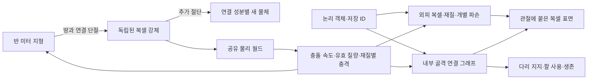

# 구조와 물체가 남는 샌드박스 — 0.10.0

플레이 루프는 **연결을 끊기 → 남은 형태를 물체로 다루기 → 옮기고 쌓고 덧붙이기 → 다시 자르기**다. 원목을 전부 아이템으로 채굴하지 않고 통째로 운반해 다리·경사로·차량의 짐으로 사용할 수 있다. 물체를 고정하고 조각을 붙여 새 모양을 만들 수도 있다.

## 객체, 외피, 기능

동물은 외피를 없애도 그 사실만으로 HP나 다리 기능을 잃지 않는다. 노출된 골격은 별도의 내구도를 가지며 완전히 끊어진 관절·골격 연결만 지지 능력을 잃는다. 두 다리 지지, 절뚝거림, 기어가기, 이동 불가를 기존 행동·물리 자세에 연결했다. 머리 생존 노드나 몸통 중심과의 연결을 잃으면 죽는다. 화상·산·굶주림 같은 생리적 HP 사망도 유지한다. 포식자의 물기, 낙하, 동적 물체 충돌은 외피의 충격 흡수 이후 남은 에너지로 골격에 피해를 준다.

인물은 기존 1/32m 모델링과 관절 계층 위에 같은 구조 그래프를 사용한다. 야영지 `(81, 89)`의 **구조 훈련체**에서 외피 깎기, 골격 절단, 기능 변화, 사지 분리, 사용 버튼으로 재조립을 실행한다. 정상 보행·한 다리 보행·팔로 기어가는 자세를 연결했다. 외피·골격 손상은 지역 저장에 남는다.

현재 적용 범위는 동물과 인물형 훈련체다. 주민·주인공 렌더 리그에도 신체 구성 요소가 있지만, 일반 주민의 교역·대화와 플레이어의 HP를 해부학적 신체 상태로 전환하지는 않았다. 인물에서 떨어진 사지는 중력과 지면 반응을 가진 임시 시각 조각이다. 전신 관절 래그돌이나 연성체 물리라고 부르지 않는다.

## 지형에서 독립한 물체

- 월드 편집은 여전히 0.5m 단위이며 지원 제거·산·화재·충격 파손 후 인접한 고체의 6면 연결을 검사한다. 대각선 접촉은 구조 연결이 아니다. 기반층 연결이 유지되면 지형에 남는다.
- 연결 검사는 틱당 2,048개 작업으로 나누고 변경 중이던 검사는 새 지형에서 다시 시작한다. 진행 중인 검사도 저장해 재실행 후 이어간다. 생성 시 전체 맵을 물체화하지 않는다.
- 분리된 성분의 재질·파손도·형태를 보존하고 원래 지형 셀을 제거한다. 이때 자원을 지급하지 않는다. 실제로 파괴된 셀만 자원을 한 번 지급한다.
- 물체마다 Rapier 복합 강체를 만들고 동일 재질의 직육면체를 합쳐 충돌 비용을 줄인다. 빈 상자는 속까지 채운 큰 박스가 되지 않는다. 조준은 회전된 물체의 로컬 격자를 통과하므로 구멍을 통해 뒤쪽을 조준할 수 있다.
- 물체·차량·지면이 하나의 물리 월드에서 충돌한다. 캐릭터 충돌 컨트롤러도 분리 물체를 검사하므로 올라서거나 장애물로 사용할 수 있다.
- 추가 절단은 다시 연결 성분을 분리하며 질량 중심 변화에 맞춰 선속도와 각속도를 전달한다. 핀으로 고정한 물체에서 잘려 나온 새 성분은 자유롭게 떨어진다.
- 형태·부분 손상·위치·회전·속도·고정 상태·ID를 월드에 저장하고 지역 이동 캐시에도 보존한다. 비활성 지역의 물리는 진행하지 않는다. 구 저장에 필드가 없으면 빈 동적 물체 목록으로 이전한다.

## 잡기·끌기·밀기

| 들고 있는 아이템 | 사용 | 공격 |
| --- | --- | --- |
| 빈 손 | 3m 안 물체 잡기·끌기 | 물체 밀기 |
| 일반 도구 | 3m 안 물체 잡기·끌기 | 조준한 0.5m 복셀 깎기 |
| 운반 집게 | 6.5m 안 물체 잡기 | 밀기 |
| 물체를 잡은 상태 | 내려놓기 | 밀어 던지기 |
| 조립 렌치 | 물체 고정·해제 | 복셀 깎기 |
| 건축 재료 | 물체 표면에 0.5m 복셀 하나 붙이기 | 복셀 깎기 |

**운반 집게** 제작: 원목 2 + 섬유 2 + 광석 결정 1. 모든 재료는 시작 지급품 없이 다시 얻을 수 있다. 가방·핫바·손에 든 3D 모델과 제작 검색에 통합했다.

질량은 재질 밀도 × 0.125m³로 계산한다. 한 조각의 원목은 75kg, 돌은 300kg이다. 게임적 허용을 위해 맨손은 최대 3,500N, 집게는 22,000N을 전달하고 잡은 물체의 마찰을 낮춘다. 그래도 중력을 질량과 무관하게 상쇄하지 않기 때문에 무거운 돌은 바닥에서 끌리며, 가벼운 재료는 들린다. 무거울수록 이동·던지기 속도도 낮아진다. 집은 위치에 힘을 가하므로 긴 원목은 기울고 회전한다. 시선을 너무 멀리 떼면 손을 놓는다.

모바일은 사용 버튼을 누른 채 같은 손가락으로 시점을 돌릴 수 있다. 길게 누르는 반복 입력은 잡기/놓기·고정/해제를 재반복하지 않는다. 메뉴 진입이나 백그라운드 전환은 손을 놓고, 물체 자체는 남긴다. 대상 안내는 물체 옆 월드 UI를 사용한다.

## 낙하·충돌 피해

`impact.js`의 공통 규칙에서 유효 질량 `1 / (1/m1 + 1/m2)`와 충돌 직전의 접촉 법선 방향 상대 속도를 사용한다. 충돌 에너지는 안전 속도분을 제외한 `0.5 × 유효 질량 × (속도² - 안전 속도²)`다. 옆으로 스치는 운동량 전부를 정면충돌로 계산하지 않는다.

정지 지지력에는 피해가 없고, 같은 복합 물체의 여러 접촉점 중 가장 강한 충격만 짧은 재피격 간격으로 처리한다. 일반 물체 4m/s, 차량 바퀴의 완충 및 생물의 낙하 8m/s까지는 안전 구간을 둔다. 정상 점프는 낙하 피해를 받지 않는다. 강체·지형의 재질별 내구도, 차량 부품 HP, 플레이어 HP, 동물의 외피/골격으로 피해를 전달한다. 충격으로 깨진 자원도 한 번만 회수된다.

## 해체·운반 작업장

새로 생성하는 지역 `(94, 102)`에 가대교, 광석 추, 빈 상자, 긴 원목 네 구조물을 배치했다. 표지판에서 조작 안내를 볼 수 있다. 모두 실제 지형 복셀이므로 별도의 설계 화면이나 전용 퍼즐 판정이 없다. 양쪽 지지대를 모두 자르기, 추를 떨어뜨리기, 빈 상자를 옮기기, 긴 원목으로 다리를 놓기 등으로 조합할 수 있다.

이전 저장의 건축물을 덮어쓰지 않도록 기존 지역 생성 버전은 유지한다. 기존 지역에서도 모든 분리·조립·물리 기능과 집게 제작을 사용할 수 있고, 새 지역을 방문하면 작업장이 생성된다. 초대형 연결 성분의 최종 메시/충돌체 생성은 동기 작업이므로 매우 큰 산을 한 번에 분리하는 상황의 모바일 성능은 별도 최적화 과제다.
