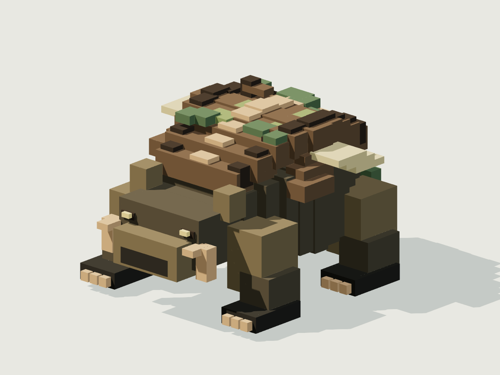
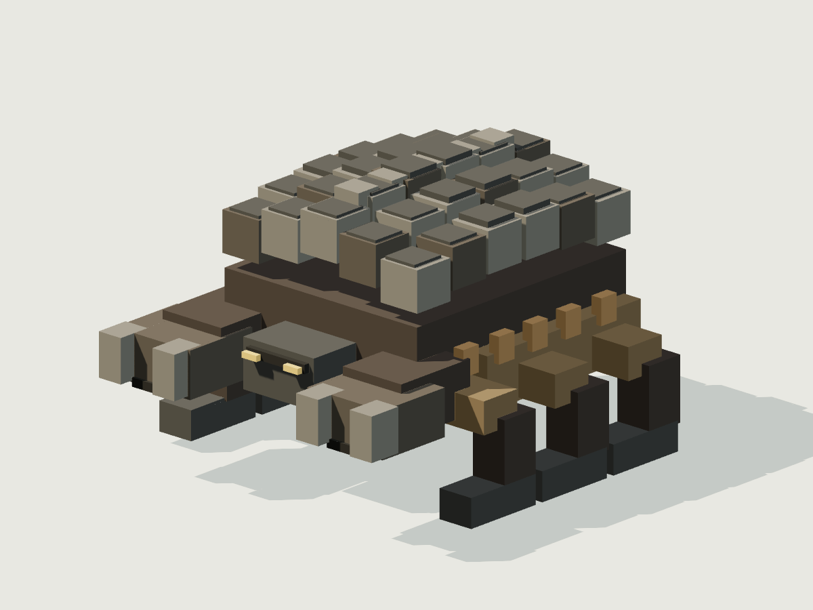
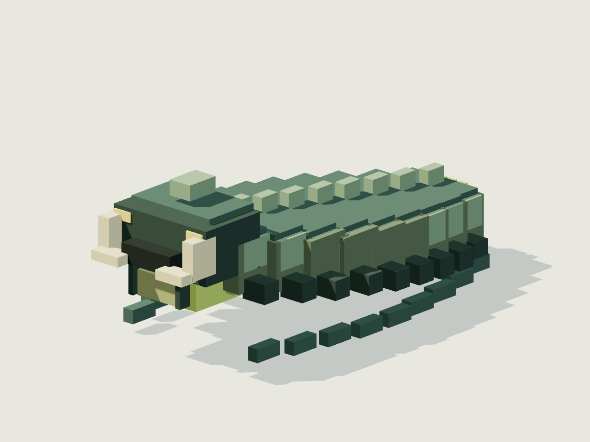
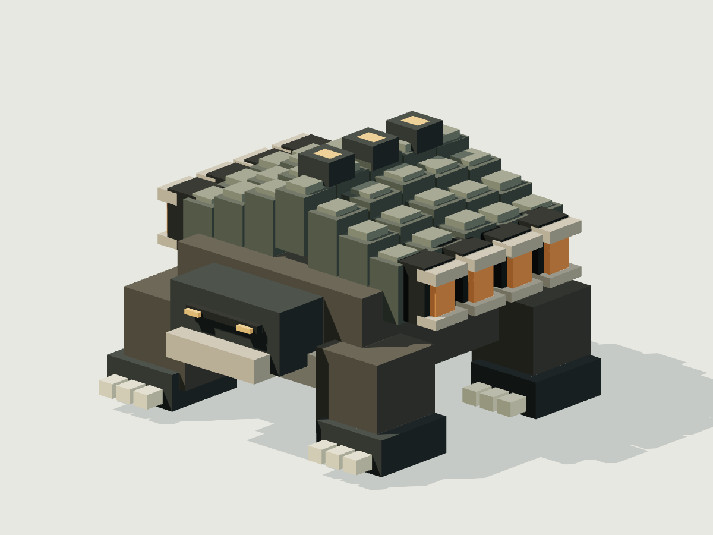
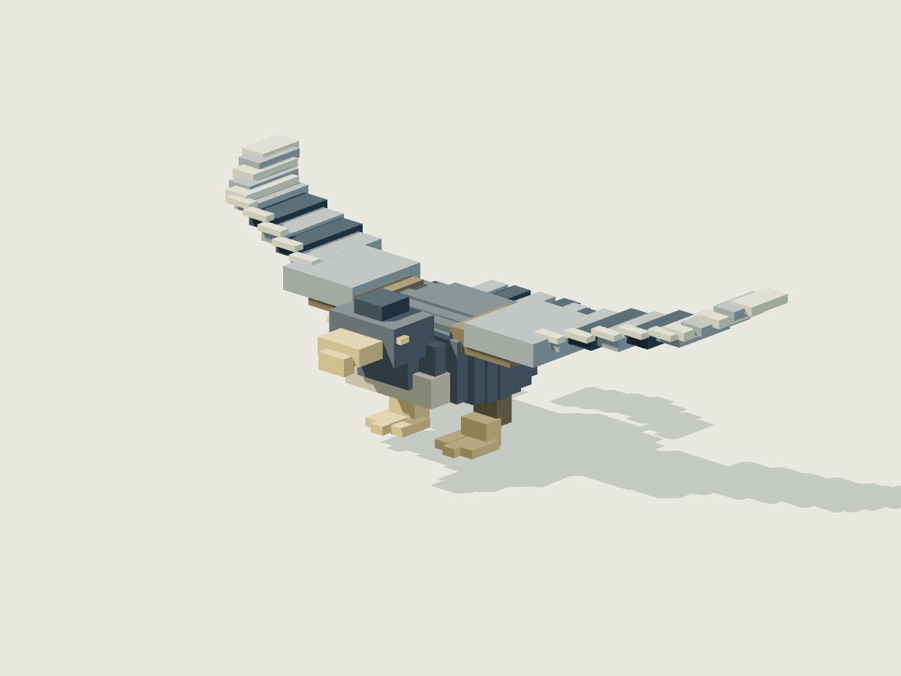
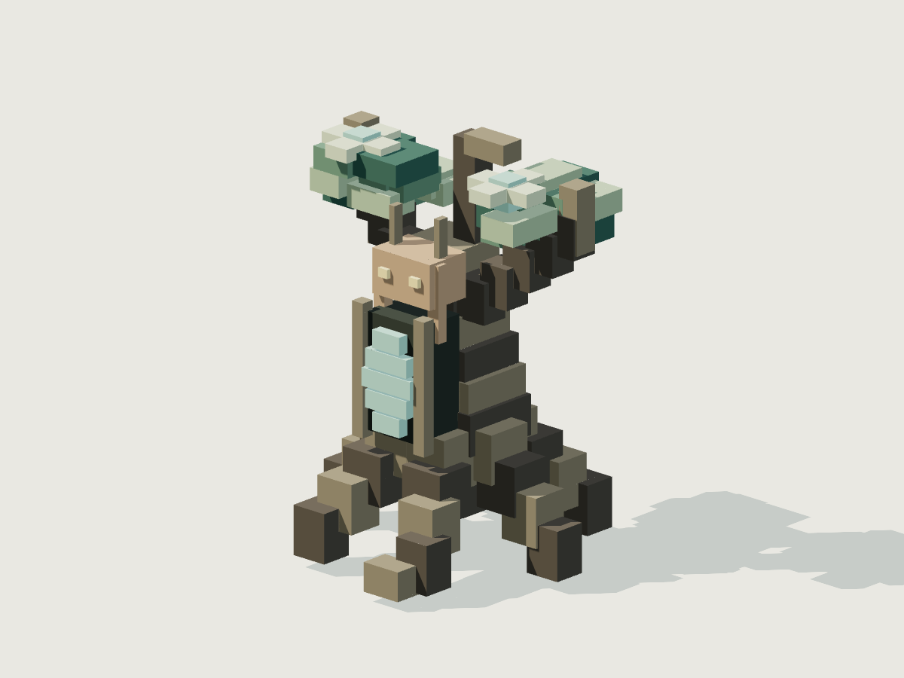
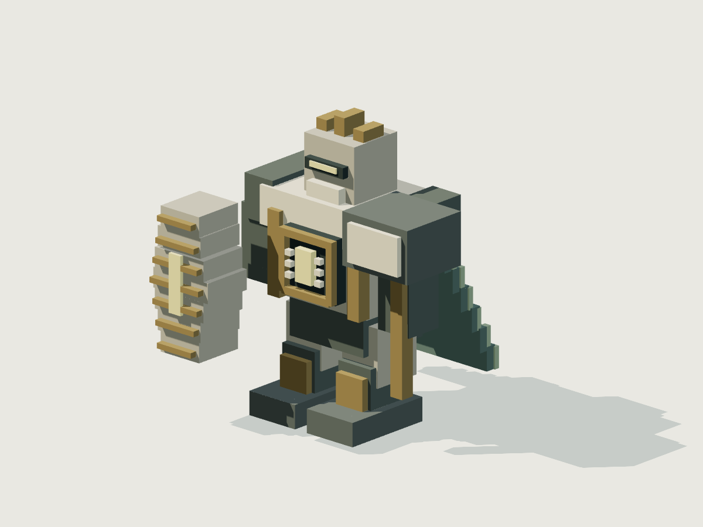
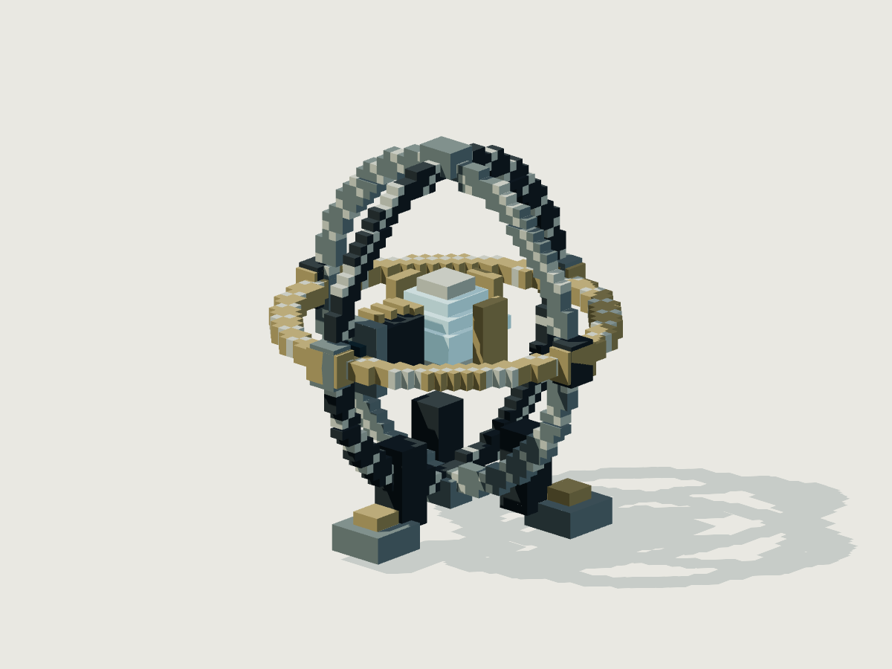

# 보스 위키 — 페이즈·기술·수치·공간 계약

[시각 에셋 저장·재사용 안내](VISUAL-ASSETS.md) · 아래 이미지는 설계용 복셀 원형을 직접 렌더한 것이며 실제 게임 화면이 아닙니다.

> 상태: 8개 원형과 명시 T9/T10 변형의 전투 시뮬레이션이 구현되어 있다. 수치·TTK·보상량은 실제 전투 성능이나 경제를 측정한 값이 아닌 제안 목표이며 통합 플레이 검증은 별도다. 데이터 원본은 [bosses.json](../../design/content/bosses.json). 기존 저장 던전의 원형 보스는 사후 치환하지 않는다.

## 1. 개념

보스는 환경과 연결된 건축물의 폐쇄 생태계 또는 수호 체계를 대표한다. 높은 HP만 가진 일반몹이 아니라, 준비 동작을 관찰하고 지형·장비·기계를 선택해 해결하는 탐험 목표다. 보스 처치는 재료·연구·신성을 얻는 빠른 경로이며 연구나 재료의 독점 공급원이 아니다.

플레이어가 만든 구조물은 모두 기계다. 아래 세계 생성 보스만 유기생명 또는 무기생명으로 분류한다. 무기생명 보스를 처치했다고 동일한 생명체 제작법이 열리지는 않는다. 플레이어의 원거리·비행·기계 제작은 유효한 공략이며, 이를 조건만으로 무효화하는 면역이나 전장 봉쇄를 두지 않는다.

## 2. 분류

| 보스 | 기준 티어 | 유형 | 대표 장소 | 역할 |
|---|---:|---|---|---|
| 뿌리등짐 짐승 (`rootback_beast`) | 2 | organic | `root_manor` | 먹이터를 지키는 영역형 보스. 멈춘 공격을 피하고 노출된 등판을 치는 학습 구간. |
| 갱도 갑각수 (`mine_carapace`) | 3 | organic | `mining_fort` | 돌진을 기둥으로 유도하거나 옆으로 돌아 측복부를 노출시키는 전투. |
| 수문 산성충 (`sluice_acidworm`) | 4 | organic | `floodworks` | 배수 밸브로 액체 위험을 줄이고 긴 몸의 회전 사각을 이용한다. |
| 용광 등갑수 (`furnace_carapace`) | 5 | organic | `geothermal_foundry` | 가열 공격 후 배기구를 공략하고 냉각 밸브로 안전한 접근 시간을 만든다. |
| 첨탑 활공수 (`spire_glider`) | 5 | organic | `cliff_observatory` | 선회와 착지 사이의 창을 읽는 수직 전투. 지상 근접 장비도 정기 착지로 공략 가능. |
| 수목원 공생체 (`arboretum_symbiote`) | 6 | organic | `sealed_arboretum` | 새 물성의 예고를 읽고 성장 결절을 차단하여 몸통 접근 창을 확보한다. |
| 성역 수호자 (`sanctuary_warden`) | 7 | inorganic | `forgotten_monastery` | 예배 회랑의 수호 규칙을 읽고 수리 연결을 끊는다. 신성을 맞아도 면역이 아니다. |
| 관측탑 무기생명 수호자 (`observatory_sentinel`) | 8 | inorganic | `inertia_tower` | 관성 축과 방출 방향을 이용해 정밀한 고출력 공격을 유도하고 제어핵을 노출시킨다. |

앞 여섯 종은 유기생명으로 칼로리를 사용한다. 두 무기생명은 칼로리가 null이고 자연회복은 0이다. 이 두 개체의 문명 속성 true는 공동체를 형성할 능력만 의미하며, 자동 가입·우호·교역은 뜻하지 않는다. 공동체 소속과 관계는 별도 데이터가 소유한다.

대표 티어는 환경 전체의 고정 티어가 아니다. 자동 tier 배율은 적용하지 않는다. 수도원 수호자와 관측탑 파수기는 각각 `sanctuary_warden_t9/t10`, `observatory_sentinel_t9/t10`의 명시 ID만 사용한다. 네 변형은 원형 에셋 ID·세 페이즈·네 기술을 보존하고, 티어별 HP·피해·EU·실제 재배치 행동을 별도 정의한다. 던전 보상 override는 기존 최초 처치 키를 유지하며 boss 채널에만 적용한다. 모든 수치·TTK·보상량은 제안값이며 실제 플레이 전에는 검증값으로 취급하지 않는다. 다른 티어를 자동 배율로 만들거나 8개 수치만 기계적으로 확대하지 않는다. 전체 제안은 [후반 보스 변형](BOSS-VARIANTS-PROPOSAL.md)을 참조한다.

## 3. 구성과 관계

- 환경·건축물: `environmentId`·`dungeonId`는 공통 식별자다. 방의 실측 형상과 출구는 [STRUCTURES.md](STRUCTURES.md)가 소유한다. 이 파일의 arena 수치는 교차 검증용 스냅샷이며 생성기가 다른 값을 두 번 적용하면 안 된다.
- 생명체: 보스는 여기의 독립 종 인스턴스이고 일반몹 목록을 무한히 소환하지 않는다. 던전 먹이망과 일반종 스폰 예산은 [CREATURES.md](CREATURES.md)의 소유다.
- 장비: `baselineRef`는 [PROGRESSION.md](PROGRESSION.md)의 `gear_baseline_tN`을 참조한다. HP는 장착 생존장구의 기준이지 자동 레벨 성장량이 아니다.
- 전투체: 하나의 전신 HP, 두 파손 부위, 에너지 저장물, 세 페이즈, 네 기술, 두 공간 기믹, 영속 보상 상태로 구성한다. 부위 피해는 전신 HP에 한 번 차감하면서 파손 누적에도 기록한다. 부위 HP를 별도 생명력으로 더하지 않는다.
- 보상: `reward_<dungeonId>` 참조는 성장 담당이 소유한다. 보스 본체와 보상상자를 따로 파밍하여 같은 보상을 두 번 지급하지 않는다.

## 4. 동작 규칙

### 4.1 상태와 페이즈

`휴면 → 인지 → 준비 → 발동 → 회복 → 선택`을 기본으로, 파손·회복·수리·철수·격파 상태를 둔다. 인지 반경 36m, 최근 10초 피해 기여가 높은 대상 우선, 동률은 가까운 대상과 안정된 ID 순이다. 첫 준비 순간 목표의 월드 위치와 3차원 방향을 고정한다. 준비 중 조준을 따라 돌리는 숨은 추적은 없다.

페이즈는 보스별 고유HP임계(개별표)를 사용한다. 전환시간은 JSON onEnter.durationS이며 1.8~3초 자세·소리·색 변화, 무적도 치유도 없다. 진행 중 미확정 공격과 지속위험은 취소한다. 한 타격으로 두 경계를 넘으면 최종 단계로 한 번만 전환하고 HP 0이면 격파를 우선한다. 회복으로 이전 페이즈로 돌아가지 않는다.

각 페이즈의 순환표를 따라 하나씩 선택한다. 쿨다운·사거리·시야·잔여 에너지·부위 생존·회피 경로 조건을 확인하며 불가한 기술은 건너뛴다. 동시에 두 공격을 예고하거나 지속위험 위에 다음 공격을 겹치지 않는다. 후보가 없으면 접근·엄폐·재충전하고 공짜 기본 공격을 만들지 않는다. 한 기술 연속 3회 금지. phase가 올라가도 예고 시간을 줄이거나 피해를 갑자기 배증하지 않는다.

핵 부위 파손은 기술 4번을 모든 페이즈에서 제외하고 나머지 3기술의 예고에 0.4초를 더한다. 1·3번이 fallback이지만 같은 쿨다운과 비용을 지켜야 한다. 핵 파손 뒤에는 벌어진 외피 뒤의 몸체가 항상 노출되며, 후속 단계의 특정 기술을 기다리지 않는다. 같은 부위를 다시 파손하여 기절을 반복하지 않는다. 이동 지지부의 파손은 구조 균열로서 속도를 20% 줄이고, 절단된 날개가 동일하게 기능하는 표현을 쓰지 않는다. 활공수는 날개 손상 후 공중 지속 상한을 12초에서 6초로 줄인다.

### 4.2 에너지에서 피해까지

성장 담당과 합의한 공통 단위는 **EU(게임 에너지 단위)**, 출력은EU/s다. 실제 줄(J) 대응은 없으며 채널별별도ledger를 사용한다. 기술별비용도EU다. 채널간변환은 정의된component에서만 허용한다. 공통변환예시 역학→전기0.75, 전기→역학0.8, 열→역학0.35는 성장데이터가소유하며 보스는자동교환하지않는다.

각 기술은 준비 시작 때 EU 비용을 차감하며 중단되어도 반환하지 않는다. 입사 EU=spentEU×deliveredFraction(0~1)에 damageYieldHpPerEU를 곱하고 neutralTargetHp로 제한한 뒤 에너지반응·장비방어를 각각 한 번 적용한다. 외피 유효 타격도 전체 HP를 감소시키며 외피를 전부 벗겨야 HP를 줄일 수 있는 조건은 없다. shellIntegrity는 외피 파손 상태, bodyHP는 생존 상태를 따로 저장한다는 의미다. 실제 형상·재질·깊이에 따른 부위별 침착 EU/피해는 같은 공격 예산을 분배한 값이며 전체 HP에서 다시 차감하지 않는다. 전투 사망은 HP 0으로 결정하고 core·중추 파손은 이동/비행/기술 등 행동만 바꾼다. 최신 실제 관통·충격 전달 및 기존 모드 호환 계약은 [COMBAT-TRACE-PROPOSAL.md](COMBAT-TRACE-PROPOSAL.md)를 따른다.

저장고는 해당 에너지에서 가장 비싼 기술의 10회분으로 시작한다. 4초 정지 재충전으로 4회분을 채우며 종류별로 최대 6회, 재충전 중 피격 배율은 1.25다. 이것은 유한 체내 저장물 또는 내장 전지·성물에 담긴 에너지를 옮기는 행위다. 공급 저장물이 소진되면 공격하지 못한다. 재충전 비용과 부위·남은 공급량을 저장해 재접속으로 초기화하지 않는다. 유기생명의 칼로리를 공격용 에너지로 자동 바꾸지 않는다. 체내 무기용 저장물 생산은 생태 생산 모델과 이어야 하는 명시적 후속 구현 항목이다.

### 4.3 회피·피격·기계

준비시간, 발동시간, 회복시간은 초 단위다. 쿨다운은 준비 시작부터 계산하고, 추가 전역 간격은 페이즈별 1.4/1.2/1.0초다. active가 길어도 **대상당 1회**, 다중 부품에 닿아도 시전 총 피해를 초과하지 않는다. 산성 웅덩이는 4초 남지만 매 프레임 피해를 반복하지 않는다.

모든 투사체는 시전당 하나, 속도 12m/s, 첫 실체 엄폐에서 차단된다. active는 도착 이후의 유효시간이며 실제 비행시간은 별도로 추가한다. 예고 형상과 판정 형상은 같은 데이터에서 나온다. sphere는 공중 표적도 검사하고 바닥 높이 1~1.2m 공격은 그 위로 비행하면 피할 수 있다. line은 폭·길이·높이를 가진 방향 상자이며 공중 조준 시 3차원 방향을 따른다. 별도의 `flying` 전체면역을 두지 않는다.

회피 표의 최소시간은 `반응여유0.3 + 위험경계까지거리 / 속도`다. 아바타 충돌반경 0.35m를 더한다. 원·구는 중심에서 반지름+0.35, 선은 중앙에서 폭/2+0.35, 고리는 띠 중앙에서 두께/2+0.35다. 보행 3.2, 달리기 4.8m/s 기준이다. 공중 공격의 3차원 거리와 통로의 실제 회피 방향은 별도 공간 검사 대상이다.

이 계산은 평지의 빈 경로에 대한 하한이며 플레이 검증을 대체하지 않는다. 벽·보스 본체·기믹으로 막혀 같은 시간 안에 안전점에 못 가면 해당 시전을 취소한다. 넓은 기계는 사람과 같은 회피를 보장하지 않으며, 출구 폭에 맞는 차체·사전 정렬·장갑·차폐가 선택지가 된다. 피격한 부품의 재질과 전달 구조로 피해를 계산하고 차체와 탑승자에게 자동 이중 적용하지 않는다. 탑승자에게 도달한 분량만 별도로 전달한다.

### 4.4 회복·탈주·재도전·저장

유기생명은 전투 중 2페이즈에서만, 마지막 피격 12초 후, 정지 회복 준비 4초를 마치면 8초 동안 초당 최대HP의 0.25%를 회복한다. HP 1당 칼로리 2, 전투 회복은 최대HP의 2%이자 전투 인스턴스당 1회다. 회복 중 피격하면 즉시 정지한다. 초기 칼로리는 최대HP×0.8, 생명유지 소모는 활성 초당0.1이다. 전투 외에는 12초 피격 없음을 조건으로 같은 속도로 회복하되 칼로리·최대HP에서 멈춘다. 오프라인에서는 진행하지 않는다.

무기생명은 자연회복이 전혀 없다. 2페이즈에서 HP60% 이하일 때 남은 수리성소/닻을 이용하여 5초 정지 수리를 시도한다. 25초 간격, 총2회, 각8% HP. 공급재1개를 준비시 소모하고 피격 시 중단하며 돌려주지 않는다. 수리 기믹 파괴는 남은 수리재를 하나씩 비활성화한다.

전장 바깥12m를 넘어선 뒤 전투 상호작용 없이15초가 지나면 둥지로 복귀한다. 위치만 안전하게 되돌리며 HP·부위·칼로리·EU·수리재를 초기화하지 않는다. 즉시 무적이 되지 않으며 벽을 통과해 순간이동하지 않는다. 청크 비활성화 시 전투 타이머를 저장·정지한다. 재개 시 이미 시작한 공격은 전체 예고를 다시 표시하되 비용은 두 번 차감하지 않는다.

던전 인스턴스당 보스1개, 소환몹0개, 동시 지속위험1개다. 격파하면 같은 인스턴스에서 자동 재생성하지 않는다. 격파·보상권한을 하나의 원자적 기록으로 확정하고 그 후 인벤토리에 이전한다. 월드·던전 인스턴스·보스·첫격파를 결합한 보상키로 중복을 막는다. 가방이 차면 미수령분을 보존한다. 다른 던전에서 같은 종을 처치하는 것은 정상적인 별도 보상이다.

플레이어 사망 보관은 전투 리셋과 별개다. 소지품은 사라지지 않으며 사망지점10m 안에서 요정이 회수한다. 출구2개는 항상 열려 있고 지면 지속위험은 전체 형상이 출구 연결띠 z=-3~3m와 겹치면 생성을 취소한다. 중심점만 검사하지 않는다. 보스가 남아 있어도 회수는 가능하나 주변 전투 자체가 자동 중지되지는 않는다. 배치 기계의 사망 손실 규칙은 이 문서가 임의로 정하지 않는다.

## 5. 실제 보스 데이터

### 공통 비교 기준

| 보스 | HP | 질량 kg | 폭×높이×길이 m | 이동 m/s | 유효 개인 DPS | 목표 개인 TTK s | 기계 DPS 1.6배 가정 TTK s |
|---|---:|---:|---|---:|---:|---:|---:|
| 뿌리등짐 짐승 | 1440 | 240 | 3.2×2.4×4.0 | 2.3 | 12 | 120 | 75.0 |
| 갱도 갑각수 | 2340 | 520 | 4×2.8×4.8 | 2.1 | 18 | 130 | 81.25 |
| 수문 산성충 | 3780 | 430 | 3.6×2.6×7 | 2.5 | 27 | 140 | 87.5 |
| 용광 등갑수 | 6000 | 850 | 4.6×3.2×5.2 | 2.1 | 40 | 150 | 93.75 |
| 첨탑 활공수 | 5600 | 170 | 6.8×2×3.5 | 3.0 | 40 | 140 | 87.5 |
| 수목원 공생체 | 8700 | 610 | 4.2×5.6×4.2 | 2.0 | 58 | 150 | 93.75 |
| 성역 수호자 | 13440 | 1600 | 4.6×5×4.6 | 2.2 | 84 | 160 | 100.0 |
| 관측탑 무기생명 수호자 | 19200 | 2200 | 5×5.5×5 | 2.4 | 120 | 160 | 100.0 |

TTK=HP/유효DPS. 성장 담당의 유효DPS에는 이동·회피·일반 저항이 이미 포함되어 있으므로 가동률이나 저항을 다시 곱하지 않는다. 아래 부위·에너지 배율은 원시 타격에 적용할 값이다. 기계의 1.6배는 비교용 구성 목표이며 기계 전체에 주는 숨은 보너스가 아니다. 회복이 전부 성립하면 유기생명 약2%, 무기생명 최대16%만큼 시간이 더 들 수 있다. 우수한 장비·유도·차량은 이보다 빠르게 공략할 수 있다.

| 보스 | 역학 | 전기 | 열 | 화학 | 마법 | 신성 | 핵 파손 누적HP / 이동부 파손 누적HP |
|---|---:|---:|---:|---:|---:|---:|---|
| 뿌리등짐 짐승 | 1 | 0.95 | 1.2 | 0.85 | 1 | 1 | 173 / 259 |
| 갱도 갑각수 | 0.8 | 1.15 | 1 | 0.9 | 1 | 1 | 281 / 421 |
| 수문 산성충 | 1 | 1.2 | 1 | 0.55 | 1 | 1 | 454 / 680 |
| 용광 등갑수 | 0.9 | 1 | 0.5 | 1.15 | 1 | 1 | 720 / 1080 |
| 첨탑 활공수 | 1 | 1.2 | 1 | 0.9 | 1 | 1 | 672 / 1008 |
| 수목원 공생체 | 1 | 1 | 1.15 | 0.9 | 0.65 | 1.1 | 1044 / 1566 |
| 성역 수호자 | 0.85 | 0.95 | 1 | 1.15 | 1 | 0.7 | 1613 / 2419 |
| 관측탑 무기생명 수호자 | 0.7 | 1.15 | 1 | 1 | 1.1 | 0.9 | 2304 / 3456 |

배율0 면역은 없다. 노출된 핵은 1.4배, 일반 이동부1배, 재충전 노출1.25배이며 핵과 재충전이 겹칠 때 둘 중 큰 값만 사용한다. 기본 몸통 에너지 반응은 위 표를 한 번 적용한다. 핵 파손은 최대HP12%, 이동부 파손은18% 누적 피해 기준이다.

### 5.1. 뿌리등짐 짐승

<!-- asset:rootback_beast -->

시각 원형 · [복셀 원본](../../design/assets/models/rootback_beast.voxel.json) · [GLB](../../design/assets/exports/rootback_beast.glb)

낙엽을 먹는 작은 생물을 사냥하며 등에 뿌리와 균류가 얹힌 사족 포식자. 낮은 머리와 높은 등판으로 정면 공격과 등 약점을 구별한다.

먹이터를 지키는 영역형 보스. 멈춘 공격을 피하고 노출된 등판을 치는 학습 구간.

- 연결: `grove` / `root_manor` / `gear_baseline_t2` / `reward_root_manor`.
- 공간: 24×24m, 유효높이10m. 보스 시작점[0, 0, 4]. 양쪽6×5m출구, 중앙8m십자통로.
- 기믹: root_food_cache_west [-7, 0, 7], root_food_cache_east [7, 0, 7]. 각각 상호작용1초/1회, 파괴형은 HP36. 돌진으로 먹이 더미 파괴 시3초비틀거림·회복 먹이1개 제거. 근접 도구로도 파괴 가능.
- 핵 약점: 등의 뿌리 접합부. 파손 시 `root_sweep` 영구 비활성. 기믹과 핵 파손의 노출 시간을 겹쳐 더 큰 배율로 중첩하지 않는다.
- 칼로리 1152/1152, 회복 3.6HP/s, HP당칼로리2. 전투 중 최대28.8HP/1회.

| 단계 / HP | 순환 기술 | 간격 s | 전환·변화 |
|---|---|---:|---|
| 먹이터 방어 / 75~100% | 뿌리 내려찍기 → 등짐 씨앗탄 → 뿌리 내려찍기 → 먹이터 돌진 | 1.4 | 전환2초. 먹이터 방어: 몸의 핵심 기관 색·자세가 변하고 고유 울음/기계음. HUD에 단계명을 표시. 전투회복/수리없음. 단계별 자세·기관노출·이동규칙을 적용. |
| 등짐 균열 / 40~75% | 먹이터 돌진 → 등짐 씨앗탄 → 뿌리 고리 휩쓸기 → 뿌리 내려찍기 | 1.2 | 전환2초. 등짐 균열: 몸의 핵심 기관 색·자세가 변하고 고유 울음/기계음. HUD에 단계명을 표시. 2페이즈에서만 전투회복1회. 준비전12초무피격, 준비4초, 회복8초를지킨다. |
| 굶주린 저항 / 0~40% | 뿌리 고리 휩쓸기 → 등짐 씨앗탄 → 먹이터 돌진 → 뿌리 내려찍기 → 등짐 씨앗탄 | 1.0 | 전환2초. 굶주린 저항: 몸의 핵심 기관 색·자세가 변하고 고유 울음/기계음. HUD에 단계명을 표시. 전투회복/수리없음. 단계별 자세·기관노출·이동규칙을 적용. |

단계별 실제 상태 변경(이동배율은 기본속도와 파손배율에 곱함):

- **먹이터 방어**: 먹이 더미 가까이에서 정면을 막고 내려찍기 뒤에만 등의 접합부가 드러난다.
- **등짐 균열**: 먹이 주변을 돌며 돌진축을 만든다. 먹이더미 충돌의 비틀거림이 길어지고 돌진 뒤에도 약점이 열린다. 피격을 멈추면 한 번 먹고 회복한다.
- **굶주린 저항**: 등의 뿌리가 벗겨져 핵이 항상 보이며 이동이 느려진다. 회복을 멈추고 남은 세 기술과 고리 공격으로 영역을 방어한다.

| 기술 | 에너지 | 준비 / 발동 / 회복 / 쿨다운 s | 거리 m / 형상 | 중립피해 HP / 기준장비 피격HP | 소비 EU | 보행회피 필요 s / 여유 s |
|---|---|---|---|---|---:|---|
| 뿌리 내려찍기 (`root_slam`) | mechanical | 1.6 / 0.25 / 2.0 / 7 | 6 / 원 r2.6 h1.2 | 26 / 23.92 | 39 | 1.2219 / 0.3781 |
| 먹이터 돌진 (`root_charge`) | mechanical | 1.6 / 1 / 2.8 / 10 | 14 / 선 폭2.8 길이14 높이2.4 | 38 / 34.96 | 57 | 0.8469 / 0.7531 |
| 등짐 씨앗탄 (`root_seed`) | mechanical | 1.4 / 0.3 / 1.8 / 8 | 22 / 구 r1.6 | 24 / 22.08 | 36 | 0.9094 / 0.4906 |
| 뿌리 고리 휩쓸기 (`root_sweep`) | mechanical | 1.6 / 0.4 / 2.5 / 13 | 8 / 고리 3.2~5.6 높이1 | 31 / 28.52 | 47 | 0.7844 / 0.8156 |

- **뿌리 내려찍기**: 앞발을 들어 목표 지점에 뿌리 흙덩이를 내려찍는다. 개인: 고정된 원 밖으로 걷고 내려온 등판을 공격. 기계: 전진 대신 측면 이동; 전면 장갑으로 버티면 접합부에 전달되는 충격을 확인.
- **먹이터 돌진**: 낮은 포효 후 직선 돌진. 음식 더미를 맞히면 3초 비틀거린다. 개인: 옆으로 이동하거나 먹이 더미 뒤에서 유도. 기계: 회전 반경이 큰 차체는 출발 전 측면 정렬. 덩치를 이용해 충격을 받을 수도 있음.
- **등짐 씨앗탄**: 등의 씨앗 주머니가 열리고 예고 시작 위치로 포물선 탄을 보낸다. 개인: 위치 고정 후 이동; 기둥으로 탄을 막을 수 있음. 기계: 비행도 표적이 되지만 방향이 고정되어 회피 가능. 씨앗은 재추적하지 않음.
- **뿌리 고리 휩쓸기**: 몸을 웅크린 뒤 반경 3.2~5.6m의 바닥을 뿌리로 쓸어낸다. 개인: 안쪽 빈 공간 또는 바깥으로 이동; 낮은 공격 위로 비행 가능. 기계: 다리·바퀴가 고리에 걸리면 피격; 차체 중심만 검사하지 않음.

| 에너지 저장물 | 초기/최대 EU | 4초 재충전량 EU | 공급 횟수 |
|---|---:|---:|---:|
| mechanical | 570 / 570 | 228 | 6 |

### 5.2. 갱도 갑각수

<!-- asset:mine_carapace -->

시각 원형 · [복셀 원본](../../design/assets/models/mine_carapace.voxel.json) · [GLB](../../design/assets/exports/mine_carapace.glb)

광물 분진으로 굳어진 등갑, 양옆의 굴착 집게, 낮은 배를 가진 굴 포식자.

돌진을 기둥으로 유도하거나 옆으로 돌아 측복부를 노출시키는 전투.

- 연결: `ridge` / `mining_fort` / `gear_baseline_t3` / `reward_mining_fort`.
- 공간: 28×28m, 유효높이12m. 보스 시작점[0, 0, 4]. 양쪽6×5m출구, 중앙8m십자통로.
- 기믹: mine_brittle_pillar_west [-8, 0, 8], mine_brittle_pillar_east [8, 0, 8]. 각각 상호작용1초/1회, 파괴형은 HP54. 기둥 돌진충돌 또는 채굴 파괴 시등갑핵6초노출. 파괴잔해는 출구띠로 떨어지지 않음.
- 핵 약점: 측복부 갑각 연결부. 파손 시 `mine_ring` 영구 비활성. 기믹과 핵 파손의 노출 시간을 겹쳐 더 큰 배율로 중첩하지 않는다.
- 칼로리 1872/1872, 회복 5.85HP/s, HP당칼로리2. 전투 중 최대46.8HP/1회.

| 단계 / HP | 순환 기술 | 간격 s | 전환·변화 |
|---|---|---:|---|
| 갱도 봉쇄 / 70~100% | 쌍집게 굴착 → 등갑 파편 → 쌍집게 굴착 → 광맥 돌진 | 1.4 | 전환2초. 갱도 봉쇄: 몸의 핵심 기관 색·자세가 변하고 고유 울음/기계음. HUD에 단계명을 표시. 전투회복/수리없음. 단계별 자세·기관노출·이동규칙을 적용. |
| 등갑 균열 / 35~70% | 광맥 돌진 → 등갑 파편 → 굴진 진동 → 쌍집게 굴착 | 1.2 | 전환2초. 등갑 균열: 몸의 핵심 기관 색·자세가 변하고 고유 울음/기계음. HUD에 단계명을 표시. 2페이즈에서만 전투회복1회. 준비전12초무피격, 준비4초, 회복8초를지킨다. |
| 노출 굴진 / 0~35% | 굴진 진동 → 등갑 파편 → 광맥 돌진 → 쌍집게 굴착 → 등갑 파편 | 1.0 | 전환2초. 노출 굴진: 몸의 핵심 기관 색·자세가 변하고 고유 울음/기계음. HUD에 단계명을 표시. 전투회복/수리없음. 단계별 자세·기관노출·이동규칙을 적용. |

단계별 실제 상태 변경(이동배율은 기본속도와 파손배율에 곱함):

- **갱도 봉쇄**: 좁은 정면을 유지하며 집게 공격 후 측복부가 잠시 드러난다.
- **등갑 균열**: 기둥으로 돌진축을 잡는다. 충돌 기절이 두 배로 길어지고 돌진 회복창을 통해 갑각 연결부를 공략할 수 있다.
- **노출 굴진**: 등갑이 벌어져 핵이 항상 노출되고 역학 피해 감소가 사라진다. 측면으로 물러나는 속도도 느려져 접근 방식이 바뀐다.

| 기술 | 에너지 | 준비 / 발동 / 회복 / 쿨다운 s | 거리 m / 형상 | 중립피해 HP / 기준장비 피격HP | 소비 EU | 보행회피 필요 s / 여유 s |
|---|---|---|---|---|---:|---|
| 쌍집게 굴착 (`mine_claw`) | mechanical | 1.5 / 0.4 / 2.3 / 7 | 8 / 선 폭3.2 길이8 높이2.4 | 35 / 29.75 | 53 | 0.9094 / 0.5906 |
| 광맥 돌진 (`mine_charge`) | mechanical | 1.8 / 1.2 / 3 / 12 | 18 / 선 폭3.4 길이18 높이2.4 | 53 / 45.05 | 80 | 0.9406 / 0.8594 |
| 등갑 파편 (`mine_shard`) | mechanical | 1.5 / 0.35 / 2 / 9 | 26 / 구 r1.8 | 34 / 28.9 | 51 | 0.9719 / 0.5281 |
| 굴진 진동 (`mine_ring`) | mechanical | 1.8 / 0.5 / 2.8 / 14 | 10 / 고리 4~6.4 높이1 | 44 / 37.4 | 66 | 0.7844 / 1.0156 |

- **쌍집게 굴착**: 두 집게가 바닥에 정렬되고 정면 좁은 통로를 연속 절삭한다. 개인: 측면 집게 밖으로 이동. 1회 공격당 대상 1회 피해. 기계: 진입 축을 바꾸거나 교체 가능한 전면판 사용.
- **광맥 돌진**: 발로 바닥을 긁고 고정 방향으로 돌진. 취약 기둥 충돌 시 등갑 연결부 노출. 개인: 밝아진 기둥으로 유도; 기둥 파괴가 필수는 아님. 기계: 차량으로 유도 가능하나 무게 자체로 보스를 정지시키려면 실제 충돌 계산 필요.
- **등갑 파편**: 등갑 틈에서 한 덩이의 광물 파편을 목표 위치로 발사한다. 개인: 벽이나 장애물 뒤로 이동; 착탄 위치는 예고 시작에 고정. 기계: 비행·원거리 대상도 같은 탄속과 예고 적용.
- **굴진 진동**: 집게를 박아 반경 4~6.4m의 바닥을 들썩인다. 개인: 몸 가까이 또는 고리 밖으로 이동. 기계: 낮게 달린 바퀴만 피해받을 수 있음. 떠 있는 구조물은 회피 가능.

| 에너지 저장물 | 초기/최대 EU | 4초 재충전량 EU | 공급 횟수 |
|---|---:|---:|---:|
| mechanical | 800 / 800 | 320 | 6 |

### 5.3. 수문 산성충

<!-- asset:sluice_acidworm -->

시각 원형 · [복셀 원본](../../design/assets/models/sluice_acidworm.voxel.json) · [GLB](../../design/assets/exports/sluice_acidworm.glb)

얕은 수로를 이동하는 분절 몸통과 목 아래 산성낭. 산성낭은 공격 전 팽창한다.

배수 밸브로 액체 위험을 줄이고 긴 몸의 회전 사각을 이용한다.

- 연결: `marsh` / `floodworks` / `gear_baseline_t4` / `reward_floodworks`.
- 공간: 28×28m, 유효높이12m. 보스 시작점[0, 0, 4]. 양쪽6×5m출구, 중앙8m십자통로.
- 기믹: marsh_drain_valve_west [-9, 0, 9], marsh_drain_valve_east [9, 0, 9]. 각각 상호작용1초/1회, 파괴형은 HP81. 배수밸브 사용 시현재 웅덩이 제거, 다음 웅덩이1회 취소.
- 핵 약점: 목 아래 산성낭. 파손 시 `acid_glob` 영구 비활성. 기믹과 핵 파손의 노출 시간을 겹쳐 더 큰 배율로 중첩하지 않는다.
- 칼로리 3024/3024, 회복 9.45HP/s, HP당칼로리2. 전투 중 최대75.6HP/1회.

| 단계 / HP | 순환 기술 | 간격 s | 전환·변화 |
|---|---|---:|---|
| 수문 잠복 / 65~100% | 산성낭 분사 → 분절 꼬리치기 → 산성낭 분사 → 침전 웅덩이 | 1.4 | 전환2초. 수문 잠복: 몸의 핵심 기관 색·자세가 변하고 고유 울음/기계음. HUD에 단계명을 표시. 전투회복/수리없음. 단계별 자세·기관노출·이동규칙을 적용. |
| 산성낭 팽창 / 30~65% | 침전 웅덩이 → 분절 꼬리치기 → 수문 포말탄 → 산성낭 분사 | 1.2 | 전환2초. 산성낭 팽창: 몸의 핵심 기관 색·자세가 변하고 고유 울음/기계음. HUD에 단계명을 표시. 2페이즈에서만 전투회복1회. 준비전12초무피격, 준비4초, 회복8초를지킨다. |
| 분절 광폭 / 0~30% | 수문 포말탄 → 분절 꼬리치기 → 침전 웅덩이 → 산성낭 분사 → 분절 꼬리치기 | 1.0 | 전환2초. 분절 광폭: 몸의 핵심 기관 색·자세가 변하고 고유 울음/기계음. HUD에 단계명을 표시. 전투회복/수리없음. 단계별 자세·기관노출·이동규칙을 적용. |

단계별 실제 상태 변경(이동배율은 기본속도와 파손배율에 곱함):

- **수문 잠복**: 얕은 수로를 따라 이동하며 분사 후 산성낭이 열린다.
- **산성낭 팽창**: 북쪽 수조만 수심0.5m가 되고 그 안의 보행속도가15% 줄어든다. 출구 연결띠는 마르며 밸브로 배수할 수 있다. 포말탄 후에도 산성낭이 열린다.
- **분절 광폭**: 수조가 빠지고 물 밖으로 나온 분절 몸이 느려진다. 산성낭은 계속 노출되며 회복하지 않는다.

| 기술 | 에너지 | 준비 / 발동 / 회복 / 쿨다운 s | 거리 m / 형상 | 중립피해 HP / 기준장비 피격HP | 소비 EU | 보행회피 필요 s / 여유 s |
|---|---|---|---|---|---:|---|
| 산성낭 분사 (`acid_spit`) | chemical | 1.6 / 0.6 / 2.2 / 8 | 20 / 선 폭3 길이20 높이2.4 | 48 / 37.44 | 72 | 0.8781 / 0.7219 |
| 침전 웅덩이 (`acid_pool`) | chemical | 1.8 / 4 / 2.3 / 13 | 22 / 원 r2.6 h1.2 | 45 / 35.1 | 68 | 1.2219 / 0.5781 |
| 분절 꼬리치기 (`acid_tail`) | mechanical | 1.6 / 0.35 / 2.5 / 9 | 8 / 고리 3~5.4 높이1 | 52 / 40.56 | 78 | 0.7844 / 0.8156 |
| 수문 포말탄 (`acid_glob`) | chemical | 1.5 / 0.3 / 2 / 10 | 28 / 구 r1.8 | 46 / 35.88 | 69 | 0.9719 / 0.5281 |

- **산성낭 분사**: 목 아래 낭이 부풀며 고정 직선으로 산을 분사한다. 개인: 측면 이동. 산성낭 타격으로 해당 공격 중단 가능. 기계: 내식 전면판 또는 옆으로 회전; 유체 용기 노출은 손상 위험.
- **침전 웅덩이**: 고정 위치에 산성 유체를 뱉어 짧게 남긴다. 출구 통로에는 놓지 않는다. 개인: 원 밖으로 이동; 배수 밸브로 현재 웅덩이 제거. 기계: 차륜·착륙 다리의 접촉을 검사. 비행으로 건너갈 수 있음.
- **분절 꼬리치기**: 몸통이 둥글게 휘며 반경 3~5.4m를 꼬리로 쓸어낸다. 개인: 몸 안쪽이나 바깥으로 이동. 기계: 넓은 차체는 피해 부위를 분산하지만 대상당1회 총량 제한.
- **수문 포말탄**: 꼬리 끝의 거품이 빛난 뒤 목표의 3차원 위치로 포말탄을 발사한다. 개인: 고정 위치에서 벗어나거나 엄폐. 기계: 공중 대상에 유효하나 추적·즉발·무한 사거리 없음.

| 에너지 저장물 | 초기/최대 EU | 4초 재충전량 EU | 공급 횟수 |
|---|---:|---:|---:|
| chemical | 720 / 720 | 288 | 6 |
| mechanical | 780 / 780 | 312 | 6 |

### 5.4. 용광 등갑수

<!-- asset:furnace_carapace -->

시각 원형 · [복셀 원본](../../design/assets/models/furnace_carapace.voxel.json) · [GLB](../../design/assets/exports/furnace_carapace.glb)

내열 등갑 사이에 밝아지는 배열 기관과 측면 배기구가 있는 육중한 생물.

가열 공격 후 배기구를 공략하고 냉각 밸브로 안전한 접근 시간을 만든다.

- 연결: `thermal` / `geothermal_foundry` / `gear_baseline_t5` / `reward_geothermal_foundry`.
- 공간: 32×32m, 유효높이14m. 보스 시작점[0, 0, 4]. 양쪽6×5m출구, 중앙8m십자통로.
- 기믹: thermal_cooling_valve_west [-10, 0, 10], thermal_cooling_valve_east [10, 0, 10]. 각각 상호작용1초/1회, 파괴형은 HP120. 냉각밸브 사용 시현재/다음 가열고리1회 취소, 배기구6초노출.
- 핵 약점: 측면 배기구. 파손 시 `furnace_ring` 영구 비활성. 기믹과 핵 파손의 노출 시간을 겹쳐 더 큰 배율로 중첩하지 않는다.
- 칼로리 4800/4800, 회복 15.0HP/s, HP당칼로리2. 전투 중 최대120HP/1회.

| 단계 / HP | 순환 기술 | 간격 s | 전환·변화 |
|---|---|---:|---|
| 축열 / 70~100% | 배기 화염 → 비산 용재 → 배기 화염 → 용광 압쇄 | 1.4 | 전환2초. 축열: 몸의 핵심 기관 색·자세가 변하고 고유 울음/기계음. HUD에 단계명을 표시. 전투회복/수리없음. 단계별 자세·기관노출·이동규칙을 적용. |
| 과열 배기 / 30~70% | 용광 압쇄 → 비산 용재 → 가열 고리 → 배기 화염 | 1.2 | 전환2.5초. 과열 배기: 몸의 핵심 기관 색·자세가 변하고 고유 울음/기계음. HUD에 단계명을 표시. 2페이즈에서만 전투회복1회. 준비전12초무피격, 준비4초, 회복8초를지킨다. |
| 등갑 개방 / 0~30% | 가열 고리 → 비산 용재 → 용광 압쇄 → 배기 화염 → 비산 용재 | 1.0 | 전환3초. 등갑 개방: 몸의 핵심 기관 색·자세가 변하고 고유 울음/기계음. HUD에 단계명을 표시. 전투회복/수리없음. 단계별 자세·기관노출·이동규칙을 적용. |

단계별 실제 상태 변경(이동배율은 기본속도와 파손배율에 곱함):

- **축열**: 공격3회 후 3초 배열한다. 배기구가 열리는 주기를 관찰하는 단계다.
- **과열 배기**: 과열되어 공격2회마다 4초 배열한다. 냉각밸브는 고리 공격을 취소하고 별도 약점창을 만든다.
- **등갑 개방**: 배기구를 닫지 못하고 핵이 항상 노출된다. 움직임이25% 느려지고 열 저항도 완화된다.

| 기술 | 에너지 | 준비 / 발동 / 회복 / 쿨다운 s | 거리 m / 형상 | 중립피해 HP / 기준장비 피격HP | 소비 EU | 보행회피 필요 s / 여유 s |
|---|---|---|---|---|---:|---|
| 배기 화염 (`furnace_breath`) | thermal | 1.8 / 0.7 / 2.6 / 9 | 22 / 선 폭3.6 길이22 높이2.4 | 66 / 47.52 | 99 | 0.9719 / 0.8281 |
| 용광 압쇄 (`furnace_impact`) | mechanical | 1.8 / 0.35 / 2.7 / 8 | 7 / 원 r3 h1.2 | 80 / 57.6 | 120 | 1.3469 / 0.4531 |
| 비산 용재 (`furnace_cinder`) | thermal | 1.6 / 0.3 / 2.0 / 10 | 28 / 구 r2.0 | 59 / 42.48 | 89 | 1.0344 / 0.5656 |
| 가열 고리 (`furnace_ring`) | thermal | 1.8 / 0.5 / 3 / 15 | 10 / 고리 4~6.4 높이1 | 71 / 51.12 | 107 | 0.7844 / 1.0156 |

- **배기 화염**: 측면 배기구가 적열하고 고정 방향으로 화염을 내보낸다. 개인: 정면을 벗어나 배기구가 열린 동안 공격. 기계: 내열 장갑이나 측면 회피. 화염이 벽을 통과하지 않음.
- **용광 압쇄**: 등갑을 들어 고정 지점을 강하게 내려찍는다. 개인: 원 밖으로 걷기; 동작 종료 후 복부 노출. 기계: 장갑만으로 버티기보다 충격 연결부를 보호.
- **비산 용재**: 등갑 틈이 한 곳으로 모여 빛나고 용재 한 덩이를 발사한다. 개인: 예고된 위치에서 벗어나거나 장애물 이용. 기계: 항공기에도 같은 고정점 조준 적용.
- **가열 고리**: 반경 4~6.4m 바닥을 가열한다. 냉각 밸브 사용 시 이번 고리를 취소한다. 개인: 안쪽·바깥쪽 이동 또는 냉각 밸브 1초 상호작용. 기계: 바닥에서1m보다 높은 비접촉 부품은 피격되지 않음.

| 에너지 저장물 | 초기/최대 EU | 4초 재충전량 EU | 공급 횟수 |
|---|---:|---:|---:|
| mechanical | 1200 / 1200 | 480 | 6 |
| thermal | 1070 / 1070 | 428 | 6 |

### 5.5. 첨탑 활공수

<!-- asset:spire_glider -->

시각 원형 · [복셀 원본](../../design/assets/models/spire_glider.voxel.json) · [GLB](../../design/assets/exports/spire_glider.glb)

긴 양날개와 부채꼬리를 가진 활공 포식자. 양 날개 관절이 지상에서도 보인다.

선회와 착지 사이의 창을 읽는 수직 전투. 지상 근접 장비도 정기 착지로 공략 가능.

- 연결: `coast` / `cliff_observatory` / `gear_baseline_t5` / `reward_cliff_observatory`.
- 공간: 36×36m, 유효높이18m. 보스 시작점[0, 0, 4]. 양쪽6×5m출구, 중앙8m십자통로.
- 기믹: coast_anchor_post_west [-11, 0, 11], coast_anchor_post_east [11, 0, 11]. 각각 상호작용1초/1회, 파괴형은 HP120. 정박주를 작동하면 먹잇감 유인 소리 발생, 다음 기술을 착지분쇄로 선택(정상 쿨다운·예고 적용). 비행 강제무효화 없음.
- 핵 약점: 양 날개 관절. 파손 시 `glider_landing` 영구 비활성. 기믹과 핵 파손의 노출 시간을 겹쳐 더 큰 배율로 중첩하지 않는다.
- 칼로리 4480/4480, 회복 14.0HP/s, HP당칼로리2. 전투 중 최대112HP/1회.
- 공중속도5m/s·기본고도8m, 공중12초마다 지상최소5초. 날개손상 후공중최대6초. 지상근접만으로도 착지창을 이용한 완주가 가능해야 한다.

| 단계 / HP | 순환 기술 | 간격 s | 전환·변화 |
|---|---|---:|---|
| 저공 선회 / 75~100% | 첨탑 급강하 → 깃창 표적탄 → 첨탑 급강하 → 압축 날개바람 | 1.4 | 전환1.8초. 저공 선회: 몸의 핵심 기관 색·자세가 변하고 고유 울음/기계음. HUD에 단계명을 표시. 전투회복/수리없음. 단계별 자세·기관노출·이동규칙을 적용. |
| 고공 활공 / 35~75% | 압축 날개바람 → 깃창 표적탄 → 착지 분쇄 → 첨탑 급강하 | 1.2 | 전환2.2초. 고공 활공: 몸의 핵심 기관 색·자세가 변하고 고유 울음/기계음. HUD에 단계명을 표시. 2페이즈에서만 전투회복1회. 준비전12초무피격, 준비4초, 회복8초를지킨다. |
| 손상 착지 / 0~35% | 착지 분쇄 → 깃창 표적탄 → 압축 날개바람 → 첨탑 급강하 → 깃창 표적탄 | 1.0 | 전환2.5초. 손상 착지: 몸의 핵심 기관 색·자세가 변하고 고유 울음/기계음. HUD에 단계명을 표시. 전투회복/수리없음. 단계별 자세·기관노출·이동규칙을 적용. |

단계별 실제 상태 변경(이동배율은 기본속도와 파손배율에 곱함):

- **저공 선회**: 4m 저공에서8초까지만 선회하고 최소5초 착지한다. 근접과 원거리 모두 날개관절을 공략한다.
- **고공 활공**: 8m 높이에서 최대12초 활공한다. 정박주 유인으로 착지를 앞당기거나 예고된 공중탄을 피하며 다음 착지를 기다린다.
- **손상 착지**: 3m 높이의 짧은 활공만 가능하고 지상체류가7초로 늘어난다. 기계와 개인장비가 마무리 화력을 넣는 창이 길어진다.

| 기술 | 에너지 | 준비 / 발동 / 회복 / 쿨다운 s | 거리 m / 형상 | 중립피해 HP / 기준장비 피격HP | 소비 EU | 보행회피 필요 s / 여유 s |
|---|---|---|---|---|---:|---|
| 첨탑 급강하 (`glider_dive`) | mechanical | 1.8 / 1.2 / 3.4 / 10 | 24 / 선 폭3.2 길이24 높이2.4 | 80 / 57.6 | 120 | 0.9094 / 0.8906 |
| 압축 날개바람 (`glider_wind`) | magic | 1.8 / 0.5 / 2.4 / 9 | 22 / 선 폭4 길이22 높이2.4 | 57 / 41.04 | 86 | 1.0344 / 0.7656 |
| 깃창 표적탄 (`glider_feather`) | mechanical | 1.5 / 0.3 / 2 / 8 | 30 / 구 r1.8 | 54 / 38.88 | 81 | 0.9719 / 0.5281 |
| 착지 분쇄 (`glider_landing`) | mechanical | 1.9 / 0.4 / 3.5 / 13 | 8 / 원 r3 h1.2 | 68 / 48.96 | 102 | 1.3469 / 0.5531 |

- **첨탑 급강하**: 날개를 접고 착지 직선이 표시된다. 공격 후 3.4초 지상에 머문다. 개인: 옆으로 피한 뒤 날개 관절 공격. 기계: 기계로 경로를 유도하거나 지상 회복창에 화력 집중.
- **압축 날개바람**: 날개가 밝아진 후 물성이 부여된 바람을 직선 방출한다. 개인: 측면 이동 또는 실체 엄폐. 뒤로 밀림은 최대1m, 추락 즉사 없음. 기계: 넓은 차체는 장갑 또는 측면 이동; 단순 비행 상태로 무효화하지 않음.
- **깃창 표적탄**: 한 날개 끝이 표적 위치를 향해 고정되며 깃창 묶음이 날아간다. 개인: 고정점에서 이동, 한 묶음에 한 번만 피해. 기계: 공중 방향전환으로 회피; 외부 사거리에서 공격해도 자동무적 전환 없음.
- **착지 분쇄**: 원으로 표시한 장소에 내려앉고 날개를 펴며 균형을 잡는다. 개인: 착지 원을 피한 후 충분한 지상 타격창 활용. 기계: 무거운 장비도 다음 착지 위치를 보고 미리 정렬 가능.

| 에너지 저장물 | 초기/최대 EU | 4초 재충전량 EU | 공급 횟수 |
|---|---:|---:|---:|
| magic | 860 / 860 | 344 | 6 |
| mechanical | 1200 / 1200 | 480 | 6 |

### 5.6. 수목원 공생체

<!-- asset:arboretum_symbiote -->

시각 원형 · [복셀 원본](../../design/assets/models/arboretum_symbiote.voxel.json) · [GLB](../../design/assets/exports/arboretum_symbiote.glb)

큰 숙주 줄기와 얽힌 공생 생물이 함께 움직이는 생명체. 실제 핵은 빛나는 수액낭이다.

새 물성의 예고를 읽고 성장 결절을 차단하여 몸통 접근 창을 확보한다.

- 연결: `mana_grove` / `sealed_arboretum` / `gear_baseline_t6` / `reward_sealed_arboretum`.
- 공간: 32×32m, 유효높이16m. 보스 시작점[0, 0, 4]. 양쪽6×5m출구, 중앙8m십자통로.
- 기믹: mana_growth_node_west [-10, 0, 10], mana_growth_node_east [10, 0, 10]. 각각 상호작용1초/1회, 파괴형은 HP174. 성장결절 파괴 시뿌리창 사거리20%감소·자연회복 장소1개 제거.
- 핵 약점: 중심 수액낭. 파손 시 `symbiote_fall` 영구 비활성. 기믹과 핵 파손의 노출 시간을 겹쳐 더 큰 배율로 중첩하지 않는다.
- 칼로리 6960/6960, 회복 21.75HP/s, HP당칼로리2. 전투 중 최대174HP/1회.

| 단계 / HP | 순환 기술 | 간격 s | 전환·변화 |
|---|---|---:|---|
| 숙주 방어 / 66~100% | 수액 뿌리창 → 삼투 고리 → 수액 뿌리창 → 부유 꽃송이 → 공생 가지 낙하 | 1.4 | 전환2초. 숙주 방어: 몸의 핵심 기관 색·자세가 변하고 고유 울음/기계음. HUD에 단계명을 표시. 전투회복/수리없음. 단계별 자세·기관노출·이동규칙을 적용. |
| 공생 확산 / 33~66% | 부유 꽃송이 → 삼투 고리 → 공생 가지 낙하 → 수액 뿌리창 | 1.2 | 전환2.5초. 공생 확산: 몸의 핵심 기관 색·자세가 변하고 고유 울음/기계음. HUD에 단계명을 표시. 2페이즈에서만 전투회복1회. 준비전12초무피격, 준비4초, 회복8초를지킨다. |
| 수액핵 노출 / 0~33% | 공생 가지 낙하 → 삼투 고리 → 부유 꽃송이 → 수액 뿌리창 → 삼투 고리 | 1.0 | 전환3초. 수액핵 노출: 몸의 핵심 기관 색·자세가 변하고 고유 울음/기계음. HUD에 단계명을 표시. 전투회복/수리없음. 단계별 자세·기관노출·이동규칙을 적용. |

단계별 실제 상태 변경(이동배율은 기본속도와 파손배율에 곱함):

- **숙주 방어**: 거의 뿌리박힌 자세로 가지를 내린 뒤에만 수액핵이 열린다.
- **공생 확산**: 남아 있는 두 성장결절이3m 높이 차폐로 자라며 보스가 이를 지키러 움직인다. 새 생명을 소환하지 않으며 출구를 막지 않는다.
- **수액핵 노출**: 결절 차폐가 내려가고 수액핵이 항상 노출된다. 마법저항이 완화되고 회복행동이 끝난다.

| 기술 | 에너지 | 준비 / 발동 / 회복 / 쿨다운 s | 거리 m / 형상 | 중립피해 HP / 기준장비 피격HP | 소비 EU | 보행회피 필요 s / 여유 s |
|---|---|---|---|---|---:|---|
| 수액 뿌리창 (`symbiote_root`) | magic | 1.7 / 0.5 / 2.4 / 8 | 22 / 선 폭3.2 길이22 높이2.4 | 78 / 52.26 | 117 | 0.9094 / 0.7906 |
| 부유 꽃송이 (`symbiote_bloom`) | magic | 1.7 / 0.4 / 2.2 / 10 | 28 / 구 r2 | 78 / 52.26 | 117 | 1.0344 / 0.6656 |
| 삼투 고리 (`symbiote_ring`) | chemical | 1.8 / 0.5 / 2.8 / 12 | 10 / 고리 4~6.4 높이1 | 84 / 56.28 | 126 | 0.7844 / 1.0156 |
| 공생 가지 낙하 (`symbiote_fall`) | mechanical | 1.9 / 0.4 / 3.0 / 14 | 24 / 원 r3 h16 | 101 / 67.67 | 152 | 1.3469 / 0.5531 |

- **수액 뿌리창**: 바닥의 맥이 직선으로 빛난 뒤 물성을 부여한 뿌리창이 솟는다. 개인: 선에서 벗어나기; 성장 결절 파괴 시 사거리20% 감소. 기계: 통로 차체는 장갑판/위치변경으로 대응, 바닥 공격이라 상공 회피 가능.
- **부유 꽃송이**: 꽃송이가 표적의 고정된 3차원 지점에서 피어난다. 개인: 구 밖으로 이동. 공중에서도 동일한 구형 예고 제공. 기계: 큰 기계는 일부 부품만 닿아도 1회 총피해 상한.
- **삼투 고리**: 반경4~6.4m에 짧은 수액 고리를 형성한다. 개인: 안쪽이나 바깥으로 이동. 배합이 달라도 산성 피해만 사용. 기계: 내식 하부나 비접촉 이동으로 회피.
- **공생 가지 낙하**: 한 가지가 꺾이는 소리와 그림자로 고정 착탄점을 알린다. 개인: 원 밖으로 이동하고 꺾인 쪽 수액낭을 공격. 기계: 비행 고도보다 위에서 떨어지면 공중도 맞음. 구체적인 수직 범위 표시.

| 에너지 저장물 | 초기/최대 EU | 4초 재충전량 EU | 공급 횟수 |
|---|---:|---:|---:|
| chemical | 1260 / 1260 | 504 | 6 |
| magic | 1170 / 1170 | 468 | 6 |
| mechanical | 1520 / 1520 | 608 | 6 |

### 5.7. 성역 수호자

<!-- asset:sanctuary_warden -->

시각 원형 · [복셀 원본](../../design/assets/models/sanctuary_warden.voxel.json) · [GLB](../../design/assets/exports/sanctuary_warden.glb)

오래된 성물을 내장한 석금속 무기생명. 방패판과 가슴의 수리 접속구를 가진다.

예배 회랑의 수호 규칙을 읽고 수리 연결을 끊는다. 신성을 맞아도 면역이 아니다.

- 연결: `sacred` / `forgotten_monastery` / `gear_baseline_t7` / `reward_forgotten_monastery`.
- 공간: 36×36m, 유효높이16m. 보스 시작점[0, 0, 4]. 양쪽6×5m출구, 중앙8m십자통로.
- 기믹: sacred_repair_shrine_west [-11, 0, 11], sacred_repair_shrine_east [11, 0, 11]. 각각 상호작용1초/1회, 파괴형은 HP252. 수리성소 파괴 시수리재1개 비활성화·접속구6초노출.
- 핵 약점: 가슴 수리 접속구. 파손 시 `warden_sweep` 영구 비활성. 기믹과 핵 파손의 노출 시간을 겹쳐 더 큰 배율로 중첩하지 않는다.
- 칼로리 없음·자연회복0. 5초 수리당1075HP, 재료2개/총2회. 수리성소 또는 닻을 끊거나 수리 중 피격시켜 중단.

| 단계 / HP | 순환 기술 | 간격 s | 전환·변화 |
|---|---|---:|---|
| 회랑 경계 / 70~100% | 서약 망치 → 축성 인장 → 서약 망치 → 성물 광선 | 1.4 | 전환2초. 회랑 경계: 몸의 핵심 기관 색·자세가 변하고 고유 울음/기계음. HUD에 단계명을 표시. 전투회복/수리없음. 단계별 자세·기관노출·이동규칙을 적용. |
| 성물 방출 / 40~70% | 성물 광선 → 축성 인장 → 수호 회랑 베기 → 서약 망치 | 1.2 | 전환2초. 성물 방출: 몸의 핵심 기관 색·자세가 변하고 고유 울음/기계음. HUD에 단계명을 표시. 2페이즈에서만 수리. 최대2회, 공급재를 각각 소비하고25초 간격을 지킨다. |
| 최후 서약 / 0~40% | 수호 회랑 베기 → 축성 인장 → 성물 광선 → 서약 망치 → 축성 인장 | 1.0 | 전환2초. 최후 서약: 몸의 핵심 기관 색·자세가 변하고 고유 울음/기계음. HUD에 단계명을 표시. 전투회복/수리없음. 단계별 자세·기관노출·이동규칙을 적용. |

단계별 실제 상태 변경(이동배율은 기본속도와 파손배율에 곱함):

- **회랑 경계**: 전면120도 방패로 몸을 가리고 뒤120도에서 접속구가 노출된다. 실제 방패복셀을 우회하거나 파괴한다.
- **성물 방출**: 방패 범위가90도로 줄고 수리성소로 후퇴한다. 수리 중 접속구가 추가로 노출되므로 방해할 선택지가 생긴다.
- **최후 서약**: 방패를 내려 더 이상 전면을 가리지 않는다. 접속구가 상시 노출되고 수리도 멈추지만 남은 전투기술은 유지한다.

| 기술 | 에너지 | 준비 / 발동 / 회복 / 쿨다운 s | 거리 m / 형상 | 중립피해 HP / 기준장비 피격HP | 소비 EU | 보행회피 필요 s / 여유 s |
|---|---|---|---|---|---:|---|
| 서약 망치 (`warden_hammer`) | mechanical | 1.9 / 0.4 / 2.8 / 8 | 8 / 원 r3 h1.2 | 106 / 65.72 | 159 | 1.3469 / 0.5531 |
| 성물 광선 (`warden_ray`) | divine | 1.8 / 0.6 / 2.5 / 10 | 28 / 선 폭3.6 길이28 높이2.4 | 114 / 70.68 | 171 | 0.9719 / 0.8281 |
| 축성 인장 (`warden_seal`) | divine | 1.8 / 0.4 / 2.5 / 12 | 30 / 구 r2.2 | 102 / 63.24 | 153 | 1.0969 / 0.7031 |
| 수호 회랑 베기 (`warden_sweep`) | mechanical | 1.9 / 0.5 / 3.2 / 14 | 12 / 고리 4~6.6 높이1 | 121 / 75.02 | 182 | 0.8156 / 1.0844 |

- **서약 망치**: 망치 면과 바닥 원이 빛난 후 내려찍는다. 개인: 원 밖으로 이동한 뒤 수리 접속구 공격. 기계: 전면 충돌로 버티기 가능하나 피해 총량은 재질에 따라 결정.
- **성물 광선**: 가슴 성물이 고정 방향으로 빛나며 한 줄기 강화 광선을 낸다. 개인: 옆으로 이동하거나 엄폐. 신앙·계열로 면역을 요구하지 않음. 기계: 공중 목표에도 방향만 달라지며 폭·예고는 같음.
- **축성 인장**: 고정 표적점에 입체 인장이 닫힌다. 개인: 구 밖으로 이동. 기계 중심 대신 실제 접촉 부품 판정. 기계: 기체 크기에 맞춰 미리 이동하거나 외피로 방어.
- **수호 회랑 베기**: 반경4~6.6m의 회랑을 방패 테두리로 쓸어낸다. 개인: 안쪽·바깥쪽 이동, 위쪽은 공격 높이 밖이면 안전. 기계: 비행으로 회피 가능. 지상 차량은 진입 각도를 사전 선택.

| 에너지 저장물 | 초기/최대 EU | 4초 재충전량 EU | 공급 횟수 |
|---|---:|---:|---:|
| divine | 1710 / 1710 | 684 | 6 |
| mechanical | 1820 / 1820 | 728 | 6 |

### 5.8. 관측탑 무기생명 수호자

<!-- asset:observatory_sentinel -->

시각 원형 · [복셀 원본](../../design/assets/models/observatory_sentinel.voxel.json) · [GLB](../../design/assets/exports/observatory_sentinel.glb)

세 겹의 회전 고리와 중심 제어핵을 가진 무기생명. 고리의 회전면 자체가 예고 표면이다.

관성 축과 방출 방향을 이용해 정밀한 고출력 공격을 유도하고 제어핵을 노출시킨다.

- 연결: `anomaly` / `inertia_tower` / `gear_baseline_t8` / `reward_inertia_tower`.
- 공간: 40×40m, 유효높이20m. 보스 시작점[0, 0, 4]. 양쪽6×5m출구, 중앙8m십자통로.
- 기믹: anomaly_inertia_anchor_west [-12, 0, 12], anomaly_inertia_anchor_east [12, 0, 12]. 각각 상호작용1초/1회, 파괴형은 HP360. 관성닻 파괴 시수리재1개 비활성화·역상관성환 recovery+1초.
- 핵 약점: 중심 제어핵. 파손 시 `sentinel_collapse` 영구 비활성. 기믹과 핵 파손의 노출 시간을 겹쳐 더 큰 배율로 중첩하지 않는다.
- 칼로리 없음·자연회복0. 5초 수리당1536HP, 재료2개/총2회. 수리성소 또는 닻을 끊거나 수리 중 피격시켜 중단.

| 단계 / HP | 순환 기술 | 간격 s | 전환·변화 |
|---|---|---:|---|
| 관측 정렬 / 60~100% | 관성 투사선 → 역상 관성환 → 관성 투사선 → 전하 낙점 | 1.4 | 전환2초. 관측 정렬: 몸의 핵심 기관 색·자세가 변하고 고유 울음/기계음. HUD에 단계명을 표시. 전투회복/수리없음. 단계별 자세·기관노출·이동규칙을 적용. |
| 축 회전 / 25~60% | 전하 낙점 → 역상 관성환 → 관측점 붕괴 → 관성 투사선 | 1.2 | 전환2초. 축 회전: 몸의 핵심 기관 색·자세가 변하고 고유 울음/기계음. HUD에 단계명을 표시. 2페이즈에서만 수리. 최대2회, 공급재를 각각 소비하고25초 간격을 지킨다. |
| 제어핵 노출 / 0~25% | 관측점 붕괴 → 역상 관성환 → 전하 낙점 → 관성 투사선 → 역상 관성환 | 1.0 | 전환2초. 제어핵 노출: 몸의 핵심 기관 색·자세가 변하고 고유 울음/기계음. HUD에 단계명을 표시. 전투회복/수리없음. 단계별 자세·기관노출·이동규칙을 적용. |

단계별 실제 상태 변경(이동배율은 기본속도와 파손배율에 곱함):

- **관측 정렬**: 중앙에서 고리를 정렬하고 투사선 발사 후에만 제어핵을 연다.
- **축 회전**: 반경6m 궤도로 관성닻 사이를 이동한다. 전하낙점 뒤에도 핵이 열리며 닻을 끊어 수리를 차단할 수 있다.
- **제어핵 노출**: 궤도가3m로 줄고 속도도25% 낮아진다. 제어핵이 항상 노출되며 역학저항이 사라지고 수리하지 않는다.

| 기술 | 에너지 | 준비 / 발동 / 회복 / 쿨다운 s | 거리 m / 형상 | 중립피해 HP / 기준장비 피격HP | 소비 EU | 보행회피 필요 s / 여유 s |
|---|---|---|---|---|---:|---|
| 관성 투사선 (`sentinel_rail`) | mechanical | 2 / 0.45 / 2.8 / 9 | 32 / 선 폭4 길이32 높이2.4 | 156 / 90.48 | 234 | 1.0344 / 0.9656 |
| 전하 낙점 (`sentinel_arc`) | electrical | 1.9 / 0.4 / 2.4 / 11 | 32 / 구 r2.2 | 133 / 77.14 | 200 | 1.0969 / 0.8031 |
| 역상 관성환 (`sentinel_ring`) | mechanical | 2 / 0.5 / 3.2 / 14 | 12 / 고리 4.5~7.1 높이1 | 152 / 88.16 | 228 | 0.8156 / 1.1844 |
| 관측점 붕괴 (`sentinel_collapse`) | magic | 2 / 0.4 / 3.2 / 15 | 28 / 원 r3 h20 | 171 / 99.18 | 257 | 1.3469 / 0.6531 |

- **관성 투사선**: 회전 고리가 정렬되어 고정 선을 따라 추를 발사한다. 개인: 선 옆으로 이동하거나 엄폐. 기계: 질량이 큰 기계도 무조건 관통하지 않으며 벽·장갑의 실제 차폐를 적용.
- **전하 낙점**: 고정된 3차원 위치를 전기 고리로 표시한 후 방전한다. 개인: 구 밖으로 이동, 절연 장비로 피해 경감. 기계: 공중에도 유효하지만 순간 추적은 없음.
- **역상 관성환**: 반경4.5~7.1m의 바닥에 역방향 고리를 방출한다. 개인: 안쪽·바깥으로 이동. 관성 닻을 끊으면 회복시간1초 증가. 기계: 지상 장비 이동 경로 선택, 높이1m 위 부품은 피격되지 않음.
- **관측점 붕괴**: 고정 관측점 위에 빛의 격자가 모이고 아래로 압축된다. 개인: 원 밖으로 이동. 남은 출구 통로는 영구 위험지대로 만들지 않음. 기계: 항공기도 표시된 수직기둥에 있으면 피격; 경고 시 이동 가능.

| 에너지 저장물 | 초기/최대 EU | 4초 재충전량 EU | 공급 횟수 |
|---|---:|---:|---:|
| electrical | 2000 / 2000 | 800 | 6 |
| magic | 2570 / 2570 | 1028 | 6 |
| mechanical | 2340 / 2340 | 936 | 6 |

## 6. 변수 사전

경로의 `[]`는 배열의 각 원소다. **유효**는 입력 검증 범위, **균형**은 이 초안의 조정 대상 범위다. 모든 수치는 제안 기본값 또는 개별 항목에 명시되어 있고 암묵적인 랜덤 기본값이 없다. null은 무기생명의 칼로리가 존재하지 않음을 뜻하며0과 구별한다. 표가 지칭하는 실제 항목값은 위 표와 JSON을 함께 따른다.

| 개념/분류 | 현재 변수·위치 | 새 데이터 경로 | 상태 | 타입·단위 | 허용 범위/열거형 | 제안 기본값/항목별 값 | 결정 근거·연관 규칙 | 검증·이전 방식 |
|---|---|---|---|---|---|---|---|
| 식별·연결 | frontier/model.js ensureRegion의 지역별boss, 별도bossId없음 | entries[].id/name/environmentId/dungeonId/baselineRef, persistence.rewardRef | 신규 | string | 공통ID·등록참조 | 8항목표 | 생성위치·보상·장비소유권분리 | 참조존재검사. 기존biome 인덱스자동대응금지 |
| 버전·제안상태 | 현재런타임미연결 | schemaVersion/status | 신규 | integer/string | 1/proposed | 1/proposed | 미통합설계구분 | 신규로더버전검사;게임저장버전과별개 |
| 분류·티어 | frontier/model.js info.tier | entries[].baselineTier/entityType/civilization | 변경 | integer/enum/boolean | 유효tier1~10; organic/inorganic | 대표2~8, 앞6organic·뒤2inorganic | machine은플레이어제작전용 | 새월드/콘텐츠변형만적용. 기존보스자동치환금지 |
| 전신HP | frontier/model.js ensureRegion boss.hp,maxHP=100*i.tier | entries[].stats.maxHp | 변경 | number HP | 유효>0유한; 균형1440~19200 | 개별표 | 유효DPS×목표120~160초 | hp는저장상태. 동일종마이그레이션명시전원본보존 |
| 크기·질량 | 기존frontier보스에없음 | entries[].stats.massKg,sizeM.width/height/length | 신규 | number kg/m | 유효>0; 균형170~2200kg,2~7m | 개별표 | 공간·충돌·조준실루엣 | AABB/충돌캡슐과전장경로검사 |
| 이동·회전 | frontier/model.js boss추적*dt*1.2 | entries[].stats.moveSpeedMps,turnSpeedDegPerS,contactDamageHp | 변경 | number m/s,degree/s,HP | 유효>=0; 균형2~3m/s,60~75deg/s;접촉0 | 유기75/무기60,접촉0 | 보행으로거리조절;접촉즉사방지 | 실제충돌이동검사. 기존speed직접덮어쓰기금지 |
| 에너지방어 | 기존hitBoss(amount) 단순HP차감 | entries[].stats.energyDamageMultipliers.* | 신규 | number ratio | 유효>=0유한; 균형0.5~1.2 | 6종별표 | 면역없이상대적강약;중복저항금지 | 여섯에너지각단일피격검사 |
| 균형기준 | 신규설계용기준,기존전투식과다름 | entries[].balanceTarget.* | 신규 | number DPS/s/ratio; boolean | 유효DPS>0,TTK>0;기계비율>0 | 개인120~160s;기계1.6,ttkIncludesRecovery=false | 성장baseline참조;유효DPS에가동률재적용X | HP/DPS 일치검사;실측주장금지 |
| 부위누적파손 | frontier보스에없음; 구조파손시스템과별도 | entries[].parts[].breakThresholdHp,damageMultiplier,staggerS,extraWindupS,speedMultiplierAfterBreak | 신규 | number HP/ratio/s | 유효>=0;속도배율[0,1];균형HP12/18%,약점1.4,이동1 | 기절6s/예고+.4s/속도*.8 | 전신HP차감1회;파손부위자동복원X | 다중부위한타격중복검사;부위상태저장 |
| 파손기술선택 | 없음 | entries[].parts[].disabledSkillIds/slowedSkillIds/fallbackSkillIds | 신규 | string[] | 같은보스skillId참조 | 기술4금지,1~3느리게,1·3대안 | 모든후속phase에서불가능기술배제 | 핵파손후각phase선택전수검사 |
| 칼로리 | frontier/model.js hunger는플레이어만;보스없음 | entries[].lifeRecovery.maxCalories/initialCalories/caloriesPerHp/activityCaloriesPerS | 신규 | number calorie,calorie/HP,calorie/s;null | 유효>=0;초기<=최대;무기calories=null | 유기HP*.8,2,0.1 | 회복자원과공격EU분리 | 유기소진·무기칼로리없음검사;hunger재사용금지 |
| 자연회복 | 기존보스없음 | entries[].lifeRecovery.naturalRegenHpPerS/noDamageDelayS/restWindupS/maxRegenDurationS/combatRegenMaxHpFraction/combatRegenMaxActions/triggerHpFraction | 신규 | number HP/s,s,ratio; integer | 유효>=0;ratio[0,1];균형.25%HP/s,12/4/8s | 유기전투2%/1회/60%trigger,무기0 | 피격중단;회복으로phase역행X | 칼로리원자차감·회복액상한·저장후횟수유지 |
| 수리 | 없음 | entries[].lifeRecovery.repairActionS/repairHp/maxRepairActions/repairSupplies/repairCooldownS/repairTriggerHpFraction/repairAllowedPhaseIds | 신규 | number s/HP/ratio,integer,string[] | 유효>=0,ratio[0,1];무기만 | 5s/8%HP/2회/25s/60%/p2 | 수리재·성소조건과중단비용 | 피격중단·기믹파괴·재로드중복회복검사 |
| 에너지저장 | 기존frontier보스없음 | entries[].energyReserves[].capacityEU/initialEU/rechargeActionS/rechargeEU/maxRechargeActionsPerEncounter/sourceCharges/exposedMultiplierDuringRecharge | 신규 | number EU/s/ratio;integer | 유효>=0;초기<=최대;공급횟수integer | 최대기술비용*10,4s,*4,6회,1.25 | 공격무료생성방지·유한재충전 | 잔여EU/공급회수저장;중단시소모규칙검사 |
| 페이즈 | frontier/model.js boss.phase는공격순번, encounters.js phase%sequence.length | entries[].phases[].hpFractionUpperInclusive/hpFractionLowerExclusive/onEnter.durationS/onEnter.healHp/interCastGapS/damageMultiplier | 변경 | number ratio/s/HP | 유효ratio[0,1],시간>=0;보스별임계 | 전환1.8~3s,치유0,간격1.4/1.2/1,피해1 | 구phase를HPphase로해석하면안됨 | 임계관통·회복·사망순서검사;새phaseId저장 |
| 단계별행동 | 없음 | entries[].phases[].state.* | 신규 | enum/number/boolean | 유효move배율>0,노출시간>=0;각모드열거 | 개별phase state 블록 | 기술순서외에자세·기관·지형·비행을변경 | 노출mode와event연결;꺼진기능은적용금지 |
| 단계별기관 | 없음 | entries[].phases[].state.coreExposure.durationS/completedAttackCount/angleDeg;moveSpeedMultiplier;bodyReactionOverrides.* | 신규 | number s/횟수/degree/ratio | 유효>=0,angle[0,360],count정수>0 | 이동.5~1,노출2~4s/상시0,각120deg,2~3공격 | after_skill/after_attack_count/grounded/rear_arc/rear_or_repair/always모드별처리 | 이벤트타이머저장;0은상시/조건형노출의비시간제 |
| 단계별공간 | 없음 | entries[].phases[].state.foodChargeStaggerS/chargePillarStaggerS/northWaterDepthM/northWaterPlayerSpeedMultiplier/growthNodeCoverSizeM/growthNodeMaxCount/shieldFrontCoverageDeg/orbitRadiusM | 신규 | number s/m/ratio/degree,vector3,integer | 유효>=0;speed배율(0,1];angle[0,360] | 기믹기절3~6,수심0~.5/속도.85~1,성장2x3x2/2개,방패0~120,궤도0~6 | 출구띠영향없음;파괴기믹재생X | 방그래프위치검사/저장상태검사 |
| 단계별비행 | 없음 | entries[].phases[].state.cruiseHeightM/maxAirborneS/minimumGroundedS | 신규 | number m/s | 유효>0 | 고도4/8/3,공중8/12/6,지상5/5/7 | phase별수직전투차이;날개손상시더낮은상한 | 실제grounded타이머검사 |
| 외피독립 | frontier보스에없음;외피와개체HP분리설계원칙을따름 | entries[].stats.shellContract.baselineCoverageFraction/bodyHpIndependent | 신규 | number ratio/boolean | 유효ratio[0,1] | 기준피복.35,true | 외피상태와전체HP별도저장;외피타격도전체HP1회차감 | 외피만으로처치/중추파손후생존/부위별단일예산검사 |
| 수위영역 | 없음 | entries[].arena.phaseWaterRegion.minM/maxM/damageHp | 신규 | vector3 m/number HP | 유효min<=max;피해>=0 | [-10,0,5]~[10,.5,11],피해0 | 북측만수위변화·출구띠보존 | arena경계·마른회피경로검사 |
| 시전시간 | encounters.js PATTERNS.warning, model.js boss.warning/cooldown | entries[].skills[].windupS/activeS/recoveryS/cooldownS/rangeM | 변경 | number s/m | 유효>0;균형1.4~2준비,.25~4발동,1.8~3.5회복,7~15쿨다운,6~32거리 | 개별기술표 | 형상별보행회피시간+여유 | 공간·모바일입력지연검사;구warning임의재해석X |
| 피해·비용 | frontier/model.js hitBoss와기존보스일괄피해 | entries[].skills[].damage.*,energyCost.amount/damageYieldHpPerEU | 신규 | number HP/ratio/EU,integer횟수 | 유효>=0유한;횟수1;기준HP비율0~1 | 각표;비용=ceil(중립피해*1.5) | 중립피해/비용→변환계수;장비방어1회 | energy총량·다중부품·다중프레임피해상한검사 |
| 원/구형상 | encounters.js circle.outer/inner | entries[].skills[].geometry.radiusM/heightM | 변경 | number m | 유효>0;반경1.6~3,높이1~20 | 개별표 | 고정목표점,반경+.35를피함 | 3D경고/충돌동일데이터;구2D원상속X |
| 선형상 | encounters.js line.width/length/angle | entries[].skills[].geometry.widthM/lengthM/heightM | 변경 | number m | 유효>0;폭2.8~4,길이8~32,높이2.4 | 개별표 | 공중포함방향상자;폭/2+.35회피 | 월드변환·엄폐·모서리판정검사 |
| 고리형상 | encounters.js circle.outer/inner | entries[].skills[].geometry.innerRadiusM/outerRadiusM/heightM | 변경 | number m | 유효0<=inner<outer;높이>0;띠2.4~2.6 | 개별표 | 안/밖양방향회피;지면높이1 | inner/outer 경계와높이검사 |
| 회피검산 | 기존정적warning만있음 | entries[].skills[].escapeCheck.* | 신규 | number s/m | 유효>=0;walkMargin>=0 | 반응.3s,반경.35m,속도README3.2/4.8 | 평지수학검사;실제충돌경로는별도 | 산식재계산;장애물실행검사미완료명시 |
| 공간 | frontier/model.js boss.x/z;방그래프없음 | entries[].arena.widthM/depthM/heightM/bossSpawnM/openExitCount/exitWidthM/exitHeightM/clearCrossWidthM/protectedEscapeStripZ | 신규 | number m,integer개수 | 유효치수>0,좌표유한;균형24~40m/높이10~20 | 개별표,출구2/6x5,중앙8,z±3 | 건축담당소유복사계약;기계진입 | 구조JSON과동일값검증;월드좌표로직접해석X |
| 기믹 | 없음 | entries[].arena.gimmicks[].positionM,gimmickInteractionS/gimmickUsesEach/gimmickBreakHp/gimmickContactCollisionDamageHp | 신규 | vector3 m,number s/HP,integer | 유효좌표유한/시간>0/HP>0/횟수>=0 | 기믹2개/1s/1회/유효DPS*3/접촉0 | 소모돼도전투완료가능;기본장애물과통합 | 방범위·기둥중첩검사;기믹상태영속 |
| 활공 | 기존attackHits player.flying blanket면역 | entries[].flight.cruiseHeightM/flightSpeedMps/maxAirborneS/minimumGroundedS/maxAirborneAfterWingBreakS | 신규 | number m,m/s,s | 유효>0;활공수만 | 8m/5m/s/12s/5s/6s | 근접장비착지창보장 | 30s마다지상타격기회검사;기존면역폐기후3D사용 |
| 영속·리셋 | model.js boss.defeated와즉시보상 | entries[].persistence.bossCountPerDungeon/summonedCreatureLimit/simultaneousPersistentHazards/leashBeyondArenaM/disengageDelayS/saveFields/rewardKey | 변경 | integer,number m/s,string[] | 유효>=0;상한정수 | 1/0/1/12m/15s | 보상exactly-once·사망보관독립 | 재접속/이탈/격파프레임중단/미수령재처리검사 |

텍스트 규칙 속 상수도 계약이다: 투사체 속도12m/s·시전당1개, 인지36m·위협집계10초, 기믹 노출6초, 먹이더미 돌진 비틀거림3초, 뿌리창 사거리감소20%, 관성닻 recovery+1초, 날개바람 밀림최대1m, 요정 회수10m. 런타임 구현 시 이를 별도 숫자 필드로 승격하고 서술과 일치시키는 검증이 필요하다. 위 값으로 물리 실측을 가장하지 않는다. 랜덤 선택은 없으며 보스 ID·던전 인스턴스·저장된 순환 인덱스로 같은 상태가 재현된다.

## 7. 현재 구현과의 차이·이전 경계

- `app/src/main/assets/frontier/encounters.js`는 stomp/charge/ring/cross/burst의 다섯 공통 패턴과 2D 원/선을 제공한다. `prepareAttack`은 biome별 세 패턴을 순환한다. 새32개기술·3D형상·부위스케줄·에너지 저장고는 아직 연결되지 않았다.
- 같은 파일의 `attackHits`는 `player.flying && pattern !== burst`면 피해를 주지 않는다. 이는 새 설계의 실제 높이·구형 공격과 다르므로 새 구현에서 명시적으로 대체해야 한다.
- `app/src/main/assets/frontier/model.js`의 `ensureRegion`은 maxHP=100*tier를 사용하고 `boss.phase`는 공격 순번에 쓰인다. 새 HP페이즈에 숫자만 복사하면 잘못된 상태가 된다. 새 데이터와 새 저장 구조를 버전으로 분리한다.
- 기존 `hitBoss`는 defeated를 먼저 찍고 보상을 지급하지만, 새 상태의 보상권한·재시도 journal과 가방초과분 보존까지 구현됐다고 볼 수 없다. 현재 사망은 캠프복귀·경험치감소로 처리하므로 사용자확정 사망보관과도 다르다.
- 기존 보스 체력을 새 maxHP비율로 무조건 변환하거나 기존 부위를 생성하지 않는다. 새월드/새던전 사용을 우선하고, 기존세계 지원 시 원본백업과 개별 이전함수를 별도 검증한다.

## 8. 검증과 구현 완료 기준

작성 시 정적 검산: 8보스·32기술, 고유ID·세페이즈·기술참조·여섯에너지열거·부위fallback·HP/DPS·형상별회피·공간범위·에너지비용·회복예산을 검사한다. 이것은 플레이테스트가 아니다.

구현 후 반드시 검증할 사례:

1. 동일 장비 개인 플레이에서 지상 근접·원거리·기계 각각 완주. 측정 TTK·피격횟수·소비자원을 기록하고 목표에서 벗어나면 기준DPS와 보스를 함께 재평가한다.
2. 준비 시작·active 직전·격파 직전 저장후로드, 핵파손후페이즈전환, 무기수리중단을 반복해 비용/부위/보상을 복제할 수 없는지 확인한다.
3. 3차원 구형 공격과 바닥고리를 비행·걷기·넓은차체로 통과시켜 표시와 판정이 같은지 확인한다.
4. 기둥과벽이 출구를 막거나, 예고된 두 위험이동시에 안전구역을 없애는 경우를 생성검사에서 거부한다.
5. 사망보관이 여러 개·가방초과·원격청크이탈에도 보존되고10m 접근에서중복없이회수되는지 확인한다.
6. 모든기믹을 먼저소모하고핵을파괴해도 남은기술·위치·자원규칙으로전투를끝낼수있는지 확인한다.
7. 각에너지의 저장→소비→전달→대상반응을추적하여 실제지출없는피해·동일시전의부품다중피해·무한재충전이없는지 확인한다.

기초위험/지형실행검증·DPS실측·에너지의물리량매핑·저장마이그레이션은 미완료다. 문서와 JSON을 넣는 일만으로 콘텐츠 구현이 완료됐다고 표시하지 않는다.
