# 생명체·먹이망·개체 스탯 상세 위키

[시각 에셋 저장·재사용 안내](VISUAL-ASSETS.md) · 아래 이미지는 설계용 복셀 원형을 직접 렌더한 것이며 실제 게임 화면이 아닙니다.

> 상태: **설계 제안, 런타임 미연결**. 사용자 확정 규칙은 유기/무기생명·문명·기계 구분과 칼로리 회복 원칙이다. 아래 종 명칭, 행동, 스탯, 생태 수지는 새 밸런스 제안이다. 기존 3종의 이름과 HP를 유지하는 것도 전체 신규 모델로 자동 이전됐다는 뜻이 아니다.

데이터 원본: [creatures.json](../../design/content/creatures.json). 환경 예산은 [환경](ENVIRONMENTS.md), 실내 방과 서식 구획은 [건축물](STRUCTURES.md), 제작 대체경로는 [성장](PROGRESSION.md), 보스는 [보스](BOSSES.md)가 소유한다. 이 문서는 보스를 제외한 34개 일반종·역할 원형을 정의한다.

## 1. 개념 — 생명체는 적 목록이 아니라 세계의 소비자다

외부 환경의 생산원과 먹이사슬이 먼저 존재하고, 그 위에 생명 개체가 먹고 쉬고 도망가며 살아간다. 던전은 외부 생태를 복사한 전투 방이 아니라, 제한된 생산원·물·서식공간을 가진 독립 생태 구획이다. 외부와 같은 종이 있더라도 개체 원장과 먹이 예산은 분리된다. 건축물 출입구가 실제로 열려 있고 길이 연결될 때만 이주가 가능하다.

플레이어가 만든 것은 자율 동작 여부에 관계없이 기계 엔티티다. 이 문서의 무기생명은 월드 기원 개체이며 플레이어의 로봇 조립으로 생성되지 않는다. 문명 속성은 생명 개체의 상호작용 능력이고, 소속·외교·식량·정비 재고는 공동체 데이터다. 문명 속성이 참이어도 적대적일 수 있다.

칼로리는 생존과 유기생명 회복의 예산이다. 여섯 에너지의 전투·장치 작용과 칼로리는 같은 변수가 아니다. 자연회복을 가진 개체는 먹이를 확보해야 하고, 무기생명은 같은 역할·티어의 유기생명보다 높은 HP·공격 출력을 가지는 대신 정비 공급이 끊기면 회복하지 못한다.

## 2. 분류 — 생명 유형, 생태 역할, 신체는 독립 축이다

| 축 | 값 | 의미 |
|---|---|---|
| 생명 유형 | organic / inorganic | 칼로리·자연회복 또는 수리 회복 |
| 문명 | true / false | 공동체 상호작용 능력; 공동체 ID는 인스턴스에 저장 |
| 생태 역할 | primary_consumer, detritivore, pollinator, predator | 생산원 섭식, 분해, 수분, 포식 역할 |
| 사회 역할 | guardian, community_member | 무기 경비·문명 개체; 먹이사슬과 별도 정비·물자 원장 |
| 신체 | 사족·절지·거미·복족·장체·유익·이족·부유 | 외피·골격 연결·이동/공격 기능의 구조 원형 |

문명 원형 둘은 완성된 종족 외형이 아니라 공동체 역할 검증용이다. 이후 종족 외형을 정해도 개체의 HP·식량·정비·소속 계약은 재사용한다. 모든 초식·소형종을 공격적으로 만들지 않는다. 포식자는 배고픔이 사냥 임계치 아래일 때 약한 먹이를 찾으며, 자신보다 강한 플레이어를 무조건 추적하지 않는다.

## 3. 구성과 관계

### 종 정의 → 지역 변종 → 영속 개체

종 정의는 불변 원형이다. 지역 난도에 맞는 허용 변종을 만들 때 HP·피해를 조정하고 결과를 인스턴스에 저장한다. 개체에는 고유 ID, 종 ID, 생명 유형, 생체 상태, 골격/외피 손상, 원래 영역, 소속, 먹이/출생 사건의 순서가 있다. 단순 청크 재로드는 새로운 개체 생성 사건이 아니다.

기존 `entities.js`의 `type`은 `SPECIES` 배열 인덱스 0/1/2다. 신규 `entityType`은 organic/inorganic이므로 같은 값으로 덮어쓸 수 없다. 기존 종 0=이끼사슴, 1=구리여우, 2=청금딱정은 `legacyMappingCandidate`로만 보관한다.

### 개체 HP ↔ 외피 ↔ 골격 ↔ 기능

외피는 충격과 재질 반응의 첫 층이고 골격은 지지·연결 그래프다. 겉 복셀이 없어졌다는 이유만으로 뼈를 끊었다고 판정하지 않는다. 동일 충격의 전달 예산을 각 층에 분배하고 개체HP와 부위HP에 같은 피해를 중복 부과하지 않는다. 핵심 또는 필수 연결이 끊기면 HP가 남아도 사망한다. 일반 HP 회복은 분리된 다리·외피·골격을 재생하지 않는다. 재생 치료와 부품 교체의 세부 제작은 후속 명세다.

종별 질량은 목표 총질량이다. 외피 복셀 부피만으로 목표 질량을 다시 더하지 않는다. 실제 밀도·빈 공간·골격이 만드는 합계가 목표에 맞게 모델링되는지 검사한다. 생물 표현 셀 0.125/0.25m는 월드 기본 구조 셀 0.5m와 별개다.

### 생태 자원 레지스트리

`contracts.ecologyResources`는 아이템과 별개인 구획 내부 자원이다. `detritus`는 식생 잔재·남은 사체 예산을 이전한 분해 유기물(CP), `community_plant_food`는 생산원 BU를 실차감해 공동체로 옮긴 식물식량(CP)이다. 두 자원 모두 실제 잔량을 영속 저장하며 새 원료를 무에서 만들지 않는다. 식사·분해·회수의 동시 요청은 하나의 원장에서 직렬화한다.

### 환경별 먹이망

| 환경 | 외부 생산원 → 섭식자 → 포식자 | 분해·순환 | 실내의 차이 |
|---|---|---|
| 이끼 숲·초원 | grass, moss, leaves → 이끼사슴 → 구리여우 | 청금딱정 → 분해층 → 생산원 | 저택 온실의 이끼사슴, 낙엽 분해층의 청금딱정, 통로의 뿌리잠복수. |
| 붉은 구릉·광산권 | dry_grass → 너덜토끼 → 부싯돌자칼 | 광분진진드기 → 분해층 → 생산원 | 굴 속 생산은 단순 돌이 아니라 균류·미생물막. 족제비는 균류실과 통로를 오간다. |
| 습지·산성 수역 | reed, algae → 갈대등짐수 → 진흙악어 | 침전달팽이 → 분해층 → 생산원 | 저수조의 갈대·조류와 침전물을 바탕으로 뱀장어가 먹이를 기다린다. |
| 화산·열곡 | ash_lichen → 재이끼염소 → 불씨도마뱀 | 분기구유충 → 분해층 → 생산원 | 열은 생산 조건이지 유기생명의 직접 식량이 아니다. 냉각정원과 분기구 미생물층을 보존한다. |
| 해안·고원 | salt_grass, algae → 절벽산양 → 돌풍맹금 | 조수게 → 분해층 → 생산원 | 온실의 산양·저수조의 조수게·큰뱀. 외부 맹금은 밀폐된 방에 스폰하지 않는다. |
| 마나림 | mana_fern, mana_log → 유리잎사슴 → 장막표범 | 마나나방 → 분해층 → 생산원 | 수액·수분 매개 나방·사슴·거미가 제한된 마나 및 유기물 공급 아래 순환한다. |
| 성역 중첩 | luminous_moss → 촛빛토끼 → 성흔들개 | 제단딱정 → 분해층 → 생산원 | 야외 들개 대신 무기 경비가 보안 역할. 무기 경비는 토끼를 먹지 않으며 분해층은 따로 있다. |
| 국소 이상 중첩 | mineral_lichen → 부유각초식수 → 위상추적수 | 닻다리진드기 → 분해층 → 생산원 | 내부 부유체는 정비망에 의존한다. 초식수·진드기는 지의와 유기물로 별도 순환한다. |

sacred/anomaly는 별도 대륙 생태를 강제하지 않고 기저 환경 위에 중첩한다. 중첩종은 기저 환경의 이동·물·생산 조건도 만족해야 한다. 먹이망이 없는 경비 전용 방은 가능하지만 던전 전체에는 실제 생산·소비·분해 구획이 있어야 한다. 균류실 생산원은 실내 건축물 데이터가 제공하며 야외 dry_grass를 지하에 억지로 생성하지 않는다. JSON `ecology.dungeonDietOverrides`는 각 실내 생산원 `{dungeonId}_primary_producer`/`{dungeonId}_secondary_producer`를 참조하고 야외 식단을 대체한다. 포식자는 생산원을 직접 먹지 않고 종 참조 먹이만 소비한다.

## 4. 동작 규칙

### 칼로리와 회복

- CP는 현실 kcal가 아닌 게임 내 칼로리 점수다. 초기값은 최대값의 75%로 고정하며, 재로드 시 저장값을 유지한다.
- 최대CP는 초기안 `max(120, 질량kg × 5)`이다. 기본 생존 소비는 최대CP/2400 매초, 달리기 추가 소비는 최대CP/1200 매초다. 종별 반올림값은 데이터에 기록했다. 기본 소비만으로 가득 찬 저장량이 약40분 지속되므로 휴식·회복·급행동의 비용이 관찰된다.
- HP가 부족하고 마지막 피격 후 대기시간이 지났거나 안전한 휴식 중이면 회복한다. 같은 프레임 피격은 회복을 중단한다. 공격 중이거나 추격 중인 상태를 안전 휴식으로 취급하지 않는다.
- `heal = max(0, min(부족HP, 회복률 × dt × 휴식배율, (현재CP − 최대CP × 유보율) / HP당CP))`. `CP -= heal × HP당CP`. 유보량 아래에서는 회복량이 반드시0이다.
- 자연회복 원가 기본값은 초식·소형 2CP/HP, 포식·실내 3CP/HP, 6티어 이상은 각각1CP/HP 추가한다. 회복률은 `max(0.15, 최대HP/180)`을 소수2자리로 반올림한다. 고티어도 비용 없이 전투 손실을 지우지 못하게 하는 제안이다.
- 휴식 시 속도만1.5배, HP당 원가는 동일하다. CP=0이120s 지속되면 최대HP/240에 해당하는 HP를 매초 잃는다.
- 예: 이끼사슴은 HP48, CP425, 회복률0.27HP/s, 원가2CP/HP다. HP24를 회복하려면48CP가 필요하며 기본 소비는 별도다. CP42.5 이하이면 회복하지 않는다.
- 무기생명은 calories=null이며 회복률 변수를 가지지 않는다. 정비소에서 잡철1개와8s로 HP40을 수리하는 제안이다. 에너지 충전만으로 HP가 오르지 않고 핵심이 파괴된 개체는 이 정비로 부활하지 않는다.

### 먹이·출생·이주·고갈

- 먹이량 BU1은 CP100이다. 생산 패치 용량·재생은 환경 파일의 값이 단일 권위다. 현재 합의안은10BU, 일반0.004BU/s, 열곡·이상0.002BU/s다. 섭식과 플레이어 채집은 같은 잔량에서 차감한다.
- 야외 64×64m 셀 예산과 그룹 수는 환경 명세를 참조한다. 이 문서의 dungeonGroup 값은 실내 기본값이며 방별 배치가 더 엄격하면 방 규칙을 적용한다. 개체별 확률을 따로 곱해 환경 가중치를 중복 적용하지 않는다.
- 생존 성체 둘, 각 칼로리70% 이상, 먹이 가용률40% 이상, 빈 슬롯, 번식 대기시간이 모두 충족되어야 출생한다. 새끼 초기 칼로리는 최대값의25%이며 부모가 그 양의2배를 반씩 지불한다. 절반은 새끼 칼로리, 절반은 번식 비용이다. 부모 예산과 슬롯 예약은 한 번에 처리한다.
- 새끼는 성숙 전 공격하지 못한다. 문명 개체의 자동 번식은 현 범위에 넣지 않고 실제 이주·구조로만 인원을 보충한다.
- 먹이 가용률20% 미만이120s 지속되면 인접 생태셀 한 칸에서 이주 경로를 찾는다. 이주는 실제 개체의 위치·소속 원장을 옮기며 개체를 복제하지 않는다. 문명 개체의 식량은 공동체 저장을 참조한다.
- 던전 종 cap은 지속가능 개체수의 보장이 아니다. 먹이 종의 실제 출생으로 공급할 수 있는 식용CP가 포식자 유지소비보다 적으면 포식자 번식을 중지한다. 구조물의 `initialCarrionCp`는 유한 초기 비축이며 재로드로 복원하지 않는다. 개체 한도 전체를 채운 상태의 장기 평형은 아직 시뮬레이션으로 확인하지 않았다.
- 닫힌 던전에서 소비자가 전멸하면 자동 부활하지 않는다. 출입구 개방 후 실제 외부 이주 또는 살아있는 개체의 번식으로만 회복한다. 무기 경비도 핵심이 살아있는 개체 정비만 가능하다.
- 사체의 식용 CP 예산은 종 최대CP의35%다. 포식자의 섭식과 플레이어 드롭 회수는 동일 사체 원장 안에서 잔량을 분할한다. 죽은 생물을 먹으면서 동시에 온전한 드롭을 무한 생성하지 않는다. 사체 분해는 생태 양분으로 환원하며 플레이어 사망 보관함은 대상에서 제외한다.
- 가까이서 갑자기 등장하지 않도록 물리 실체화는 시야 밖32m 이상 조건을 적용한다. 이미 존재하는 개체의 이동·번식 논리 자체를 플레이어 근접으로 중단하지 않는다. 환경 오프라인 규칙이 적분 시간·최대 단계를 소유한다.

### 전투와 부위 손상

- 전투는 경계→예고→공격→회복→재판단 순서다. 쿨다운은 공격 시작 시각 기준이며 예고·회복보다 짧아질 수 없다. 시야가6s 끊기거나 홈 추격 반경을 벗어나면 복귀하되 HP·CP가 리셋되지 않는다.
- 공격 사거리는 중심에서 공격 판정까지의 최대 거리이며 실제 스윕·표적 형상을 함께 검사한다. 표의 피해는 무방어 표준 표적 목표값이고, 실제 재질 반응 후 피해를 보장하는 고정 수치가 아니다.
- 일반 공격도 예고 없이 연속 중첩하지 않는다. 같은 무리에서 동시에 플레이어를 공격하는 근접 포식자는 최대2마리로 시작하는 제안이며 방 cap을 늘리는 이유로 사용하지 않는다.
- 원거리 공격은 벽을 통과하지 않는다. 작은 물체를 통한 전격 전도, 방사열, 연쇄 반응은 공통 에너지 전달 구현 후 추가한다.
- 공격의 `reserveCostEu`와 저장량은 공통 `progression:energy_units`의 EU, 출력은 EU/s를 사용한다. 현실 J 대응은 null이며 채널별 원장을 유지한다. 채널 변환은 선언된 변환 컴포넌트로만 수행하고 입력 차감 후 출력 계상, 변환 총 EU 증가 금지 규칙을 따른다. 유기생명은 음식대사로 해당 공격 채널을 충전하는 생산 어댑터를 제안하며 비용은1CP/EU다. 이는 칼로리와 모든 채널을 자유 교환하는 기능이 아니다. 공격 기본 CP비용도 별도로 지불한다. 무기생명은 정비소/공동체 공급의 같은 채널로 충전하고 다른 채널 공급은 변환 컴포넌트가 필요하다. 공격 에너지 전달·재질 반응·HP 피해 계수와 유기생명 생산 연결은 미구현이다.

### 난도 변종과 드롭

- 인스턴스 티어와 기준티어 차이를d라 하면 HP·부위HP는 `round(base × 1.35^d)`, 피해는 `round(base × 1.2^d)`를 초기안으로 둔다. 종마다 환경이 허용한 변종만 생성한다. 속도·개체수·감지는 티어만으로 증가시키지 않는다.
- 먹이·회복 예산은 티어에 따라 자동 증식하지 않는다. 고티어의 긴 회복 시간과 식량 부담이 과하면 개별 변종을 조정하고 저장값을 명시한다.
- 아이템 수량은 min..max 정수 균등분포다. 월드시드·생태셀·던전 인스턴스·종·사망사건 순번으로 최초 사망 원장 생성 때 한 번만 추첨한다. 재로드 재추첨은 금지한다.
- 모든 제작 투입 드롭은 자체 합성 대체경로가 있다. 생물 합성은 비생명 조직/대체소재 생산이며 생명 엔티티 제작 기능이 아니다. 일반 생명체를 죽여 신성에너지를 얻는 규칙은 없다. 문명 개체는 실제 소지품 원장만 이전하고 사망 보너스 드롭을 만들지 않는다.

## 5. 변수 사전

경로는 `design/content/creatures.json` 기준이다. `entries[]` 아래 값은 각 종의 명시값이며 누락 시 엔진이 추측하지 않는다. null은 “적용 안 됨”이고0과 다르다. 아래 유효범위는 데이터 무결성, 밸런스 범위는 이번 제안의 튜닝 범위다. 행의 `*`는 그 그룹에 속한 모든 열거 필드를 뜻한다.

| 개념/분류 | 현재 변수·위치 | 새 데이터 경로 | 상태 | 타입·단위 | 허용 범위/열거형 | 제안 기본값/항목별 값 | 결정 근거·연관 규칙 | 검증·이전 방식 |
|---|---|---|---|---|---|---|---|---|
| 식별/형식 | entities.js SPECIES/type, save/load | schemaVersion; entries[].id/entityType/legacyMappingCandidate | 신규/변경 | int/string/nullable int | schemaVersion=1; organic/inorganic; legacy0..2/null | 본문34종; 기존3종 후보0/1/2 | 종 인덱스와 생명유형 분리 | 기존 type 보존; 자동 매핑 금지, 저장 변환 별도 |
| 역할/문명/출처 | SPECIES.predator, 현재 civilization 없음 | entries[].role/civilization/origin/behavior.disposition | 신규 | enum/bool | 본문 역할; world_life만 | 종별; 문명 원형2개 true | 플레이어 기계와 구별 | machine 생성 경로가 이 표를 사용하지 않는지 검사 |
| 기준 난도 | 없음 | entries[].baselineTier; contracts.tierScaling.* | 신규 | int/number 배율 | 유효tier1..10, 배율>0; 튜닝HP1.1..1.6 피해1.1..1.4 | tier2..8, HP1.35 피해1.2 | 플레이어 성장 대비 역할 보존 | delta 음수/양수/경계 저장 왕복 |
| 몸체 크기/질량 | entities.js species cell/s/parts; anatomy.js massProperties | entries[].body.lengthWidthHeightM/massKg/outerCellM | 변경 | number m/kg | 유효>0; 튜닝L.3..3.2/W.25..3.2/H.2..2.2, mass.4..320, cell.125/.25 | 개별 표 | 충돌·운반·통로 크기와 연결 | 실모델 외피+골격 총질량/크기 대조; 구 모델 보존 |
| 개체 HP | entities.js spawn hp/maxHP, load maxHP 배열 | entries[].stats.maxHp | 변경 | number HP | 유효>0; 기준튜닝26..680 | 첫3종48/72/32 유지, 나머지 표 | 회복원가·전투 생존 시간 | 기존 hp는 비율 후보만 제시; 마이그레이션 승인 전 변환 없음 |
| 이동속도 | entities.js e.speed; anatomy.js speed | entries[].stats.cruiseMps/sprintMps | 변경 | number m/s | 유효>=0, sprint>=cruise; 튜닝.25..6.2 | 종별 표; 첫3종 기본1.2/2.2/.7 | 기본 플레이어 보행3.2/달리기4.8 대비 회피 여지 | 부위배율 적용 전후 실거리 측정 |
| 감지/추적 | entities.js think nearby9/night distance10 | entries[].stats.detectionM/chaseFromHomeM/loseSightS/retreatHpFraction | 변경 | number m/s/ratio | 유효거리/시간>=0, 비율0..1; 튜닝감지4..30 추적2..40 | 종별; lost6s, 후퇴.25/무기.15 | 덜 공격적인 생태와 우회 | 벽차단·원점추적·복귀시 무회복 검증 |
| 행동 조건 | entities.js angryUntil/fear/night | entries[].behavior.huntBelowCalorieFraction/warningS | 변경 | nullable ratio/number s | 유효0..1/null, s>=0; 튜닝.4...7/1..3s | 유기.55/무기null; 경고1 또는2 | 배고픔과 적대 분리 | 포만 개체 비공격/경고 후 피해 검증 |
| 공격 피해/형태 | entities.js impact/huntBiteAt/biteAt | entries[].attacks[].damageHp/rangeM/windupS/recoveryS/cooldownS | 변경 | number HP/m/s | 유효>=0; cooldown>=windup+recovery; 튜닝피해3..75 사거리.5..9 | 종별 카드, 비공격 나방 attacks=[] | 예고·회복 공략 창 | 한 예고당 한 타격·벽 관통 금지·스윕 검사 |
| 공격 비용 | 기존 공격에 독립 CP비용 없음 | entries[].attacks[].calorieCostCp/reserveCostEu | 신규 | number CP/EU | 유효>=0; 튜닝CP1..13.4 EU0..150 | 유기 max(1,피해×.2), 특수/무기 피해×2EU | 에너지 없는 무한 공격 방지 | 예산 부족시 행동 금지; 비용1회 원자 차감 |
| 칼로리 저장 | entities.js energy60+random40, clamp150 | entries[].calories.maxCp/initialFraction | 변경 | number CP/ratio | 유효CP>0, fraction0..1; 튜닝120..950/.5..1 | max(120,kg×5), 초기.75 | 40분 생존 예산; kcal 아님 | legacy energy와 단위 동일시 금지; 개체 저장 유지 |
| 칼로리 소모 | entities.js energy -=dt*(.33/.13) | entries[].calories.basalCpPerS/sprintExtraCpPerS | 변경 | number CP/s | 유효>=0; 튜닝.05...792 | maxCp/2400, maxCp/1200 반올림3자리 | 식량 소비와 장거리 이동 | 60s 분할/일괄 적분 오차 확인 |
| 자연회복 | entities.js 자연회복 없음; content catalog 플래그만 | entries[].calories.regenDelayS/regenHpPerS/regenCpPerHp/restMultiplier/minimumReserveFraction | 신규 | number s/HP/s/CP/HP/배율/ratio | 유효delay>=0, rate/cost>0,mult>=1,reserve0..1; 튜닝delay10..12 rate.15..2.61 cost2..4 | 본문 공식을 종별 수치로 기록; 휴식1.5,유보.1 | 부족HP·실CP 모두 제한 | CP<유보 시 heal0, 회복으로 CP 증가 금지, 휴식중 피격 중지 |
| 기아 | entities.js energy<=0 즉사 | entries[].calories.starvationDelayS/starvationDamageHpPerS | 변경 | number s/HP/s | 유효>=0; 튜닝120s/HP÷240 | 120,종HP/240 반올림3자리 | 갑작스런 소멸 대신 탈진 경고 | 0CP 경계·재급식·재로드 보존 |
| 에너지 저장 | 없음 | entries[].energyReserve.capacityEu/initialFraction/cpPerEu | 신규 | number EU/ratio/nullable CP/EU | 유효capacity>0,fraction0..1,cost>0/null; 튜닝120..900 | capacity=max(120,피해×12),초기.75,유기1/무기null | 칼로리와 외부 작용 에너지 분리 | progression:energy_units 참조; 채널별 원장·변환 보존 검사; 생산 어댑터 미구현 |
| 무기 정비 | 현재 일반종 무기생명 없음 | entries[].repair.unitsPerAction/durationS/hpPerAction | 신규 | int item/number s/HP | 유효>0; 튜닝1/8/40 | 잡철1,8s,40HP | 유기 자연회복의 기회비용과 대조 | 재료없음/피격중단/HP상한/핵심파괴 검사 |
| 신체 골격 원형 | anatomy.js support/speed; structural-body.js skeleton/evaluateStructure | bodyProfiles.*.limbCount/shellHpFraction/coreHpFraction/limbHpFraction/intactLimbSpeed | 유지/신규 | int/ratio/ratio[] | 유효limbs1..8, fractions0..1, 배열길이limbs+1; 튜닝본문 | 사족 기존 지지배율 유지, 다른 몸체 제안 | 외피와 연결그래프 독립 | 단절경로/비대각2다리/날개추락; 표현해상도 별도 |
| 부위 HP | structural-body.js node.hp/state.hp | entries[].body.coreHp/shellPatchHp/limbNodeHp | 변경 | number HP | 유효>0; 튜닝부위비율×개체HP | core 반올림, shell/limb 최소2 | 같은 피해 이중 차감 금지 | 한 충격 에너지 예산·개체사망과 부위사망 분리 |
| 먹이 환산/사체 | entities.js plants bite*30; animalDrops | contracts.edibleBiomassCpPerUnit; entries[].ecology.carcassEdibleCp | 변경 | number CP/BU,CP | 유효>=0; 튜닝100,0..333 | 100; 유기 maxCp×.35 반올림/무기0 | 음식과 드롭 동일 사체 원장 | 먹기와 채집 동시 요청 중복 방지 |
| 이주 | entities.js nextMigration/birthBudget | entries[].ecology.migrationFoodFraction/migrationAfterS/migrationSearchCells | 변경 | ratio/s/int cell | 유효0..1,>=0,integer>=0; 튜닝.2/120/1 | 먹이20% 이하120s,인접1칸 | 고갈시 실제 개체 이동 | 이주 전후 세계 총개체 보존 |
| 내부/문명 수용력 | entities.js 전체3200 cap, 지역 구분 없음 | entries[].population.dungeonMaxCount/communityMaxCount/dungeonGroupMin/dungeonGroupMax | 변경 | int 개체 | 유효>=0,min<=max; 튜닝내부0..10 공동체0..8 그룹1..4 | 초기던전 초식2/소형6/포식2,기타4/10/5; 문명8/4 | 야외예산은 환경 단일권위; 방 cap 우선 | 방/종/던전 총 cap 및 보스 호출 슬롯 공유 |
| 출현 위치/평가 | entities.js spawn/clamp | entries[].population.spawnClearanceM/minPlayerDistanceM/recoveryEvaluationS | 변경 | number m/s | 유효>=0; 튜닝clearance.15..1.6/거리32/60s | max(길이,폭)/2;32m;60s | 벽속 생성·팝인 방지 | 실체화와 논리출생 구분; 실제 형상 충돌 검사 |
| 성숙/번식 | entities.js age/breedAt | entries[].population.maturityS/breedingCooldownS/offspringCount/reproductionCalorieFraction/foodAvailabilityFraction/newbornCalorieFraction | 변경 | nullable s/int/nullable ratio | 유효s>=0,offspring>=0,ratio0..1; 튜닝600/1200s,offspring0/1 | 소형600 그외1200;부모.7 먹이.4 새끼.25 | 출생칼로리 부모 지불; 문명/무기 자연출생0 | 성체2·비용·슬롯 원자 예약; 오프라인 환경정책 참조 |
| 드롭 수량/대체 | entities.js animalDrops meat/crystal/bio/essence | entries[].drops[].min/max/itemId/alternativeRecipe | 변경 | int/string ID | 유효0<=min<=max; 튜닝1..5 | 종별 카드; 8개 공통아이템 | 생물 전용 필수품 없도록 합성 | 레시피 외부참조 검사; legacy drops 자동 이름변환 없음 |
| 참조/정책 문자열 | 없음 또는 지역원장 없음 | ecology.*Ids/diet/dungeonDietOverrides; contracts.ecologyResources; population.*Ref; contracts의 규칙 문자열; civilizationRules | 신규 | ID/string/array/bool | 외부ID 존재; null은 적용없음 | 실제 항목 데이터 참조 | 외부 소유권과 동작규칙 연결 | 종/환경/던전/아이템 레지스트리 무결성 |

공통 규칙 문자열 안의 수치는 규칙 설명이며 이중 튜닝 변수가 아니다. 예를 들어 배아 칼로리 비용2배는 `contracts.reproduction`, 공격 동시수2는 이 문서의 전투 제안이다. 런타임 통합 시 해당 상수를 별도 검증 필드로 승격해야 한다. 임의 문자열을 실행 가능한 규칙 파서로 해석하지 않는다.

## 6. 신체 원형과 손상

| 원형 | 핵심 / 필수 연결 | 이동부 수 | 외피패치·핵심·이동부 HP 비율 | 남은 이동부 수0부터 속도배율 | 파손 영향 |
|---|---|---|---|---|---|
| 사족 `quadruped` | thorax / brain, spine | 4 | 0.2 / 0.35 / 0.12 | [0, 0.045, 0.12, 0.55, 1] | 3다리 절뚝임, 2다리 대각지지이면0.22/그외0.12; 머리 연결 또는 척추 파괴 시 사망; 꼬리 손상은 회전속도0.8 |
| 절지 `arthropod` | central_ganglion / thorax_ring | 6 | 0.35 / 0.3 / 0.08 | [0, 0.06, 0.15, 0.35, 0.6, 0.8, 1] | 좌우 지지 각각1개 필요; 턱 부착 파괴 시 섭식·물기 중단; 외피 손상만으로 다리 파괴 판정 금지 |
| 복족·유충 `crawler` | central_ganglion / ventral_tract | 1 | 0.3 / 0.35 / 0.3 | [0, 1] | 복측 이동띠 단절 시 정지; 분비샘 파괴 시 산성 방어 중단 |
| 장체 `serpent` | heart_segment / head, axial_chain | 4 | 0.15 / 0.35 / 0.15 | [0, 0.15, 0.4, 0.7, 1] | 네 구간 연결 중간이 끊기면 머리·심장 연결 판정; 꼬리만 잃으면 후방 밀기 감소, 분리된 꼬리는 사물 |
| 유익 `winged` | thorax / brain, keel | 2 | 0.1 / 0.35 / 0.2 | [0, 0, 1] | 한쪽 날개 기능 상실 시 비행 중지·추락, 지상 이동은 원속도0.25; 날개 표면 50% 소실 시 양력0.5 |
| 이족 `biped` | torso_core / head, central_column | 2 | 0.25 / 0.35 / 0.15 | [0, 0.2, 1] | 한쪽 다리 손실 시 기어 이동, 무장 팔 연결 파괴 시 해당 공격 중단; 외장과 뼈·프레임은 독립 |
| 부유 `hover` | logic_core / power_bus | 3 | 0.3 / 0.3 / 0.12 | [0, 0.15, 0.55, 1] | 추진기 셋 중 하나 파괴 시 기울고 출력 감소, 모두 파괴 시 추락; 축전부 파괴 시 전격 중단 |
| 거미형 `arachnid` | central_ganglion / thorax_ring | 8 | 0.35 / 0.3 / 0.08 | [0, 0.03, 0.08, 0.18, 0.35, 0.55, 0.7, 0.85, 1] | 좌우 지지 각각1개 필요; 턱 부착 파괴 시 섭식·물기 중단; 외피 손상만으로 다리 파괴 판정 금지 |

부위 HP는 최종 상세 뼈 모델의 모든 노드를 같은 값으로 채우라는 뜻이 아니다. 종 카드의 coreHp/shellPatchHp/limbNodeHp는 대표 핵심·외피 패치·지지부용 초기값이며 최종 모델의 노드 ID와 실제 전달 어댑터는 구현 단계에서 연결해야 한다. 유익종의 비행 불능과 지상 이동 배율은 별도 상태이며 intactLimbSpeed의0은 비행 출력만 뜻한다.

## 7. 실제 종 데이터

표기: 크기는 길이×폭×높이 m, 이동은 순항/최대 m/s, 감지/추적은 m, 칼로리는 CP. 아래 카드의 모든 수치는 JSON에서 생성했다. 전투 카드의 피해는 기준 티어 무방어 표적에 대한 목표값이다.

### 이끼사슴 — `moss_deer`

<!-- asset:moss_deer -->
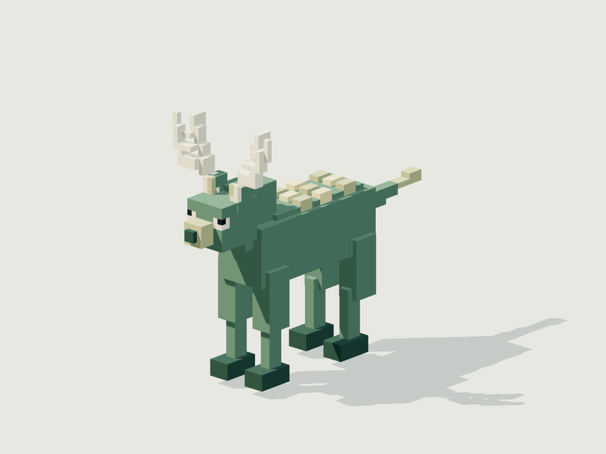

시각 원형 · [복셀 원본](../../design/assets/models/moss_deer.voxel.json) · [GLB](../../design/assets/exports/moss_deer.glb)

이끼빛 등과 밝은 배. 무리의 경계 개체가 먼저 귀를 세우고 도주하며 새끼 주변에서만 발차기한다.

- 분류: **organic**, 문명 `false`, 역할 `primary_consumer`, 기준 **T2**. 환경: grove; 던전: root_manor.
- 형태·스탯: 1.8×0.7×1.5m, 85kg, 외피 셀 0.25m. **HP 48**, 이동 1.2/4.4, 감지 20, 홈 추적 24, 시야 상실 6s, 후퇴 HP비율 0.25.
- 구조: `quadruped`; 핵심 17HP, 외피 패치 10HP, 지지부 노드 6HP. 3다리 절뚝임, 2다리 대각지지이면0.22/그외0.12; 머리 연결 또는 척추 파괴 시 사망; 꼬리 손상은 회전속도0.8.
- 행동: day; 퇴로가 막힌 상태에서 공격받음. 경고 1s. 추격 반경 또는 시야 상실 시간을 넘으면 복귀; 복귀만으로 HP·에너지 리셋 없음.
- 공격 **뒷발차기**: mechanical 9HP, 사거리 1.5m, 예고 0.8s / 회복 0.6s / 쿨다운 2.8s. 예고: 뒷발을 들고 귀를 젖힘. 판정: 뒤쪽 70도 부채꼴. 비용 1.8CP + 0EU.
- 칼로리: 최대 425, 초기 75%, 생존 0.177CP/s + 달리기 0.354CP/s. 자연회복 대기 10s, 0.27HP/s, 비용 2CP/HP, 휴식 1.5배, 유보 10%. 기아 120s 이후 0.2HP/s.
- 먹이·서식: producer:grass, producer:moss, producer:leaves. 생산원과 은신처가 연결된 지표; 중첩 환경에서는 기저 환경의 이동 조건도 만족. 사체 식용예산 149CP. 배설물·사체→분해층→생산원; 사체 먹이와 플레이어 채집은 동일 잔량 원장 공유.
- 배치: 야외 `environments:grove:spawning` 참조. 실내 종 한도 2 / 기본 그룹 1~3, 공동체 한도 0. 최소 여유 반경 0.9m, 실체화는 플레이어 32m 밖, 평가주기 60s. 건축물 방 예산 우선.
- 개체 회복: 성숙 1200s, 번식 간격 1200s, 자식 1마리, 부모 칼로리 70%·먹이 40% 이상, 새끼 CP 25%. 먹이 20% 미만 120s 뒤 1셀 이주 검색. 생존 성체2·먹이·빈 슬롯·부모 칼로리 지불이 있을 때 출생; 완전 전멸은 실제 외부 이주만.
- 드롭·대체 제작: `meat` 2~4개 → 자체 `synth_meat`; `hide` 1~2개 → 자체 `synth_hide`; `bone` 1~2개 → 자체 `synth_bone`.

### 구리여우 — `copper_fox`

<!-- asset:copper_fox -->
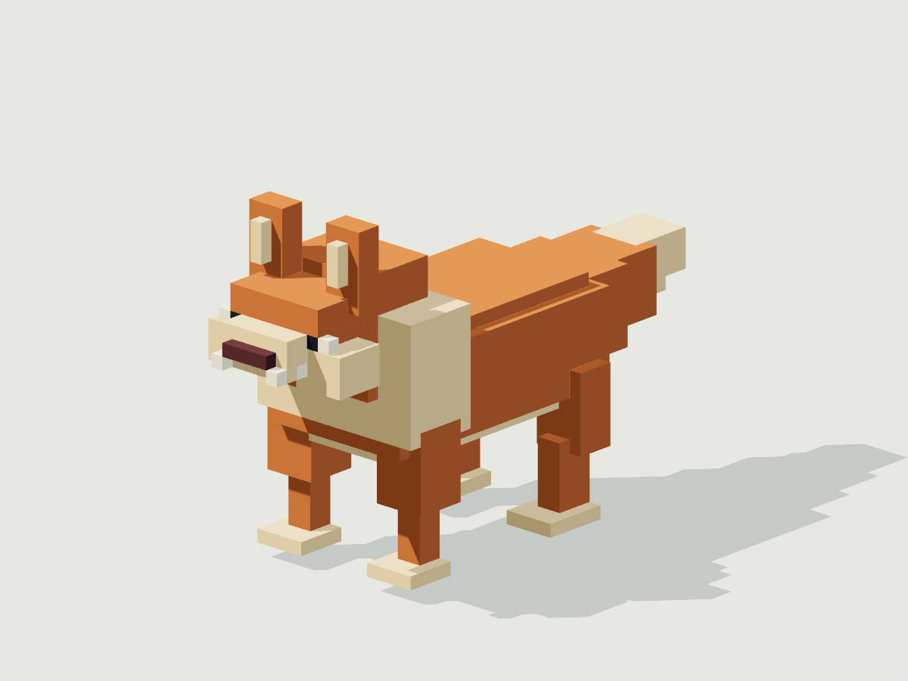

시각 원형 · [복셀 원본](../../design/assets/models/copper_fox.voxel.json) · [GLB](../../design/assets/exports/copper_fox.glb)

붉은 꼬리로 방향 전환을 보여준다. 포만 시 추적하지 않고 야간에 작은 먹이를 노린다.

- 분류: **organic**, 문명 `false`, 역할 `predator`, 기준 **T2**. 환경: grove; 던전: 없음/공동체 전용.
- 형태·스탯: 1.3×0.45×0.8m, 24kg, 외피 셀 0.25m. **HP 72**, 이동 2.2/4.2, 감지 16, 홈 추적 28, 시야 상실 6s, 후퇴 HP비율 0.25.
- 구조: `quadruped`; 핵심 25HP, 외피 패치 14HP, 지지부 노드 9HP. 3다리 절뚝임, 2다리 대각지지이면0.22/그외0.12; 머리 연결 또는 척추 파괴 시 사망; 꼬리 손상은 회전속도0.8.
- 행동: dusk_night; 배고픔 기준 이하이며 자신보다 약한 먹이, 또는 직접 공격에 대한 방어. 경고 1s. 추격 반경 또는 시야 상실 시간을 넘으면 복귀; 복귀만으로 HP·에너지 리셋 없음.
- 공격 **짧은 물기**: mechanical 12HP, 사거리 1.5m, 예고 0.65s / 회복 0.49s / 쿨다운 2.1s. 예고: 몸을 낮추고 꼬리를 세움. 판정: 직선 0.8m 도약. 비용 2.4CP + 0EU.
- 칼로리: 최대 120, 초기 75%, 생존 0.05CP/s + 달리기 0.1CP/s. 자연회복 대기 12s, 0.4HP/s, 비용 3CP/HP, 휴식 1.5배, 유보 10%. 기아 120s 이후 0.3HP/s.
- 먹이·서식: species:moss_deer, species:azure_beetle. 생산원과 은신처가 연결된 지표; 중첩 환경에서는 기저 환경의 이동 조건도 만족. 사체 식용예산 42CP. 배설물·사체→분해층→생산원; 사체 먹이와 플레이어 채집은 동일 잔량 원장 공유.
- 배치: 야외 `environments:grove:spawning` 참조. 실내 종 한도 0 / 기본 그룹 1~2, 공동체 한도 0. 최소 여유 반경 0.65m, 실체화는 플레이어 32m 밖, 평가주기 60s. 건축물 방 예산 우선.
- 개체 회복: 성숙 1200s, 번식 간격 1200s, 자식 1마리, 부모 칼로리 70%·먹이 40% 이상, 새끼 CP 25%. 먹이 20% 미만 120s 뒤 1셀 이주 검색. 생존 성체2·먹이·빈 슬롯·부모 칼로리 지불이 있을 때 출생; 완전 전멸은 실제 외부 이주만.
- 드롭·대체 제작: `meat` 1~2개 → 자체 `synth_meat`; `hide` 1~2개 → 자체 `synth_hide`; `bone` 1~2개 → 자체 `synth_bone`.

### 청금딱정 — `azure_beetle`

<!-- asset:azure_beetle -->
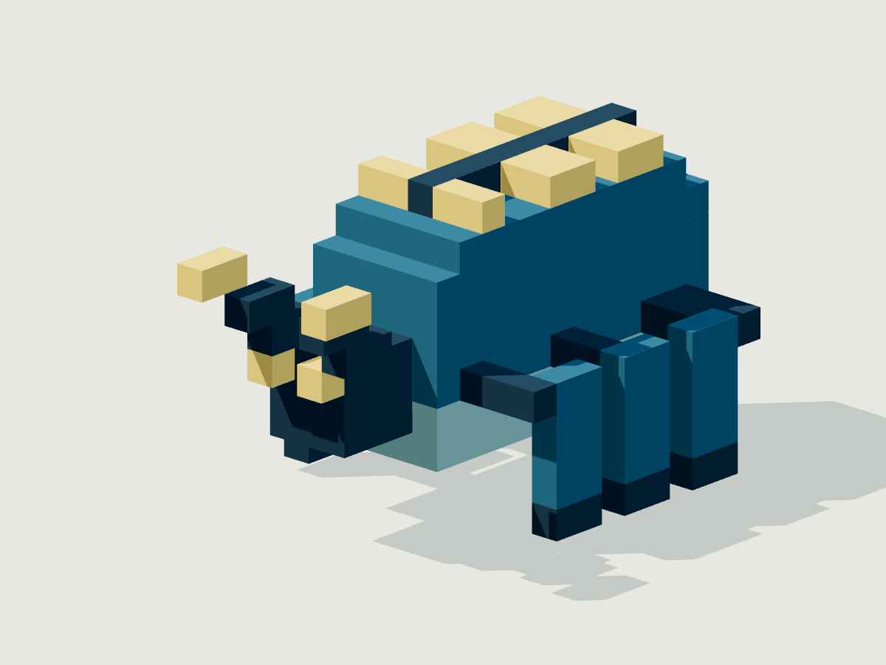

시각 원형 · [복셀 원본](../../design/assets/models/azure_beetle.voxel.json) · [GLB](../../design/assets/exports/azure_beetle.glb)

청금빛 등딱지와 작은 집게. 낙엽·썩은 목질을 분해하며 위협받으면 틈으로 숨는다.

- 분류: **organic**, 문명 `false`, 역할 `detritivore`, 기준 **T2**. 환경: grove; 던전: root_manor.
- 형태·스탯: 0.55×0.35×0.3m, 3kg, 외피 셀 0.125m. **HP 32**, 이동 0.7/1.4, 감지 6, 홈 추적 4, 시야 상실 6s, 후퇴 HP비율 0.25.
- 구조: `arthropod`; 핵심 10HP, 외피 패치 11HP, 지지부 노드 3HP. 좌우 지지 각각1개 필요; 턱 부착 파괴 시 섭식·물기 중단; 외피 손상만으로 다리 파괴 판정 금지.
- 행동: all; 퇴로가 막힌 상태에서 공격받음. 경고 1s. 추격 반경 또는 시야 상실 시간을 넘으면 복귀; 복귀만으로 HP·에너지 리셋 없음.
- 공격 **방어 집게**: mechanical 3HP, 사거리 0.65m, 예고 0.9s / 회복 0.68s / 쿨다운 3s. 예고: 집게를 벌리고 멈춤. 판정: 정면 45도. 비용 1CP + 0EU.
- 칼로리: 최대 120, 초기 75%, 생존 0.05CP/s + 달리기 0.1CP/s. 자연회복 대기 10s, 0.18HP/s, 비용 2CP/HP, 휴식 1.5배, 유보 10%. 기아 120s 이후 0.133HP/s.
- 먹이·서식: producer:log, producer:leaves, resource:detritus. 생산원과 은신처가 연결된 지표; 중첩 환경에서는 기저 환경의 이동 조건도 만족. 사체 식용예산 42CP. 배설물·사체→분해층→생산원; 사체 먹이와 플레이어 채집은 동일 잔량 원장 공유.
- 배치: 야외 `environments:grove:spawning` 참조. 실내 종 한도 6 / 기본 그룹 1~4, 공동체 한도 0. 최소 여유 반경 0.275m, 실체화는 플레이어 32m 밖, 평가주기 60s. 건축물 방 예산 우선.
- 개체 회복: 성숙 600s, 번식 간격 600s, 자식 1마리, 부모 칼로리 70%·먹이 40% 이상, 새끼 CP 25%. 먹이 20% 미만 120s 뒤 1셀 이주 검색. 생존 성체2·먹이·빈 슬롯·부모 칼로리 지불이 있을 때 출생; 완전 전멸은 실제 외부 이주만.
- 드롭·대체 제작: `chitin` 1~2개 → 자체 `synth_chitin`.

### 뿌리잠복수 — `root_stalker`

<!-- asset:root_stalker -->
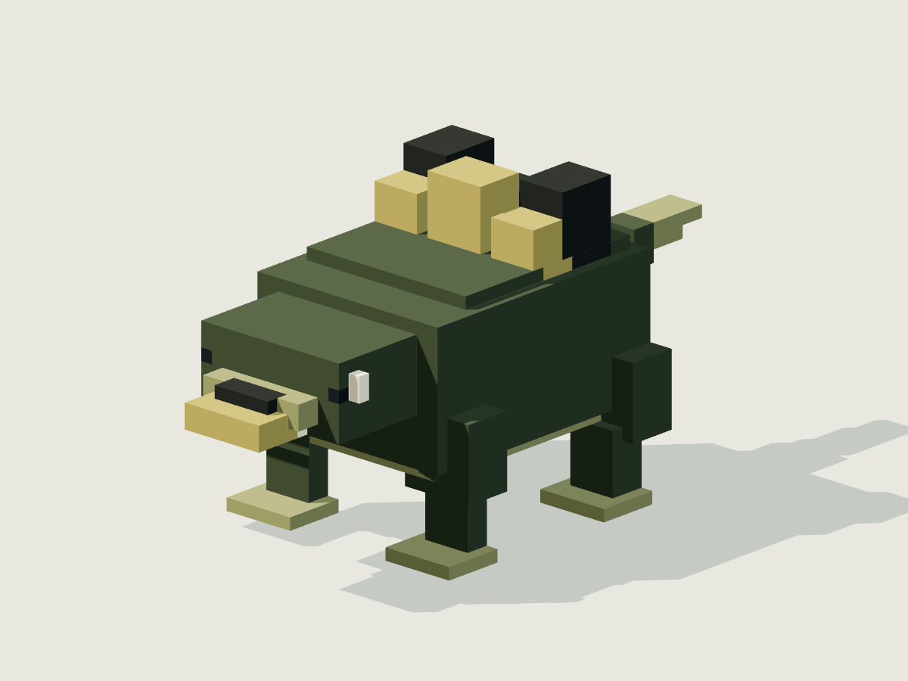

시각 원형 · [복셀 원본](../../design/assets/models/root_stalker.voxel.json) · [GLB](../../design/assets/exports/root_stalker.glb)

저택 뿌리 통로의 낮은 포식자. 발자국 진동을 감지하되 돌바닥의 조용한 우회를 허용한다.

- 분류: **organic**, 문명 `false`, 역할 `predator`, 기준 **T2**. 환경: grove; 던전: root_manor.
- 형태·스탯: 1.5×0.65×0.75m, 38kg, 외피 셀 0.25m. **HP 86**, 이동 1.5/3.8, 감지 12, 홈 추적 18, 시야 상실 6s, 후퇴 HP비율 0.25.
- 구조: `quadruped`; 핵심 30HP, 외피 패치 17HP, 지지부 노드 10HP. 3다리 절뚝임, 2다리 대각지지이면0.22/그외0.12; 머리 연결 또는 척추 파괴 시 사망; 꼬리 손상은 회전속도0.8.
- 행동: dusk_night; 배고픔 기준 이하이며 자신보다 약한 먹이, 또는 직접 공격에 대한 방어. 경고 1s. 추격 반경 또는 시야 상실 시간을 넘으면 복귀; 복귀만으로 HP·에너지 리셋 없음.
- 공격 **뿌리 통로 덮치기**: mechanical 16HP, 사거리 2.8m, 예고 1.1s / 회복 0.83s / 쿨다운 3.4s. 예고: 바닥 긁는 소리와 어깨 수축. 판정: 직선 2m, 벽에서 정지. 비용 3.2CP + 0EU.
- 칼로리: 최대 190, 초기 75%, 생존 0.079CP/s + 달리기 0.158CP/s. 자연회복 대기 12s, 0.48HP/s, 비용 3CP/HP, 휴식 1.5배, 유보 10%. 기아 120s 이후 0.358HP/s.
- 먹이·서식: species:azure_beetle, species:moss_deer. 내부 그늘·먹이 방과 연결된 매복처. 사체 식용예산 66CP. 배설물·사체→분해층→생산원; 사체 먹이와 플레이어 채집은 동일 잔량 원장 공유.
- 배치: 야외 `없음` 참조. 실내 종 한도 2 / 기본 그룹 1~2, 공동체 한도 0. 최소 여유 반경 0.75m, 실체화는 플레이어 32m 밖, 평가주기 60s. 건축물 방 예산 우선.
- 개체 회복: 성숙 1200s, 번식 간격 1200s, 자식 1마리, 부모 칼로리 70%·먹이 40% 이상, 새끼 CP 25%. 먹이 20% 미만 120s 뒤 1셀 이주 검색. 생존 성체2·먹이·빈 슬롯·부모 칼로리 지불이 있을 때 출생; 완전 전멸은 실제 외부 이주만.
- 드롭·대체 제작: `meat` 1~2개 → 자체 `synth_meat`; `hide` 1~2개 → 자체 `synth_hide`; `bone` 1~2개 → 자체 `synth_bone`.

### 너덜토끼 — `scree_hare`

<!-- asset:scree_hare -->
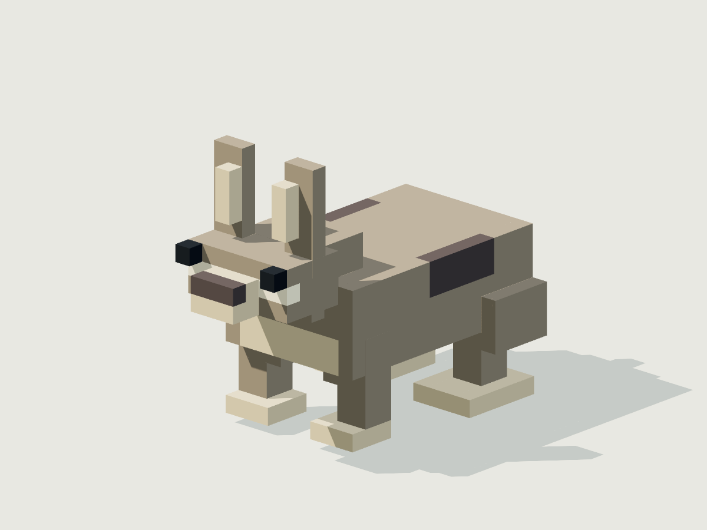

시각 원형 · [복셀 원본](../../design/assets/models/scree_hare.voxel.json) · [GLB](../../design/assets/exports/scree_hare.glb)

돌색 등과 긴 뒷다리. 마른 풀과 동굴 균류를 먹고 돌틈으로 피한다.

- 분류: **organic**, 문명 `false`, 역할 `primary_consumer`, 기준 **T3**. 환경: ridge; 던전: mining_fort.
- 형태·스탯: 0.7×0.35×0.5m, 5kg, 외피 셀 0.125m. **HP 42**, 이동 1.5/4.7, 감지 18, 홈 추적 20, 시야 상실 6s, 후퇴 HP비율 0.25.
- 구조: `quadruped`; 핵심 15HP, 외피 패치 8HP, 지지부 노드 5HP. 3다리 절뚝임, 2다리 대각지지이면0.22/그외0.12; 머리 연결 또는 척추 파괴 시 사망; 꼬리 손상은 회전속도0.8.
- 행동: day; 퇴로가 막힌 상태에서 공격받음. 경고 1s. 추격 반경 또는 시야 상실 시간을 넘으면 복귀; 복귀만으로 HP·에너지 리셋 없음.
- 공격 **필사적 발차기**: mechanical 7HP, 사거리 0.9m, 예고 0.7s / 회복 0.52s / 쿨다운 3.5s. 예고: 몸을 둥글게 말고 뒷발을 모음. 판정: 후방 좁은 접촉. 비용 1.4CP + 0EU.
- 칼로리: 최대 120, 초기 75%, 생존 0.05CP/s + 달리기 0.1CP/s. 자연회복 대기 10s, 0.23HP/s, 비용 2CP/HP, 휴식 1.5배, 유보 10%. 기아 120s 이후 0.175HP/s.
- 먹이·서식: producer:dry_grass. 생산원과 은신처가 연결된 지표; 중첩 환경에서는 기저 환경의 이동 조건도 만족. 사체 식용예산 42CP. 배설물·사체→분해층→생산원; 사체 먹이와 플레이어 채집은 동일 잔량 원장 공유.
- 배치: 야외 `environments:ridge:spawning` 참조. 실내 종 한도 2 / 기본 그룹 1~3, 공동체 한도 0. 최소 여유 반경 0.35m, 실체화는 플레이어 32m 밖, 평가주기 60s. 건축물 방 예산 우선.
- 개체 회복: 성숙 1200s, 번식 간격 1200s, 자식 1마리, 부모 칼로리 70%·먹이 40% 이상, 새끼 CP 25%. 먹이 20% 미만 120s 뒤 1셀 이주 검색. 생존 성체2·먹이·빈 슬롯·부모 칼로리 지불이 있을 때 출생; 완전 전멸은 실제 외부 이주만.
- 드롭·대체 제작: `meat` 1~2개 → 자체 `synth_meat`; `hide` 1~2개 → 자체 `synth_hide`; `bone` 1~2개 → 자체 `synth_bone`.

### 부싯돌자칼 — `flint_jackal`

<!-- asset:flint_jackal -->
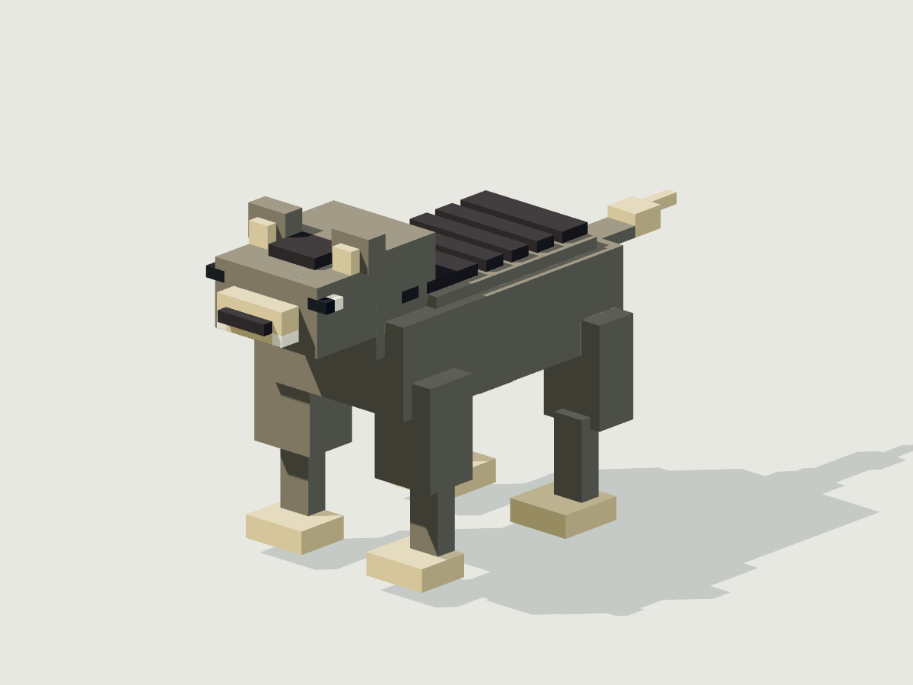

시각 원형 · [복셀 원본](../../design/assets/models/flint_jackal.voxel.json) · [GLB](../../design/assets/exports/flint_jackal.glb)

바위 능선에서 먹이를 몰아가는 소규모 포식자. 혼자 있을 때 큰 표적을 회피한다.

- 분류: **organic**, 문명 `false`, 역할 `predator`, 기준 **T3**. 환경: ridge; 던전: 없음/공동체 전용.
- 형태·스탯: 1.6×0.6×0.95m, 42kg, 외피 셀 0.25m. **HP 115**, 이동 2.1/4.6, 감지 22, 홈 추적 32, 시야 상실 6s, 후퇴 HP비율 0.25.
- 구조: `quadruped`; 핵심 40HP, 외피 패치 23HP, 지지부 노드 14HP. 3다리 절뚝임, 2다리 대각지지이면0.22/그외0.12; 머리 연결 또는 척추 파괴 시 사망; 꼬리 손상은 회전속도0.8.
- 행동: dusk_night; 배고픔 기준 이하이며 자신보다 약한 먹이, 또는 직접 공격에 대한 방어. 경고 1s. 추격 반경 또는 시야 상실 시간을 넘으면 복귀; 복귀만으로 HP·에너지 리셋 없음.
- 공격 **측면 물기**: mechanical 19HP, 사거리 1.8m, 예고 0.85s / 회복 0.64s / 쿨다운 2.5s. 예고: 옆걸음 두 번 후 짖음. 판정: 정면 60도. 비용 3.8CP + 0EU.
- 칼로리: 최대 210, 초기 75%, 생존 0.087CP/s + 달리기 0.175CP/s. 자연회복 대기 12s, 0.64HP/s, 비용 3CP/HP, 휴식 1.5배, 유보 10%. 기아 120s 이후 0.479HP/s.
- 먹이·서식: species:scree_hare, species:ore_mite. 생산원과 은신처가 연결된 지표; 중첩 환경에서는 기저 환경의 이동 조건도 만족. 사체 식용예산 74CP. 배설물·사체→분해층→생산원; 사체 먹이와 플레이어 채집은 동일 잔량 원장 공유.
- 배치: 야외 `environments:ridge:spawning` 참조. 실내 종 한도 0 / 기본 그룹 1~2, 공동체 한도 0. 최소 여유 반경 0.8m, 실체화는 플레이어 32m 밖, 평가주기 60s. 건축물 방 예산 우선.
- 개체 회복: 성숙 1200s, 번식 간격 1200s, 자식 1마리, 부모 칼로리 70%·먹이 40% 이상, 새끼 CP 25%. 먹이 20% 미만 120s 뒤 1셀 이주 검색. 생존 성체2·먹이·빈 슬롯·부모 칼로리 지불이 있을 때 출생; 완전 전멸은 실제 외부 이주만.
- 드롭·대체 제작: `meat` 1~2개 → 자체 `synth_meat`; `hide` 1~2개 → 자체 `synth_hide`; `bone` 1~2개 → 자체 `synth_bone`.

### 광분진진드기 — `ore_mite`

<!-- asset:ore_mite -->
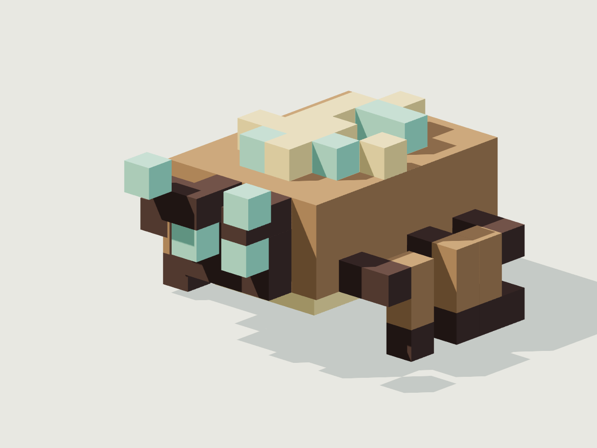

시각 원형 · [복셀 원본](../../design/assets/models/ore_mite.voxel.json) · [GLB](../../design/assets/exports/ore_mite.glb)

광석을 먹는 것이 아니라 표면의 미생물막을 긁어 먹는다. 부드러운 복부가 드러나면 도망친다.

- 분류: **organic**, 문명 `false`, 역할 `detritivore`, 기준 **T3**. 환경: ridge; 던전: mining_fort.
- 형태·스탯: 0.35×0.3×0.2m, 1kg, 외피 셀 0.125m. **HP 26**, 이동 0.5/1.2, 감지 5, 홈 추적 3, 시야 상실 6s, 후퇴 HP비율 0.25.
- 구조: `arthropod`; 핵심 8HP, 외피 패치 9HP, 지지부 노드 2HP. 좌우 지지 각각1개 필요; 턱 부착 파괴 시 섭식·물기 중단; 외피 손상만으로 다리 파괴 판정 금지.
- 행동: all; 퇴로가 막힌 상태에서 공격받음. 경고 1s. 추격 반경 또는 시야 상실 시간을 넘으면 복귀; 복귀만으로 HP·에너지 리셋 없음.
- 공격 **집게 방어**: mechanical 3HP, 사거리 0.5m, 예고 0.9s / 회복 0.68s / 쿨다운 3.4s. 예고: 앞다리를 세움. 판정: 접촉 1회. 비용 1CP + 0EU.
- 칼로리: 최대 120, 초기 75%, 생존 0.05CP/s + 달리기 0.1CP/s. 자연회복 대기 10s, 0.15HP/s, 비용 2CP/HP, 휴식 1.5배, 유보 10%. 기아 120s 이후 0.108HP/s.
- 먹이·서식: producer:dry_grass, resource:detritus. 생산원과 은신처가 연결된 지표; 중첩 환경에서는 기저 환경의 이동 조건도 만족. 사체 식용예산 42CP. 배설물·사체→분해층→생산원; 사체 먹이와 플레이어 채집은 동일 잔량 원장 공유.
- 배치: 야외 `environments:ridge:spawning` 참조. 실내 종 한도 6 / 기본 그룹 1~4, 공동체 한도 0. 최소 여유 반경 0.175m, 실체화는 플레이어 32m 밖, 평가주기 60s. 건축물 방 예산 우선.
- 개체 회복: 성숙 600s, 번식 간격 600s, 자식 1마리, 부모 칼로리 70%·먹이 40% 이상, 새끼 CP 25%. 먹이 20% 미만 120s 뒤 1셀 이주 검색. 생존 성체2·먹이·빈 슬롯·부모 칼로리 지불이 있을 때 출생; 완전 전멸은 실제 외부 이주만.
- 드롭·대체 제작: `chitin` 1~2개 → 자체 `synth_chitin`.

### 갱도족제비 — `shaft_weasel`

<!-- asset:shaft_weasel -->
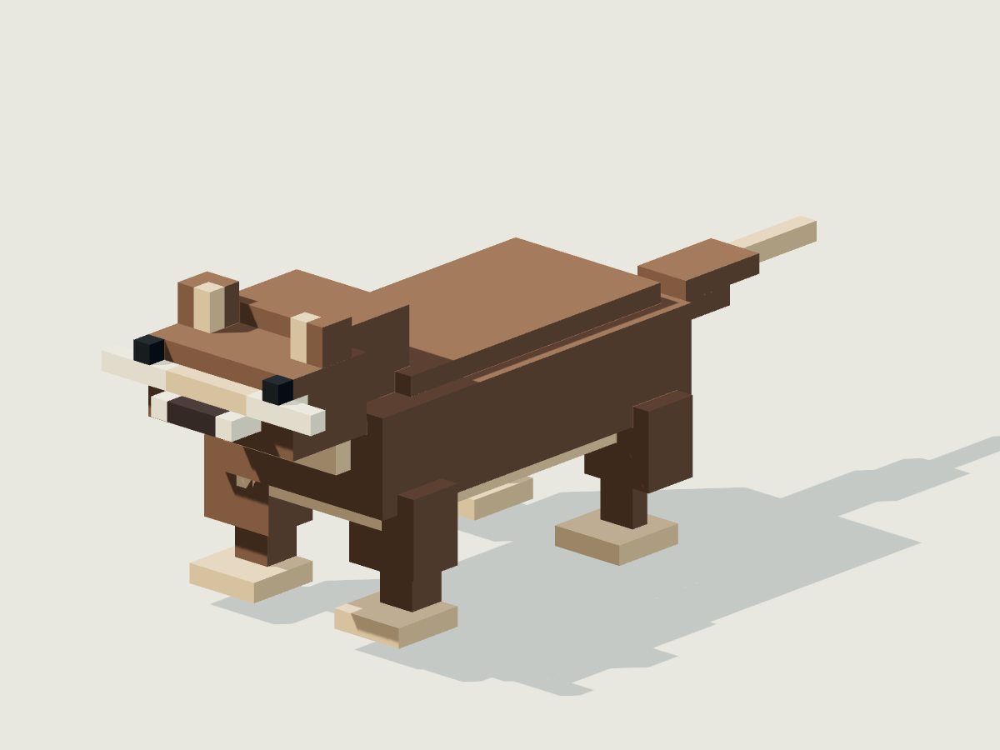

시각 원형 · [복셀 원본](../../design/assets/models/shaft_weasel.voxel.json) · [GLB](../../design/assets/exports/shaft_weasel.glb)

굴 입구에서 몸을 낮춘 뒤 짧게 돌진한다. 좁은 통로에 강하지만 개방 공간에서는 오래 쫓지 않는다.

- 분류: **organic**, 문명 `false`, 역할 `predator`, 기준 **T3**. 환경: ridge; 던전: mining_fort.
- 형태·스탯: 1.3×0.4×0.5m, 18kg, 외피 셀 0.125m. **HP 105**, 이동 1.7/4.1, 감지 14, 홈 추적 22, 시야 상실 6s, 후퇴 HP비율 0.25.
- 구조: `quadruped`; 핵심 37HP, 외피 패치 21HP, 지지부 노드 13HP. 3다리 절뚝임, 2다리 대각지지이면0.22/그외0.12; 머리 연결 또는 척추 파괴 시 사망; 꼬리 손상은 회전속도0.8.
- 행동: dusk_night; 배고픔 기준 이하이며 자신보다 약한 먹이, 또는 직접 공격에 대한 방어. 경고 1s. 추격 반경 또는 시야 상실 시간을 넘으면 복귀; 복귀만으로 HP·에너지 리셋 없음.
- 공격 **갱도 돌진**: mechanical 22HP, 사거리 3m, 예고 1s / 회복 0.75s / 쿨다운 3.8s. 예고: 바닥 먼지와 긴 울음. 판정: 직선 2.5m, 실패 후1s 회복. 비용 4.4CP + 0EU.
- 칼로리: 최대 120, 초기 75%, 생존 0.05CP/s + 달리기 0.1CP/s. 자연회복 대기 12s, 0.58HP/s, 비용 3CP/HP, 휴식 1.5배, 유보 10%. 기아 120s 이후 0.438HP/s.
- 먹이·서식: species:ore_mite, species:scree_hare. 내부 그늘·먹이 방과 연결된 매복처. 사체 식용예산 42CP. 배설물·사체→분해층→생산원; 사체 먹이와 플레이어 채집은 동일 잔량 원장 공유.
- 배치: 야외 `없음` 참조. 실내 종 한도 2 / 기본 그룹 1~2, 공동체 한도 0. 최소 여유 반경 0.65m, 실체화는 플레이어 32m 밖, 평가주기 60s. 건축물 방 예산 우선.
- 개체 회복: 성숙 1200s, 번식 간격 1200s, 자식 1마리, 부모 칼로리 70%·먹이 40% 이상, 새끼 CP 25%. 먹이 20% 미만 120s 뒤 1셀 이주 검색. 생존 성체2·먹이·빈 슬롯·부모 칼로리 지불이 있을 때 출생; 완전 전멸은 실제 외부 이주만.
- 드롭·대체 제작: `meat` 1~2개 → 자체 `synth_meat`; `hide` 1~2개 → 자체 `synth_hide`; `bone` 1~2개 → 자체 `synth_bone`.

### 갈대등짐수 — `reed_grazer`

<!-- asset:reed_grazer -->
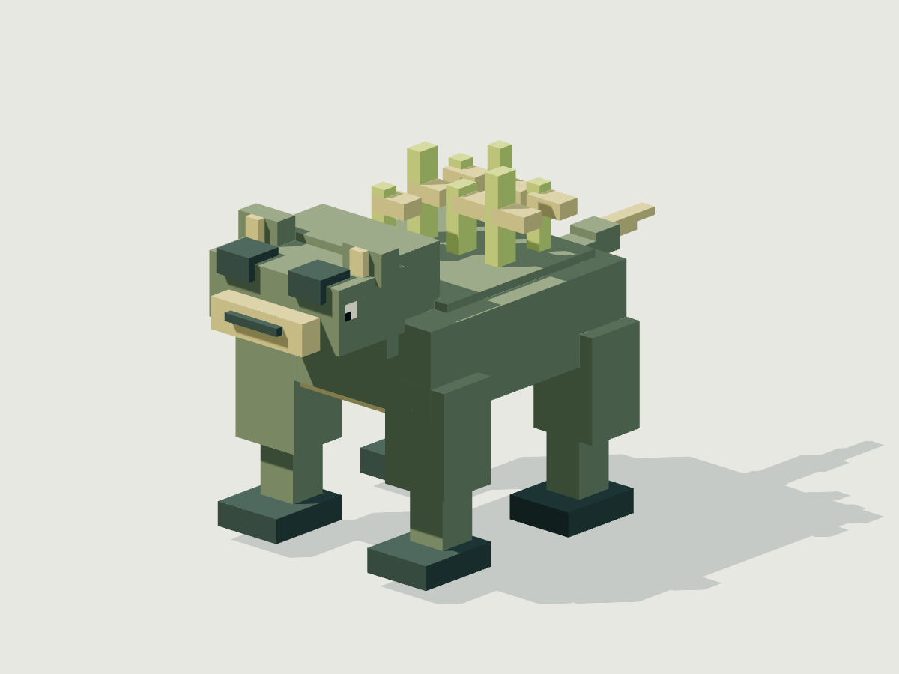

시각 원형 · [복셀 원본](../../design/assets/models/reed_grazer.voxel.json) · [GLB](../../design/assets/exports/reed_grazer.glb)

넓은 발과 갈대색 등. 얕은 물을 헤치며 갈대를 먹고 깊은 물과 산성 웅덩이는 피한다.

- 분류: **organic**, 문명 `false`, 역할 `primary_consumer`, 기준 **T4**. 환경: marsh; 던전: floodworks.
- 형태·스탯: 2.1×1×1.3m, 150kg, 외피 셀 0.25m. **HP 165**, 이동 1.1/3.4, 감지 16, 홈 추적 18, 시야 상실 6s, 후퇴 HP비율 0.25.
- 구조: `quadruped`; 핵심 58HP, 외피 패치 33HP, 지지부 노드 20HP. 3다리 절뚝임, 2다리 대각지지이면0.22/그외0.12; 머리 연결 또는 척추 파괴 시 사망; 꼬리 손상은 회전속도0.8.
- 행동: day; 퇴로가 막힌 상태에서 공격받음. 경고 1s. 추격 반경 또는 시야 상실 시간을 넘으면 복귀; 복귀만으로 HP·에너지 리셋 없음.
- 공격 **몸통 밀기**: mechanical 20HP, 사거리 2m, 예고 1.1s / 회복 0.83s / 쿨다운 3.8s. 예고: 머리를 돌리고 갈대를 흔듦. 판정: 정면 80도. 비용 4.0CP + 0EU.
- 칼로리: 최대 750, 초기 75%, 생존 0.312CP/s + 달리기 0.625CP/s. 자연회복 대기 10s, 0.92HP/s, 비용 2CP/HP, 휴식 1.5배, 유보 10%. 기아 120s 이후 0.688HP/s.
- 먹이·서식: producer:reed, producer:algae. 수심 0.2~1.5m의 조류·갈대 가장자리. 사체 식용예산 262CP. 배설물·사체→분해층→생산원; 사체 먹이와 플레이어 채집은 동일 잔량 원장 공유.
- 배치: 야외 `environments:marsh:spawning` 참조. 실내 종 한도 4 / 기본 그룹 1~3, 공동체 한도 0. 최소 여유 반경 1.05m, 실체화는 플레이어 32m 밖, 평가주기 60s. 건축물 방 예산 우선.
- 개체 회복: 성숙 1200s, 번식 간격 1200s, 자식 1마리, 부모 칼로리 70%·먹이 40% 이상, 새끼 CP 25%. 먹이 20% 미만 120s 뒤 1셀 이주 검색. 생존 성체2·먹이·빈 슬롯·부모 칼로리 지불이 있을 때 출생; 완전 전멸은 실제 외부 이주만.
- 드롭·대체 제작: `meat` 2~4개 → 자체 `synth_meat`; `hide` 1~2개 → 자체 `synth_hide`; `bone` 1~2개 → 자체 `synth_bone`.

### 진흙악어 — `mud_croc`

<!-- asset:mud_croc -->
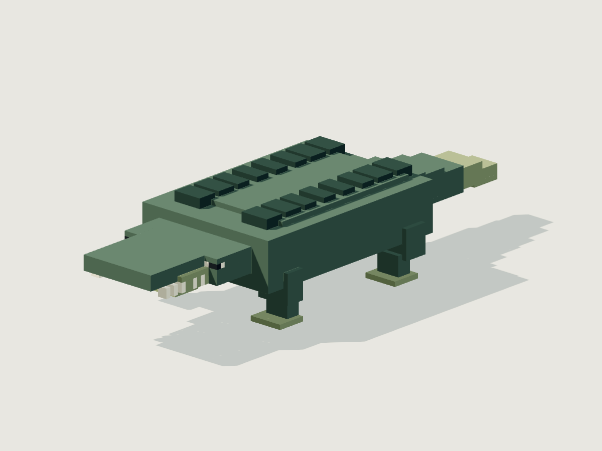

시각 원형 · [복셀 원본](../../design/assets/models/mud_croc.voxel.json) · [GLB](../../design/assets/exports/mud_croc.glb)

수면에 눈만 드러내고 기다린다. 입 벌리는 예고 뒤 물가의 표적만 짧게 추격한다.

- 분류: **organic**, 문명 `false`, 역할 `predator`, 기준 **T4**. 환경: marsh; 던전: 없음/공동체 전용.
- 형태·스탯: 3×1×0.6m, 190kg, 외피 셀 0.25m. **HP 220**, 이동 1.4/4, 감지 18, 홈 추적 26, 시야 상실 6s, 후퇴 HP비율 0.25.
- 구조: `quadruped`; 핵심 77HP, 외피 패치 44HP, 지지부 노드 26HP. 3다리 절뚝임, 2다리 대각지지이면0.22/그외0.12; 머리 연결 또는 척추 파괴 시 사망; 꼬리 손상은 회전속도0.8.
- 행동: dusk_night; 배고픔 기준 이하이며 자신보다 약한 먹이, 또는 직접 공격에 대한 방어. 경고 1s. 추격 반경 또는 시야 상실 시간을 넘으면 복귀; 복귀만으로 HP·에너지 리셋 없음.
- 공격 **턱 닫기**: mechanical 29HP, 사거리 2.6m, 예고 1.25s / 회복 0.94s / 쿨다운 3.6s. 예고: 입을 크게 벌리며 수면 파문. 판정: 정면 60도, 고정 후 회전 금지. 비용 5.8CP + 0EU.
- 칼로리: 최대 950, 초기 75%, 생존 0.396CP/s + 달리기 0.792CP/s. 자연회복 대기 12s, 1.22HP/s, 비용 3CP/HP, 휴식 1.5배, 유보 10%. 기아 120s 이후 0.917HP/s.
- 먹이·서식: species:reed_grazer, species:silt_snail. 수심 0.2~1.5m의 조류·갈대 가장자리. 사체 식용예산 332CP. 배설물·사체→분해층→생산원; 사체 먹이와 플레이어 채집은 동일 잔량 원장 공유.
- 배치: 야외 `environments:marsh:spawning` 참조. 실내 종 한도 0 / 기본 그룹 1~2, 공동체 한도 0. 최소 여유 반경 1.5m, 실체화는 플레이어 32m 밖, 평가주기 60s. 건축물 방 예산 우선.
- 개체 회복: 성숙 1200s, 번식 간격 1200s, 자식 1마리, 부모 칼로리 70%·먹이 40% 이상, 새끼 CP 25%. 먹이 20% 미만 120s 뒤 1셀 이주 검색. 생존 성체2·먹이·빈 슬롯·부모 칼로리 지불이 있을 때 출생; 완전 전멸은 실제 외부 이주만.
- 드롭·대체 제작: `meat` 2~4개 → 자체 `synth_meat`; `hide` 1~2개 → 자체 `synth_hide`; `bone` 1~2개 → 자체 `synth_bone`; `acid_gland` 1~1개 → 자체 `synth_acid_gland`.

### 침전달팽이 — `silt_snail`

<!-- asset:silt_snail -->
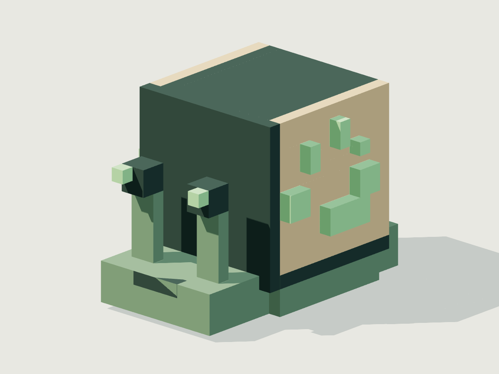

시각 원형 · [복셀 원본](../../design/assets/models/silt_snail.voxel.json) · [GLB](../../design/assets/exports/silt_snail.glb)

퇴적물과 조류를 먹고 산성 부산물을 저장한다. 접촉만으로 피해를 주지 않고 찔렸을 때 방어 분비한다.

- 분류: **organic**, 문명 `false`, 역할 `detritivore`, 기준 **T4**. 환경: marsh; 던전: floodworks.
- 형태·스탯: 0.6×0.45×0.45m, 8kg, 외피 셀 0.125m. **HP 65**, 이동 0.25/0.6, 감지 5, 홈 추적 2, 시야 상실 6s, 후퇴 HP비율 0.25.
- 구조: `crawler`; 핵심 23HP, 외피 패치 20HP, 지지부 노드 20HP. 복측 이동띠 단절 시 정지; 분비샘 파괴 시 산성 방어 중단.
- 행동: all; 퇴로가 막힌 상태에서 공격받음. 경고 1s. 추격 반경 또는 시야 상실 시간을 넘으면 복귀; 복귀만으로 HP·에너지 리셋 없음.
- 공격 **산성 방어액**: chemical 8HP, 사거리 1.1m, 예고 1.4s / 회복 1.05s / 쿨다운 5s. 예고: 껍데기 아래 초록 기포. 판정: 단일 접촉, 잔류 장판 없음. 비용 1.6CP + 16EU.
- 칼로리: 최대 120, 초기 75%, 생존 0.05CP/s + 달리기 0.1CP/s. 자연회복 대기 10s, 0.36HP/s, 비용 2CP/HP, 휴식 1.5배, 유보 10%. 기아 120s 이후 0.271HP/s.
- 공격 저장량: chemical 120EU, 초기 75%, 충전 `food_metabolism`, 1CP/EU.
- 먹이·서식: producer:reed, producer:algae, resource:detritus. 수심 0.2~1.5m의 조류·갈대 가장자리. 사체 식용예산 42CP. 배설물·사체→분해층→생산원; 사체 먹이와 플레이어 채집은 동일 잔량 원장 공유.
- 배치: 야외 `environments:marsh:spawning` 참조. 실내 종 한도 10 / 기본 그룹 1~4, 공동체 한도 0. 최소 여유 반경 0.3m, 실체화는 플레이어 32m 밖, 평가주기 60s. 건축물 방 예산 우선.
- 개체 회복: 성숙 600s, 번식 간격 600s, 자식 1마리, 부모 칼로리 70%·먹이 40% 이상, 새끼 CP 25%. 먹이 20% 미만 120s 뒤 1셀 이주 검색. 생존 성체2·먹이·빈 슬롯·부모 칼로리 지불이 있을 때 출생; 완전 전멸은 실제 외부 이주만.
- 드롭·대체 제작: `chitin` 1~2개 → 자체 `synth_chitin`; `acid_gland` 1~1개 → 자체 `synth_acid_gland`.

### 수로뱀장어 — `drain_eel`

<!-- asset:drain_eel -->
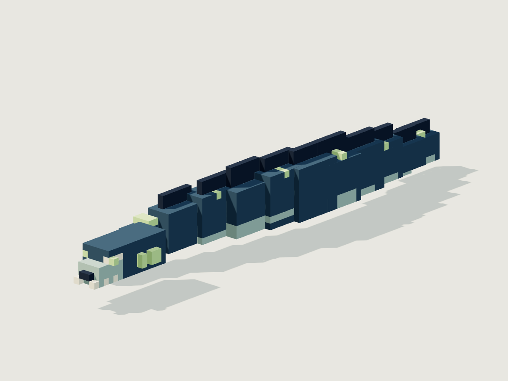

시각 원형 · [복셀 원본](../../design/assets/models/drain_eel.voxel.json) · [GLB](../../design/assets/exports/drain_eel.glb)

수문 뒤 조용한 수로에 숨는다. 물결과 턱의 밝은 반점으로 공격을 예고하며 마른 바닥에서는 느리다.

- 분류: **organic**, 문명 `false`, 역할 `predator`, 기준 **T4**. 환경: marsh; 던전: floodworks.
- 형태·스탯: 2.4×0.35×0.35m, 28kg, 외피 셀 0.25m. **HP 155**, 이동 1.2/3.7, 감지 12, 홈 추적 18, 시야 상실 6s, 후퇴 HP비율 0.25.
- 구조: `serpent`; 핵심 54HP, 외피 패치 23HP, 지지부 노드 23HP. 네 구간 연결 중간이 끊기면 머리·심장 연결 판정; 꼬리만 잃으면 후방 밀기 감소, 분리된 꼬리는 사물.
- 행동: dusk_night; 배고픔 기준 이하이며 자신보다 약한 먹이, 또는 직접 공격에 대한 방어. 경고 1s. 추격 반경 또는 시야 상실 시간을 넘으면 복귀; 복귀만으로 HP·에너지 리셋 없음.
- 공격 **산성 물기**: chemical 25HP, 사거리 2.4m, 예고 1s / 회복 0.75s / 쿨다운 3.2s. 예고: 턱 반점 발광과 수면 선. 판정: 직선 1.8m. 비용 5.0CP + 50EU.
- 칼로리: 최대 140, 초기 75%, 생존 0.058CP/s + 달리기 0.117CP/s. 자연회복 대기 12s, 0.86HP/s, 비용 3CP/HP, 휴식 1.5배, 유보 10%. 기아 120s 이후 0.646HP/s.
- 공격 저장량: chemical 300EU, 초기 75%, 충전 `food_metabolism`, 1CP/EU.
- 먹이·서식: species:silt_snail, species:reed_grazer. 내부 그늘·먹이 방과 연결된 매복처. 사체 식용예산 49CP. 배설물·사체→분해층→생산원; 사체 먹이와 플레이어 채집은 동일 잔량 원장 공유.
- 배치: 야외 `없음` 참조. 실내 종 한도 5 / 기본 그룹 1~2, 공동체 한도 0. 최소 여유 반경 1.2m, 실체화는 플레이어 32m 밖, 평가주기 60s. 건축물 방 예산 우선.
- 개체 회복: 성숙 1200s, 번식 간격 1200s, 자식 1마리, 부모 칼로리 70%·먹이 40% 이상, 새끼 CP 25%. 먹이 20% 미만 120s 뒤 1셀 이주 검색. 생존 성체2·먹이·빈 슬롯·부모 칼로리 지불이 있을 때 출생; 완전 전멸은 실제 외부 이주만.
- 드롭·대체 제작: `meat` 1~2개 → 자체 `synth_meat`; `hide` 1~2개 → 자체 `synth_hide`; `bone` 1~2개 → 자체 `synth_bone`; `acid_gland` 1~1개 → 자체 `synth_acid_gland`.

### 재이끼염소 — `ash_goat`

<!-- asset:ash_goat -->
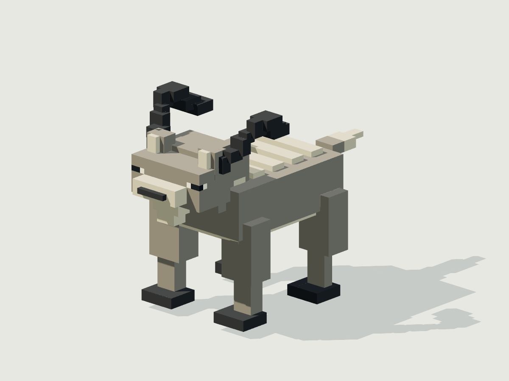

시각 원형 · [복셀 원본](../../design/assets/models/ash_goat.voxel.json) · [GLB](../../design/assets/exports/ash_goat.glb)

열원 가장자리의 재이끼를 먹는다. 열에 적응했어도 용암 위를 걷지 못하고 냉각지대로 피한다.

- 분류: **organic**, 문명 `false`, 역할 `primary_consumer`, 기준 **T5**. 환경: thermal; 던전: geothermal_foundry.
- 형태·스탯: 1.7×0.8×1.2m, 95kg, 외피 셀 0.25m. **HP 210**, 이동 1.3/4, 감지 20, 홈 추적 22, 시야 상실 6s, 후퇴 HP비율 0.25.
- 구조: `quadruped`; 핵심 74HP, 외피 패치 42HP, 지지부 노드 25HP. 3다리 절뚝임, 2다리 대각지지이면0.22/그외0.12; 머리 연결 또는 척추 파괴 시 사망; 꼬리 손상은 회전속도0.8.
- 행동: day; 퇴로가 막힌 상태에서 공격받음. 경고 1s. 추격 반경 또는 시야 상실 시간을 넘으면 복귀; 복귀만으로 HP·에너지 리셋 없음.
- 공격 **뿔 밀기**: mechanical 24HP, 사거리 1.9m, 예고 1s / 회복 0.75s / 쿨다운 3.2s. 예고: 앞발로 땅을 긁음. 판정: 정면 55도. 비용 4.8CP + 0EU.
- 칼로리: 최대 475, 초기 75%, 생존 0.198CP/s + 달리기 0.396CP/s. 자연회복 대기 10s, 1.17HP/s, 비용 2CP/HP, 휴식 1.5배, 유보 10%. 기아 120s 이후 0.875HP/s.
- 먹이·서식: producer:ash_lichen. 열원 바로 위를 제외한 생산원 가장자리. 사체 식용예산 166CP. 배설물·사체→분해층→생산원; 사체 먹이와 플레이어 채집은 동일 잔량 원장 공유.
- 배치: 야외 `environments:thermal:spawning` 참조. 실내 종 한도 4 / 기본 그룹 1~3, 공동체 한도 0. 최소 여유 반경 0.85m, 실체화는 플레이어 32m 밖, 평가주기 60s. 건축물 방 예산 우선.
- 개체 회복: 성숙 1200s, 번식 간격 1200s, 자식 1마리, 부모 칼로리 70%·먹이 40% 이상, 새끼 CP 25%. 먹이 20% 미만 120s 뒤 1셀 이주 검색. 생존 성체2·먹이·빈 슬롯·부모 칼로리 지불이 있을 때 출생; 완전 전멸은 실제 외부 이주만.
- 드롭·대체 제작: `meat` 2~4개 → 자체 `synth_meat`; `hide` 1~2개 → 자체 `synth_hide`; `bone` 1~2개 → 자체 `synth_bone`.

### 불씨도마뱀 — `ember_lizard`

<!-- asset:ember_lizard -->
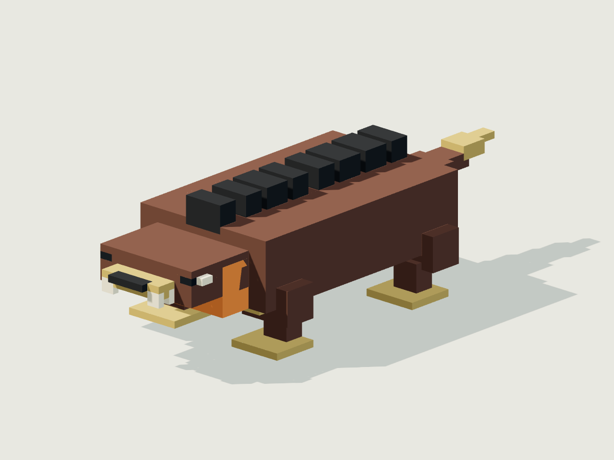

시각 원형 · [복셀 원본](../../design/assets/models/ember_lizard.voxel.json) · [GLB](../../design/assets/exports/ember_lizard.glb)

가슴 주머니에 열을 모아 짧게 뿜는다. 공격 후 배가 식는 동안 접근할 틈을 준다.

- 분류: **organic**, 문명 `false`, 역할 `predator`, 기준 **T5**. 환경: thermal; 던전: 없음/공동체 전용.
- 형태·스탯: 2.2×0.8×0.6m, 105kg, 외피 셀 0.25m. **HP 260**, 이동 1.6/4.3, 감지 18, 홈 추적 28, 시야 상실 6s, 후퇴 HP비율 0.25.
- 구조: `quadruped`; 핵심 91HP, 외피 패치 52HP, 지지부 노드 31HP. 3다리 절뚝임, 2다리 대각지지이면0.22/그외0.12; 머리 연결 또는 척추 파괴 시 사망; 꼬리 손상은 회전속도0.8.
- 행동: dusk_night; 배고픔 기준 이하이며 자신보다 약한 먹이, 또는 직접 공격에 대한 방어. 경고 1s. 추격 반경 또는 시야 상실 시간을 넘으면 복귀; 복귀만으로 HP·에너지 리셋 없음.
- 공격 **불씨 분출**: thermal 36HP, 사거리 5m, 예고 1.5s / 회복 1.12s / 쿨다운 5.5s. 예고: 가슴이 주황색으로 부풀어 오름. 판정: 정면 35도, 벽 차단. 비용 7.2CP + 72EU.
- 칼로리: 최대 525, 초기 75%, 생존 0.219CP/s + 달리기 0.438CP/s. 자연회복 대기 12s, 1.44HP/s, 비용 3CP/HP, 휴식 1.5배, 유보 10%. 기아 120s 이후 1.083HP/s.
- 공격 저장량: thermal 432EU, 초기 75%, 충전 `food_metabolism`, 1CP/EU.
- 먹이·서식: species:ash_goat, species:vent_grub. 열원 바로 위를 제외한 생산원 가장자리. 사체 식용예산 184CP. 배설물·사체→분해층→생산원; 사체 먹이와 플레이어 채집은 동일 잔량 원장 공유.
- 배치: 야외 `environments:thermal:spawning` 참조. 실내 종 한도 0 / 기본 그룹 1~2, 공동체 한도 0. 최소 여유 반경 1.1m, 실체화는 플레이어 32m 밖, 평가주기 60s. 건축물 방 예산 우선.
- 개체 회복: 성숙 1200s, 번식 간격 1200s, 자식 1마리, 부모 칼로리 70%·먹이 40% 이상, 새끼 CP 25%. 먹이 20% 미만 120s 뒤 1셀 이주 검색. 생존 성체2·먹이·빈 슬롯·부모 칼로리 지불이 있을 때 출생; 완전 전멸은 실제 외부 이주만.
- 드롭·대체 제작: `meat` 2~4개 → 자체 `synth_meat`; `hide` 1~2개 → 자체 `synth_hide`; `bone` 1~2개 → 자체 `synth_bone`; `heat_gland` 1~2개 → 자체 `synth_heat_gland`.

### 분기구유충 — `vent_grub`

<!-- asset:vent_grub -->
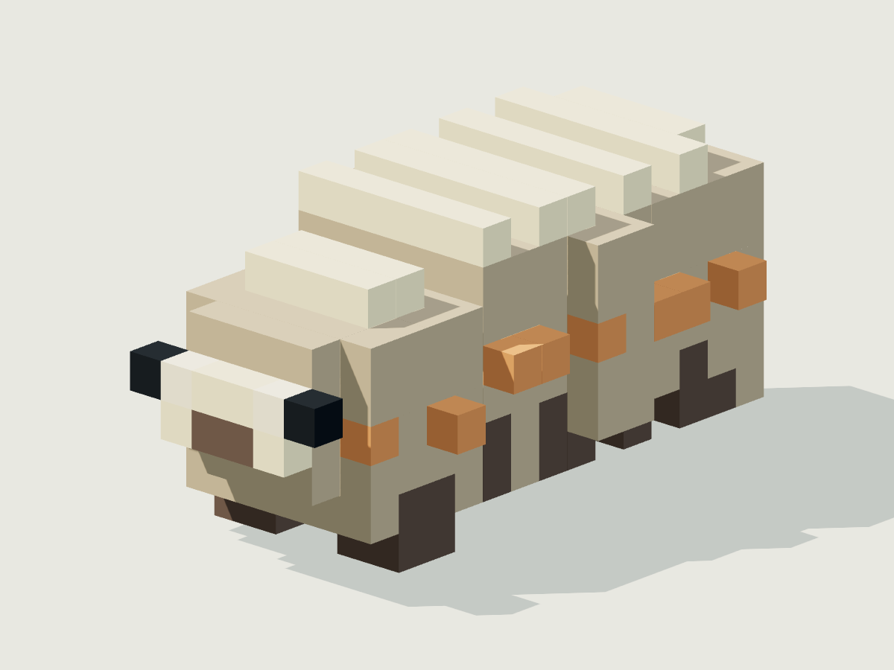

시각 원형 · [복셀 원본](../../design/assets/models/vent_grub.voxel.json) · [GLB](../../design/assets/exports/vent_grub.glb)

뜨겁지 않은 분기구 미생물층을 먹는다. 뒤집히면 이동이 멎지만 스스로 천천히 복귀한다.

- 분류: **organic**, 문명 `false`, 역할 `detritivore`, 기준 **T5**. 환경: thermal; 던전: geothermal_foundry.
- 형태·스탯: 0.5×0.25×0.25m, 2kg, 외피 셀 0.125m. **HP 55**, 이동 0.35/0.8, 감지 4, 홈 추적 2, 시야 상실 6s, 후퇴 HP비율 0.25.
- 구조: `crawler`; 핵심 19HP, 외피 패치 16HP, 지지부 노드 16HP. 복측 이동띠 단절 시 정지; 분비샘 파괴 시 산성 방어 중단.
- 행동: all; 퇴로가 막힌 상태에서 공격받음. 경고 1s. 추격 반경 또는 시야 상실 시간을 넘으면 복귀; 복귀만으로 HP·에너지 리셋 없음.
- 공격 **몸통 수축**: mechanical 5HP, 사거리 0.65m, 예고 1s / 회복 0.75s / 쿨다운 4s. 예고: 몸을 짧게 압축. 판정: 접촉 1회. 비용 1CP + 0EU.
- 칼로리: 최대 120, 초기 75%, 생존 0.05CP/s + 달리기 0.1CP/s. 자연회복 대기 10s, 0.31HP/s, 비용 2CP/HP, 휴식 1.5배, 유보 10%. 기아 120s 이후 0.229HP/s.
- 먹이·서식: producer:ash_lichen, resource:detritus. 열원 바로 위를 제외한 생산원 가장자리. 사체 식용예산 42CP. 배설물·사체→분해층→생산원; 사체 먹이와 플레이어 채집은 동일 잔량 원장 공유.
- 배치: 야외 `environments:thermal:spawning` 참조. 실내 종 한도 10 / 기본 그룹 1~4, 공동체 한도 0. 최소 여유 반경 0.25m, 실체화는 플레이어 32m 밖, 평가주기 60s. 건축물 방 예산 우선.
- 개체 회복: 성숙 600s, 번식 간격 600s, 자식 1마리, 부모 칼로리 70%·먹이 40% 이상, 새끼 CP 25%. 먹이 20% 미만 120s 뒤 1셀 이주 검색. 생존 성체2·먹이·빈 슬롯·부모 칼로리 지불이 있을 때 출생; 완전 전멸은 실제 외부 이주만.
- 드롭·대체 제작: `chitin` 1~2개 → 자체 `synth_chitin`.

### 주조사마귀 — `furnace_mantis`

<!-- asset:furnace_mantis -->
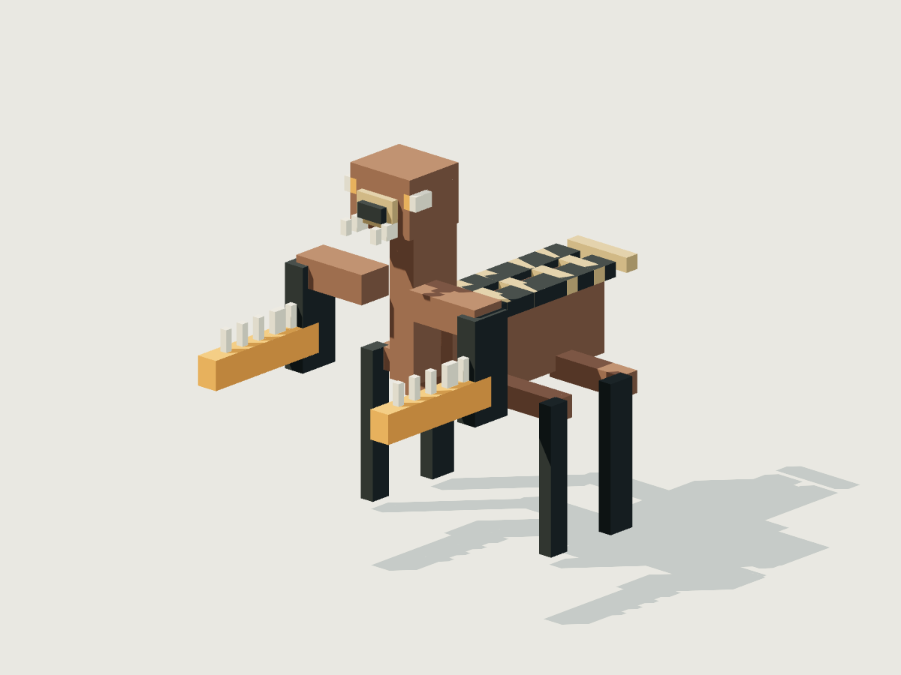

시각 원형 · [복셀 원본](../../design/assets/models/furnace_mantis.voxel.json) · [GLB](../../design/assets/exports/furnace_mantis.glb)

주조소 차가운 배관에 매달린다. 밝아지는 앞낫을 보고 회피할 수 있으며 지속 가열되면 후퇴한다.

- 분류: **organic**, 문명 `false`, 역할 `predator`, 기준 **T5**. 환경: thermal; 던전: geothermal_foundry.
- 형태·스탯: 1.8×1×1.6m, 70kg, 외피 셀 0.25m. **HP 285**, 이동 1.4/3.8, 감지 15, 홈 추적 22, 시야 상실 6s, 후퇴 HP비율 0.25.
- 구조: `arthropod`; 핵심 86HP, 외피 패치 100HP, 지지부 노드 23HP. 좌우 지지 각각1개 필요; 턱 부착 파괴 시 섭식·물기 중단; 외피 손상만으로 다리 파괴 판정 금지.
- 행동: dusk_night; 배고픔 기준 이하이며 자신보다 약한 먹이, 또는 직접 공격에 대한 방어. 경고 1s. 추격 반경 또는 시야 상실 시간을 넘으면 복귀; 복귀만으로 HP·에너지 리셋 없음.
- 공격 **가열 낫**: thermal 38HP, 사거리 2.4m, 예고 1.15s / 회복 0.86s / 쿨다운 3.6s. 예고: 앞낫을 들어 밝게 달굼. 판정: 정면 80도, 뒤쪽 안전. 비용 7.6CP + 76EU.
- 칼로리: 최대 350, 초기 75%, 생존 0.146CP/s + 달리기 0.292CP/s. 자연회복 대기 12s, 1.58HP/s, 비용 3CP/HP, 휴식 1.5배, 유보 10%. 기아 120s 이후 1.188HP/s.
- 공격 저장량: thermal 456EU, 초기 75%, 충전 `food_metabolism`, 1CP/EU.
- 먹이·서식: species:vent_grub, species:ash_goat. 내부 그늘·먹이 방과 연결된 매복처. 사체 식용예산 122CP. 배설물·사체→분해층→생산원; 사체 먹이와 플레이어 채집은 동일 잔량 원장 공유.
- 배치: 야외 `없음` 참조. 실내 종 한도 5 / 기본 그룹 1~2, 공동체 한도 0. 최소 여유 반경 0.9m, 실체화는 플레이어 32m 밖, 평가주기 60s. 건축물 방 예산 우선.
- 개체 회복: 성숙 1200s, 번식 간격 1200s, 자식 1마리, 부모 칼로리 70%·먹이 40% 이상, 새끼 CP 25%. 먹이 20% 미만 120s 뒤 1셀 이주 검색. 생존 성체2·먹이·빈 슬롯·부모 칼로리 지불이 있을 때 출생; 완전 전멸은 실제 외부 이주만.
- 드롭·대체 제작: `meat` 2~4개 → 자체 `synth_meat`; `chitin` 1~2개 → 자체 `synth_chitin`; `bone` 1~2개 → 자체 `synth_bone`; `heat_gland` 1~2개 → 자체 `synth_heat_gland`.

### 절벽산양 — `cliff_ibex`

<!-- asset:cliff_ibex -->
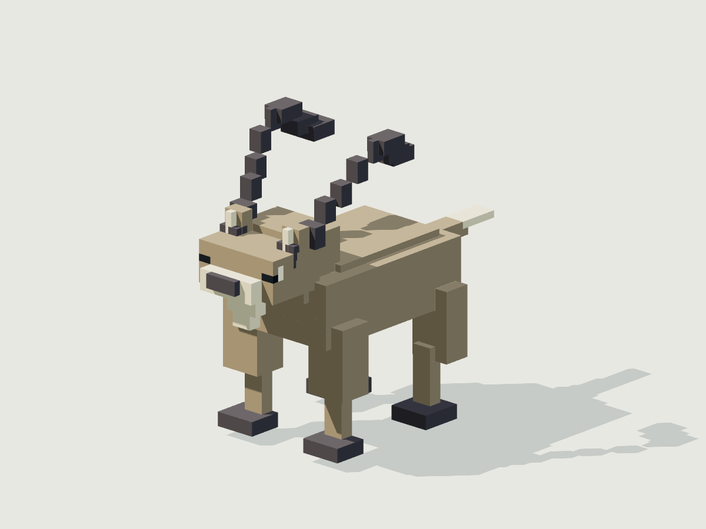

시각 원형 · [복셀 원본](../../design/assets/models/cliff_ibex.voxel.json) · [GLB](../../design/assets/exports/cliff_ibex.glb)

넓은 발굽으로 좁은 암반을 건넌다. 전투보다 탈출을 선택하며 경사 지형의 길잡이가 된다.

- 분류: **organic**, 문명 `false`, 역할 `primary_consumer`, 기준 **T5**. 환경: coast; 던전: cliff_observatory.
- 형태·스탯: 1.6×0.65×1.3m, 80kg, 외피 셀 0.25m. **HP 190**, 이동 1.4/4.3, 감지 24, 홈 추적 24, 시야 상실 6s, 후퇴 HP비율 0.25.
- 구조: `quadruped`; 핵심 66HP, 외피 패치 38HP, 지지부 노드 23HP. 3다리 절뚝임, 2다리 대각지지이면0.22/그외0.12; 머리 연결 또는 척추 파괴 시 사망; 꼬리 손상은 회전속도0.8.
- 행동: day; 퇴로가 막힌 상태에서 공격받음. 경고 1s. 추격 반경 또는 시야 상실 시간을 넘으면 복귀; 복귀만으로 HP·에너지 리셋 없음.
- 공격 **뿔 받기**: mechanical 23HP, 사거리 1.8m, 예고 1.1s / 회복 0.83s / 쿨다운 3.8s. 예고: 고개를 숙이고 발굽 소리. 판정: 정면 50도. 비용 4.6CP + 0EU.
- 칼로리: 최대 400, 초기 75%, 생존 0.167CP/s + 달리기 0.333CP/s. 자연회복 대기 10s, 1.06HP/s, 비용 2CP/HP, 휴식 1.5배, 유보 10%. 기아 120s 이후 0.792HP/s.
- 먹이·서식: producer:salt_grass, producer:algae. 절벽 선반·조수대; 비행종은 열린 상공. 사체 식용예산 140CP. 배설물·사체→분해층→생산원; 사체 먹이와 플레이어 채집은 동일 잔량 원장 공유.
- 배치: 야외 `environments:coast:spawning` 참조. 실내 종 한도 4 / 기본 그룹 1~3, 공동체 한도 0. 최소 여유 반경 0.8m, 실체화는 플레이어 32m 밖, 평가주기 60s. 건축물 방 예산 우선.
- 개체 회복: 성숙 1200s, 번식 간격 1200s, 자식 1마리, 부모 칼로리 70%·먹이 40% 이상, 새끼 CP 25%. 먹이 20% 미만 120s 뒤 1셀 이주 검색. 생존 성체2·먹이·빈 슬롯·부모 칼로리 지불이 있을 때 출생; 완전 전멸은 실제 외부 이주만.
- 드롭·대체 제작: `meat` 2~4개 → 자체 `synth_meat`; `hide` 1~2개 → 자체 `synth_hide`; `bone` 1~2개 → 자체 `synth_bone`.

### 돌풍맹금 — `gale_raptor`

<!-- asset:gale_raptor -->
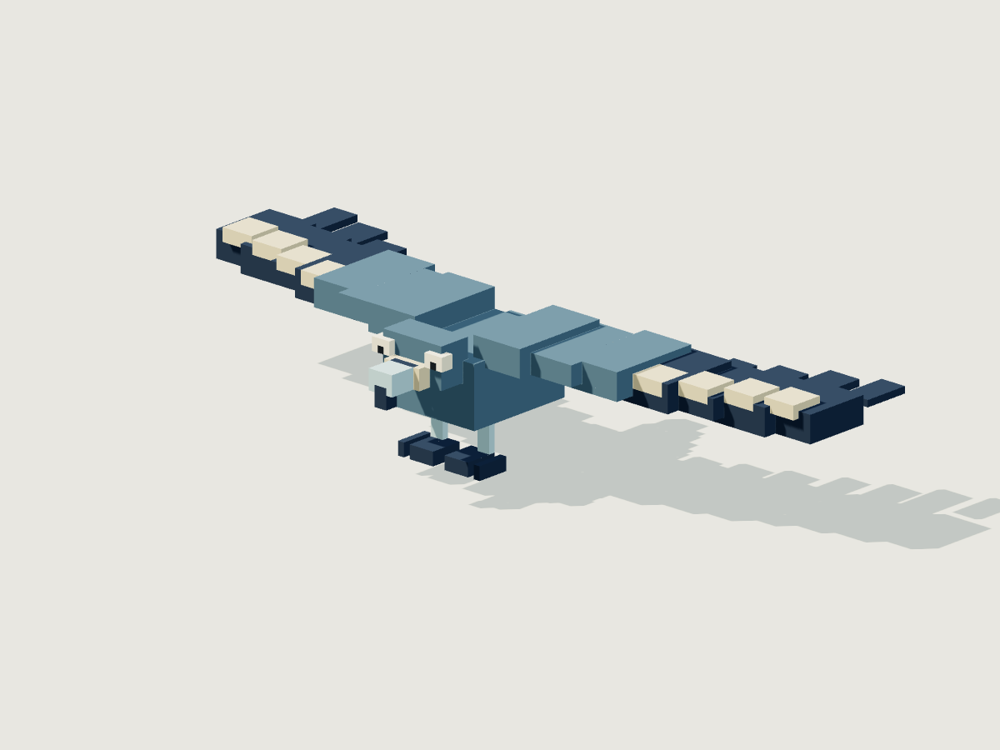

시각 원형 · [복셀 원본](../../design/assets/models/gale_raptor.voxel.json) · [GLB](../../design/assets/exports/gale_raptor.glb)

넓은 날개로 상승기류를 돈다. 그림자와 울음으로 급강하를 알리고 빗나가면 선회 시간이 길다.

- 분류: **organic**, 문명 `false`, 역할 `predator`, 기준 **T5**. 환경: coast; 던전: 없음/공동체 전용.
- 형태·스탯: 1.4×3.2×0.6m, 18kg, 외피 셀 0.125m. **HP 175**, 이동 3.2/6.2, 감지 30, 홈 추적 40, 시야 상실 6s, 후퇴 HP비율 0.25.
- 구조: `winged`; 핵심 61HP, 외피 패치 18HP, 지지부 노드 35HP. 한쪽 날개 기능 상실 시 비행 중지·추락, 지상 이동은 원속도0.25; 날개 표면 50% 소실 시 양력0.5.
- 행동: dusk_night; 배고픔 기준 이하이며 자신보다 약한 먹이, 또는 직접 공격에 대한 방어. 경고 1s. 추격 반경 또는 시야 상실 시간을 넘으면 복귀; 복귀만으로 HP·에너지 리셋 없음.
- 공격 **급강하 발톱**: mechanical 34HP, 사거리 3m, 예고 1.6s / 회복 1.2s / 쿨다운 6s. 예고: 그림자 원과 큰 울음. 판정: 직선 비행 6m, 착점 고정. 비용 6.8CP + 0EU.
- 칼로리: 최대 120, 초기 75%, 생존 0.05CP/s + 달리기 0.1CP/s. 자연회복 대기 12s, 0.97HP/s, 비용 3CP/HP, 휴식 1.5배, 유보 10%. 기아 120s 이후 0.729HP/s.
- 먹이·서식: species:cliff_ibex, species:tide_crab. 절벽 선반·조수대; 비행종은 열린 상공. 사체 식용예산 42CP. 배설물·사체→분해층→생산원; 사체 먹이와 플레이어 채집은 동일 잔량 원장 공유.
- 배치: 야외 `environments:coast:spawning` 참조. 실내 종 한도 0 / 기본 그룹 1~2, 공동체 한도 0. 최소 여유 반경 1.6m, 실체화는 플레이어 32m 밖, 평가주기 60s. 건축물 방 예산 우선.
- 개체 회복: 성숙 1200s, 번식 간격 1200s, 자식 1마리, 부모 칼로리 70%·먹이 40% 이상, 새끼 CP 25%. 먹이 20% 미만 120s 뒤 1셀 이주 검색. 생존 성체2·먹이·빈 슬롯·부모 칼로리 지불이 있을 때 출생; 완전 전멸은 실제 외부 이주만.
- 드롭·대체 제작: `meat` 1~2개 → 자체 `synth_meat`; `hide` 1~2개 → 자체 `synth_hide`; `bone` 1~2개 → 자체 `synth_bone`.

### 조수게 — `tide_crab`

<!-- asset:tide_crab -->
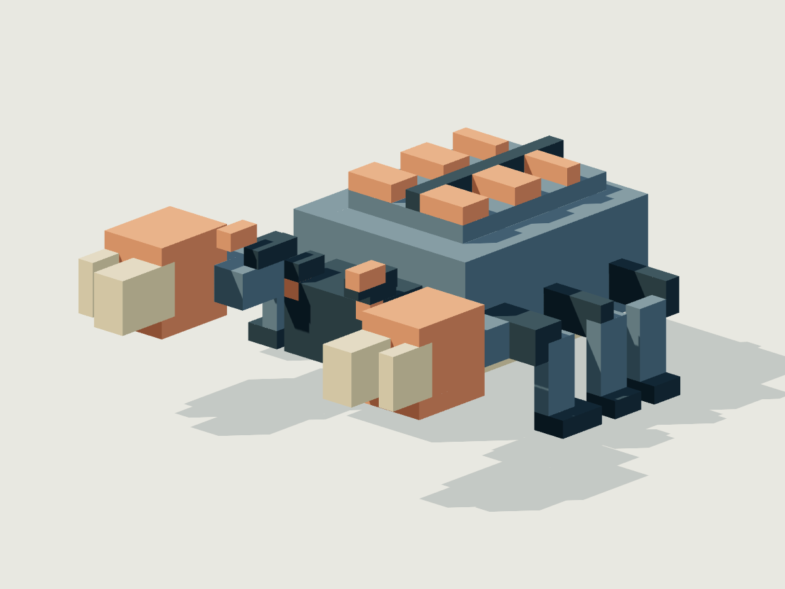

시각 원형 · [복셀 원본](../../design/assets/models/tide_crab.voxel.json) · [GLB](../../design/assets/exports/tide_crab.glb)

해조와 사체를 처리한다. 집게를 벌린 채 옆걸음으로 경고하고 먹이를 두고 도주한다.

- 분류: **organic**, 문명 `false`, 역할 `detritivore`, 기준 **T5**. 환경: coast; 던전: cliff_observatory.
- 형태·스탯: 0.8×0.7×0.35m, 12kg, 외피 셀 0.125m. **HP 85**, 이동 0.6/1.5, 감지 8, 홈 추적 5, 시야 상실 6s, 후퇴 HP비율 0.25.
- 구조: `arthropod`; 핵심 26HP, 외피 패치 30HP, 지지부 노드 7HP. 좌우 지지 각각1개 필요; 턱 부착 파괴 시 섭식·물기 중단; 외피 손상만으로 다리 파괴 판정 금지.
- 행동: all; 퇴로가 막힌 상태에서 공격받음. 경고 1s. 추격 반경 또는 시야 상실 시간을 넘으면 복귀; 복귀만으로 HP·에너지 리셋 없음.
- 공격 **경고 집게**: mechanical 12HP, 사거리 1.2m, 예고 1s / 회복 0.75s / 쿨다운 3.5s. 예고: 집게를 벌리고 옆걸음 중지. 판정: 정면 70도. 비용 2.4CP + 0EU.
- 칼로리: 최대 120, 초기 75%, 생존 0.05CP/s + 달리기 0.1CP/s. 자연회복 대기 10s, 0.47HP/s, 비용 2CP/HP, 휴식 1.5배, 유보 10%. 기아 120s 이후 0.354HP/s.
- 먹이·서식: producer:salt_grass, producer:algae, resource:detritus. 절벽 선반·조수대; 비행종은 열린 상공. 사체 식용예산 42CP. 배설물·사체→분해층→생산원; 사체 먹이와 플레이어 채집은 동일 잔량 원장 공유.
- 배치: 야외 `environments:coast:spawning` 참조. 실내 종 한도 10 / 기본 그룹 1~4, 공동체 한도 0. 최소 여유 반경 0.4m, 실체화는 플레이어 32m 밖, 평가주기 60s. 건축물 방 예산 우선.
- 개체 회복: 성숙 600s, 번식 간격 600s, 자식 1마리, 부모 칼로리 70%·먹이 40% 이상, 새끼 CP 25%. 먹이 20% 미만 120s 뒤 1셀 이주 검색. 생존 성체2·먹이·빈 슬롯·부모 칼로리 지불이 있을 때 출생; 완전 전멸은 실제 외부 이주만.
- 드롭·대체 제작: `chitin` 1~2개 → 자체 `synth_chitin`.

### 저수조큰뱀 — `cistern_serpent`

<!-- asset:cistern_serpent -->
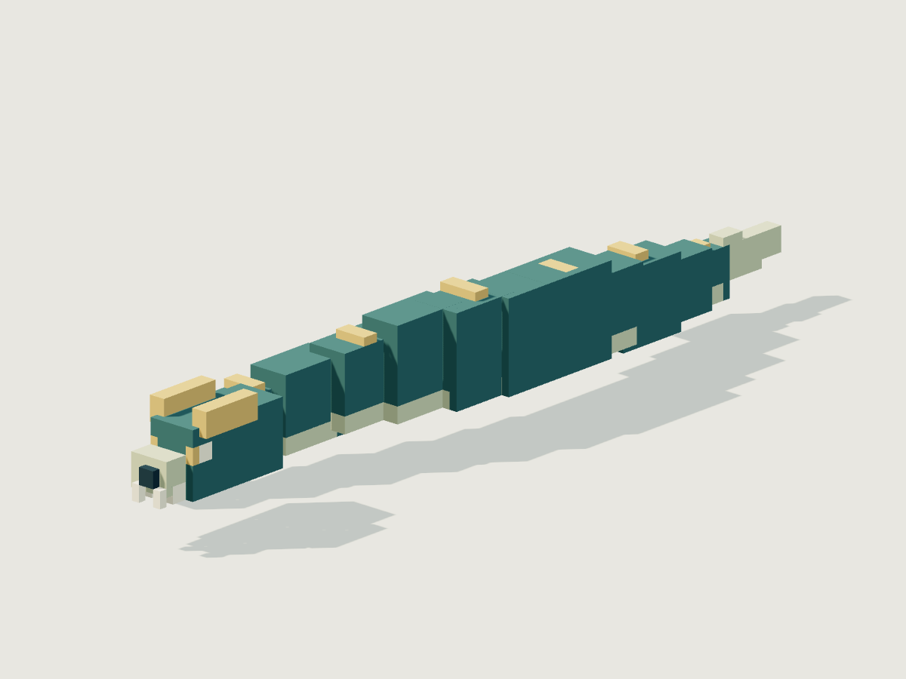

시각 원형 · [복셀 원본](../../design/assets/models/cistern_serpent.voxel.json) · [GLB](../../design/assets/exports/cistern_serpent.glb)

관측성 저수조에서 기다린다. 꼬리가 벽을 두드린 뒤 짧은 직선 돌진을 하고 회복 틈을 둔다.

- 분류: **organic**, 문명 `false`, 역할 `predator`, 기준 **T5**. 환경: coast; 던전: cliff_observatory.
- 형태·스탯: 3.2×0.45×0.45m, 48kg, 외피 셀 0.25m. **HP 225**, 이동 1.1/3.4, 감지 13, 홈 추적 20, 시야 상실 6s, 후퇴 HP비율 0.25.
- 구조: `serpent`; 핵심 79HP, 외피 패치 34HP, 지지부 노드 34HP. 네 구간 연결 중간이 끊기면 머리·심장 연결 판정; 꼬리만 잃으면 후방 밀기 감소, 분리된 꼬리는 사물.
- 행동: dusk_night; 배고픔 기준 이하이며 자신보다 약한 먹이, 또는 직접 공격에 대한 방어. 경고 1s. 추격 반경 또는 시야 상실 시간을 넘으면 복귀; 복귀만으로 HP·에너지 리셋 없음.
- 공격 **저수조 돌진**: mechanical 32HP, 사거리 3.5m, 예고 1.3s / 회복 0.98s / 쿨다운 4s. 예고: 꼬리 벽 두드림 2회. 판정: 직선 3m, 조준 확정 후 회전 금지. 비용 6.4CP + 0EU.
- 칼로리: 최대 240, 초기 75%, 생존 0.1CP/s + 달리기 0.2CP/s. 자연회복 대기 12s, 1.25HP/s, 비용 3CP/HP, 휴식 1.5배, 유보 10%. 기아 120s 이후 0.938HP/s.
- 먹이·서식: species:tide_crab, species:cliff_ibex. 내부 그늘·먹이 방과 연결된 매복처. 사체 식용예산 84CP. 배설물·사체→분해층→생산원; 사체 먹이와 플레이어 채집은 동일 잔량 원장 공유.
- 배치: 야외 `없음` 참조. 실내 종 한도 5 / 기본 그룹 1~2, 공동체 한도 0. 최소 여유 반경 1.6m, 실체화는 플레이어 32m 밖, 평가주기 60s. 건축물 방 예산 우선.
- 개체 회복: 성숙 1200s, 번식 간격 1200s, 자식 1마리, 부모 칼로리 70%·먹이 40% 이상, 새끼 CP 25%. 먹이 20% 미만 120s 뒤 1셀 이주 검색. 생존 성체2·먹이·빈 슬롯·부모 칼로리 지불이 있을 때 출생; 완전 전멸은 실제 외부 이주만.
- 드롭·대체 제작: `meat` 1~2개 → 자체 `synth_meat`; `hide` 1~2개 → 자체 `synth_hide`; `bone` 1~2개 → 자체 `synth_bone`.

### 유리잎사슴 — `prism_deer`

<!-- asset:prism_deer -->
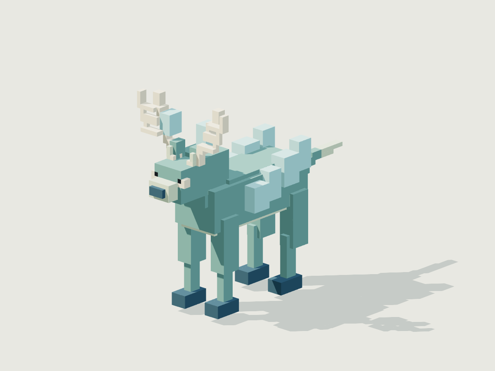

시각 원형 · [복셀 원본](../../design/assets/models/prism_deer.voxel.json) · [GLB](../../design/assets/exports/prism_deer.glb)

반투명 뿔과 잎 형태의 털. 마나 식생을 먹고 빛의 흔들림을 남기며 무리와 도망친다.

- 분류: **organic**, 문명 `false`, 역할 `primary_consumer`, 기준 **T6**. 환경: mana_grove; 던전: sealed_arboretum.
- 형태·스탯: 1.9×0.8×1.6m, 100kg, 외피 셀 0.25m. **HP 255**, 이동 1.4/4.5, 감지 24, 홈 추적 24, 시야 상실 6s, 후퇴 HP비율 0.25.
- 구조: `quadruped`; 핵심 89HP, 외피 패치 51HP, 지지부 노드 31HP. 3다리 절뚝임, 2다리 대각지지이면0.22/그외0.12; 머리 연결 또는 척추 파괴 시 사망; 꼬리 손상은 회전속도0.8.
- 행동: day; 퇴로가 막힌 상태에서 공격받음. 경고 1s. 추격 반경 또는 시야 상실 시간을 넘으면 복귀; 복귀만으로 HP·에너지 리셋 없음.
- 공격 **수정뿔 밀기**: mechanical 28HP, 사거리 2m, 예고 1s / 회복 0.75s / 쿨다운 3.4s. 예고: 뿔에 흰 선이 모임. 판정: 정면 55도. 비용 5.6CP + 0EU.
- 칼로리: 최대 500, 초기 75%, 생존 0.208CP/s + 달리기 0.417CP/s. 자연회복 대기 10s, 1.42HP/s, 비용 3CP/HP, 휴식 1.5배, 유보 10%. 기아 120s 이후 1.062HP/s.
- 먹이·서식: producer:mana_fern, producer:mana_log. 생산원과 은신처가 연결된 지표; 중첩 환경에서는 기저 환경의 이동 조건도 만족. 사체 식용예산 175CP. 배설물·사체→분해층→생산원; 사체 먹이와 플레이어 채집은 동일 잔량 원장 공유.
- 배치: 야외 `environments:mana_grove:spawning` 참조. 실내 종 한도 4 / 기본 그룹 1~3, 공동체 한도 0. 최소 여유 반경 0.95m, 실체화는 플레이어 32m 밖, 평가주기 60s. 건축물 방 예산 우선.
- 개체 회복: 성숙 1200s, 번식 간격 1200s, 자식 1마리, 부모 칼로리 70%·먹이 40% 이상, 새끼 CP 25%. 먹이 20% 미만 120s 뒤 1셀 이주 검색. 생존 성체2·먹이·빈 슬롯·부모 칼로리 지불이 있을 때 출생; 완전 전멸은 실제 외부 이주만.
- 드롭·대체 제작: `meat` 2~4개 → 자체 `synth_meat`; `hide` 1~2개 → 자체 `synth_hide`; `bone` 1~2개 → 자체 `synth_bone`; `mana_sap` 1~2개 → 자체 `synth_mana_sap`.

### 장막표범 — `veil_cat`

<!-- asset:veil_cat -->
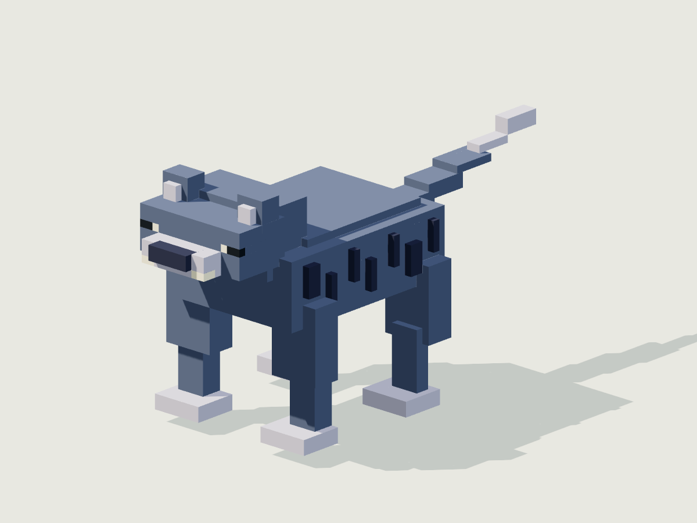

시각 원형 · [복셀 원본](../../design/assets/models/veil_cat.voxel.json) · [GLB](../../design/assets/exports/veil_cat.glb)

굴절된 외피로 접근하지만 발자국·그림자는 남는다. 완전 투명이나 무경고 순간이동은 사용하지 않는다.

- 분류: **organic**, 문명 `false`, 역할 `predator`, 기준 **T6**. 환경: mana_grove; 던전: 없음/공동체 전용.
- 형태·스탯: 2×0.75×1m, 90kg, 외피 셀 0.25m. **HP 305**, 이동 1.9/4.7, 감지 22, 홈 추적 32, 시야 상실 6s, 후퇴 HP비율 0.25.
- 구조: `quadruped`; 핵심 107HP, 외피 패치 61HP, 지지부 노드 37HP. 3다리 절뚝임, 2다리 대각지지이면0.22/그외0.12; 머리 연결 또는 척추 파괴 시 사망; 꼬리 손상은 회전속도0.8.
- 행동: dusk_night; 배고픔 기준 이하이며 자신보다 약한 먹이, 또는 직접 공격에 대한 방어. 경고 1s. 추격 반경 또는 시야 상실 시간을 넘으면 복귀; 복귀만으로 HP·에너지 리셋 없음.
- 공격 **장막 도약**: magic 42HP, 사거리 3m, 예고 1.2s / 회복 0.9s / 쿨다운 4s. 예고: 윤곽이 드러나고 뒷발 고정. 판정: 물성 부여 도약, 벽 통과 불가. 비용 8.4CP + 84EU.
- 칼로리: 최대 450, 초기 75%, 생존 0.188CP/s + 달리기 0.375CP/s. 자연회복 대기 12s, 1.69HP/s, 비용 4CP/HP, 휴식 1.5배, 유보 10%. 기아 120s 이후 1.271HP/s.
- 공격 저장량: magic 504EU, 초기 75%, 충전 `food_metabolism`, 1CP/EU.
- 먹이·서식: species:prism_deer, species:mana_moth. 생산원과 은신처가 연결된 지표; 중첩 환경에서는 기저 환경의 이동 조건도 만족. 사체 식용예산 158CP. 배설물·사체→분해층→생산원; 사체 먹이와 플레이어 채집은 동일 잔량 원장 공유.
- 배치: 야외 `environments:mana_grove:spawning` 참조. 실내 종 한도 0 / 기본 그룹 1~2, 공동체 한도 0. 최소 여유 반경 1.0m, 실체화는 플레이어 32m 밖, 평가주기 60s. 건축물 방 예산 우선.
- 개체 회복: 성숙 1200s, 번식 간격 1200s, 자식 1마리, 부모 칼로리 70%·먹이 40% 이상, 새끼 CP 25%. 먹이 20% 미만 120s 뒤 1셀 이주 검색. 생존 성체2·먹이·빈 슬롯·부모 칼로리 지불이 있을 때 출생; 완전 전멸은 실제 외부 이주만.
- 드롭·대체 제작: `meat` 2~4개 → 자체 `synth_meat`; `hide` 1~2개 → 자체 `synth_hide`; `bone` 1~2개 → 자체 `synth_bone`; `mana_sap` 1~2개 → 자체 `synth_mana_sap`.

### 마나나방 — `mana_moth`

<!-- asset:mana_moth -->
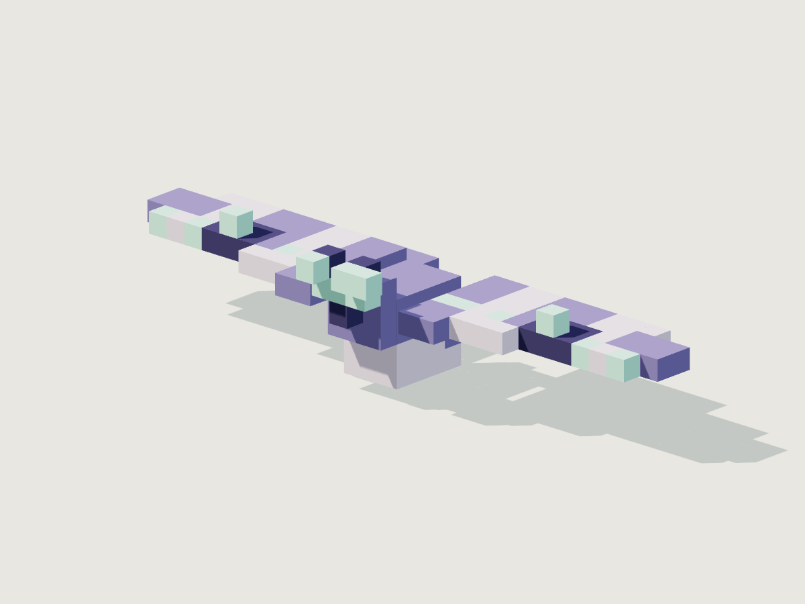

시각 원형 · [복셀 원본](../../design/assets/models/mana_moth.voxel.json) · [GLB](../../design/assets/exports/mana_moth.glb)

발광 꽃가루를 옮기며 잎의 수액을 먹는다. 공격하지 않고 빛이 약한 잎 아래로 숨는다.

- 분류: **organic**, 문명 `false`, 역할 `pollinator`, 기준 **T6**. 환경: mana_grove; 던전: sealed_arboretum.
- 형태·스탯: 0.3×0.9×0.2m, 0.4kg, 외피 셀 0.125m. **HP 45**, 이동 0.8/2.6, 감지 8, 홈 추적 5, 시야 상실 6s, 후퇴 HP비율 0.25.
- 구조: `winged`; 핵심 16HP, 외피 패치 4HP, 지지부 노드 9HP. 한쪽 날개 기능 상실 시 비행 중지·추락, 지상 이동은 원속도0.25; 날개 표면 50% 소실 시 양력0.5.
- 행동: all; 퇴로가 막힌 상태에서 공격받음. 경고 1s. 추격 반경 또는 시야 상실 시간을 넘으면 복귀; 복귀만으로 HP·에너지 리셋 없음.
- 공격 없음. 피격 시 도주·숨기만 수행한다.
- 칼로리: 최대 120, 초기 75%, 생존 0.05CP/s + 달리기 0.1CP/s. 자연회복 대기 10s, 0.25HP/s, 비용 3CP/HP, 휴식 1.5배, 유보 10%. 기아 120s 이후 0.188HP/s.
- 먹이·서식: producer:mana_fern. 생산원과 은신처가 연결된 지표; 중첩 환경에서는 기저 환경의 이동 조건도 만족. 사체 식용예산 42CP. 배설물·사체→분해층→생산원; 사체 먹이와 플레이어 채집은 동일 잔량 원장 공유.
- 배치: 야외 `environments:mana_grove:spawning` 참조. 실내 종 한도 10 / 기본 그룹 1~4, 공동체 한도 0. 최소 여유 반경 0.45m, 실체화는 플레이어 32m 밖, 평가주기 60s. 건축물 방 예산 우선.
- 개체 회복: 성숙 600s, 번식 간격 600s, 자식 1마리, 부모 칼로리 70%·먹이 40% 이상, 새끼 CP 25%. 먹이 20% 미만 120s 뒤 1셀 이주 검색. 생존 성체2·먹이·빈 슬롯·부모 칼로리 지불이 있을 때 출생; 완전 전멸은 실제 외부 이주만.
- 드롭·대체 제작: `mana_sap` 1~1개 → 자체 `synth_mana_sap`.

### 뿌리직조거미 — `root_weaver`

<!-- asset:root_weaver -->
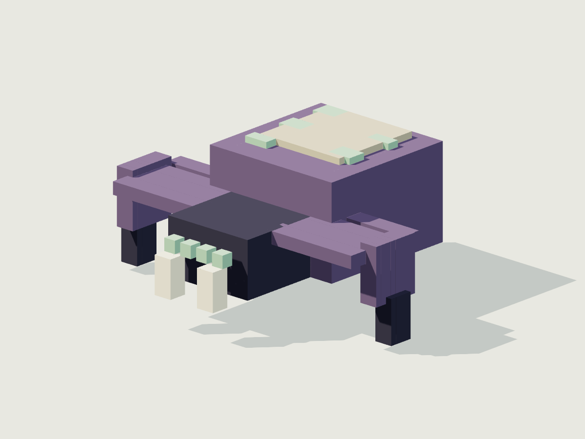

시각 원형 · [복셀 원본](../../design/assets/models/root_weaver.voxel.json) · [GLB](../../design/assets/exports/root_weaver.glb)

수목원 뿌리 사이에 보이는 실을 건다. 바닥을 미리 표시하고 얽매는 물성의 실을 발사한다.

- 분류: **organic**, 문명 `false`, 역할 `predator`, 기준 **T6**. 환경: mana_grove; 던전: sealed_arboretum.
- 형태·스탯: 1.4×1.6×0.65m, 35kg, 외피 셀 0.25m. **HP 285**, 이동 1.2/3.5, 감지 16, 홈 추적 24, 시야 상실 6s, 후퇴 HP비율 0.25.
- 구조: `arachnid`; 핵심 86HP, 외피 패치 100HP, 지지부 노드 23HP. 좌우 지지 각각1개 필요; 턱 부착 파괴 시 섭식·물기 중단; 외피 손상만으로 다리 파괴 판정 금지.
- 행동: dusk_night; 배고픔 기준 이하이며 자신보다 약한 먹이, 또는 직접 공격에 대한 방어. 경고 1s. 추격 반경 또는 시야 상실 시간을 넘으면 복귀; 복귀만으로 HP·에너지 리셋 없음.
- 공격 **속박실**: magic 34HP, 사거리 6m, 예고 1.6s / 회복 1.2s / 쿨다운 5s. 예고: 바닥에 가는 발광선 표시. 판정: 투사체 한 발, 명중 시2s 속도0.7. 비용 6.8CP + 68EU.
- 칼로리: 최대 175, 초기 75%, 생존 0.073CP/s + 달리기 0.146CP/s. 자연회복 대기 12s, 1.58HP/s, 비용 4CP/HP, 휴식 1.5배, 유보 10%. 기아 120s 이후 1.188HP/s.
- 공격 저장량: magic 408EU, 초기 75%, 충전 `food_metabolism`, 1CP/EU.
- 먹이·서식: species:mana_moth, species:prism_deer. 내부 그늘·먹이 방과 연결된 매복처. 사체 식용예산 61CP. 배설물·사체→분해층→생산원; 사체 먹이와 플레이어 채집은 동일 잔량 원장 공유.
- 배치: 야외 `없음` 참조. 실내 종 한도 5 / 기본 그룹 1~2, 공동체 한도 0. 최소 여유 반경 0.8m, 실체화는 플레이어 32m 밖, 평가주기 60s. 건축물 방 예산 우선.
- 개체 회복: 성숙 1200s, 번식 간격 1200s, 자식 1마리, 부모 칼로리 70%·먹이 40% 이상, 새끼 CP 25%. 먹이 20% 미만 120s 뒤 1셀 이주 검색. 생존 성체2·먹이·빈 슬롯·부모 칼로리 지불이 있을 때 출생; 완전 전멸은 실제 외부 이주만.
- 드롭·대체 제작: `meat` 1~2개 → 자체 `synth_meat`; `chitin` 1~2개 → 자체 `synth_chitin`; `bone` 1~2개 → 자체 `synth_bone`; `mana_sap` 1~2개 → 자체 `synth_mana_sap`.

### 촛빛토끼 — `candle_hare`

<!-- asset:candle_hare -->
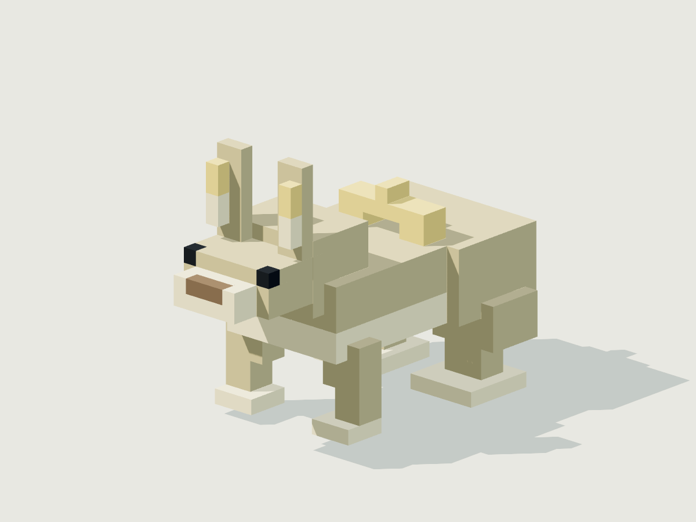

시각 원형 · [복셀 원본](../../design/assets/models/candle_hare.voxel.json) · [GLB](../../design/assets/exports/candle_hare.glb)

성역의 발광 이끼를 먹는다. 신성 획득용 사냥 대상이 아니며 등불 주변으로 무리지어 피한다.

- 분류: **organic**, 문명 `false`, 역할 `primary_consumer`, 기준 **T7**. 환경: sacred; 던전: forgotten_monastery.
- 형태·스탯: 0.8×0.4×0.55m, 7kg, 외피 셀 0.125m. **HP 235**, 이동 1.5/4.6, 감지 22, 홈 추적 20, 시야 상실 6s, 후퇴 HP비율 0.25.
- 구조: `quadruped`; 핵심 82HP, 외피 패치 47HP, 지지부 노드 28HP. 3다리 절뚝임, 2다리 대각지지이면0.22/그외0.12; 머리 연결 또는 척추 파괴 시 사망; 꼬리 손상은 회전속도0.8.
- 행동: day; 퇴로가 막힌 상태에서 공격받음. 경고 1s. 추격 반경 또는 시야 상실 시간을 넘으면 복귀; 복귀만으로 HP·에너지 리셋 없음.
- 공격 **필사적 발차기**: mechanical 30HP, 사거리 1m, 예고 0.9s / 회복 0.68s / 쿨다운 3.5s. 예고: 촛빛 털이 모이고 뒷발 준비. 판정: 후방 접촉. 비용 6.0CP + 0EU.
- 칼로리: 최대 120, 초기 75%, 생존 0.05CP/s + 달리기 0.1CP/s. 자연회복 대기 10s, 1.31HP/s, 비용 3CP/HP, 휴식 1.5배, 유보 10%. 기아 120s 이후 0.979HP/s.
- 먹이·서식: producer:luminous_moss. 생산원과 은신처가 연결된 지표; 중첩 환경에서는 기저 환경의 이동 조건도 만족. 사체 식용예산 42CP. 배설물·사체→분해층→생산원; 사체 먹이와 플레이어 채집은 동일 잔량 원장 공유.
- 배치: 야외 `environments:sacred:spawning` 참조. 실내 종 한도 4 / 기본 그룹 1~2, 공동체 한도 0. 최소 여유 반경 0.4m, 실체화는 플레이어 32m 밖, 평가주기 60s. 건축물 방 예산 우선.
- 개체 회복: 성숙 1200s, 번식 간격 1200s, 자식 1마리, 부모 칼로리 70%·먹이 40% 이상, 새끼 CP 25%. 먹이 20% 미만 120s 뒤 1셀 이주 검색. 생존 성체2·먹이·빈 슬롯·부모 칼로리 지불이 있을 때 출생; 완전 전멸은 실제 외부 이주만.
- 드롭·대체 제작: `meat` 1~2개 → 자체 `synth_meat`; `hide` 1~2개 → 자체 `synth_hide`; `bone` 1~2개 → 자체 `synth_bone`.

### 성흔들개 — `relic_hound`

<!-- asset:relic_hound -->
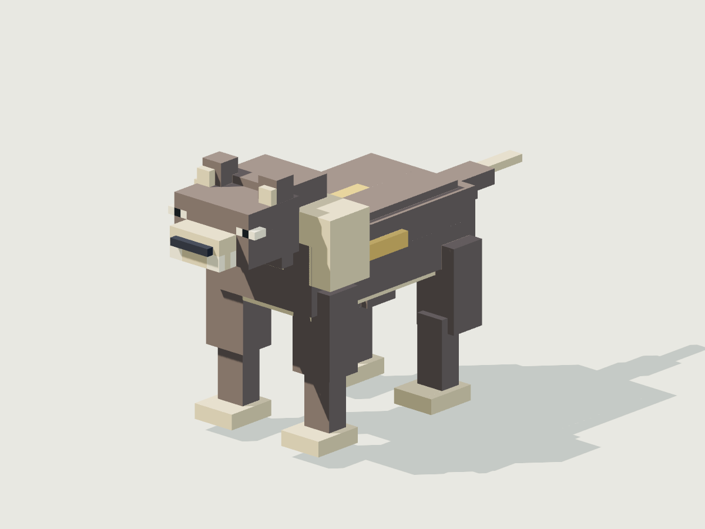

시각 원형 · [복셀 원본](../../design/assets/models/relic_hound.voxel.json) · [GLB](../../design/assets/exports/relic_hound.glb)

성역 야생종으로 신앙 공동체와 별개다. 먹이 또는 새끼를 지키며 경계 울음을 먼저 낸다.

- 분류: **organic**, 문명 `false`, 역할 `predator`, 기준 **T7**. 환경: sacred; 던전: 없음/공동체 전용.
- 형태·스탯: 1.8×0.7×1.1m, 65kg, 외피 셀 0.25m. **HP 370**, 이동 1.8/4.5, 감지 24, 홈 추적 30, 시야 상실 6s, 후퇴 HP비율 0.25.
- 구조: `quadruped`; 핵심 130HP, 외피 패치 74HP, 지지부 노드 44HP. 3다리 절뚝임, 2다리 대각지지이면0.22/그외0.12; 머리 연결 또는 척추 파괴 시 사망; 꼬리 손상은 회전속도0.8.
- 행동: dusk_night; 배고픔 기준 이하이며 자신보다 약한 먹이, 또는 직접 공격에 대한 방어. 경고 1s. 추격 반경 또는 시야 상실 시간을 넘으면 복귀; 복귀만으로 HP·에너지 리셋 없음.
- 공격 **경계 돌진**: mechanical 50HP, 사거리 3m, 예고 1.2s / 회복 0.9s / 쿨다운 4.2s. 예고: 성흔 밝아짐과 경계 울음. 판정: 직선 2.5m. 비용 10.0CP + 0EU.
- 칼로리: 최대 325, 초기 75%, 생존 0.135CP/s + 달리기 0.271CP/s. 자연회복 대기 12s, 2.06HP/s, 비용 4CP/HP, 휴식 1.5배, 유보 10%. 기아 120s 이후 1.542HP/s.
- 먹이·서식: species:candle_hare, species:shrine_beetle. 생산원과 은신처가 연결된 지표; 중첩 환경에서는 기저 환경의 이동 조건도 만족. 사체 식용예산 114CP. 배설물·사체→분해층→생산원; 사체 먹이와 플레이어 채집은 동일 잔량 원장 공유.
- 배치: 야외 `environments:sacred:spawning` 참조. 실내 종 한도 0 / 기본 그룹 1~2, 공동체 한도 0. 최소 여유 반경 0.9m, 실체화는 플레이어 32m 밖, 평가주기 60s. 건축물 방 예산 우선.
- 개체 회복: 성숙 1200s, 번식 간격 1200s, 자식 1마리, 부모 칼로리 70%·먹이 40% 이상, 새끼 CP 25%. 먹이 20% 미만 120s 뒤 1셀 이주 검색. 생존 성체2·먹이·빈 슬롯·부모 칼로리 지불이 있을 때 출생; 완전 전멸은 실제 외부 이주만.
- 드롭·대체 제작: `meat` 2~4개 → 자체 `synth_meat`; `hide` 1~2개 → 자체 `synth_hide`; `bone` 1~2개 → 자체 `synth_bone`.

### 제단딱정 — `shrine_beetle`

<!-- asset:shrine_beetle -->
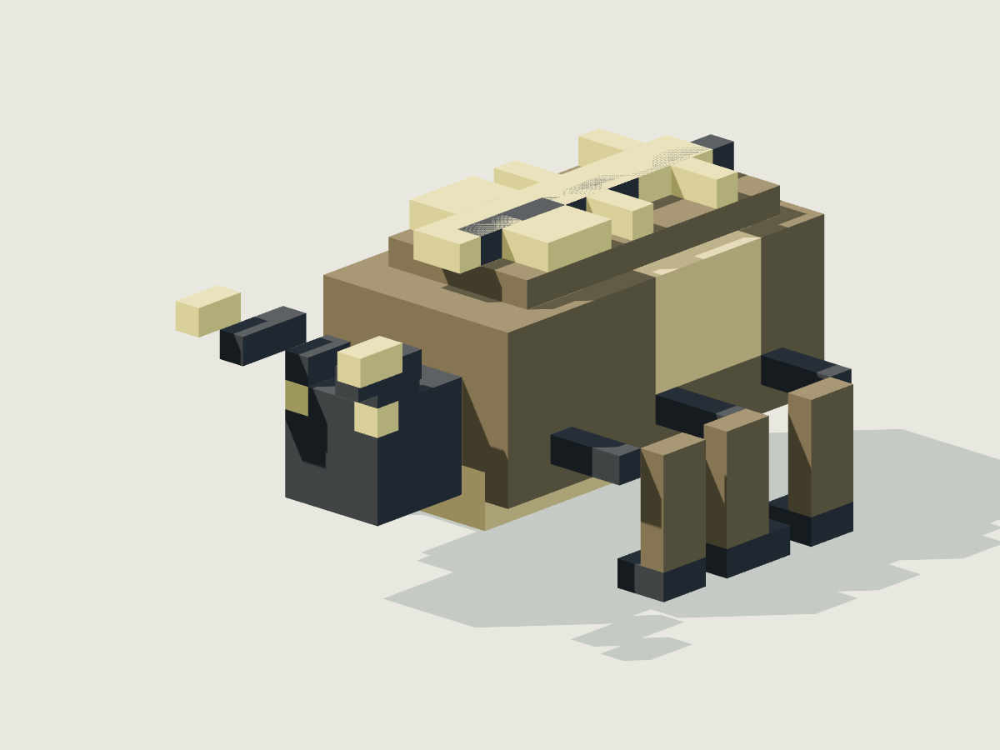

시각 원형 · [복셀 원본](../../design/assets/models/shrine_beetle.voxel.json) · [GLB](../../design/assets/exports/shrine_beetle.glb)

제단 주변 낙엽과 균류를 분해한다. 신성에너지를 생성하거나 보상으로 떨구지 않는다.

- 분류: **organic**, 문명 `false`, 역할 `detritivore`, 기준 **T7**. 환경: sacred; 던전: forgotten_monastery.
- 형태·스탯: 0.7×0.5×0.35m, 7kg, 외피 셀 0.125m. **HP 125**, 이동 0.6/1.5, 감지 8, 홈 추적 4, 시야 상실 6s, 후퇴 HP비율 0.25.
- 구조: `arthropod`; 핵심 38HP, 외피 패치 44HP, 지지부 노드 10HP. 좌우 지지 각각1개 필요; 턱 부착 파괴 시 섭식·물기 중단; 외피 손상만으로 다리 파괴 판정 금지.
- 행동: all; 퇴로가 막힌 상태에서 공격받음. 경고 1s. 추격 반경 또는 시야 상실 시간을 넘으면 복귀; 복귀만으로 HP·에너지 리셋 없음.
- 공격 **방어 집게**: mechanical 16HP, 사거리 0.9m, 예고 1.1s / 회복 0.83s / 쿨다운 3.8s. 예고: 등딱지를 들고 멈춤. 판정: 정면 45도. 비용 3.2CP + 0EU.
- 칼로리: 최대 120, 초기 75%, 생존 0.05CP/s + 달리기 0.1CP/s. 자연회복 대기 10s, 0.69HP/s, 비용 3CP/HP, 휴식 1.5배, 유보 10%. 기아 120s 이후 0.521HP/s.
- 먹이·서식: producer:luminous_moss, resource:detritus. 생산원과 은신처가 연결된 지표; 중첩 환경에서는 기저 환경의 이동 조건도 만족. 사체 식용예산 42CP. 배설물·사체→분해층→생산원; 사체 먹이와 플레이어 채집은 동일 잔량 원장 공유.
- 배치: 야외 `environments:sacred:spawning` 참조. 실내 종 한도 10 / 기본 그룹 1~2, 공동체 한도 0. 최소 여유 반경 0.35m, 실체화는 플레이어 32m 밖, 평가주기 60s. 건축물 방 예산 우선.
- 개체 회복: 성숙 600s, 번식 간격 600s, 자식 1마리, 부모 칼로리 70%·먹이 40% 이상, 새끼 CP 25%. 먹이 20% 미만 120s 뒤 1셀 이주 검색. 생존 성체2·먹이·빈 슬롯·부모 칼로리 지불이 있을 때 출생; 완전 전멸은 실제 외부 이주만.
- 드롭·대체 제작: `chitin` 1~2개 → 자체 `synth_chitin`.

### 서약경비체 — `oath_sentinel`

<!-- asset:oath_sentinel -->
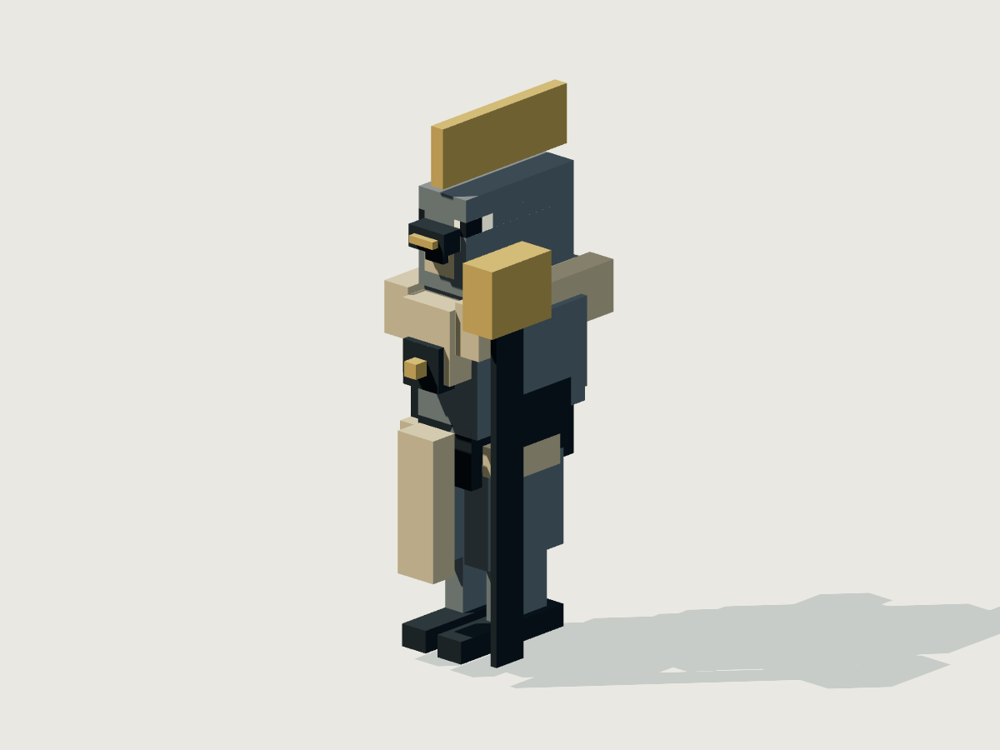

시각 원형 · [복셀 원본](../../design/assets/models/oath_sentinel.voxel.json) · [GLB](../../design/assets/exports/oath_sentinel.glb)

원래 월드에 존재하는 무기생명. 경계선을 표시하고 침범·공격에 반응하며 정비실 없이는 회복하지 않는다.

- 분류: **inorganic**, 문명 `false`, 역할 `guardian`, 기준 **T7**. 환경: sacred; 던전: forgotten_monastery.
- 형태·스탯: 0.9×0.7×2.2m, 320kg, 외피 셀 0.25m. **HP 520**, 이동 1.4/3.2, 감지 20, 홈 추적 24, 시야 상실 6s, 후퇴 HP비율 0.15.
- 구조: `biped`; 핵심 182HP, 외피 패치 130HP, 지지부 노드 78HP. 한쪽 다리 손실 시 기어 이동, 무장 팔 연결 파괴 시 해당 공격 중단; 외장과 뼈·프레임은 독립.
- 행동: all; 표시된 경계 침입 후 경고가 끝나거나 직접 공격. 경고 2s. 추격 반경 또는 시야 상실 시간을 넘으면 복귀; 복귀만으로 HP·에너지 리셋 없음.
- 공격 **경계봉 내려치기**: mechanical 62HP, 사거리 2.8m, 예고 1.5s / 회복 1.12s / 쿨다운 4s. 예고: 바닥 경계선 점멸과 봉 들어올림. 판정: 정면 70도, 시야 차단 가능. 비용 0CP + 124EU.
- 칼로리 없음, 자연회복 없음. 정비소에서 scrap_iron 1개와 8s로 40HP 수리; 파괴된 핵심 부활 불가.
- 공격 저장량: mechanical 744EU, 초기 75%, 충전 `community_grid_or_maintenance_station`; 충전은 수리가 아니다.
- 먹이·서식: 정비 공급; 유기 먹이 없음. 내부 그늘·먹이 방과 연결된 매복처. 사체 식용예산 0CP. 먹이망에 포함하지 않음; 정비 공급은 별도 공동체 원장.
- 배치: 야외 `없음` 참조. 실내 종 한도 5 / 기본 그룹 1~2, 공동체 한도 0. 최소 여유 반경 0.45m, 실체화는 플레이어 32m 밖, 평가주기 60s. 건축물 방 예산 우선.
- 개체 회복: 핵심이 살아있는 기존 개체를 정비; 사망 개체 재생성 없음. 자연 번식·음식 회복 없음.
- 드롭·대체 제작: `scrap_iron` 3~5개 → 자체 `make_scrap_iron`.

### 부유각초식수 — `drift_grazer`

<!-- asset:drift_grazer -->
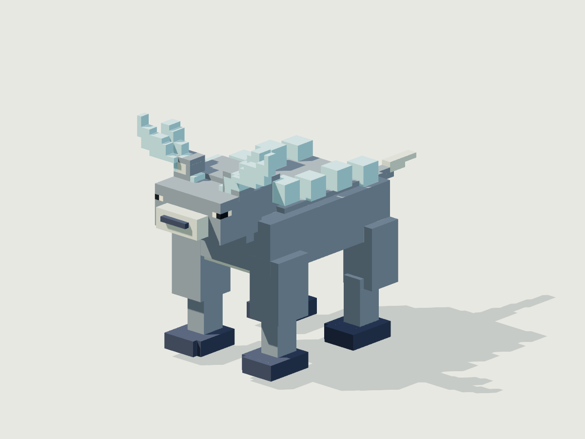

시각 원형 · [복셀 원본](../../design/assets/models/drift_grazer.voxel.json) · [GLB](../../design/assets/exports/drift_grazer.glb)

짧게 떠오르는 발판에서 광물지의를 먹는다. 부유는 월드 생물의 기존 능력이며 외형만으로 제작에 복제되지 않는다.

- 분류: **organic**, 문명 `false`, 역할 `primary_consumer`, 기준 **T8**. 환경: anomaly; 던전: inertia_tower.
- 형태·스탯: 2×1×1.4m, 125kg, 외피 셀 0.25m. **HP 360**, 이동 1.3/4.2, 감지 22, 홈 추적 24, 시야 상실 6s, 후퇴 HP비율 0.25.
- 구조: `quadruped`; 핵심 126HP, 외피 패치 72HP, 지지부 노드 43HP. 3다리 절뚝임, 2다리 대각지지이면0.22/그외0.12; 머리 연결 또는 척추 파괴 시 사망; 꼬리 손상은 회전속도0.8.
- 행동: day; 퇴로가 막힌 상태에서 공격받음. 경고 1s. 추격 반경 또는 시야 상실 시간을 넘으면 복귀; 복귀만으로 HP·에너지 리셋 없음.
- 공격 **관성 뿔받기**: mechanical 39HP, 사거리 2.3m, 예고 1.2s / 회복 0.9s / 쿨다운 4s. 예고: 앞발이 바닥에 고정되고 뿔을 낮춤. 판정: 정면 60도. 비용 7.8CP + 0EU.
- 칼로리: 최대 625, 초기 75%, 생존 0.26CP/s + 달리기 0.521CP/s. 자연회복 대기 10s, 2.0HP/s, 비용 3CP/HP, 휴식 1.5배, 유보 10%. 기아 120s 이후 1.5HP/s.
- 먹이·서식: producer:mineral_lichen. 생산원과 은신처가 연결된 지표; 중첩 환경에서는 기저 환경의 이동 조건도 만족. 사체 식용예산 219CP. 배설물·사체→분해층→생산원; 사체 먹이와 플레이어 채집은 동일 잔량 원장 공유.
- 배치: 야외 `environments:anomaly:spawning` 참조. 실내 종 한도 4 / 기본 그룹 1~2, 공동체 한도 0. 최소 여유 반경 1.0m, 실체화는 플레이어 32m 밖, 평가주기 60s. 건축물 방 예산 우선.
- 개체 회복: 성숙 1200s, 번식 간격 1200s, 자식 1마리, 부모 칼로리 70%·먹이 40% 이상, 새끼 CP 25%. 먹이 20% 미만 120s 뒤 1셀 이주 검색. 생존 성체2·먹이·빈 슬롯·부모 칼로리 지불이 있을 때 출생; 완전 전멸은 실제 외부 이주만.
- 드롭·대체 제작: `meat` 2~4개 → 자체 `synth_meat`; `hide` 1~2개 → 자체 `synth_hide`; `bone` 1~2개 → 자체 `synth_bone`.

### 위상추적수 — `phase_stalker`

<!-- asset:phase_stalker -->
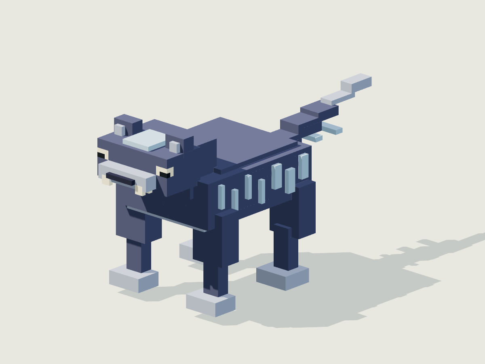

시각 원형 · [복셀 원본](../../design/assets/models/phase_stalker.voxel.json) · [GLB](../../design/assets/exports/phase_stalker.glb)

몸의 줄무늬가 정렬된 뒤 직선으로 가속한다. 벽 통과 없이 열린 경로만 이용한다.

- 분류: **organic**, 문명 `false`, 역할 `predator`, 기준 **T8**. 환경: anomaly; 던전: 없음/공동체 전용.
- 형태·스탯: 2.3×0.9×1.2m, 150kg, 외피 셀 0.25m. **HP 470**, 이동 2/4.8, 감지 26, 홈 추적 36, 시야 상실 6s, 후퇴 HP비율 0.25.
- 구조: `quadruped`; 핵심 164HP, 외피 패치 94HP, 지지부 노드 56HP. 3다리 절뚝임, 2다리 대각지지이면0.22/그외0.12; 머리 연결 또는 척추 파괴 시 사망; 꼬리 손상은 회전속도0.8.
- 행동: dusk_night; 배고픔 기준 이하이며 자신보다 약한 먹이, 또는 직접 공격에 대한 방어. 경고 1s. 추격 반경 또는 시야 상실 시간을 넘으면 복귀; 복귀만으로 HP·에너지 리셋 없음.
- 공격 **가속 돌진**: mechanical 67HP, 사거리 4m, 예고 1.5s / 회복 1.12s / 쿨다운 4.6s. 예고: 줄무늬 정렬과 낮은 울음. 판정: 직선 4m, 장애물에 정지. 비용 13.4CP + 0EU.
- 칼로리: 최대 750, 초기 75%, 생존 0.312CP/s + 달리기 0.625CP/s. 자연회복 대기 12s, 2.61HP/s, 비용 4CP/HP, 휴식 1.5배, 유보 10%. 기아 120s 이후 1.958HP/s.
- 먹이·서식: species:drift_grazer, species:anchor_tick. 생산원과 은신처가 연결된 지표; 중첩 환경에서는 기저 환경의 이동 조건도 만족. 사체 식용예산 262CP. 배설물·사체→분해층→생산원; 사체 먹이와 플레이어 채집은 동일 잔량 원장 공유.
- 배치: 야외 `environments:anomaly:spawning` 참조. 실내 종 한도 0 / 기본 그룹 1~2, 공동체 한도 0. 최소 여유 반경 1.15m, 실체화는 플레이어 32m 밖, 평가주기 60s. 건축물 방 예산 우선.
- 개체 회복: 성숙 1200s, 번식 간격 1200s, 자식 1마리, 부모 칼로리 70%·먹이 40% 이상, 새끼 CP 25%. 먹이 20% 미만 120s 뒤 1셀 이주 검색. 생존 성체2·먹이·빈 슬롯·부모 칼로리 지불이 있을 때 출생; 완전 전멸은 실제 외부 이주만.
- 드롭·대체 제작: `meat` 2~4개 → 자체 `synth_meat`; `hide` 1~2개 → 자체 `synth_hide`; `bone` 1~2개 → 자체 `synth_bone`.

### 닻다리진드기 — `anchor_tick`

<!-- asset:anchor_tick -->
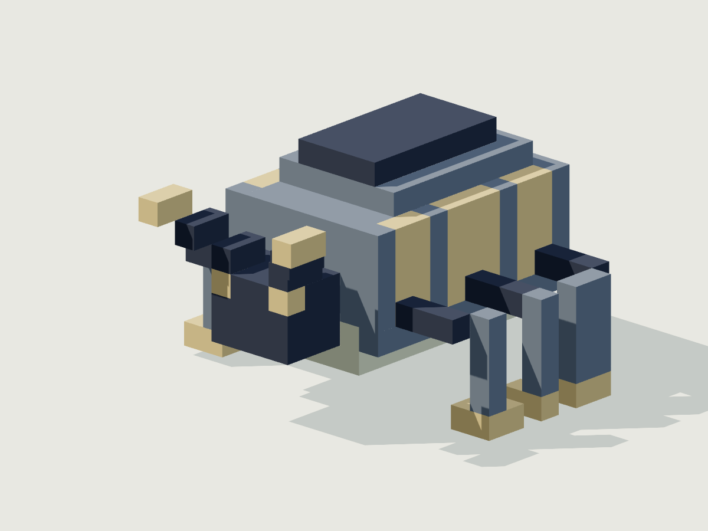

시각 원형 · [복셀 원본](../../design/assets/models/anchor_tick.voxel.json) · [GLB](../../design/assets/exports/anchor_tick.glb)

지의와 사체의 얇은 막을 먹고 변화하는 중력에 다리로 버틴다. 문명종의 수리 소재를 생성하지 않는다.

- 분류: **organic**, 문명 `false`, 역할 `detritivore`, 기준 **T8**. 환경: anomaly; 던전: inertia_tower.
- 형태·스탯: 0.5×0.5×0.3m, 5kg, 외피 셀 0.125m. **HP 150**, 이동 0.5/1.3, 감지 7, 홈 추적 4, 시야 상실 6s, 후퇴 HP비율 0.25.
- 구조: `arthropod`; 핵심 45HP, 외피 패치 52HP, 지지부 노드 12HP. 좌우 지지 각각1개 필요; 턱 부착 파괴 시 섭식·물기 중단; 외피 손상만으로 다리 파괴 판정 금지.
- 행동: all; 퇴로가 막힌 상태에서 공격받음. 경고 1s. 추격 반경 또는 시야 상실 시간을 넘으면 복귀; 복귀만으로 HP·에너지 리셋 없음.
- 공격 **닻다리 집게**: mechanical 20HP, 사거리 1m, 예고 1.2s / 회복 0.9s / 쿨다운 4s. 예고: 다리 두 개를 들어올림. 판정: 정면 접촉. 비용 4.0CP + 0EU.
- 칼로리: 최대 120, 초기 75%, 생존 0.05CP/s + 달리기 0.1CP/s. 자연회복 대기 10s, 0.83HP/s, 비용 3CP/HP, 휴식 1.5배, 유보 10%. 기아 120s 이후 0.625HP/s.
- 먹이·서식: producer:mineral_lichen, resource:detritus. 생산원과 은신처가 연결된 지표; 중첩 환경에서는 기저 환경의 이동 조건도 만족. 사체 식용예산 42CP. 배설물·사체→분해층→생산원; 사체 먹이와 플레이어 채집은 동일 잔량 원장 공유.
- 배치: 야외 `environments:anomaly:spawning` 참조. 실내 종 한도 10 / 기본 그룹 1~2, 공동체 한도 0. 최소 여유 반경 0.25m, 실체화는 플레이어 32m 밖, 평가주기 60s. 건축물 방 예산 우선.
- 개체 회복: 성숙 600s, 번식 간격 600s, 자식 1마리, 부모 칼로리 70%·먹이 40% 이상, 새끼 CP 25%. 먹이 20% 미만 120s 뒤 1셀 이주 검색. 생존 성체2·먹이·빈 슬롯·부모 칼로리 지불이 있을 때 출생; 완전 전멸은 실제 외부 이주만.
- 드롭·대체 제작: `chitin` 1~2개 → 자체 `synth_chitin`.

### 측량부유체 — `survey_drone`

<!-- asset:survey_drone -->
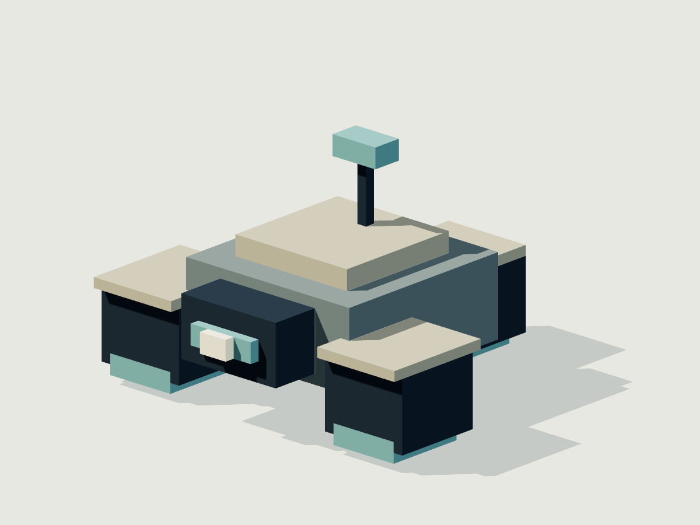

시각 원형 · [복셀 원본](../../design/assets/models/survey_drone.voxel.json) · [GLB](../../design/assets/exports/survey_drone.glb)

월드 기원의 무기생명 경비. 탐조선을 바닥에 그은 뒤 전격을 방출하고 발광 축전부가 취약점이다.

- 분류: **inorganic**, 문명 `false`, 역할 `guardian`, 기준 **T8**. 환경: anomaly; 던전: inertia_tower.
- 형태·스탯: 1.1×1.1×0.7m, 180kg, 외피 셀 0.25m. **HP 680**, 이동 1.8/3.6, 감지 26, 홈 추적 32, 시야 상실 6s, 후퇴 HP비율 0.15.
- 구조: `hover`; 핵심 204HP, 외피 패치 204HP, 지지부 노드 82HP. 추진기 셋 중 하나 파괴 시 기울고 출력 감소, 모두 파괴 시 추락; 축전부 파괴 시 전격 중단.
- 행동: all; 표시된 경계 침입 후 경고가 끝나거나 직접 공격. 경고 2s. 추격 반경 또는 시야 상실 시간을 넘으면 복귀; 복귀만으로 HP·에너지 리셋 없음.
- 공격 **측량 전격**: electrical 75HP, 사거리 9m, 예고 1.8s / 회복 1.35s / 쿨다운 5s. 예고: 탐조선 고정과 축전부 세 번 점멸. 판정: 직선 투사체, 금속 전도 연쇄는 후속. 비용 0CP + 150EU.
- 칼로리 없음, 자연회복 없음. 정비소에서 scrap_iron 1개와 8s로 40HP 수리; 파괴된 핵심 부활 불가.
- 공격 저장량: electrical 900EU, 초기 75%, 충전 `community_grid_or_maintenance_station`; 충전은 수리가 아니다.
- 먹이·서식: 정비 공급; 유기 먹이 없음. 내부 그늘·먹이 방과 연결된 매복처. 사체 식용예산 0CP. 먹이망에 포함하지 않음; 정비 공급은 별도 공동체 원장.
- 배치: 야외 `없음` 참조. 실내 종 한도 5 / 기본 그룹 1~2, 공동체 한도 0. 최소 여유 반경 0.55m, 실체화는 플레이어 32m 밖, 평가주기 60s. 건축물 방 예산 우선.
- 개체 회복: 핵심이 살아있는 기존 개체를 정비; 사망 개체 재생성 없음. 자연 번식·음식 회복 없음.
- 드롭·대체 제작: `scrap_iron` 3~5개 → 자체 `make_scrap_iron`.

### 개척민 유기생명 원형 — `wayfarer_organic`

<!-- asset:wayfarer_organic -->
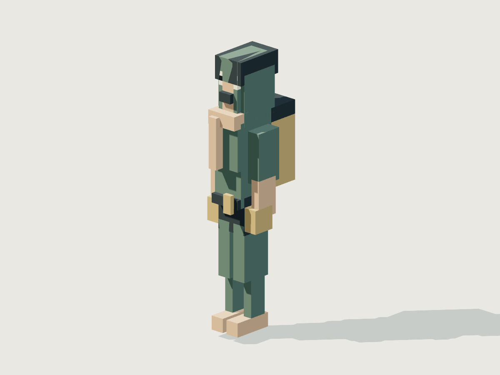

시각 원형 · [복셀 원본](../../design/assets/models/wayfarer_organic.voxel.json) · [GLB](../../design/assets/exports/wayfarer_organic.glb)

종족 외형 확정 전 문명 개체용 역할 원형. 공동체 식량·경보·거래·구조 요청을 공유한다.

- 분류: **organic**, 문명 `true`, 역할 `community_member`, 기준 **T3**. 환경: grove, ridge, marsh, thermal, coast, mana_grove, sacred, anomaly; 던전: 없음/공동체 전용.
- 형태·스탯: 0.6×0.4×1.8m, 72kg, 외피 셀 0.25m. **HP 125**, 이동 1.4/4, 감지 20, 홈 추적 18, 시야 상실 6s, 후퇴 HP비율 0.25.
- 구조: `biped`; 핵심 44HP, 외피 패치 31HP, 지지부 노드 19HP. 한쪽 다리 손실 시 기어 이동, 무장 팔 연결 파괴 시 해당 공격 중단; 외장과 뼈·프레임은 독립.
- 행동: all; 공동체 적대 판정 또는 직접 공격 이후만. 경고 2s. 추격 반경 또는 시야 상실 시간을 넘으면 복귀; 복귀만으로 HP·에너지 리셋 없음.
- 공격 **방어봉**: mechanical 17HP, 사거리 1.8m, 예고 1s / 회복 0.75s / 쿨다운 3s. 예고: 물러서라는 경고와 봉 들기. 판정: 정면 60도, 먼저 공격하지 않음. 비용 3.4CP + 0EU.
- 칼로리: 최대 360, 초기 75%, 생존 0.15CP/s + 달리기 0.3CP/s. 자연회복 대기 10s, 0.69HP/s, 비용 3CP/HP, 휴식 1.5배, 유보 10%. 기아 120s 이후 0.521HP/s.
- 먹이·서식: item:meat, resource:community_plant_food. 공동체 주거·작업·정비 구역. 사체 식용예산 126CP. 배설물·사체→분해층→생산원; 사체 먹이와 플레이어 채집은 동일 잔량 원장 공유.
- 배치: 야외 `없음` 참조. 실내 종 한도 0 / 기본 그룹 1~1, 공동체 한도 8. 최소 여유 반경 0.3m, 실체화는 플레이어 32m 밖, 평가주기 60s. 건축물 방 예산 우선.
- 개체 회복: 성숙 1200s, 번식 간격 1200s, 자식 0마리, 부모 칼로리 70%·먹이 40% 이상, 새끼 CP 25%. 먹이 20% 미만 120s 뒤 1셀 이주 검색. 살아있는 인접 공동체의 이주 또는 회수된 비핵심파손 개체 정비; 무에서 생성 금지.
- 드롭: 새 보상 생성 없음. 실제 개인 소지품만 단일 원장으로 이전한다. 거래·기여·구조 요청·경고 상호작용을 제공하고 공동체 소속은 개체 인스턴스에 저장한다.

### 관리인 무기생명 원형 — `custodian_inorganic`

<!-- asset:custodian_inorganic -->
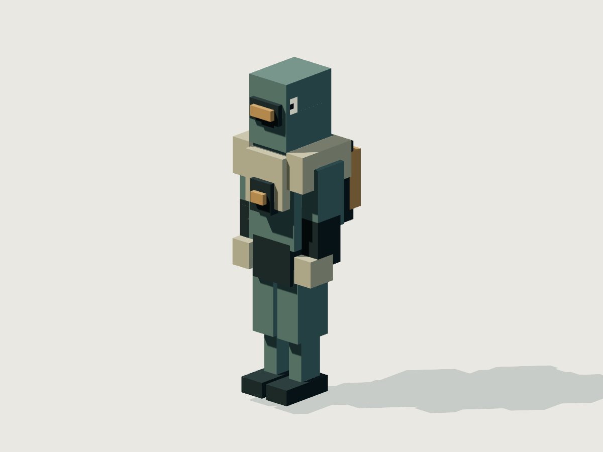

시각 원형 · [복셀 원본](../../design/assets/models/custodian_inorganic.voxel.json) · [GLB](../../design/assets/exports/custodian_inorganic.glb)

월드에서 만나는 문명 무기생명 원형. 식량 대신 정비 공급을 이용하며 기여와 거래가 가능하다.

- 분류: **inorganic**, 문명 `true`, 역할 `community_member`, 기준 **T3**. 환경: grove, ridge, marsh, thermal, coast, mana_grove, sacred, anomaly; 던전: 없음/공동체 전용.
- 형태·스탯: 0.75×0.6×1.9m, 160kg, 외피 셀 0.25m. **HP 190**, 이동 1.4/4.2, 감지 22, 홈 추적 18, 시야 상실 6s, 후퇴 HP비율 0.15.
- 구조: `biped`; 핵심 66HP, 외피 패치 48HP, 지지부 노드 28HP. 한쪽 다리 손실 시 기어 이동, 무장 팔 연결 파괴 시 해당 공격 중단; 외장과 뼈·프레임은 독립.
- 행동: all; 공동체 적대 판정 또는 직접 공격 이후만. 경고 2s. 추격 반경 또는 시야 상실 시간을 넘으면 복귀; 복귀만으로 HP·에너지 리셋 없음.
- 공격 **정비팔 방어**: mechanical 24HP, 사거리 2m, 예고 1.2s / 회복 0.9s / 쿨다운 3.2s. 예고: 경고음과 팔 올리기. 판정: 정면 65도, 먼저 공격하지 않음. 비용 0CP + 48EU.
- 칼로리 없음, 자연회복 없음. 정비소에서 scrap_iron 1개와 8s로 40HP 수리; 파괴된 핵심 부활 불가.
- 공격 저장량: mechanical 288EU, 초기 75%, 충전 `community_grid_or_maintenance_station`; 충전은 수리가 아니다.
- 먹이·서식: 정비 공급; 유기 먹이 없음. 공동체 주거·작업·정비 구역. 사체 식용예산 0CP. 먹이망에 포함하지 않음; 정비 공급은 별도 공동체 원장.
- 배치: 야외 `없음` 참조. 실내 종 한도 0 / 기본 그룹 1~1, 공동체 한도 4. 최소 여유 반경 0.375m, 실체화는 플레이어 32m 밖, 평가주기 60s. 건축물 방 예산 우선.
- 개체 회복: 살아있는 인접 공동체의 이주 또는 회수된 비핵심파손 개체 정비; 무에서 생성 금지. 자연 번식·음식 회복 없음.
- 드롭: 새 보상 생성 없음. 실제 개인 소지품만 단일 원장으로 이전한다. 거래·기여·구조 요청·경고 상호작용을 제공하고 공동체 소속은 개체 인스턴스에 저장한다.

## 8. 검증과 구현 전 확인

현재 수행한 것은 데이터/문서 설계이며 플레이 검증이 아니다. 첫 구현은 기존3종을 유지한 채 신규 종 ID 어댑터와 칼로리·부위상태·먹이 원장을 연결하는 순서가 적합하다. 신규 JSON을 기존 세 종 배열에 즉시 덮어씌우지 않는다.

1. 스키마: 34개 ID 유일성, 환경8개 연결, organic calorie 필수/inorganic null, 문명 원형2개, 공격 쿨다운≥예고+회복, 최대HP·형상 양수, 전체 외부참조 존재를 검사한다.
2. 칼로리: HP0/최대HP/부족CP/유보CP/휴식중 피격, dt0·큰dt·분할dt, 기아중 재급식에서 음수CP와 무료회복이 없어야 한다.
3. 먹이수지: 같은 시드의 각 환경을 무플레이어·집중사냥·생산원파괴·복구·이주 허용/차단으로 돌린다. 일반 생산8패치×0.004BU/s×100=3.2CP/s와 종 basal/sprint/regen 소비를 비교하고 개체수·먹이량·출생/사망을 함께 관찰한다. 목표는 무한 개체 생성이 아니라 자연스러운 평형·고갈·회복이다.
4. 닫힌 던전: 전멸 후 재접속으로 종이 부활하지 않는다. 생산실만 파괴하면 소비자가 즉시 사라지는 대신 먹이 고갈→이동→기아로 이어진다. 보스 경비 호출은 별도 원장이더라도 전체 방 예산을 공유한다.
5. 구조: 외피만 제거/다리 연결 단절/핵심 단절/정비 중단을 각각 검사한다. 분리 물체가 사물로 남고 플레이어 조립물이 무기생명으로 변하지 않아야 한다.
6. 사망 보존: 생물의 사체 처리·이주·청크 언로드가 플레이어 사망물품 보관함을 삭제하거나 먹이로 사용하지 않는다. 요정10m 회수는 회수 담당 모듈이 소유한다.
7. 밸런스: 각 기준티어 플레이어 장비로 평화 관찰/도주/개인 전투/제작물 활용 네 접근을 평가한다. 일반 포식자와 보스의 체력·위험 차이, 유기/무기 정비 비용 차이를 실제로 측정해야 확정할 수 있다.

추가 구현 명세가 필요한 경계: 개별 외피 모델과 최종 뼈 노드, 공통 EU 계약을 사용하는 공격 피해 계수와 유기생명 에너지 생산 어댑터, 유익종/유체종 이동 어댑터, 사체 드롭·CP 분할 단위, NPC 소지품/거래 원장, 저장 버전 마이그레이션. 이 목록은 설계가 구현 완료됐다는 오해를 막기 위한 것이다.
