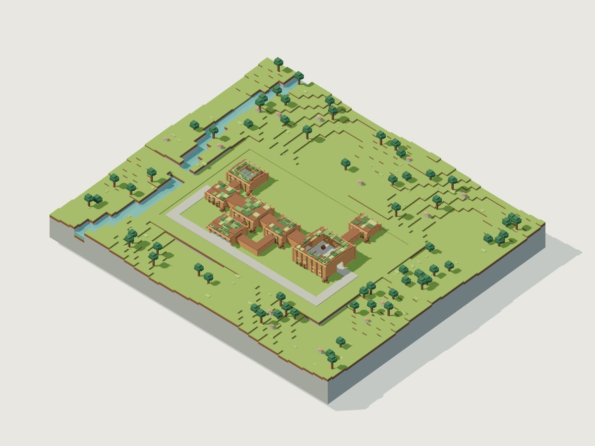
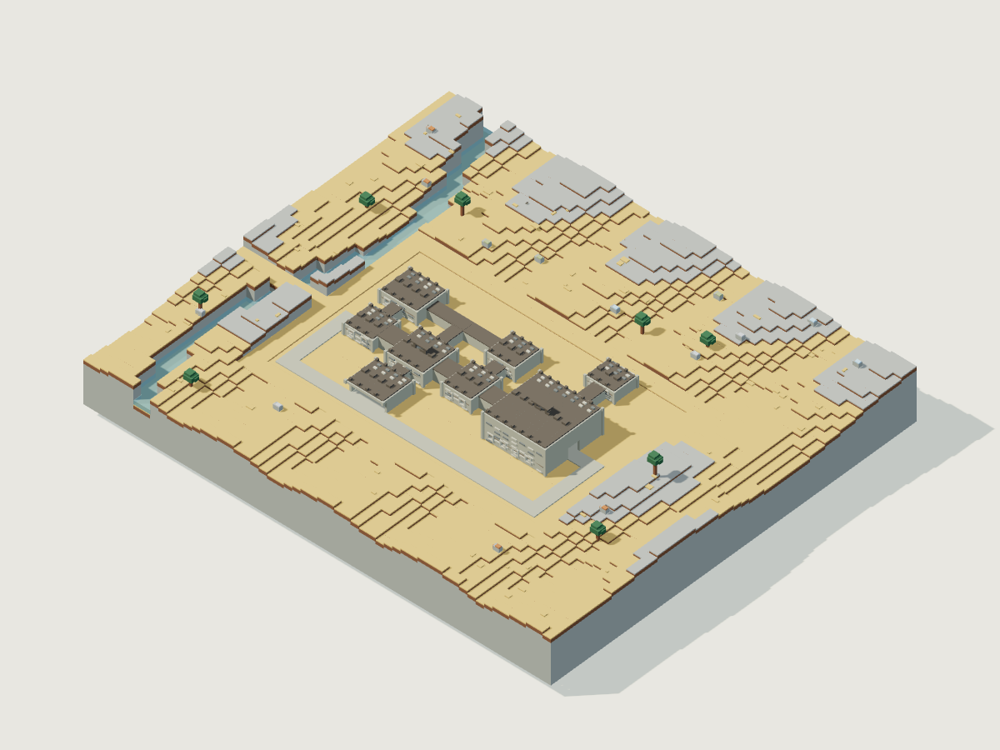
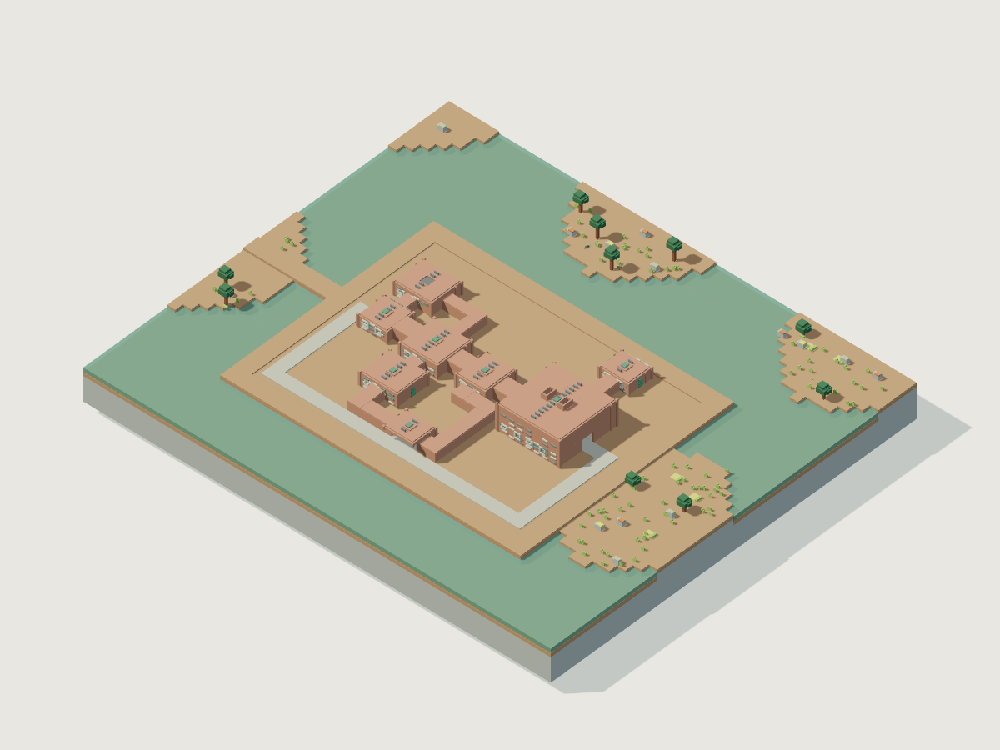
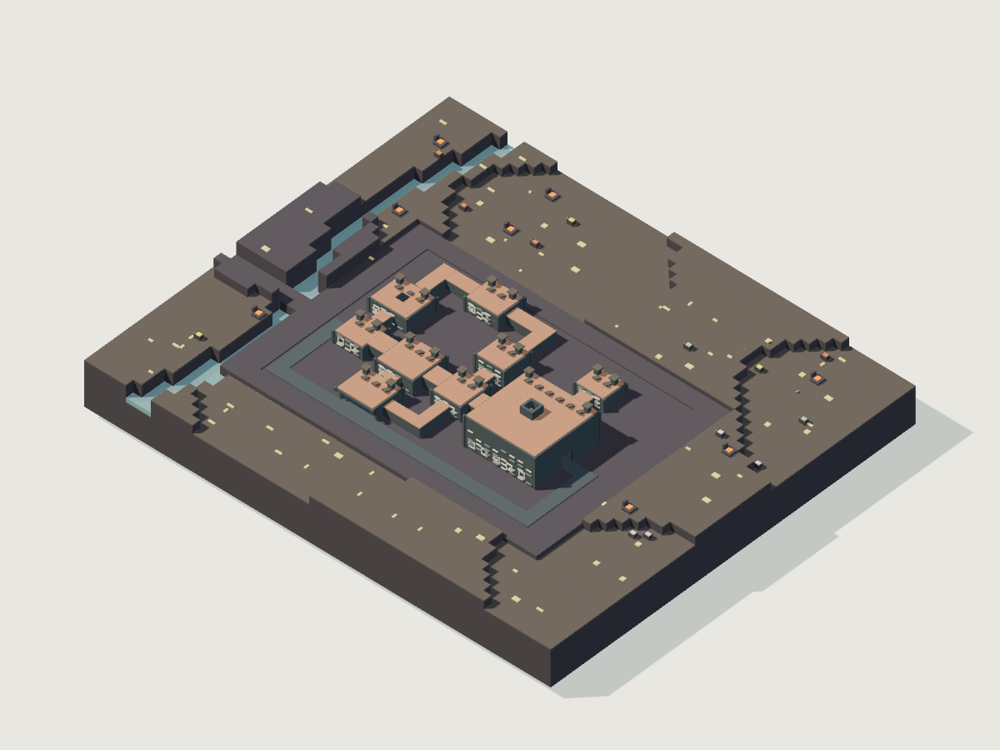
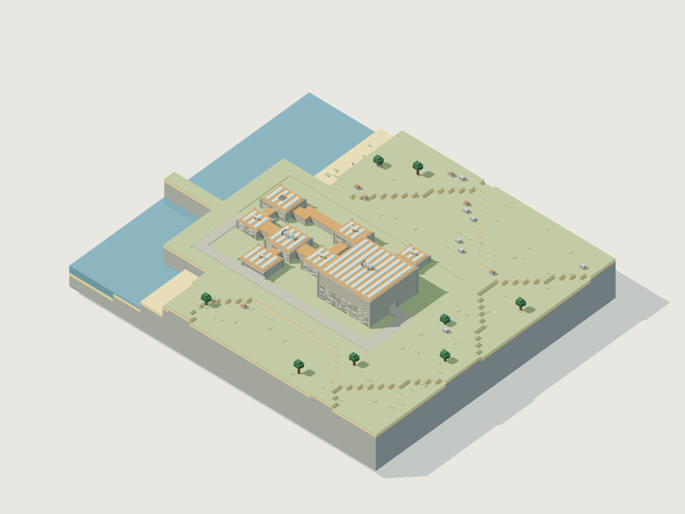
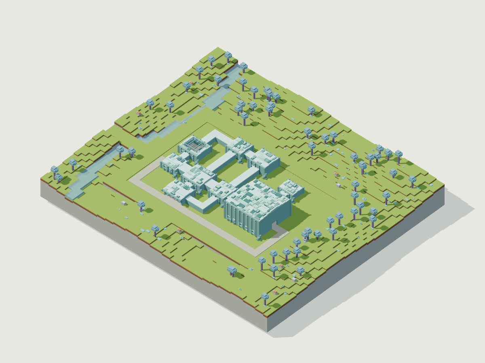
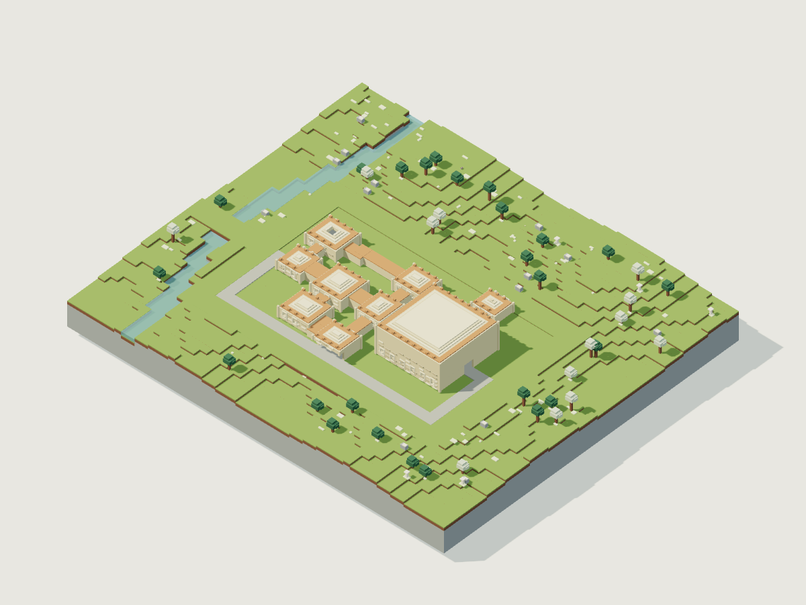
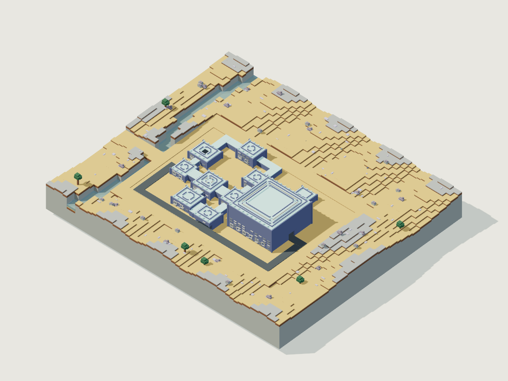

# 환경·지형·블록·야외 배치 위키

[시각 에셋 저장·재사용 안내](VISUAL-ASSETS.md) · 아래 이미지는 설계용 복셀 원형을 직접 렌더한 것이며 실제 게임 화면이 아닙니다.

상태: **개발 전 설계 제안**. 사용자 확정은 최초 스폰 중심 거리 난도, 세계 평균 5~6티어 지향, 먼 동서남북 고난도 파편의 우회 가능성, 환경의 먹이망, 환경에 맞는 건축물이다. 이 문서의 모든 거리·비율·생산량·HP·분포는 밸런스 제안이다. 데이터는 [environments.json](../../design/content/environments.json), [blocks.json](../../design/content/blocks.json)에 있으며 런타임에서 읽지 않는다.

## 1. 개념

환경은 단순한 배경색이 아니라 지형, 수역, 재료층, 먹이 생산원, 생물 서식지, 건물 입지의 묶음이다. 난도는 별도의 공간 필드다. 숲도 고티어일 수 있고 열곡도 초반에 보일 수 있다. 환경 전체에 자동 피해를 걸어 장비로 입장권을 사게 하지 않고, 보이는 산성 웅덩이·열 분출구를 회피하거나 장비로 통과한다.

건축물은 탐험의 주된 발견물이다. 지형 생성은 건물을 무작위로 얹은 뒤 주변을 깎는 방식보다, 하천·우회로·건물 부지를 먼저 예약하고 자연물을 그 사이에 배치한다. 던전 내부 방 그래프·보스·폐쇄 생태계는 [건축물](STRUCTURES.md), [생명체](CREATURES.md), [보스](BOSSES.md)가 소유한다. 이 문서는 야외와 건물 입구까지 담당한다.

## 2. 분류

기본 환경 6종은 grove/ridge/marsh/thermal/coast/mana_grove다. sacred/anomaly는 **중첩 환경**이다. 중첩은 기본 환경의 높이·기후·수역·광물층을 보존하고 표면 일부, 생물 후보, 건물 후보만 바꾼다. 두 중첩은 동시에 같은 위치를 점유하지 않는다. 성역은 난도 증가와 동의어가 아니며 이상대도 고티어 파편과 별도 필드다.

블록은 soil/stone/wood/vegetation/ore/metal/glass로 분류한다. 액체는 블록이 아닌 용적·농도 상태로 유지한다. 월드에서 분리된 물체는 object, 플레이어가 조립한 구조물은 machine이다. 재료·모양은 컴포넌트에 없는 기능을 생성하지 않는다.

## 3. 구성과 관계

- 16m 스트리밍 청크: 저장·메시·충돌의 적재 단위 제안. 1m 균질 셀은 압축할 수 있고 모든 구조 상호작용은 0.5m 세부 셀로 해석한다.
- 64×64m 생태셀: 식량량, 실제 개체 목록, 서식 수용력, 미방문 시간의 소유 단위.
- 512×512m 배치 영역: 공동체·던전·유적 후보 소유 단위. 청크가 먼저 보였다는 이유로 생성 결과를 바꾸지 않는다.
- 4096×4096m 검증 영역: 고난도 면적 상한을 검사한다. 경계 주변 인접 영역도 함께 검사한다.
- 난도는 최초 스폰 좌표를 원점으로 계산한다. 플레이어가 침대를 놓거나 현재 위치가 달라져도 중심은 변하지 않는다.
- speciesId는 creatures.json, dungeonId는 structures.json, materialId는 catalog.js MATERIALS, rawResourceId는 성장 원료 레지스트리를 참조한다. 타 분야 스탯·드롭을 이 문서가 재정의하지 않는다.

## 4. 동작 규칙

### 4.1 절대 좌표·결정성·저장

현재 world.js는 160×160×40m의 1m 배열과 수정된 셀에만 0.5m 하위 셀을 둔다. frontier/terrain.js는 이 유한 월드를 이동마다 구성하고, frontier/model.js regionInfo는 맨해튼 지역 거리로 1~3티어를 정한다. **현재 구현이 무한 월드라는 의미가 아니다.**

새 좌표는 부호 있는 청크 정수와 0~31 세부 셀 좌표다. 저장에서는 청크 정수를 십진 문자열로 적어 큰 좌표 정밀도를 유지한다. 음수 나눗셈은 floor이며 나머지는 항상 비음수다. 지형을 카메라 근처 상대 좌표로 렌더링해도 생성·사망 보관 좌표는 바뀌지 않는다. 수직도 청크화하며 기존 HEIGHT=40을 새 월드 상한으로 사용하지 않는다.

해시 입력은 `[seed,generatorVersion,namespace,chunkX,chunkY,chunkZ,candidateIndex]`의 UTF-8 JSON이며 SHA-256 첫 **53비트**를 2^53으로 나누어 [0,1) 표본을 얻는다. 경계 끝 1로 반올림되지 않는다. climate/height/water/ores/trees/difficulty/overlays/structures/population 채널을 분리한다. 변수마다 후보 번호를 고정하여 나무 수 변경이 던전 위치를 바꾸지 않도록 한다. 변경 시 generatorVersion을 올리고 기존 월드는 기존 생성기를 유지한다.

범위형 길이는 연속 균등 표본을 0.5m로 양자화, 개수는 양끝 포함 정수 균등, 확률은 Bernoulli, 가중치는 누적 범주 선택이다. 각 표본은 생성 때 한 번 뽑는다. 주민 출생·식물 수확 같은 가변 사건은 별도 저장된 사건 순번을 사용한다. 방문 순서·실시간·전역 Math.random을 생성 입력으로 쓰지 않는다.

### 4.2 생성 순서

1. 불변 최초 스폰과 생성 버전을 읽는다. 스폰 중심 128m는 숲·초원으로 보정하고 64m는 적대 야외 생성에서 제외한다.
2. 대륙 노이즈(파장4096m), 기후(1024m), 지질(512m), 높이(256m), 세부 높이(32m)를 독립 계산한다. 격자 value noise는 cubic smoothstep 보간한다.
3. 해안 거리·원시 높이와 기후로 기본 환경을 선택한다. JSON의 selectionOrder 우선순위를 사용한다. 환경별 높이 범위로 보정하고 경계32m에서 smoothstep 가중 혼합한다. 최종 배수로는 이후 확정한다.
4. 하천 폭3~8m와 여울을 예약한다. 수역 면적 비율은 서식지 목표이지 전체 청크를 무조건 침수시키는 값이 아니다. 생성 후 면적을 검사해 목표 범위를 만족하도록 분지 후보를 제한한다.
5. 거리 난도와 고난도 파편 후보를 만들고 낮은 난도 접근 포털·우회로를 예약한다. 아래 경로 검사를 통과하지 못하면 파편을 버린다.
6. 성역·이상대 중첩을 배치한다. 성역 후보 확률0.08/배치영역, 이상대0.04/배치영역이며 반경48~96m. 이상대는 스폰1536m 밖에서 생성한다.
7. 공동체→던전→소규모 유적 순으로 예약한다. 던전 확률0.32·최대1, 공동체0.18·최대1, 소유적0.65·최대2/배치영역. 소유적은 후보 슬롯마다 독립 확률이다. 건축물 사이 최소160m는 던전-공동체 쌍에 적용한다. 최종 공간은 STRUCTURES의 footprint와 여유폭을 우선한다.
8. 동굴·광맥·식생을 배치한다. 플레이어 수정은 생성 완료 후 적용하되 수정된 지역에 신규 구조물을 소급 생성하지 않는다.
9. 먹이량과 서식 조건을 먼저 만든 뒤 초기 생물 개체를 생성한다. 이미 방문한 곳은 저장된 개체를 읽고 정원까지 리필하지 않는다.

512m 후보 소유 영역을 기준으로 이웃2영역의 후보를 조회하고 `(채널 우선순위, 소유X, 소유Z, 후보번호)` 순서로 공간 충돌을 해결한다. 같은 부지를 서로 다른 청크가 이중 소유하지 않는다. 건물 실크기가 조회 범위를 넘으면 구현 검증 실패이며 자동으로 잘라 배치하지 않는다.

### 4.3 난도와 우회 보장

| 최초 스폰 거리 | 기본 난도 |
|---|---|
| 0~128m | 1 |
| 128~384m | 2 |
| 384~768m | 3 |
| 768~1536m | 4 |
| 1536~3072m | 5 |
| 3072m 이후 | 256m 난도셀마다 5티어60%, 6티어40% |

먼 지대의 기본 기대값은5.4다. 7/8/9/10티어 파편은 각각 최소4096/6144/8192/12288m 밖에서 허용한다. 반경64~96m, 동서남북 축에서 ±25도 안의 영역에 배치하며 지역당 최대1개다. 일반 후보 확률0.20 후 공간·면적·우회 검사로 기각한다. 고난도 면적 목표3%, 4096m 검증영역 상한6%다. 최악에 모든 파편이10티어여도 기대 평균은 `5.4×0.94+10×0.06=5.676`이므로 목표5~6과 양립한다. 이는 구현 표본 결과가 아닌 설계 상한 설명이다.

각 티어·방향마다 최소 거리 바깥에 시드 변동을 준 대표 후보를 둔다. 실패하면512m씩 최대32개 거리띠를 검색한다. 끝까지 유효 위치가 없으면 **생성 검증 실패**이며 안전하지 않은 파편을 강제로 넣지 않는다. 특정 방향이 특정 연구 분야를 독점하지 않는다.

파편 외곽40m에서 시각·소리로 위험을 알린다. 우회 경로는 폭12m, 경사25도 이하, 단차0.5m 이하, 물깊이0.5m 이하, 지속 위험 없음, 지역 기본 난도+1 이하를 만족한다. 파편 간 최소 여백96m를 유지한다. 경로 검사 격자는4m이며 보행 판정은 실제0.5m 셀에서도 재검사한다.

파편 경계박스를128m 확장한 구역에서 서로 반대편의 저위험 포털 사이 **정점 독립 경로2개**가 있어야 한다. 우회길 길이는 안전 포털 사이 직선거리의2.5배 이하. 포털에서 다음512m 영역의 안전 포털까지 연결돼야 하므로 작은 섬만 안전한 배치는 실패다. 파편 경계와 우회길 사이 최소32m를 두되 보스·위험의 최대 유효거리보다 좁으면 그 거리+4m까지 확장한다. 침입 개체 추적과 투사체도 안전 경로까지 무제한 확장되지 않도록 보스·개체 경계 규칙을 적용한다. 8회 후보 재시도 후 실패하면 파편을 생략한다. 이 보장은 미개척 기본 생성에 적용하며 플레이어가 직접 파괴한 길을 자동 복구하지 않는다.

### 4.4 광맥·식생·수확

광맥은 64m 생태셀 소유이며 최종 지표 아래 깊이 범위에서 시작한다. 6방향 이웃 연결 random walk로 암반만 치환하고, 셀마다 이웃6회·전체 목표 셀수4배까지 시도한다. 동굴·건축물·예약 통로를 덮어쓰지 않으며 적은 광량으로 끝날 수 있다. 조기 실패는 기록한다. 모든 기본 환경에 철계 광석 후보가 있고 특화 환경은 더 풍부하다. 상위 기술에 필요한 재료를 던전 안에만 배치하지 않는다.

나무는0.5m 셀1×1~2×2의 줄기와 반경2m 타원체 수관으로 만든다. 줄기 길이·군집 중심은 시드로 결정하며 청크 경계에서 후보 자체를 잘라서는 안 된다. 지지가 끊긴 연결체는 사물 엔티티가 된다. 흙·모래·재·점토도 공중에 고정되지 않고 granular_collapse로 붕괴한다. 식물은 지지 상실 시 떨어지거나 시든다.

생산원 패치는 반경2~5m, 중심 최소4m 간격, 패치 안 식생 점유 확률0.65다. 패치당 식량10BU, 1BU=100CP이며 재생0.004BU/s, 열곡·이상대는0.002BU/s다. 기본8패치/생태셀, 열곡·이상대5패치다. 시각용 풀 복셀 수를 먹이로 다시 계산하지 않고 patch의 실제 biomass를 소비한다. 생물 섭식·초식 재생·플레이어 채집은 같은 저장량에 접근한다. 회복은 생산원이 살아 있고 물·빛 등 서식 조건이 충족될 때만 최대량까지 이뤄진다.

손수집용 가지·돌·섬유·베리는 스폰96m 안에 각각8/8/8/12단위를 보장한다. 목재·돌 구조 셀64개씩, 먹이 패치4개, 담수2m³도 별도로 보장한다. 별도 도구가 필요한 통나무만 주고 첫 도구 제작을 막지 않는다. 물은 용기가 없어도 현장에서 마실 수 있지만 저장·운반은 용기 기능이 필요하다.

수확 노드별 실제 숫자는 JSON world.harvestNodes에 있다. `regrowS=0`은 무한 즉시재생이 아니라 타이머 재생 없음이다. 가지·돌은 일회성, 물은 실제 부피에서1단위=1L 차감, 점토·모래는 셀에서 차감한다. 식물 재생 타이머가 지나도 부모 식물이 파괴됐거나 biomass가 부족하면 수확할 수 없다. 일반 식물 수확1회는1BU를 소모한다. 씨앗은 seed_head 노드에서 수확한다. 수율·채집 시간·필요 도구는 각 sourceId가 가리키는 PROGRESSION 획득 정의가 단일 정본이다. 환경은 분포·재성장·식량 소모만 소유한다. 시작 베리12단위는 output2인 관목6개로 보장한다.

### 4.5 생물 스폰과 성능 예산

환경 풀은 초식/포식/소형 소비자 순으로 가중치5:1:4다. 낮/밤/상시 조건이며 종의 상세 활동성·번식·먹이는 CREATURES가 최종 정의한다. 첫 생성도 그룹 전체가 남는 자리와 먹이량에 들어갈 때만 성공한다. 그룹 크기는 초식2~4, 포식1, 소형2~4다. 한 그룹의 일부를 보이지 않는 곳에 반복해서 생성해 cap을 넘기지 않는다.

수용력은 생태셀의 정원이지 시간마다 자동 보충하는 수가 아니다. 60s 간격 평가에서 CREATURES의 출생 조건이나 실제 이주로만 새 개체가 생긴다. 초기 시드 개체·저장된 자식만 플레이어32~96m 구간에서 물리 엔티티로 활성화하고, 보이는 곳에 갑자기 나타내지 않는다. 1tick 활성화 최대2, 후보 위치8회 시도. 플레이어 구조물12m 안의 신규 배치는 거부한다. 논리상 출생 위치와 시각 활성화 조건은 분리한다.

플레이어 주변 야외 활성 개체48, 그중 포식8을 모바일용 제안 예산으로 둔다. 던전 예산은 건축물 명세 별도이므로 이 수치만으로 총 프레임 성능을 보장하지 않는다. 비활성 개체는 삭제하지 않고 생태 집계로 남긴다. 미방문60s씩 최대120단계를 따라잡고 더 긴 시간은 자원 한도 내 집계 갱신을 수행한다. 오프라인 진행을 미구현인 채 재접속 시 정원으로 초기화해서는 안 된다.

성역·이상대는 host 정원의40%를 floor로 배정받고 가중치 최대잔여법 후 종별2/1/2 상한을 적용한다. 남은 자리는 host pool에 남긴다. host와 overlay 포식 합계는2 이하. 중첩을 이유로 총 개체수가 늘지 않는다. 문명 개체는 공동체가 배치하며 야외 야생 풀에서 생성하지 않는다.

## 5. 실제 환경 항목

### 이끼 숲·초원 — `grove`

<!-- asset:grove -->

시각 원형 · [복셀 원본](../../design/assets/models/grove.voxel.json) · [GLB](../../design/assets/exports/grove.glb)

낮은 언덕의 숲 군집과 넓은 빈터를 교차시킨다. 시야가 트인 빈터에서 던전 지붕을 먼저 보게 하고 나무·덤불은 접근 동선을 여러 갈래로 나눈다. 사슴은 생산원 빈터, 여우는 숲 경계, 딱정벌레는 이끼·썩은 나무 주변에 산다. 뿌리 저택은 숲 경계에 두고 담수와 통나무 운반길을 연결한다.

| 항목 | 제안 데이터 |
|---|---|
| 기후 | 온도 8 ~ 26°C / 습윤도 0.45 ~ 0.9 |
| 지표 높이·토심 | 해수면 기준 2 ~ 34m / 0.5 ~ 2.5m |
| 지층 | `grass` → `dirt` → `stone`; 중첩은 host 지층 유지 |
| 수역 목표 | 0.25 ~ 0.55; 산성 비율 0 |
| 나무 | 1024m²당 6그루; 높이 4 ~ 8m; 간격 4m 이상 |
| 생산원 | 4096m²당 8패치, 패치당10BU, 재생0.004BU/s |
| 야외 정원 | 14 |
| 건물 후보 | `root_manor`, 최대 경사12°, 입구 접근6m |

| 야외 종 | 역할 | 최대/생태셀 | 그룹 | 활동 |
|---|---|---|---|---|
| `moss_deer` | grazer | 8 | 2 ~ 4 | day |
| `copper_fox` | predator | 2 | 1 ~ 1 | night |
| `azure_beetle` | small_consumer | 4 | 2 ~ 4 | any |

| 광맥 블록 | 지표 아래 깊이m | 후보 수/4096m² | 0.5m 셀수/광맥 |
|---|---|---|---|
| `iron_ore` | 4 ~ 28 | 1 | 8 ~ 24 |

### 붉은 구릉·광산권 — `ridge`

<!-- asset:ridge -->

시각 원형 · [복셀 원본](../../design/assets/models/ridge.voxel.json) · [GLB](../../design/assets/exports/ridge.glb)

64m 간격의 침식된 능선과 낮은 채굴 골짜기를 교차시킨다. 능선 방향은 시드마다 달라진다. 광맥 노출부와 부스러진 암석은 지하 자원을 읽는 단서다. 토끼는 초본 선반, 자칼은 골짜기 경계, 광물진드기는 광맥 노출부에 배치한다. 채굴 요새의 입구는 급경사 정상이 아닌 능선 측면에 둔다.

| 항목 | 제안 데이터 |
|---|---|
| 기후 | 온도 10 ~ 34°C / 습윤도 0.1 ~ 0.45 |
| 지표 높이·토심 | 해수면 기준 12 ~ 72m / 0.5 ~ 1.5m |
| 지층 | `dry_grass` → `dirt` → `stone`; 중첩은 host 지층 유지 |
| 수역 목표 | 0.02 ~ 0.08; 산성 비율 0 |
| 나무 | 1024m²당 2그루; 높이 4 ~ 8m; 간격 4m 이상 |
| 생산원 | 4096m²당 8패치, 패치당10BU, 재생0.004BU/s |
| 야외 정원 | 12 |
| 건물 후보 | `mining_fort`, 최대 경사18°, 입구 접근6m |

| 야외 종 | 역할 | 최대/생태셀 | 그룹 | 활동 |
|---|---|---|---|---|
| `scree_hare` | grazer | 6 | 2 ~ 4 | day |
| `flint_jackal` | predator | 2 | 1 ~ 1 | night |
| `ore_mite` | small_consumer | 4 | 2 ~ 4 | any |

| 광맥 블록 | 지표 아래 깊이m | 후보 수/4096m² | 0.5m 셀수/광맥 |
|---|---|---|---|
| `iron_ore` | 4 ~ 28 | 3 | 8 ~ 24 |
| `titanium_ore` | 16 ~ 56 | 1 | 4 ~ 12 |
| `nickel_ore` | 12 ~ 48 | 1 | 6 ~ 16 |

### 습지·산성 수역 — `marsh`

<!-- asset:marsh -->

시각 원형 · [복셀 원본](../../design/assets/models/marsh.voxel.json) · [GLB](../../design/assets/exports/marsh.glb)

얕은 분지와 반경6~16m 마른 섬을 연결한다. 마른 땅 연결 비율35% 이상을 유지한다. 산성 웅덩이는 전체 물의12% 후보이며 실제 위험 점유율8% 이하로 제한한다. 초식종은 갈대 가장자리, 악어는 물·육지 접점, 달팽이는 퇴적·조류 층이다. 수문 시설은 침수돼도 진입 마당6m는 건조하게 확보한다.

| 항목 | 제안 데이터 |
|---|---|
| 기후 | 온도 15 ~ 32°C / 습윤도 0.8 ~ 1 |
| 지표 높이·토심 | 해수면 기준 -2 ~ 6m / 1 ~ 4m |
| 지층 | `reed` → `clay` → `stone`; 중첩은 host 지층 유지 |
| 수역 목표 | 0.4 ~ 0.65; 산성 비율 0.12 |
| 나무 | 1024m²당 1그루; 높이 4 ~ 8m; 간격 4m 이상 |
| 생산원 | 4096m²당 8패치, 패치당10BU, 재생0.004BU/s |
| 야외 정원 | 14 |
| 건물 후보 | `floodworks`, 최대 경사8°, 입구 접근6m |

| 야외 종 | 역할 | 최대/생태셀 | 그룹 | 활동 |
|---|---|---|---|---|
| `reed_grazer` | grazer | 6 | 2 ~ 4 | day |
| `mud_croc` | predator | 2 | 1 ~ 1 | night |
| `silt_snail` | small_consumer | 6 | 2 ~ 4 | any |

| 광맥 블록 | 지표 아래 깊이m | 후보 수/4096m² | 0.5m 셀수/광맥 |
|---|---|---|---|
| `iron_ore` | 4 ~ 28 | 1 | 8 ~ 24 |
| `nickel_ore` | 12 ~ 48 | 1 | 6 ~ 16 |
| `sulfur_deposit` | 1 ~ 8 | 2 | 8 ~ 16 |

### 화산·열곡 — `thermal`

<!-- asset:thermal -->

시각 원형 · [복셀 원본](../../design/assets/models/thermal.voxel.json) · [GLB](../../design/assets/exports/thermal.glb)

4m 단차의 현무암 단구와 폭12~24m 선반을 쌓고 완만한 접근길을 연결한다. 열 분출구는 반경2~4m, 서로32m 이상 떨어뜨린다. 재염소는 냉각된 지의류 선반, 도마뱀은 열·냉각 경계, 유충은 열원 바깥 생산원에 산다. 주조소 기초는 단구에 걸치되 입구를 뜨거운 분출구 위에 놓지 않는다.

| 항목 | 제안 데이터 |
|---|---|
| 기후 | 온도 28 ~ 48°C / 습윤도 0.05 ~ 0.35 |
| 지표 높이·토심 | 해수면 기준 16 ~ 100m / 0.5 ~ 2m |
| 지층 | `ash` → `basalt` → `basalt`; 중첩은 host 지층 유지 |
| 수역 목표 | 0.01 ~ 0.05; 산성 비율 0 |
| 나무 | 1024m²당 1그루; 높이 4 ~ 8m; 간격 4m 이상 |
| 생산원 | 4096m²당 5패치, 패치당10BU, 재생0.002BU/s |
| 야외 정원 | 10 |
| 건물 후보 | `geothermal_foundry`, 최대 경사15°, 입구 접근6m |

| 야외 종 | 역할 | 최대/생태셀 | 그룹 | 활동 |
|---|---|---|---|---|
| `ash_goat` | grazer | 4 | 2 ~ 4 | day |
| `ember_lizard` | predator | 2 | 1 ~ 1 | night |
| `vent_grub` | small_consumer | 4 | 2 ~ 4 | any |

| 광맥 블록 | 지표 아래 깊이m | 후보 수/4096m² | 0.5m 셀수/광맥 |
|---|---|---|---|
| `iron_ore` | 4 ~ 28 | 1 | 8 ~ 24 |
| `titanium_ore` | 16 ~ 56 | 1 | 4 ~ 12 |
| `nickel_ore` | 12 ~ 48 | 1 | 6 ~ 16 |

### 해안·고원 — `coast`

<!-- asset:coast -->

시각 원형 · [복셀 원본](../../design/assets/models/coast.voxel.json) · [GLB](../../design/assets/exports/coast.glb)

폭12~24m 해변, 높이12~32m 절벽, 폭32~96m 고원을 한 환경군으로 다룬다. 조수 진폭0.5m를 고려해 안전 여울은 최대 만조에도 통과해야 한다. 산양은 고원 초지, 맹금은 절벽 상공, 게는 조간대다. 관측성은 절벽을 바라보지만 육상 우회로와 보행 진입로를 남긴다.

| 항목 | 제안 데이터 |
|---|---|
| 기후 | 온도 5 ~ 26°C / 습윤도 0.3 ~ 0.8 |
| 지표 높이·토심 | 해수면 기준 -12 ~ 96m / 0.5 ~ 2m |
| 지층 | `salt_grass` → `sand` → `stone`; 중첩은 host 지층 유지 |
| 수역 목표 | 0.2 ~ 0.55; 산성 비율 0 |
| 나무 | 1024m²당 2그루; 높이 4 ~ 8m; 간격 4m 이상 |
| 생산원 | 4096m²당 8패치, 패치당10BU, 재생0.004BU/s |
| 야외 정원 | 12 |
| 건물 후보 | `cliff_observatory`, 최대 경사18°, 입구 접근6m |

| 야외 종 | 역할 | 최대/생태셀 | 그룹 | 활동 |
|---|---|---|---|---|
| `cliff_ibex` | grazer | 6 | 2 ~ 4 | day |
| `gale_raptor` | predator | 2 | 1 ~ 1 | night |
| `tide_crab` | small_consumer | 4 | 2 ~ 4 | any |

| 광맥 블록 | 지표 아래 깊이m | 후보 수/4096m² | 0.5m 셀수/광맥 |
|---|---|---|---|
| `iron_ore` | 4 ~ 28 | 1 | 8 ~ 24 |
| `titanium_ore` | 16 ~ 56 | 1 | 4 ~ 12 |

### 마나림 — `mana_grove`

<!-- asset:mana_grove -->

시각 원형 · [복셀 원본](../../design/assets/models/mana_grove.voxel.json) · [GLB](../../design/assets/exports/mana_grove.glb)

반경16~28m 수림 군집 사이에 지름16m 이상 마나 빈터를 둔다. 땅은 일반 흙·돌이며 마나 식생과 광맥이 차이를 만든다. 야생 마나 목재를 조기에 발견해도 그 물성만 얻으며 미연구 기능이 생기지 않는다. 사슴은 빈터, 고양이는 수림 경계, 나방은 마나 양치 패치다. 수목원 입구는 생산원과 연결하되 실내 생물 예산은 독립이다.

| 항목 | 제안 데이터 |
|---|---|
| 기후 | 온도 10 ~ 28°C / 습윤도 0.5 ~ 0.95 |
| 지표 높이·토심 | 해수면 기준 4 ~ 48m / 1 ~ 3m |
| 지층 | `mana_fern` → `dirt` → `stone`; 중첩은 host 지층 유지 |
| 수역 목표 | 0.15 ~ 0.3; 산성 비율 0 |
| 나무 | 1024m²당 5그루; 높이 5 ~ 10m; 간격 4m 이상 |
| 생산원 | 4096m²당 8패치, 패치당10BU, 재생0.004BU/s |
| 야외 정원 | 12 |
| 건물 후보 | `sealed_arboretum`, 최대 경사12°, 입구 접근6m |

| 야외 종 | 역할 | 최대/생태셀 | 그룹 | 활동 |
|---|---|---|---|---|
| `prism_deer` | grazer | 6 | 2 ~ 4 | day |
| `veil_cat` | predator | 2 | 1 ~ 1 | night |
| `mana_moth` | small_consumer | 4 | 2 ~ 4 | any |

| 광맥 블록 | 지표 아래 깊이m | 후보 수/4096m² | 0.5m 셀수/광맥 |
|---|---|---|---|
| `iron_ore` | 4 ~ 28 | 1 | 8 ~ 24 |
| `mana_crystal_ore` | 8 ~ 32 | 2 | 4 ~ 12 |

### 성역 중첩 — `sacred`

<!-- asset:sacred -->

시각 원형 · [복셀 원본](../../design/assets/models/sacred.voxel.json) · [GLB](../../design/assets/exports/sacred.glb)

기본 환경의12% 표면만 성역 석재·이끼로 교체하고 높이를 바꾸지 않는다. 성역이 습지 위에 있으면 습지 수역과 산성도를 그대로 상속한다. 토끼·사냥개·딱정벌레가 host 일부 자리를 대체한다. 수도원은 평탄한 건조 접근부를 요구한다. 발광 이끼와 성역 석재를 캐는 행위만으로 신성이 무한 생성되지는 않는다.

| 항목 | 제안 데이터 |
|---|---|
| 기후 | 온도 host 상속°C / 습윤도 host 상속 |
| 지표 높이·토심 | 해수면 기준 host 상속m / host 상속m |
| 지층 | `luminous_moss` → `dirt` → `stone`; 중첩은 host 지층 유지 |
| 수역 목표 | host 상속; 산성 비율 host 상속 |
| 나무 | 1024m²당 0그루; 높이 4 ~ 8m; 간격 4m 이상 |
| 생산원 | 4096m²당 8패치, 패치당10BU, 재생0.004BU/s |
| 야외 정원 | host 정원의40%를 교체 |
| 건물 후보 | `forgotten_monastery`, 최대 경사12°, 입구 접근6m |

| 야외 종 | 역할 | 최대/생태셀 | 그룹 | 활동 |
|---|---|---|---|---|
| `candle_hare` | grazer | 2 | 1 ~ 2 | day |
| `relic_hound` | predator | 1 | 1 ~ 1 | night |
| `shrine_beetle` | small_consumer | 2 | 1 ~ 2 | any |

광맥은 host 기본 환경의 후보를 상속한다. 중첩으로 광맥을 두 번 생성하지 않는다.

### 국소 이상대 중첩 — `anomaly`

<!-- asset:anomaly -->

시각 원형 · [복셀 원본](../../design/assets/models/anomaly.voxel.json) · [GLB](../../design/assets/exports/anomaly.glb)

기본 환경 표면18%에 균열과 이상대 암석을 놓는다. 높이 변경은2m 이내, 균열 폭1~3m이며 예약 우회로를 자르지 않는다. 뜨는 초식종·위상 포식자·닻진드기는 같은 기존 생태셀 예산을 쓴다. 관성 관측탑은 이상대 중앙 후보지만 고난도 파편 여부는 별도 계산이다. 암석 이름만으로 추진 기능을 얻지 않는다.

| 항목 | 제안 데이터 |
|---|---|
| 기후 | 온도 host 상속°C / 습윤도 host 상속 |
| 지표 높이·토심 | 해수면 기준 host 상속m / host 상속m |
| 지층 | `mineral_lichen` → `anomaly_stone` → `stone`; 중첩은 host 지층 유지 |
| 수역 목표 | host 상속; 산성 비율 host 상속 |
| 나무 | 1024m²당 0그루; 높이 4 ~ 8m; 간격 4m 이상 |
| 생산원 | 4096m²당 5패치, 패치당10BU, 재생0.002BU/s |
| 야외 정원 | host 정원의40%를 교체 |
| 건물 후보 | `inertia_tower`, 최대 경사15°, 입구 접근6m |

| 야외 종 | 역할 | 최대/생태셀 | 그룹 | 활동 |
|---|---|---|---|---|
| `drift_grazer` | grazer | 2 | 1 ~ 2 | day |
| `phase_stalker` | predator | 1 | 1 ~ 1 | night |
| `anchor_tick` | small_consumer | 2 | 1 ~ 2 | any |

광맥은 host 기본 환경의 후보를 상속한다. 중첩으로 광맥을 두 번 생성하지 않는다.

## 6. 블록 실제 데이터

밀도와 HP는 제안값이며 현재 게임 물성을 그대로 복제한 표가 아니다. 0.5m 셀 질량은 밀도×0.125다. 지형 채굴 HP와 생물 HP는 별개 대상의 손상 단위다. 원료 단위는 인벤토리 수량이며 1kg으로 간주하지 않는다. block별 전체 필드는 JSON에 있다.

| ID / 이름 | 분류 | 밀도kg/m³ | 셀HP | 결합계수 | 내산성 | 원료 또는 재료 참조 |
|---|---|---:|---:|---:|---:|---|
| `grass` 잔디 토양 | soil | 1400 | 24 | 0.45 | 0.1 | 별도 원료 없음 |
| `dirt` 흙 | soil | 1500 | 28 | 0.5 | 0.15 | 별도 원료 없음 |
| `stone` 돌 | stone | 2600 | 100 | 0.8 | 0.75 | loose_stone |
| `sand` 모래 | soil | 1600 | 16 | 0.25 | 0.45 | sand |
| `log` 통나무 | wood | 600 | 70 | 0.65 | 0.3 | raw_timber |
| `leaves` 잎 | vegetation | 60 | 8 | 0.05 | 0.05 | 별도 원료 없음 |
| `basalt` 현무암 | stone | 2900 | 150 | 0.9 | 0.8 | loose_stone |
| `ash` 재 | soil | 500 | 10 | 0.1 | 0.1 | 별도 원료 없음 |
| `plank` 목재 판재 | wood | 600 | 45 | 0.55 | 0.2 | wood |
| `moss` 이끼 | vegetation | 100 | 10 | 0.08 | 0.1 | 별도 원료 없음 |
| `dry_grass` 건조 초본 | vegetation | 80 | 8 | 0.04 | 0.05 | plant_fiber |
| `clay` 점토 | soil | 1800 | 35 | 0.4 | 0.35 | clay |
| `reed` 갈대 | vegetation | 120 | 16 | 0.1 | 0.15 | plant_fiber |
| `algae` 수생 조류 | vegetation | 100 | 8 | 0.02 | 0.1 | 별도 원료 없음 |
| `ash_lichen` 재지의 지의류 | vegetation | 140 | 12 | 0.08 | 0.3 | 별도 원료 없음 |
| `salt_grass` 염생 초본 | vegetation | 100 | 10 | 0.06 | 0.3 | 별도 원료 없음 |
| `mana_fern` 마나 양치류 | vegetation | 120 | 12 | 0.08 | 0.15 | 별도 원료 없음 |
| `mana_log` 마나 목재 | wood | 500 | 160 | 0.85 | 0.4 | mana_wood |
| `luminous_moss` 성역 발광 이끼 | vegetation | 110 | 12 | 0.08 | 0.2 | 별도 원료 없음 |
| `mineral_lichen` 광물 공생 지의류 | vegetation | 160 | 16 | 0.12 | 0.4 | 별도 원료 없음 |
| `iron_ore` 철계 광석 | ore | 3200 | 130 | 0.75 | 0.3 | iron_ore |
| `titanium_ore` 티타늄계 광석 | ore | 2900 | 155 | 0.8 | 0.65 | titanium_ore |
| `nickel_ore` 니켈계 광석 | ore | 3400 | 160 | 0.85 | 0.7 | nickel_ore |
| `sulfur_deposit` 산성 원료 침전암 | ore | 2100 | 90 | 0.55 | 0.1 | sulfur_deposit |
| `mana_crystal_ore` 마나 함유 광맥 | ore | 2700 | 180 | 0.8 | 0.45 | mana_crystal_ore |
| `rubble` 건축 잔해석 | stone | 2200 | 70 | 0.5 | 0.65 | loose_stone |
| `clay_brick` 소성 벽돌 | stone | 1900 | 95 | 0.65 | 0.7 | 별도 원료 없음 |
| `iron_scrap_block` 잡철 구조재 | metal | 7400 | 130 | 0.95 | 0.3 | scrap_iron |
| `glass` 유리 | glass | 2500 | 35 | 0.35 | 0.85 | 별도 원료 없음 |
| `sacred_stone` 성역 석재 | stone | 2700 | 180 | 0.95 | 0.85 | stone |
| `anomaly_stone` 이상대 암석 | stone | 2800 | 180 | 0.85 | 0.65 | stone |
| `berry_bush` 열매 관목 | vegetation | 120 | 12 | 0.08 | 0.15 | berry |
| `herb_patch` 야생 약초 | vegetation | 120 | 12 | 0.08 | 0.15 | herb |

`legacyBlockId`는 읽어 확인한 B enum의 의미상 비교값이다. 새 ID로 기존 세이브를 자동 변환하는 표가 아니다. ORE7은 단일 기존 광물이라 새 철/티타늄/니켈 중 하나로 임의 치환하지 않는다. AIR0·LAVA9는 고체 블록 카탈로그에서 제외하며 비어 있음·유체 상태로 별도 처리한다. 함수 부여 목록은 모든 블록에서 빈 배열이다.

## 7. 변수 사전

범례: E=`environments.json`, B=`blocks.json`, `e`=E.entries의 환경 항목, `b`=B.entries의 블록 항목. **유효**는 파서·모델 제약, **목표**는 조정 가능한 밸런스 범위다. 숫자 배열 `[a,b]`는 min/max 범위이며 아래 분포 계약을 따른다. null은 미구현0이 아니라 지정된 상속·비적용을 뜻한다. 현재 위치는 실제 확인한 코드이며 '없음'은 동일 계약이 확인되지 않았다는 뜻이다.

| 개념/분류 | 현재 변수·위치 | 새 데이터 경로 | 상태 | 타입·단위 | 허용 범위/열거형 | 제안 기본값/항목별 값 | 결정 근거·연관 규칙 | 검증·이전 방식 |
|---|---|---|---|---|---|---|---|---|
| 버전·식별 | world.js seed; frontier/model.js terrainVersion | E.schemaVersion/status; E.world.generatorVersion; e.id/name/mode | 신규·유지 혼합 | integer/string/enum | 버전 양의정수; mode base/overlay | schema1/proposed; generator content_world_proposal_1 | 새 생성기 분기와 데이터 상태 | 기존 저장을 자동 덮어쓰지 않음 |
| 저장격자 | world.js SIZE160/HEIGHT40/CHUNK16; getCell/setCell0.5m | world.chunkSizeM/voxelCellSizeM/terrainStorage.coarseCellSizeM/detailCellSizeM | 변경 | number/m | 유효 >0, coarse/detail 정수비; 목표16/1/0.5 | 16/1/0.5 | 기본 셀·세부 셀 구분 | 1m→8하위 셀 왕복 |
| 공간소유 크기 | frontier/model.js regionKey; 유한 지역 | world.ecologyCellSizeM/placementRegionSizeM | 신규 | number/m | 양수·청크배수; 목표64/512 | 64/512 | 식량/건물의 서로 다른 갱신 범위 | 경계 중복생성 검사 |
| 해수면·좌표 | world.js SEA8, index/get, inside | world.seaLevelM/coordinateContract | 변경 | number/m, decimal integer strings | sea 유한; 좌표 손실 없는 정수 문자열 | sea0 | 음수·큰 좌표·수직청크 | ±대좌표/음수경계 hash 검증 |
| 환경 분류 | world.js generate arid; frontier terrain biome0~2 | world.baseEnvironmentSelection.* | 신규 | number,m,probability,ordered rules | 모든 파장>0; 확률[0,1]; 규칙 완전 fallback | 기후1024m·지질512m·높이256/32/8m | 환경과 난도 독립 | 6기본환경 분포, 경계 이음새 확인; JSON의 raw/profile 높이식 사용 |
| 기후 | world.js ecosystemStep wet0.8/0.35 | e.climate.temperatureC/moisture/inheritsHost | 신규 | minmax °C / index / bool | 온도 유한; 습윤도[0,1]; 중첩null | 환경 항목표 | 온도 자체 피해 없음 | 중첩은 모든 기후 필드상속 |
| 높이·토심 | world.js generate h3~27, dirt상부3층 | e.terrain.heightAboveSeaM/soilThicknessM/macroWavelengthM/detailWavelengthM/blendWidthM | 변경 | minmax m, number/m | min≤max; 토심≥0; 파장>0; 중첩범위null | 표 +256/32/32m | 지형은 수직청크 범위, 토심은 최종지표 아래 | 틈·공중흙·지하충돌 검사 |
| 지층·식생 연결 | world.js B/trees | e.terrain.*BlockId; e.decoration.blockIds; b.rawResourceId/materialId | 변경 | 참조/string|null | 존재 ID; null=원료·재료없음 | 실제 항목표 | 광석과 정제 MATERIALS 구별 | 외래키와 채집 경로 검증 |
| 하천·수역 | world.js generate river, fluids.v/a | e.water.* | 변경 | minmax m / fraction / bool|null | 너비>0, 깊이≥0, 비율[0,1] | 하천3~8m/여울0.5m/환경별 면적 | 중첩 all-fields 상속, 물량 비중복 | 산성비와 수역 마스크 검사 |
| 나무 | world.js generate hash>0.992, h3~5 | e.decoration.treesPer1024M2/treeHeightM/treeMinimumSpacingM | 변경 | integer, minmax m, m | count≥0;height>0;space>0 | 숲6/마나5/환경표, 높이4~8 또는5~10, 간격4 | 나무 개수는 후보 수, 예약충돌은 감소 허용 | 청크 경계 줄기 연결·절단 |
| 생산패치 | world.js plants/nutrients | e.decoration.producerPatchRadiusM/producerPatchesPer4096M2; world.terrainStorage.plantPattern | 변경 | minmax m/count/prob | 반경>0,count≥0,밀도[0,1] | 반경2~5,8개 또는5개, 점유0.65 | 개체 풀보다 생산원 먼저 | 먹이량 중복계산 방지 |
| 생산능력 | world.js ecosystemStep 회복 공식 | e.spawning.producerBiomassUnitsPerPatch/producerRegrowthUnitsPerSecond | 신규 | number/BU,BU/s | ≥0; 목표용량10,재생.002~.004 | 10BU, 일반.004/열·이상.002 | 100CP/BU; 숲 정원 유지비와 비교하여 제안 | 장시간 먹이-칼로리 수지 측정 |
| 환경 형태 | 같은 기본 generate만 있음 | e.pattern.* | 신규 | enum,number/minmax m,degrees,prob | 길이≥0,확률[0,1],회전[0,180) | 환경별 단구·절벽·군집 값 | 단순 색 교체 방지 | 실루엣·통행 표본검사 |
| 동굴 | 동일 절차계약 없음 | e.pattern.caveChancePerCell/caveRadiusM/caveDepthM; world.terrainStorage.cavePattern | 신규 | prob,minmax m | p[0,1];크기≥0; p0이면0반경 허용 | p0~.30;길이16~32;천장3 | 건축·우회 예약 제외 | 지지 붕괴/물 유입 검증 |
| 광맥 | world.js generate hash>.99 단일 B.ORE | e.oreVeins[*].depthBelowSurfaceM/veinsPer4096M2/veinCellCount | 변경 | minmax m/count | 깊이≥0;count 정수≥0 | 항목별 표 | 연결 광맥과 깊이 탐사의 이유 | 현재 ORE 자동 매핑 금지 |
| 광맥 시도한도 | 없음 | world.terrainStorage.orePattern | 신규 | bounded count | 이웃6,전체4×target | JSON 고정규칙 | 밀집루프 상한 | 최악 충돌 시 무한루프 금지 |
| 거리 난도 | frontier/model.js tier=min(3,1+floor(맨해튼/2)) | world.difficulty.radialBands/tierNoiseCellM | 변경 | m,tier,weight | tier1..10;구간연속;weight합1 | 거리표, 셀256 | 원점 고정, 먼 평균5.4 | 원형 면적가중 표본검사 |
| 고난도 파편 | 없음 | world.difficulty.patchTiers/patchRadiusM/cardinalSectorHalfAngleDegrees/*Coverage*/maxHighTierPatchPer512MRegion/patchCandidateProbability | 신규 | m,degree,prob,count | tier7..10;r>0;fraction0..1;count≥0 | r64~96,±25°,3%목표6%상한,영역1,확률.20 | 높은 난도 고리 방지 | 경계 주변까지 면적·우회 검사 |
| 초기 보장 | world.js landing patch; frontier terrain origin77,84 | world.difficulty.spawnHostileExclusionRadiusM/starterBiomeRadiusM/starterGuaranteedResourcesWithinM/starterResourceGuarantees | 변경 | m,count,m³ | ≥0;자원량 정수 | 64/128/96m, 항목표 | 초기 도구 순환 막힘 해소 | 맨손 시작 연구·제작 완주 |
| 경고·우회 | frontier/terrain.js 폭1.5 공급길 | world.difficulty.warningBufferM; world.bypass.* | 신규 | m,degree,ratio,bool,count | 폭>0;경사0..90;비율≥1;시도 정수 | 격자4/폭12/경사25/단차.5/여울.5/길이비2.5/여백96/경계32/경고40/재시도8 | 저위험 독립 경로2개 | 실패 허용0, 0.5m 실제복셀 재검사 |
| 후보 부지 | frontier/terrain.js pad, model.js 고정좌표 | world.placement.*; e.building.* | 변경 | prob,count,m,degrees,ref | 확률0..1;시도≥1;거리≥0 | 던전.32/공동체.18/유적.65;시도16;최소거리160;입구6m;건조반경6m;높이수정2m | structure footprint 최종권위; 입구6m≠우회로12m | 보스·차량 통로 병목·침수 확인 |
| 중첩 | 없음 | world.baseEnvironmentSelection.sacred*/anomaly*/overlay*; e.decoration.overlayCoverageFraction; e.spawning.overlayBudgetFraction | 신규 | m,prob,fraction,bool | [0,1],반경>0 | 확률.08/.04;반경48~96;이상1536m밖;교체예산.4 | 총 인구 유지 | null host계산과 overlay cap 동시검사 |
| 야외 종·정원 | world.js reactions births/deaths는 기록; 현재 동일 species 규칙 없음 | e.spawning.totalCap/rules[*]/inheritsHostBudget | 신규 | ref,count,minmax count,weight,enum | cap≥0;group1..cap;weight>0;활동day/night/any | 환경표, weight5:1:4 | 종 HP·행동은 CREATURES | 외래키, 예산합, 복합 포식≤2 |
| 활성화·평가 | 없음 | e.spawning.populationEvaluationIntervalS/realization*DistanceM/attemptsPerPopulationEvaluation/spawnInvalidatesWithinPlayerBuildM; world.population.* | 신규 | s,m,count | ≥0;min<max;batch≥1 | 60s/32~96m/시도8/건축12m;활성48·포식8·tick2;catchup60×120 | 시각 출현과 실제 출생 분리 | 재접속 리필 금지, 원거리 정밀도 검증 |
| 위험 | world.js fluids.a, burning | e.hazards.* | 신규 | bool,HP/s,m,fraction | 피해≥0;범위≥0;coverage[0,1] | 산성4/열6HP/s;알림8/12m;상한.08/.06;이상 직접피해0 | 에너지 해석 전 임시 위험 설계값 | 에너지/장비 저항 연결 전 구현완료 주장 금지 |
| 수확 노드 | inventory·frontier 자원과 동일 계약 없음 | world.harvestNodes[*]; world.harvestRules | 신규 | ref,count,s,BU,L | count≥0;regen≥0;비율적 단위 양수 | 후보2~8,재생0/600/900s;biomass1BU;물1L/최소마시기.25L | 수율·도구·시간=PROGRESSION sourceId | 도구없는 시작/중복수확/물부피 보존 |
| 질량 | loose-voxels.js DENSITY/voxelMass(b)=density/8 | b.densityKgM3/massPerCellKg/cellSizeM | 변경·공식유지 | kg/m³,kg,m | density>0,mass=density×cell³ | 표;cell.5 | 밀도는 기존 일부값과 달라 명시적 새월드 밸런스 | 절단 전후 총질량·중심 일치 |
| 블록 손상 | world.js miningDamage ratio0..1; equipment.js hardness | b.durabilityHpPerCell/cohesionIndex | 변경 | HP,index | HP>0,index0..1 | HP8~180,결합.02~.95 | HP는 셀당; 생물 HP 아님 | 기존 ratio 변환 확정 전 저장이전 금지 |
| 접촉·환경 물성 | 동일 데이터 테이블 없음 | b.friction/acidResistance/thermalConductivityIndex/heatToleranceC | 신규 | index,°C | index0..1;온도 유한 | 마찰.65(유리.35);내산표;전도.15/.6;내열180/550/650/1100 | 추정게임 계수, 실제 공학치 보증 아님 | 같은 입출력 에너지 반응 비교 |
| 연소·표현 | world.js ignite/burning,COLORS | b.flammable/ignitionTemperatureC/opacity/collision | 신규·변경 | bool,°C|null,index | 불연null;opacity0..1 | 가연280°C;유리.2/식생.5/기타1 | 점화점은 내열손상 온도와 다름 | 가연체·불연체·충돌 구별 |
| 지지·분리 | loose-voxels.js solid/components; world.loose.changed | b.detachesWhenUnsupported/unsupportedBehavior | 변경 | bool,enum | granular_collapse/detach_or_wither/connected_body_detach | 모든 고체 지지상실 반응true | 흙을 공중 고정하지 않음 | 절단·낙하·사물 전환 검사 |
| 원료·이전 | world.js B enum0..11 | b.legacyBlockId/legacyMappingStatus/rawResourceId/harvestYieldPerCell/yieldUnit/functionsGranted/specialProperties | 신규 | int|null,ref,count,array | legacy비교0..11;수량≥0;functions=[] | 원료셀1/없으면0;자동이전아님 | 광물 단일ORE 분리;기능은 컴포넌트 | 외래키·소지품 중복 없음 |
| 검증 표본 | 없음 | world.validation.* | 신규 | count,minmax m,range,bool | count>0,범위정렬 | seed64,각외곽띠4096,평균5~6,오차실패0 | 측정 전 밸런스 판단 유보 | performed=false, 실제 결과와 구분 |

기본값과 오버라이드: 글로벌 생성 규칙은 E.world, 환경별 값은 E.entries가 소유한다. 별도 null은 오직 host 상속 필드나 미적용 참조에서만 허용한다. `capPerEcologyCell`은 숫자이며 overlay.totalCap만 host에서 계산된다. `pattern`에 없는 키는 해당 환경에서 기능을 수행하지 않는다. 범위 표본은 생성 때 고정하며 HP·밀도·마찰 등 고정물성에는 임의 편차를 추가하지 않는다.

## 8. 검증과 구현 전 통과 조건

1. JSON schemaVersion/status, ID 중복, 재료·종·구조·원료 참조, 범위와 모든 확률을 검사한다. 33블록의 mass=density×0.125, group 최대≤종cap, 기본 정원합≤환경cap을 확인한다.
2. 64시드에서 각 외곽 거리띠에 면적 균등4096점을 표본한다. 반지름은 sqrt(rMin²+u(rMax²-rMin²)), 각도2πv. 외곽은3072m 이후이며 3072~4096/4096~8192/8192~16384/16384~32768m를 따로 보고한다. 초기 저티어 보호권을 평균5~6 검사에 섞지 않는다.
3. 각 영역 고난도 면적≤6%, 동서남북 각 상위티어 대표 후보 존재, 우회 실패0을 검사한다. 통행 가능한 지형과 실제 위험·공격 범위 모두 사용한다.
4. 나선/역나선/무작위 청크 방문 순서에서 생성 바이트, 광맥·건물 소유자·식물과 개체 ID가 동일해야 한다. 음수 좌표·경계·큰 좌표를 포함한다.
5. 맨손 초기 자원→연구→가공을 최소100시드에서 검증한다. 시작 가지·돌·섬유·베리가 실제 접근 가능하고 도구 없이 수집되어야 한다. 원료의 선호 환경 목록을 출현 금지 목록으로 오해하지 않는다.
6. 지형 분리 시 질량·재료가 보존되고 플레이어 편집·광맥 채굴·생물 사망·생산원 고갈이 재접속으로 초기화되지 않아야 한다. 요정 사망 보관은 지형 생성과 독립된 영속 레코드다.
7. 숲 정원과 생산패치로 게임 내30분·120분을 실행해 칼로리, 출생, 사망, 이주, 플레이어 채집 후 회복을 보고한다. 모바일 프레임·저장 크기·적재 지연은 실제 기기 측정 후 예산을 조정한다.

이 문서 작성 시 수행한 것은 JSON 파싱·정적 참조/수치 점검이다. 월드 생성기·경로 검증기·생태 시뮬레이션 구현과 위 표본실험은 아직 수행하지 않았다. 엔진 변경 시 기존 저장 스냅샷 보존·새 생성버전 격리·회귀 검증을 별도 개발 작업으로 진행한다.

### 물성 소유권과 가공 경계

블록의 `propertyProfile=world_form`이 현재 월드 형태의 물성 정본이다. `materialReferenceRole=processing_family`이면 materialId는 가공 산출 계열이며 자연석·원목을 정제 구조재와 같은 물성으로 간주하지 않는다. 이미 가공된 판재·잡철 구조재는 processed_form이며 밀도·셀HP·내열·내산성은 PROGRESSION의 wood/scrap_iron과 일치시킨다. 자연 마나 목재는 미가공 상태여서 가공 마나 목재와 다른 밀도·강도를 가질 수 있다.

분리·운반·직접 기계 조립은 블록ID, 부피, 질량, 남은HP, 열·산성 상태를 보존한다. 인벤토리에 넣거나 다시 놓았다는 이유로 가공재 물성으로 바뀌지 않는다. 명시적 가공 레시피에서 입력과 출력의 수량·잔재를 처리한 경우에만 가공 프로필을 적용한다. 가공 전후 질량·부피 단위 환산은 성장 레시피 검증 대상이며 이 문서가 자동 동일시하지 않는다. 원료 없는 블록도 구조 셀 그대로 회수·운반할 수 있고, harvestYieldPerCell0은 구조 자체의 소멸을 뜻하지 않는다.

광맥표 보충: 구릉의 마나 함유 광맥은 깊이16~40m, 생태셀당1후보, 셀수2~6. 열곡의 산성 원료 침전암은 깊이2~12m, 생태셀당1후보, 셀수4~12다. 실제 정본은 JSON의 oreVeins 배열이다.
