# 건축물·던전·공동체 공간 상세 위키

[시각 에셋 저장·재사용 안내](VISUAL-ASSETS.md) · 아래 이미지는 설계용 복셀 원형을 직접 렌더한 것이며 실제 게임 화면이 아닙니다.

**상태: 실행 전 제안.** 모든 좌표·수치·고유명은 밸런스 초안이며 게임에 연결되지 않았다. 사용자 확정 원칙은 보존한다. 원본 데이터는 [structures.json](../../design/content/structures.json), 공통 계약은 [README](README.md)다.

기존 `frontier/terrain.js`는 지역 좌표에 패드·기둥·일부 벽과 길을 배치하며, `frontier/content.js`는 자원·의뢰·유적 보상을 정의한다. 아래의 방 그래프·폐쇄 생태·다중 진입 구조는 기존 구현 완료를 뜻하지 않는다.

## 개념 → 분류 → 구성 관계 → 동작 규칙

**개념.** 건축물은 탐험의 목적지이자 독립된 공간·생태·보상의 묶음이다. 건물을 발견하면 외형에서 용도를 읽고, 내부에서 다른 먹이망과 위험을 만나며, 연구·재료·도전 보상으로 다음 제작을 준비한다.

**분류.** 던전은 자체 생산원·물·개체군·보스·연구 보상을 가진다. 공동체는 문명 개체와 유한 재고·관계·정비를 관리한다. 유적은 연구 가속을 제공하지만 독점 기술을 잠그지 않는다. 보급소는 귀환과 기여를 지원한다. 건축물 분류는 엔티티 분류와 별개이며 복셀 일부가 분리되면 object, 플레이어가 조립하면 machine이다.

**구성 관계.** 환경 후보→예약 부지→벽체·바닥·방→통로·출입구→기능 컴포넌트→생태 생산원과 개체→보스·보상 순서로 연결한다. 환경과 블록은 ENVIRONMENTS, 종과 개체 능력은 CREATURES, 보스와 기믹 작동은 BOSSES, 보상 품목·연구는 PROGRESSION이 소유한다. 이 문서는 위치·수용량·접근성과 그 참조만 소유한다.

**동작 규칙.** 고정 시드 생성 후 실제 복셀 파괴·유체·접합·거주 상태를 영속 보존한다. 방문 순서는 보상 조건이 아니다. 퍼즐을 풀거나 별도 통로·외벽 개척으로 진행할 수 있으며, 보스 처치 보상은 실제 처치와 별개로 지급되지 않는다. 모든 지점에 연구·제작 대체 경로를 제공한다. 스폰·생태 상태는 플레이어의 시야 밖이라는 이유만으로 초기화하지 않는다.

## 좌표와 구성 규칙

- 단위 m, 구조 셀 0.5m. 좌표는 건축물 원점 기준 `[x,y,z]`; y=0은 보행 바닥 윗면. 방 크기는 벽 안쪽 유효 공간이며 벽 두께 1m, 던전 바닥·천장 두께 0.5m. 벽체 생성 후 통로를 뚫고 바닥은 남긴다.
- 대표 던전은 모두 단층. 관측탑·관측성도 검증 가능한 단층 실험동·정상 시설부터 설계하며 다층 변형을 구현했다고 간주하지 않는다.
- 전면 6×5m 입구, 보스방 동쪽 6×5m 퇴로, 외곽 폭 6m 우회로를 항상 개방한다. 전투 시작으로 문을 잠그지 않는다. 외부 경로 경사는 최대 10도; 맞지 않는 후보는 재배치한다.
- 주 통로 6×5m는 폭 5m·높이 4.5m 기계를 위한 시험 규격. 곁길 3~4m는 소형 기계·개인용이다. 큰 이동 성과 우주선이 모든 내부에 들어가야 하는 설계는 아니다. 벽 파괴·기계 분해·외부 지원을 허용한다.
- 모든 방을 통과해야 보상을 얻는 순서 플래그를 두지 않는다. 벽을 뚫고 기록실로 진입해도 기록 보상 수령 가능. 보스 보상만 실제 처치가 필요하다.
- 정해진 기능 컴포넌트가 기능을 제공하고, 복셀 재질·배치·손상이 물성과 성능을 결정한다. 모든 플레이어 조립 구조물은 machine.

## 던전 목록

| ID | 이름 | 환경 | 기준 티어 | 보스방 유효 면적 | 높이 | 내부 일반개체 상한 |
|---|---|---|---:|---:|---:|---:|
| `root_manor` | 뿌리에 잠긴 저택 | grove | 2 | 576㎡ | 10m | 10 |
| `mining_fort` | 폐채굴 요새 | ridge | 3 | 784㎡ | 12m | 10 |
| `floodworks` | 침수된 수문 시설 | marsh | 4 | 784㎡ | 12m | 19 |
| `geothermal_foundry` | 지열 주조소 | thermal | 5 | 1024㎡ | 14m | 19 |
| `cliff_observatory` | 절벽 관측성 | coast | 5 | 1296㎡ | 18m | 19 |
| `sealed_arboretum` | 봉인된 수목원 | mana_grove | 6 | 1024㎡ | 16m | 19 |
| `forgotten_monastery` | 잊힌 신의 수도원 | sacred | 7 | 1296㎡ | 16m | 19 |
| `inertia_tower` | 관성 관측탑 | anomaly | 8 | 1600㎡ | 20m | 19 |

기준 티어 외 변형은 별도 조우·보상 재조정을 통과한 뒤 활성화한다. 환경을 티어에 고정하지 않으며 현재 데이터가 1~10 모든 변형의 플레이 검증을 뜻하지 않는다.

## 뿌리에 잠긴 저택 — `root_manor`

<!-- asset:root_manor -->
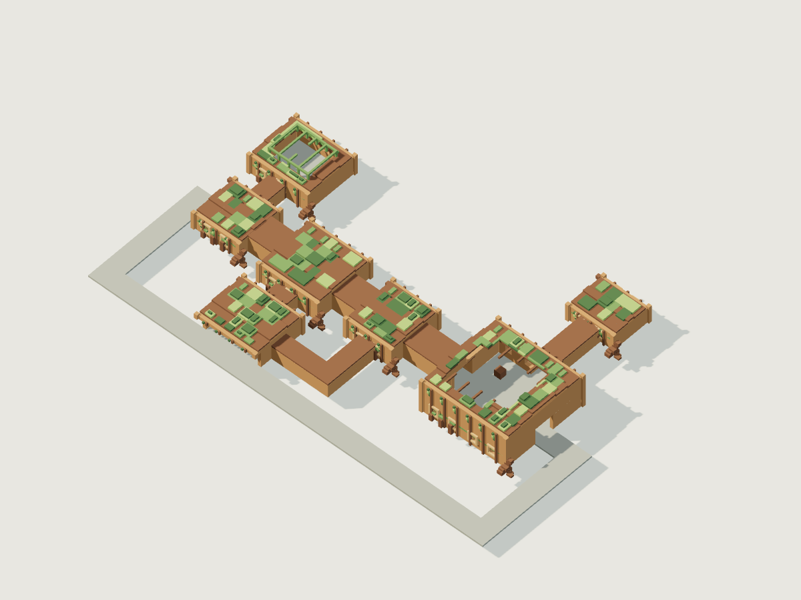

시각 원형 · [복셀 원본](../../design/assets/models/root_manor.voxel.json) · [GLB](../../design/assets/exports/root_manor.glb) · [지붕을 숨긴 내부](../../design/assets/previews/root_manor-cutaway.png)

잎으로 덮인 경사 지붕과 뿌리가 벌린 외벽. 낮은 현관, 천창이 난 온실, 외벽이 무너진 연회장이 실루엣을 만든다.

- 고유 동선: 현관의 생산실 막다른 분기와 중앙 순환 회랑. 방 수 7.
- 건축 블록: `log`, `plank`, `stone`, `moss`. 지형 후보 경사 상한 12도.
- 예약 부지 xz: [-16, -43.0] ~ [108.0, 35]m. 벽체·통로 폭·외곽 퇴로 및 여유 1m 포함.
- 내부 생태: 낙엽과 천창의 빛으로 균류·이끼를 생산; 빗물 집수로 내부 먹이망을 유지한다.
- 생산실/저수실 먹이 생산: 시간당 40/19단위(1단위=100CP), 물 소비 시간당 4/2L. 현재 초기 유기개체 기초대사 2923.2CP/h의 2배를 올림 배정. 초기 식물 먹이 118단위, 초기 사체 먹이 1138CP는 유한 재고.

| 방 ID | 이름 | 중심 좌표 | 유효 크기 x·y·z | 초기/최대 일반개체 |
|---|---|---|---|---|
| `entrance` | 진입 전실 | [0, 0, 0] | [12, 5, 12] | 없음 |
| `production` | 썩은 낙엽 온실 | [0, 0, -22] | [16, 6, 14] | azure_beetle 4/4, moss_deer 1/1 |
| `workshop` | 목공 보관실 | [24, 0, 0] | [16, 6, 16] | root_stalker 1/1 |
| `cistern` | 빗물 지하정 | [24, 0, 22] | [16, 6, 14] | azure_beetle 2/2, moss_deer 1/1 |
| `antechamber` | 뿌리 회랑 | [48, 0, 0] | [12, 6, 14] | root_stalker 1/1 |
| `arena` | 무너진 연회장 | [82, 0, 0] | [24, 10, 24] | 없음 |
| `archive` | 가문의 기록실 | [82, 0, -36] | [12, 5, 10] | 없음 |

| 연결 | 경로 좌표 | 통로 폭×높이 |
|---|---|---|
| entrance ↔ production | [0, 0, -6] → [0, 0, -15] | 3×4m |
| entrance ↔ workshop | [6, 0, 0] → [16, 0, 0] | 6×5m |
| workshop ↔ cistern | [24, 0, 8] → [24, 0, 15] | 4×4m |
| workshop ↔ antechamber | [32, 0, 0] → [42, 0, 0] | 6×5m |
| cistern ↔ antechamber | [32, 0, 22] → [48, 0, 22] → [48, 0, 7] | 3×4m |
| antechamber ↔ arena | [54, 0, 0] → [70.0, 0, 0] | 6×5m |
| arena ↔ archive | [82, 0, -12.0] → [82, 0, -31] | 4×4m |

**환경 퍼즐: 뿌리에 눌린 운반문**. workshop→antechamber 구간을 다룬다.

- 지렛대 기능 컴포넌트로 문을 들어 고정.
- 좌측 썩은 판재 벽을 절단하여 통로 개척.
- 온실의 높은 창까지 발판을 조립하여 우회.
- 상태 일관성: 문 자체의 하중과 접합 상태가 개방 여부를 결정. 손잡이 이벤트가 없어도 실제 빈 공간은 통행 가능.

보스 `rootback_beast`의 전장은 arena다. 중앙 z=-3~3m 구간은 영구 위험·장애물을 두지 않는 동서 퇴로다. 파괴 가능한 2×2×2m 엄폐물 4개는 방 폭/깊이의 ±30%를 0.5m 격자에 반올림한 위치에 배치한다. 실제 좌표는 JSON의 obstacles에 있다. 비행·차량을 허용하며 천장은 위 표의 실제 높이다.

저수조는 중심 [24,-1,22], 크기 8×1×6m, 물 48,000L. 폭 3m 이상 보행 여백을 유지해 수영을 강요하지 않는다. 환경 위험 유체는 기본 식수조와 분리하여 보스 장치 명세에 배치한다.

보상 풀 `reward_root_manor`: workshop [28,0,-4]의 salvage, archive [82,0,-38]의 archive, arena [82,0,0]의 boss 채널. 기록실은 보스 독립 연구 가속, 보스 채널은 실제 처치 보상이다. 세부 품목·수량은 성장 데이터가 소유한다.

표면 블록 배정: wall=`plank`, floor=`stone`, roof=`log`, trim=`moss`.
기능 장치 앵커: `joint` [21, 0, -4]; 각 설치 예약 크기 2×2×2m. 실제 기능·입출력은 성장 컴포넌트 계약을 사용하며 무한 공급을 주지 않는다. 주 통로 장애 예약은 [37,0,0], 1×4×5m; 개방 시 6×5m 통로 확보.

## 폐채굴 요새 — `mining_fort`

<!-- asset:mining_fort -->
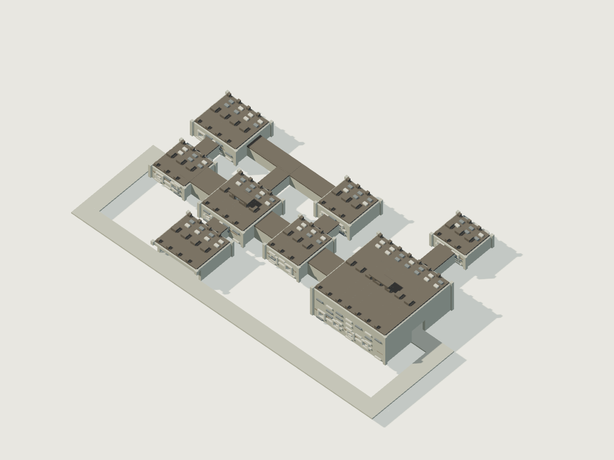

시각 원형 · [복셀 원본](../../design/assets/models/mining_fort.voxel.json) · [GLB](../../design/assets/exports/mining_fort.glb) · [지붕을 숨긴 내부](../../design/assets/previews/mining_fort-cutaway.png)

석벽 기단 위 무너진 갱도 지붕과 금속 보강대. 입구의 폐운반 레일이 내부 선별장까지 이어진다.

- 고유 동선: 광석 점검갱을 잇는 북쪽 운반 루프와 남쪽 집수 막다른 분기. 방 수 8.
- 건축 블록: `stone`, `iron_scrap_block`, `rubble`. 지형 후보 경사 상한 18도.
- 예약 부지 xz: [-16, -43.0] ~ [110.0, 35]m. 벽체·통로 폭·외곽 퇴로 및 여유 1m 포함.
- 내부 생태: 잔존 목재·지하수에서 균류가 자라며 굴 생물의 먹이를 제공. 광석은 먹이가 아니라 서식 표면이다.
- 생산실/저수실 먹이 생산: 시간당 24/12단위(1단위=100CP), 물 소비 시간당 4/2L. 현재 초기 유기개체 기초대사 1800.0CP/h의 2배를 올림 배정. 초기 식물 먹이 72단위, 초기 사체 먹이 720CP는 유한 재고.

| 방 ID | 이름 | 중심 좌표 | 유효 크기 x·y·z | 초기/최대 일반개체 |
|---|---|---|---|---|
| `entrance` | 진입 전실 | [0, 0, 0] | [12, 5, 12] | 없음 |
| `production` | 균류 배양 갱 | [0, 0, -22] | [16, 6, 14] | ore_mite 4/4, scree_hare 1/1 |
| `workshop` | 광석 선별장 | [24, 0, 0] | [16, 6, 16] | shaft_weasel 1/1 |
| `cistern` | 갱내 집수실 | [24, 0, 22] | [16, 6, 14] | ore_mite 2/2, scree_hare 1/1 |
| `antechamber` | 운반차 대기실 | [48, 0, 0] | [12, 6, 14] | shaft_weasel 1/1 |
| `arena` | 중앙 굴착장 | [82, 0, 0] | [28, 12, 28] | 없음 |
| `archive` | 측량 기록고 | [82, 0, -36] | [12, 5, 10] | 없음 |
| `ore_gallery` | 지지대 점검갱 | [48, 0, -22] | [12, 6, 12] | 없음 |

| 연결 | 경로 좌표 | 통로 폭×높이 |
|---|---|---|
| entrance ↔ production | [0, 0, -6] → [0, 0, -15] | 3×4m |
| entrance ↔ workshop | [6, 0, 0] → [16, 0, 0] | 6×5m |
| production ↔ workshop | [8, 0, -22] → [24, 0, -22] → [24, 0, -8] | 3×4m |
| workshop ↔ cistern | [24, 0, 8] → [24, 0, 15] | 4×4m |
| workshop ↔ antechamber | [32, 0, 0] → [42, 0, 0] | 6×5m |
| antechamber ↔ arena | [54, 0, 0] → [68.0, 0, 0] | 6×5m |
| arena ↔ archive | [82, 0, -14.0] → [82, 0, -31] | 4×4m |
| production ↔ ore_gallery | [8, 0, -22] → [42, 0, -22] | 4×4m |
| ore_gallery ↔ antechamber | [48, 0, -16] → [48, 0, -7] | 4×4m |

**환경 퍼즐: 낙석과 기울어진 운반교**. workshop→antechamber 구간을 다룬다.

- 낙석을 분리해 운반하고 접합부를 보수.
- 반대편 보행 갱도로 돌아 교량 아래를 통과.
- 자체 지지 다리를 조립하여 기계용 경로 확보.
- 상태 일관성: 낙석을 옮겨도 원래 위치에 새 낙석을 생성하지 않는다. 보수 전후 실제 지지와 하중을 계산.

보스 `mine_carapace`의 전장은 arena다. 중앙 z=-3~3m 구간은 영구 위험·장애물을 두지 않는 동서 퇴로다. 파괴 가능한 2×2×2m 엄폐물 4개는 방 폭/깊이의 ±30%를 0.5m 격자에 반올림한 위치에 배치한다. 실제 좌표는 JSON의 obstacles에 있다. 비행·차량을 허용하며 천장은 위 표의 실제 높이다.

저수조는 중심 [24,-1,22], 크기 8×1×6m, 물 48,000L. 폭 3m 이상 보행 여백을 유지해 수영을 강요하지 않는다. 환경 위험 유체는 기본 식수조와 분리하여 보스 장치 명세에 배치한다.

보상 풀 `reward_mining_fort`: workshop [28,0,-4]의 salvage, archive [82,0,-38]의 archive, arena [82,0,0]의 boss 채널. 기록실은 보스 독립 연구 가속, 보스 채널은 실제 처치 보상이다. 세부 품목·수량은 성장 데이터가 소유한다.

표면 블록 배정: wall=`stone`, floor=`stone`, roof=`iron_scrap_block`, trim=`rubble`.
기능 장치 앵커: `joint` [21, 0, -4], `transmission` [27, 0, -4]; 각 설치 예약 크기 2×2×2m. 실제 기능·입출력은 성장 컴포넌트 계약을 사용하며 무한 공급을 주지 않는다. 주 통로 장애 예약은 [37,0,0], 1×4×5m; 개방 시 6×5m 통로 확보.

## 침수된 수문 시설 — `floodworks`

<!-- asset:floodworks -->
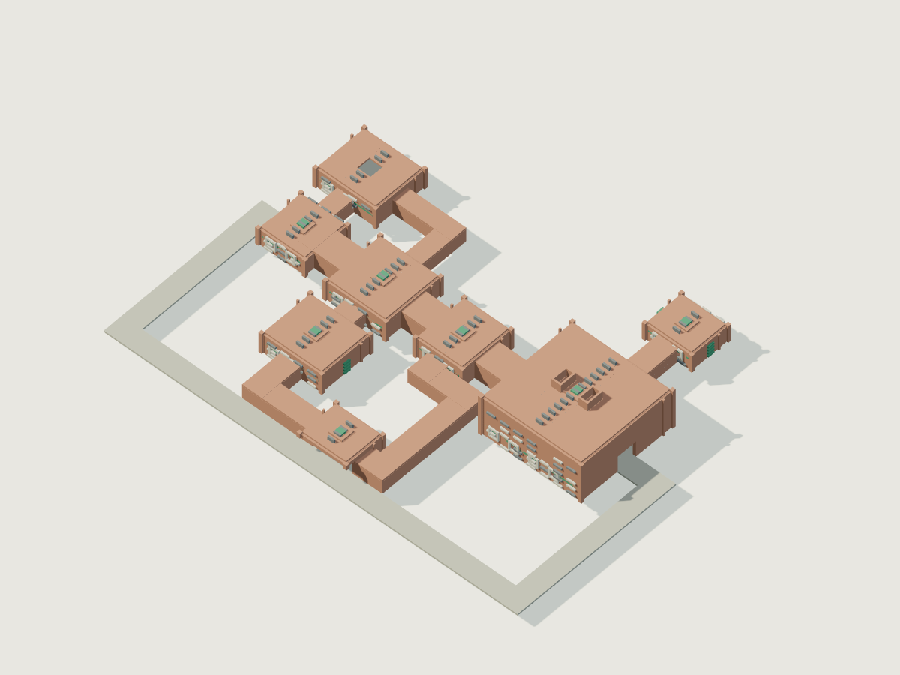

시각 원형 · [복셀 원본](../../design/assets/models/floodworks.voxel.json) · [GLB](../../design/assets/exports/floodworks.glb) · [지붕을 숨긴 내부](../../design/assets/previews/floodworks-cutaway.png)

젖은 벽돌 아치와 두 개의 외부 배수구. 상단 수위 표식으로 위험한 물의 깊이를 입구에서 읽을 수 있다.

- 고유 동선: 저수-여과-수문 순환과 별도 생산실 삼각 루프. 방 수 8.
- 건축 블록: `clay_brick`, `stone`, `algae`. 지형 후보 경사 상한 8도.
- 예약 부지 xz: [-16, -43.0] ~ [110.0, 50.0]m. 벽체·통로 폭·외곽 퇴로 및 여유 1m 포함.
- 내부 생태: 천창의 조류·수생 식물과 유입 퇴적물로 생산층을 유지; 외부 수역과 격자 수문으로 분리된다.
- 생산실/저수실 먹이 생산: 시간당 98/49단위(1단위=100CP), 물 소비 시간당 4/2L. 현재 초기 유기개체 기초대사 7336.8CP/h의 2배를 올림 배정. 초기 식물 먹이 294단위, 초기 사체 먹이 2088CP는 유한 재고.

| 방 ID | 이름 | 중심 좌표 | 유효 크기 x·y·z | 초기/최대 일반개체 |
|---|---|---|---|---|
| `entrance` | 진입 전실 | [0, 0, 0] | [12, 5, 12] | 없음 |
| `production` | 조류 배양조 | [0, 0, -22] | [16, 6, 14] | silt_snail 6/6, reed_grazer 2/2 |
| `workshop` | 펌프 정비실 | [24, 0, 0] | [16, 6, 16] | drain_eel 2/2 |
| `cistern` | 침전 저수조 | [24, 0, 22] | [16, 6, 14] | silt_snail 4/4, reed_grazer 2/2 |
| `antechamber` | 수문 관리실 | [48, 0, 0] | [12, 6, 14] | drain_eel 2/2 |
| `arena` | 대형 배수조 | [82, 0, 0] | [28, 12, 28] | drain_eel 1/1 |
| `archive` | 방수 기록실 | [82, 0, -36] | [12, 5, 10] | 없음 |
| `filter_gallery` | 퇴적물 여과실 | [48, 0, 40] | [12, 6, 10] | 없음 |

| 연결 | 경로 좌표 | 통로 폭×높이 |
|---|---|---|
| entrance ↔ production | [0, 0, -6] → [0, 0, -15] | 3×4m |
| entrance ↔ workshop | [6, 0, 0] → [16, 0, 0] | 6×5m |
| production ↔ workshop | [8, 0, -22] → [24, 0, -22] → [24, 0, -8] | 3×4m |
| workshop ↔ cistern | [24, 0, 8] → [24, 0, 15] | 4×4m |
| workshop ↔ antechamber | [32, 0, 0] → [42, 0, 0] | 6×5m |
| antechamber ↔ arena | [54, 0, 0] → [68.0, 0, 0] | 6×5m |
| arena ↔ archive | [82, 0, -14.0] → [82, 0, -31] | 4×4m |
| cistern ↔ filter_gallery | [24, 0, 29] → [24, 0, 40] → [42, 0, 40] | 4×4m |
| filter_gallery ↔ antechamber | [54, 0, 40] → [60, 0, 40] → [60, 0, 12] → [48, 0, 12] → [48, 0, 7] | 4×4m |

**환경 퍼즐: 높은 수위와 산성 유체**. workshop→antechamber 구간을 다룬다.

- 기존 펌프에 동력을 공급하여 우회 저장조로 이송.
- 고가 보행로에 발판을 연결해 건식 통행.
- 내식 용기와 이동 기계를 준비하여 수로 통과.
- 상태 일관성: 벽 파괴로 생긴 누수도 동일 유체 수지에 반영. 배수 퍼즐 플래그로 물을 삭제하지 않는다.

보스 `sluice_acidworm`의 전장은 arena다. 중앙 z=-3~3m 구간은 영구 위험·장애물을 두지 않는 동서 퇴로다. 파괴 가능한 2×2×2m 엄폐물 4개는 방 폭/깊이의 ±30%를 0.5m 격자에 반올림한 위치에 배치한다. 실제 좌표는 JSON의 obstacles에 있다. 비행·차량을 허용하며 천장은 위 표의 실제 높이다.

저수조는 중심 [24,-1,22], 크기 8×1×6m, 물 48,000L. 폭 3m 이상 보행 여백을 유지해 수영을 강요하지 않는다. 환경 위험 유체는 기본 식수조와 분리하여 보스 장치 명세에 배치한다.

보상 풀 `reward_floodworks`: workshop [28,0,-4]의 salvage, archive [82,0,-38]의 archive, arena [82,0,0]의 boss 채널. 기록실은 보스 독립 연구 가속, 보스 채널은 실제 처치 보상이다. 세부 품목·수량은 성장 데이터가 소유한다.

표면 블록 배정: wall=`clay_brick`, floor=`stone`, roof=`clay_brick`, trim=`algae`.
기능 장치 앵커: `pump` [21, 0, -4], `fluid_container` [27, 0, -4]; 각 설치 예약 크기 2×2×2m. 실제 기능·입출력은 성장 컴포넌트 계약을 사용하며 무한 공급을 주지 않는다. 주 통로 장애 예약은 [37,0,0], 1×4×5m; 개방 시 6×5m 통로 확보.

## 지열 주조소 — `geothermal_foundry`

<!-- asset:geothermal_foundry -->
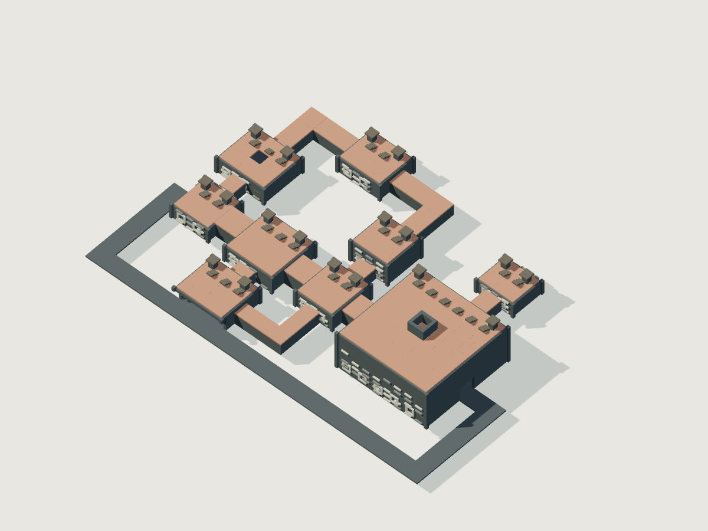

시각 원형 · [복셀 원본](../../design/assets/models/geothermal_foundry.voxel.json) · [GLB](../../design/assets/exports/geothermal_foundry.glb) · [지붕을 숨긴 내부](../../design/assets/previews/geothermal_foundry-cutaway.png)

현무암 기단, 냉각탑, 끊어진 주조 홈. 붉은 배기광과 차가운 수조의 청록광으로 경로를 구별한다.

- 고유 동선: 생산-침전-열원-압력 제어의 긴 북쪽 루프와 냉각 우회. 방 수 9.
- 건축 블록: `basalt`, `clay_brick`, `iron_scrap_block`. 지형 후보 경사 상한 15도.
- 예약 부지 xz: [-16, -52.0] ~ [112.0, 35]m. 벽체·통로 폭·외곽 퇴로 및 여유 1m 포함.
- 내부 생태: 열수 주변의 미생물 생산층과 냉각정원의 식생이 소비자를 먹인다. 생물 구획은 직접 용암과 분리된다.
- 생산실/저수실 먹이 생산: 시간당 98/48단위(1단위=100CP), 물 소비 시간당 4/2L. 현재 초기 유기개체 기초대사 7279.2CP/h의 2배를 올림 배정. 초기 식물 먹이 292단위, 초기 사체 먹이 5256CP는 유한 재고.

| 방 ID | 이름 | 중심 좌표 | 유효 크기 x·y·z | 초기/최대 일반개체 |
|---|---|---|---|---|
| `entrance` | 진입 전실 | [0, 0, 0] | [12, 5, 12] | 없음 |
| `production` | 냉각 생태정원 | [0, 0, -22] | [16, 6, 14] | vent_grub 6/6, ash_goat 2/2 |
| `workshop` | 합금 작업실 | [24, 0, 0] | [16, 6, 16] | furnace_mantis 2/2 |
| `cistern` | 냉각수 회수조 | [24, 0, 22] | [16, 6, 14] | vent_grub 4/4, ash_goat 2/2 |
| `antechamber` | 압력 분기실 | [48, 0, 0] | [12, 6, 14] | furnace_mantis 2/2 |
| `arena` | 중앙 용광실 | [82, 0, 0] | [32, 14, 32] | furnace_mantis 1/1 |
| `archive` | 내열 설계고 | [82, 0, -36] | [12, 5, 10] | 없음 |
| `heat_intake` | 열원 유입실 | [48, 0, -22] | [12, 8, 12] | 없음 |
| `slag_store` | 슬래그 침전실 | [24, 0, -44] | [14, 6, 12] | 없음 |

| 연결 | 경로 좌표 | 통로 폭×높이 |
|---|---|---|
| entrance ↔ production | [0, 0, -6] → [0, 0, -15] | 3×4m |
| entrance ↔ workshop | [6, 0, 0] → [16, 0, 0] | 6×5m |
| workshop ↔ cistern | [24, 0, 8] → [24, 0, 15] | 4×4m |
| workshop ↔ antechamber | [32, 0, 0] → [42, 0, 0] | 6×5m |
| cistern ↔ antechamber | [32, 0, 22] → [48, 0, 22] → [48, 0, 7] | 3×4m |
| antechamber ↔ arena | [54, 0, 0] → [66.0, 0, 0] | 6×5m |
| arena ↔ archive | [82, 0, -16.0] → [82, 0, -31] | 4×4m |
| production ↔ slag_store | [0, 0, -29] → [0, 0, -44] → [17, 0, -44] | 4×4m |
| slag_store ↔ heat_intake | [31, 0, -44] → [48, 0, -44] → [48, 0, -28] | 4×4m |
| heat_intake ↔ antechamber | [48, 0, -16] → [48, 0, -7] | 4×4m |

**환경 퍼즐: 과열된 주조 통로**. workshop→antechamber 구간을 다룬다.

- 밸브를 바꾸고 냉각수를 순환시켜 안전 온도 확보.
- 차폐판과 내열 기계를 조립해 통과.
- 상부 정비 측면 통로로 우회하고 출구 쪽 차단기 조작.
- 상태 일관성: 열원·냉각수·배관 단절을 실상태로 계산. 벽을 뚫으면 열 확산 경로가 바뀌며 즉시 안전 처리하지 않는다.

보스 `furnace_carapace`의 전장은 arena다. 중앙 z=-3~3m 구간은 영구 위험·장애물을 두지 않는 동서 퇴로다. 파괴 가능한 2×2×2m 엄폐물 4개는 방 폭/깊이의 ±30%를 0.5m 격자에 반올림한 위치에 배치한다. 실제 좌표는 JSON의 obstacles에 있다. 비행·차량을 허용하며 천장은 위 표의 실제 높이다.

저수조는 중심 [24,-1,22], 크기 8×1×6m, 물 48,000L. 폭 3m 이상 보행 여백을 유지해 수영을 강요하지 않는다. 환경 위험 유체는 기본 식수조와 분리하여 보스 장치 명세에 배치한다.

보상 풀 `reward_geothermal_foundry`: workshop [28,0,-4]의 salvage, archive [82,0,-38]의 archive, arena [82,0,0]의 boss 채널. 기록실은 보스 독립 연구 가속, 보스 채널은 실제 처치 보상이다. 세부 품목·수량은 성장 데이터가 소유한다.

표면 블록 배정: wall=`basalt`, floor=`basalt`, roof=`clay_brick`, trim=`iron_scrap_block`.
기능 장치 앵커: `pump` [21, 0, -4], `heat_engine` [27, 0, -4]; 각 설치 예약 크기 2×2×2m. 실제 기능·입출력은 성장 컴포넌트 계약을 사용하며 무한 공급을 주지 않는다. 주 통로 장애 예약은 [37,0,0], 1×4×5m; 개방 시 6×5m 통로 확보.

## 절벽 관측성 — `cliff_observatory`

<!-- asset:cliff_observatory -->
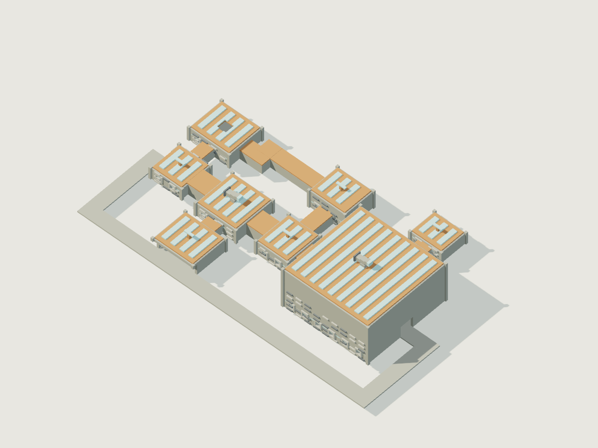

시각 원형 · [복셀 원본](../../design/assets/models/cliff_observatory.voxel.json) · [GLB](../../design/assets/exports/cliff_observatory.glb) · [지붕을 숨긴 내부](../../design/assets/previews/cliff_observatory-cutaway.png)

절벽을 향한 넓은 관측광장과 깨진 유리 온실, 바람깃 세 개. 대표 템플릿은 절벽 정상 단층이며 첨탑은 출입 불가 장식이 아닌 추후 별도 층 모듈이다.

- 고유 동선: 북쪽 풍향 정비 우회와 남쪽 담수 가지. 방 수 8.
- 건축 블록: `stone`, `glass`, `plank`. 지형 후보 경사 상한 18도.
- 예약 부지 xz: [-16, -43.0] ~ [114.0, 35]m. 벽체·통로 폭·외곽 퇴로 및 여유 1m 포함.
- 내부 생태: 온실 식생과 담수조 조류가 소비자를 지탱; 외부와 좁은 창·배수관으로만 연결한다.
- 생산실/저수실 먹이 생산: 시간당 81/40단위(1단위=100CP), 물 소비 시간당 4/2L. 현재 초기 유기개체 기초대사 6004.8CP/h의 2배를 올림 배정. 초기 식물 먹이 242단위, 초기 사체 먹이 3600CP는 유한 재고.

| 방 ID | 이름 | 중심 좌표 | 유효 크기 x·y·z | 초기/최대 일반개체 |
|---|---|---|---|---|
| `entrance` | 진입 전실 | [0, 0, 0] | [12, 5, 12] | 없음 |
| `production` | 채광 온실 | [0, 0, -22] | [16, 6, 14] | tide_crab 6/6, cliff_ibex 2/2 |
| `workshop` | 기상 계측실 | [24, 0, 0] | [16, 6, 16] | cistern_serpent 2/2 |
| `cistern` | 담수 집수조 | [24, 0, 22] | [16, 6, 14] | tide_crab 4/4, cliff_ibex 2/2 |
| `antechamber` | 풍향 조절실 | [48, 0, 0] | [12, 6, 14] | cistern_serpent 2/2 |
| `arena` | 개방 관측광장 | [82, 0, 0] | [36, 18, 36] | cistern_serpent 1/1 |
| `archive` | 항법 기록실 | [82, 0, -36] | [12, 5, 10] | 없음 |
| `weather_deck` | 바람깃 정비대 | [48, 0, -26] | [14, 8, 12] | 없음 |

| 연결 | 경로 좌표 | 통로 폭×높이 |
|---|---|---|
| entrance ↔ production | [0, 0, -6] → [0, 0, -15] | 3×4m |
| entrance ↔ workshop | [6, 0, 0] → [16, 0, 0] | 6×5m |
| workshop ↔ cistern | [24, 0, 8] → [24, 0, 15] | 4×4m |
| workshop ↔ antechamber | [32, 0, 0] → [42, 0, 0] | 6×5m |
| antechamber ↔ arena | [54, 0, 0] → [64.0, 0, 0] | 6×5m |
| arena ↔ archive | [82, 0, -18.0] → [82, 0, -31] | 4×4m |
| production ↔ weather_deck | [8, 0, -22] → [16, 0, -22] → [16, 0, -26] → [41, 0, -26] | 4×4m |
| weather_deck ↔ antechamber | [48, 0, -20] → [48, 0, -7] | 4×4m |

**환경 퍼즐: 횡풍이 부는 외부 연결로**. workshop→antechamber 구간을 다룬다.

- 풍향판을 회전 고정해 바람을 분산.
- 난간·무거운 지지 구조를 조립해 안전 통로 마련.
- 비행 장치로 외벽 개구부에 접근.
- 상태 일관성: 풍향판을 떼면 차폐 효과 소멸. 비행 진입도 동일 방 방문·보상 상태를 사용하며 보행 진입을 요구하지 않는다.

보스 `spire_glider`의 전장은 arena다. 중앙 z=-3~3m 구간은 영구 위험·장애물을 두지 않는 동서 퇴로다. 파괴 가능한 2×2×2m 엄폐물 4개는 방 폭/깊이의 ±30%를 0.5m 격자에 반올림한 위치에 배치한다. 실제 좌표는 JSON의 obstacles에 있다. 비행·차량을 허용하며 천장은 위 표의 실제 높이다.

저수조는 중심 [24,-1,22], 크기 8×1×6m, 물 48,000L. 폭 3m 이상 보행 여백을 유지해 수영을 강요하지 않는다. 환경 위험 유체는 기본 식수조와 분리하여 보스 장치 명세에 배치한다.

보상 풀 `reward_cliff_observatory`: workshop [28,0,-4]의 salvage, archive [82,0,-38]의 archive, arena [82,0,0]의 boss 채널. 기록실은 보스 독립 연구 가속, 보스 채널은 실제 처치 보상이다. 세부 품목·수량은 성장 데이터가 소유한다.

표면 블록 배정: wall=`stone`, floor=`stone`, roof=`plank`, trim=`glass`.
기능 장치 앵커: `joint` [21, 0, -4], `controller` [27, 0, -4]; 각 설치 예약 크기 2×2×2m. 실제 기능·입출력은 성장 컴포넌트 계약을 사용하며 무한 공급을 주지 않는다. 주 통로 장애 예약은 [37,0,0], 1×4×5m; 개방 시 6×5m 통로 확보.

## 봉인된 수목원 — `sealed_arboretum`

<!-- asset:sealed_arboretum -->
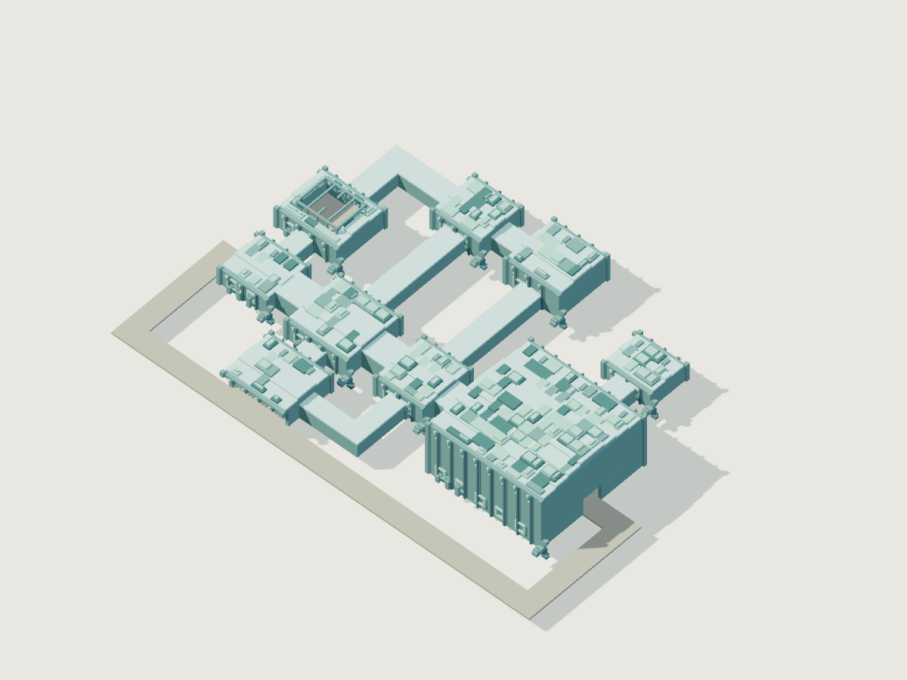

시각 원형 · [복셀 원본](../../design/assets/models/sealed_arboretum.voxel.json) · [GLB](../../design/assets/exports/sealed_arboretum.glb) · [지붕을 숨긴 내부](../../design/assets/previews/sealed_arboretum-cutaway.png)

살아 있는 듯 휘어진 마나 목재 프레임과 투명 천창. 빛나는 뿌리 배관은 기능 컴포넌트가 연결된 구간에서만 작동한다.

- 고유 동선: 종자-배양-공생을 잇는 북쪽 순환과 중앙 작업실 연결. 방 수 9.
- 건축 블록: `mana_log`, `stone`, `glass`. 지형 후보 경사 상한 12도.
- 예약 부지 xz: [-16, -53.0] ~ [112.0, 35]m. 벽체·통로 폭·외곽 퇴로 및 여유 1m 포함.
- 내부 생태: 빛·물·마나가 함께 필요한 식생 생산층. 마나가 끊기면 특수 생산만 멈추고 잔존 보통 식량은 유지한다.
- 생산실/저수실 먹이 생산: 시간당 82/41단위(1단위=100CP), 물 소비 시간당 4/2L. 현재 초기 유기개체 기초대사 6109.2CP/h의 2배를 올림 배정. 초기 식물 먹이 246단위, 초기 사체 먹이 2628CP는 유한 재고.

| 방 ID | 이름 | 중심 좌표 | 유효 크기 x·y·z | 초기/최대 일반개체 |
|---|---|---|---|---|
| `entrance` | 진입 전실 | [0, 0, 0] | [12, 5, 12] | 없음 |
| `production` | 마나 광합성실 | [0, 0, -22] | [16, 6, 14] | mana_moth 6/6, prism_deer 2/2 |
| `workshop` | 응집기 정비실 | [24, 0, 0] | [16, 6, 16] | root_weaver 2/2 |
| `cistern` | 마나 침전조 | [24, 0, 22] | [16, 6, 14] | mana_moth 4/4, prism_deer 2/2 |
| `antechamber` | 수관 접합실 | [48, 0, 0] | [12, 6, 14] | root_weaver 2/2 |
| `arena` | 중앙 공생정원 | [82, 0, 0] | [32, 16, 32] | root_weaver 1/1 |
| `archive` | 배양 기록고 | [82, 0, -36] | [12, 5, 10] | 없음 |
| `seed_bank` | 휴면 종자고 | [24, 0, -44] | [12, 6, 12] | 없음 |
| `nursery` | 접목 배양실 | [48, 0, -44] | [14, 8, 14] | 없음 |

| 연결 | 경로 좌표 | 통로 폭×높이 |
|---|---|---|
| entrance ↔ production | [0, 0, -6] → [0, 0, -15] | 3×4m |
| entrance ↔ workshop | [6, 0, 0] → [16, 0, 0] | 6×5m |
| workshop ↔ cistern | [24, 0, 8] → [24, 0, 15] | 4×4m |
| workshop ↔ antechamber | [32, 0, 0] → [42, 0, 0] | 6×5m |
| cistern ↔ antechamber | [32, 0, 22] → [48, 0, 22] → [48, 0, 7] | 3×4m |
| antechamber ↔ arena | [54, 0, 0] → [66.0, 0, 0] | 6×5m |
| arena ↔ archive | [82, 0, -16.0] → [82, 0, -31] | 4×4m |
| production ↔ seed_bank | [0, 0, -29] → [0, 0, -44] → [18, 0, -44] | 4×4m |
| seed_bank ↔ nursery | [30, 0, -44] → [41, 0, -44] | 4×4m |
| nursery ↔ antechamber | [48, 0, -37] → [48, 0, -7] | 4×4m |
| seed_bank ↔ workshop | [24, 0, -38] → [24, 0, -8] | 4×4m |

**환경 퍼즐: 팽창한 수관과 마나 흐름**. workshop→antechamber 구간을 다룬다.

- 유체 분기기로 마나 공급을 줄여 수관 팽창 해제.
- 허용된 절단 도구로 수관을 개척.
- 마나 배관을 우회 연결하여 다른 통로의 수관을 수축.
- 상태 일관성: 잘린 가지는 object로 분리. 배관 우회는 실제 연결성이 있어야 하며 외형만으로 마나 흐름을 만들지 않는다.

보스 `arboretum_symbiote`의 전장은 arena다. 중앙 z=-3~3m 구간은 영구 위험·장애물을 두지 않는 동서 퇴로다. 파괴 가능한 2×2×2m 엄폐물 4개는 방 폭/깊이의 ±30%를 0.5m 격자에 반올림한 위치에 배치한다. 실제 좌표는 JSON의 obstacles에 있다. 비행·차량을 허용하며 천장은 위 표의 실제 높이다.

저수조는 중심 [24,-1,22], 크기 8×1×6m, 물 48,000L. 폭 3m 이상 보행 여백을 유지해 수영을 강요하지 않는다. 환경 위험 유체는 기본 식수조와 분리하여 보스 장치 명세에 배치한다.

보상 풀 `reward_sealed_arboretum`: workshop [28,0,-4]의 salvage, archive [82,0,-38]의 archive, arena [82,0,0]의 boss 채널. 기록실은 보스 독립 연구 가속, 보스 채널은 실제 처치 보상이다. 세부 품목·수량은 성장 데이터가 소유한다.

표면 블록 배정: wall=`mana_log`, floor=`stone`, roof=`glass`, trim=`mana_log`.
기능 장치 앵커: `pump` [21, 0, -4], `mana_condenser` [27, 0, -4]; 각 설치 예약 크기 2×2×2m. 실제 기능·입출력은 성장 컴포넌트 계약을 사용하며 무한 공급을 주지 않는다. 주 통로 장애 예약은 [37,0,0], 1×4×5m; 개방 시 6×5m 통로 확보.

## 잊힌 신의 수도원 — `forgotten_monastery`

<!-- asset:forgotten_monastery -->
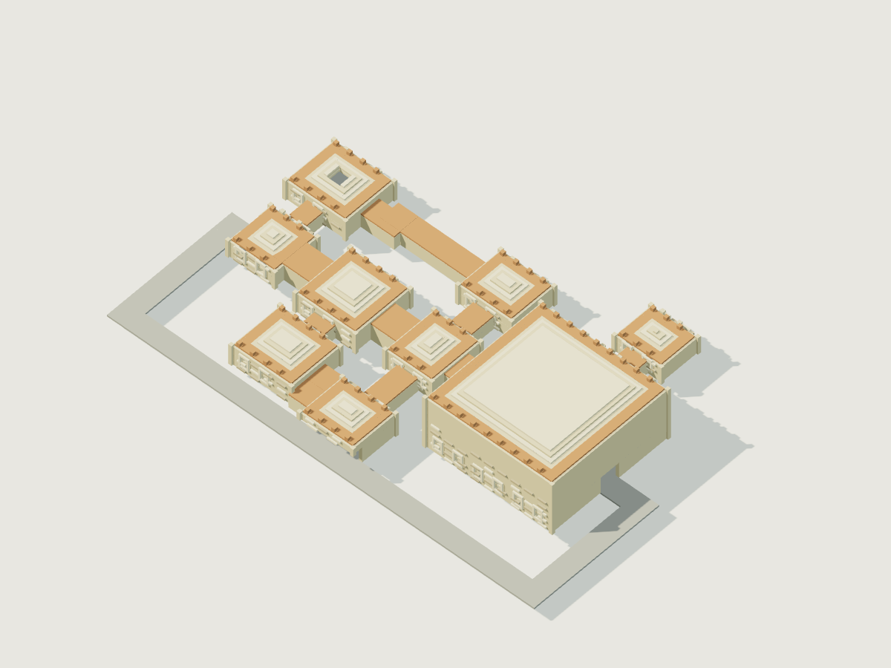

시각 원형 · [복셀 원본](../../design/assets/models/forgotten_monastery.voxel.json) · [GLB](../../design/assets/exports/forgotten_monastery.glb) · [지붕을 숨긴 내부](../../design/assets/previews/forgotten_monastery-cutaway.png)

기본 환경의 풍화 흔적 위에 성역 문양과 비어 있는 종루가 겹친다. 시련 예배당 양측의 탈출 아치는 항상 식별 가능하다.

- 고유 동선: 북쪽 순례 접근과 남쪽 봉헌 정비의 대칭 기능 분기. 방 수 9.
- 건축 블록: `sacred_stone`, `stone`, `plank`. 지형 후보 경사 상한 12도.
- 예약 부지 xz: [-16, -43.0] ~ [114.0, 39.0]m. 벽체·통로 폭·외곽 퇴로 및 여유 1m 포함.
- 내부 생태: 천창 정원·식물 잔재가 생물 먹이망을 이룬다. 무기 경비는 식량과 별개로 정비 자원과 성물 공급을 사용한다.
- 생산실/저수실 먹이 생산: 시간당 34/17단위(1단위=100CP), 물 소비 시간당 4/2L. 현재 초기 유기개체 기초대사 2520.0CP/h의 2배를 올림 배정. 초기 식물 먹이 102단위, 초기 사체 먹이 0CP는 유한 재고.

| 방 ID | 이름 | 중심 좌표 | 유효 크기 x·y·z | 초기/최대 일반개체 |
|---|---|---|---|---|
| `entrance` | 진입 전실 | [0, 0, 0] | [12, 5, 12] | 없음 |
| `production` | 촛불 정원 | [0, 0, -22] | [16, 6, 14] | shrine_beetle 6/6, candle_hare 2/2 |
| `workshop` | 성물 정비실 | [24, 0, 0] | [16, 6, 16] | oath_sentinel 2/2 |
| `cistern` | 정화 저수조 | [24, 0, 22] | [16, 6, 14] | shrine_beetle 4/4, candle_hare 2/2 |
| `antechamber` | 서약 회랑 | [48, 0, 0] | [12, 6, 14] | oath_sentinel 2/2 |
| `arena` | 시련 예배당 | [82, 0, 0] | [36, 16, 36] | oath_sentinel 1/1 |
| `archive` | 신앙 기록실 | [82, 0, -36] | [12, 5, 10] | 없음 |
| `pilgrim_hall` | 순례자 대기실 | [48, 0, -24] | [14, 6, 12] | 없음 |
| `votive_chapel` | 봉헌 정비실 | [48, 0, 28] | [14, 7, 12] | 없음 |

| 연결 | 경로 좌표 | 통로 폭×높이 |
|---|---|---|
| entrance ↔ production | [0, 0, -6] → [0, 0, -15] | 3×4m |
| entrance ↔ workshop | [6, 0, 0] → [16, 0, 0] | 6×5m |
| workshop ↔ cistern | [24, 0, 8] → [24, 0, 15] | 4×4m |
| workshop ↔ antechamber | [32, 0, 0] → [42, 0, 0] | 6×5m |
| antechamber ↔ arena | [54, 0, 0] → [64.0, 0, 0] | 6×5m |
| arena ↔ archive | [82, 0, -18.0] → [82, 0, -31] | 4×4m |
| production ↔ pilgrim_hall | [8, 0, -22] → [16, 0, -22] → [16, 0, -24] → [41, 0, -24] | 4×4m |
| pilgrim_hall ↔ antechamber | [48, 0, -18] → [48, 0, -7] | 4×4m |
| cistern ↔ votive_chapel | [32, 0, 22] → [36, 0, 22] → [36, 0, 28] → [41, 0, 28] | 4×4m |
| votive_chapel ↔ antechamber | [48, 0, 22] → [48, 0, 7] | 4×4m |

**환경 퍼즐: 시련의 전달 장치**. workshop→antechamber 구간을 다룬다.

- 정해진 전달 컴포넌트를 연결해 제단 요구 상태 충족.
- 파손 통로를 보수해 정비 출입구로 접근.
- 벽체를 개척해 직접 진입하되 시련 완료 보상은 실제 목표 충족 후 지급.
- 상태 일관성: 직접 진입은 허용하지만 방문과 시련 완료를 분리. 제단 파괴는 자동 완료가 아니며 수리·재설치 경로 제공.

보스 `sanctuary_warden`의 전장은 arena다. 중앙 z=-3~3m 구간은 영구 위험·장애물을 두지 않는 동서 퇴로다. 파괴 가능한 2×2×2m 엄폐물 4개는 방 폭/깊이의 ±30%를 0.5m 격자에 반올림한 위치에 배치한다. 실제 좌표는 JSON의 obstacles에 있다. 비행·차량을 허용하며 천장은 위 표의 실제 높이다.

저수조는 중심 [24,-1,22], 크기 8×1×6m, 물 48,000L. 폭 3m 이상 보행 여백을 유지해 수영을 강요하지 않는다. 환경 위험 유체는 기본 식수조와 분리하여 보스 장치 명세에 배치한다.

보상 풀 `reward_forgotten_monastery`: workshop [28,0,-4]의 salvage, archive [82,0,-38]의 archive, arena [82,0,0]의 boss 채널. 기록실은 보스 독립 연구 가속, 보스 채널은 실제 처치 보상이다. 세부 품목·수량은 성장 데이터가 소유한다.

표면 블록 배정: wall=`sacred_stone`, floor=`stone`, roof=`plank`, trim=`sacred_stone`.
기능 장치 앵커: `relic` [21, 0, -4], `transmission` [27, 0, -4]; 각 설치 예약 크기 2×2×2m. 실제 기능·입출력은 성장 컴포넌트 계약을 사용하며 무한 공급을 주지 않는다. 주 통로 장애 예약은 [37,0,0], 1×4×5m; 개방 시 6×5m 통로 확보.

## 관성 관측탑 — `inertia_tower`

<!-- asset:inertia_tower -->
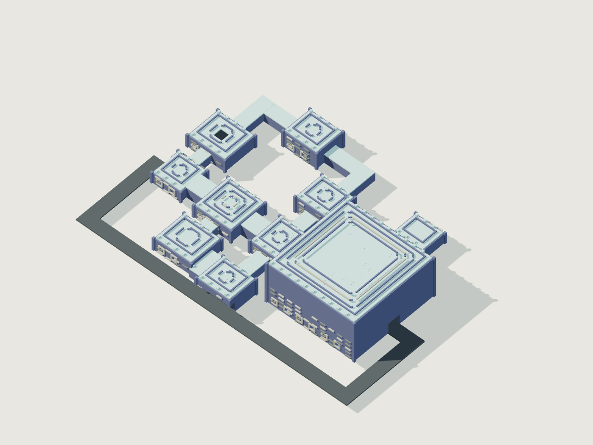

시각 원형 · [복셀 원본](../../design/assets/models/inertia_tower.voxel.json) · [GLB](../../design/assets/exports/inertia_tower.glb) · [지붕을 숨긴 내부](../../design/assets/previews/inertia_tower-cutaway.png)

큰 외곽 링과 중앙 관측 기둥을 갖는 낮고 넓은 관측 시설. 대표 시제품은 단층 실험동이며 다층 탑 변형은 별도 검증 후 추가한다.

- 고유 동선: 북쪽 저장-제어와 남쪽 회송의 독립 우회. 방 수 10.
- 건축 블록: `anomaly_stone`, `basalt`, `glass`. 지형 후보 경사 상한 15도.
- 예약 부지 xz: [-16, -52.0] ~ [116.0, 39.0]m. 벽체·통로 폭·외곽 퇴로 및 여유 1m 포함.
- 내부 생태: 응축수·채광 식생이 생물 소비자를 유지. 무기 경비는 독립 정비소를 통해서만 복구된다.
- 생산실/저수실 먹이 생산: 시간당 74/37단위(1단위=100CP), 물 소비 시간당 4/2L. 현재 초기 유기개체 기초대사 5544.0CP/h의 2배를 올림 배정. 초기 식물 먹이 222단위, 초기 사체 먹이 0CP는 유한 재고.

| 방 ID | 이름 | 중심 좌표 | 유효 크기 x·y·z | 초기/최대 일반개체 |
|---|---|---|---|---|
| `entrance` | 진입 전실 | [0, 0, 0] | [12, 5, 12] | 없음 |
| `production` | 부유 식생실 | [0, 0, -22] | [16, 6, 14] | anchor_tick 6/6, drift_grazer 2/2 |
| `workshop` | 관성 정비실 | [24, 0, 0] | [16, 6, 16] | survey_drone 2/2 |
| `cistern` | 응축 수조 | [24, 0, 22] | [16, 6, 14] | anchor_tick 4/4, drift_grazer 2/2 |
| `antechamber` | 운동량 제어실 | [48, 0, 0] | [12, 6, 14] | survey_drone 2/2 |
| `arena` | 관측 실험장 | [82, 0, 0] | [40, 20, 40] | survey_drone 1/1 |
| `archive` | 물질 기록고 | [82, 0, -36] | [12, 5, 10] | 없음 |
| `control_gallery` | 관측 제어실 | [48, 0, -24] | [14, 8, 12] | 없음 |
| `capacitor_vault` | 관성 저장고 | [24, 0, -44] | [14, 8, 12] | 없음 |
| `return_bay` | 회송 운반실 | [48, 0, 28] | [14, 8, 12] | 없음 |

| 연결 | 경로 좌표 | 통로 폭×높이 |
|---|---|---|
| entrance ↔ production | [0, 0, -6] → [0, 0, -15] | 3×4m |
| entrance ↔ workshop | [6, 0, 0] → [16, 0, 0] | 6×5m |
| workshop ↔ cistern | [24, 0, 8] → [24, 0, 15] | 4×4m |
| workshop ↔ antechamber | [32, 0, 0] → [42, 0, 0] | 6×5m |
| antechamber ↔ arena | [54, 0, 0] → [62.0, 0, 0] | 6×5m |
| arena ↔ archive | [82, 0, -20.0] → [82, 0, -31] | 4×4m |
| production ↔ capacitor_vault | [0, 0, -29] → [0, 0, -44] → [17, 0, -44] | 4×4m |
| capacitor_vault ↔ control_gallery | [31, 0, -44] → [48, 0, -44] → [48, 0, -30] | 4×4m |
| control_gallery ↔ antechamber | [48, 0, -18] → [48, 0, -7] | 4×4m |
| cistern ↔ return_bay | [32, 0, 22] → [36, 0, 22] → [36, 0, 28] → [41, 0, 28] | 4×4m |
| return_bay ↔ antechamber | [48, 0, 22] → [48, 0, 7] | 4×4m |

**환경 퍼즐: 주기적으로 움직이는 운반대**. workshop→antechamber 구간을 다룬다.

- 관성 저장부를 연결해 움직임을 안정화.
- 기계식 잠금 지지물을 조립해 운반대 고정.
- 바깥 정비 통로에서 운반대를 우회.
- 상태 일관성: 운반대 위치·운동량·접합 상태를 저장. 재접속으로 초기 위치나 충전량을 복원하지 않는다.

보스 `observatory_sentinel`의 전장은 arena다. 중앙 z=-3~3m 구간은 영구 위험·장애물을 두지 않는 동서 퇴로다. 파괴 가능한 2×2×2m 엄폐물 4개는 방 폭/깊이의 ±30%를 0.5m 격자에 반올림한 위치에 배치한다. 실제 좌표는 JSON의 obstacles에 있다. 비행·차량을 허용하며 천장은 위 표의 실제 높이다.

저수조는 중심 [24,-1,22], 크기 8×1×6m, 물 48,000L. 폭 3m 이상 보행 여백을 유지해 수영을 강요하지 않는다. 환경 위험 유체는 기본 식수조와 분리하여 보스 장치 명세에 배치한다.

보상 풀 `reward_inertia_tower`: workshop [28,0,-4]의 salvage, archive [82,0,-38]의 archive, arena [82,0,0]의 boss 채널. 기록실은 보스 독립 연구 가속, 보스 채널은 실제 처치 보상이다. 세부 품목·수량은 성장 데이터가 소유한다.

표면 블록 배정: wall=`anomaly_stone`, floor=`basalt`, roof=`glass`, trim=`anomaly_stone`.
기능 장치 앵커: `inertial_cell` [21, 0, -4], `controller` [27, 0, -4]; 각 설치 예약 크기 2×2×2m. 실제 기능·입출력은 성장 컴포넌트 계약을 사용하며 무한 공급을 주지 않는다. 주 통로 장애 예약은 [37,0,0], 1×4×5m; 개방 시 6×5m 통로 확보.

## 공동체·유적·보급 건축물

비던전 템플릿은 4개 방과 순환 연결, 전후 6×5m 출입구를 가진다. 방 유효 크기는 모두 12×5×10m, 예약 부지는 xz [-12,-22]~[44,22]m. 중앙 [16,0,0]에 12×6×10m 기계 주차 공간을 두고 폭 6m로 접근한다. 주민 원형의 문명 속성과 공동체 소속을 별도로 검사한다.

### 숲 보급 공동체 — `grove_supply_camp`

<!-- asset:grove_supply_camp -->
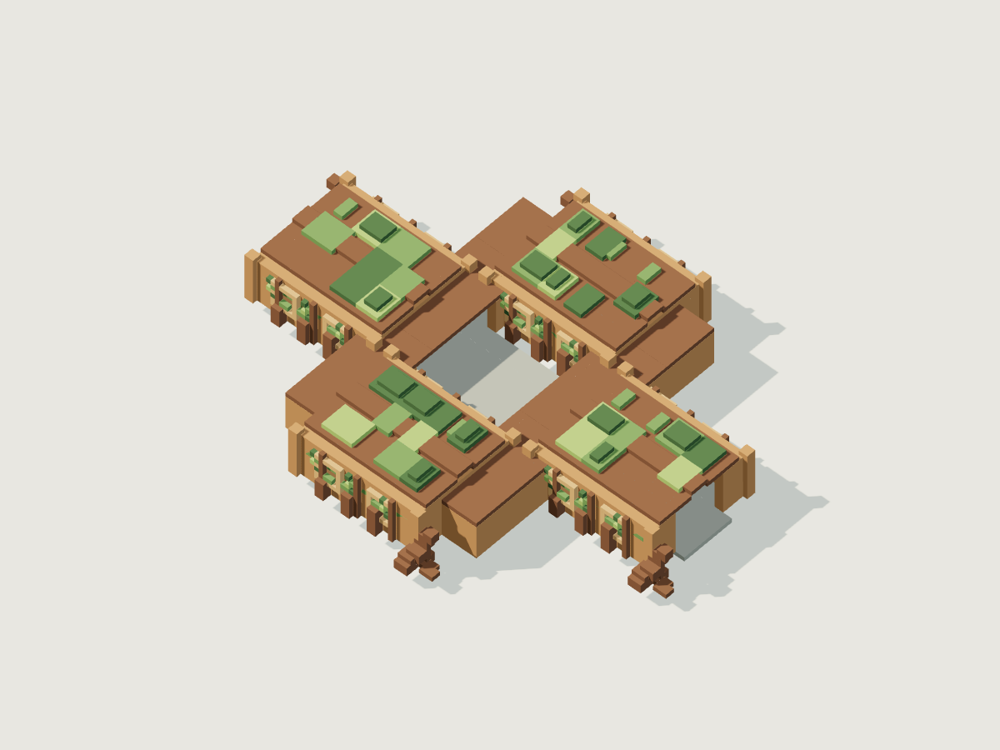

시각 원형 · [복셀 원본](../../design/assets/models/grove_supply_camp.voxel.json) · [GLB](../../design/assets/exports/grove_supply_camp.glb) · [지붕을 숨긴 내부](../../design/assets/previews/grove_supply_camp-cutaway.png)

식생과 야생 무리의 이동로를 막지 않도록 개방형 마당을 중심으로 배치. 식량·목재 납품은 신성 기여 경로와 연결 가능.

환경 `grove`, 블록 log, plank, stone. 주민 상한: wayfarer_organic 6.

| 방 | 중심 좌표 |
|---|---|
| 공동 식탁 | [0, 0, 0] |
| 휴식소 | [16, 0, -12] |
| 목재 작업장 | [16, 0, 12] |
| 공용 창고 | [32, 0, 0] |

연결: room_0↔room_1↔room_3↔room_2↔room_0. 각 통로 폭·높이 4m; 정확한 꺾임 좌표는 JSON 참조. 제공 기능: food_supply, rest, wood_processing, contribution. 재고와 수리 자원은 유한하고 거래·기여 보상은 성장 원장으로 처리한다.

표면 블록 배정: wall=`plank`, floor=`stone`, roof=`log`, trim=`moss`.

### 구릉 정비 공동체 — `ridge_repair_station`

<!-- asset:ridge_repair_station -->
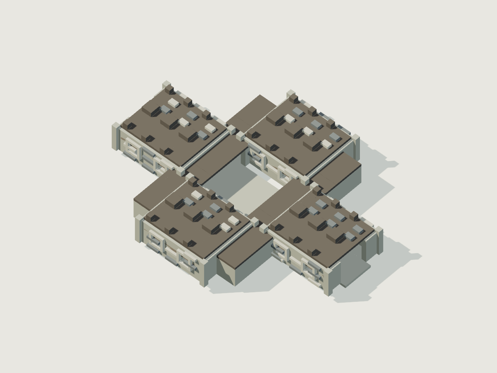

시각 원형 · [복셀 원본](../../design/assets/models/ridge_repair_station.voxel.json) · [GLB](../../design/assets/exports/ridge_repair_station.glb) · [지붕을 숨긴 내부](../../design/assets/previews/ridge_repair_station-cutaway.png)

폭넓은 마당에서 기계를 주차하고 수리. 주민과 정비 무기생명은 공동체 소속이며 제작 구조물은 모두 machine.

환경 `ridge`, 블록 stone, iron_scrap_block, plank. 주민 상한: wayfarer_organic 4, custodian_inorganic 2.

| 방 | 중심 좌표 |
|---|---|
| 정비 마당 | [0, 0, 0] |
| 도구 작업실 | [16, 0, -12] |
| 부품 창고 | [16, 0, 12] |
| 공동 숙소 | [32, 0, 0] |

연결: room_0↔room_1↔room_3↔room_2↔room_0. 각 통로 폭·높이 4m; 정확한 꺾임 좌표는 JSON 참조. 제공 기능: repair, material_trade, scrap_processing. 재고와 수리 자원은 유한하고 거래·기여 보상은 성장 원장으로 처리한다.

표면 블록 배정: wall=`stone`, floor=`stone`, roof=`iron_scrap_block`, trim=`rubble`.

### 공동 연구 기록소 — `communal_archive`

<!-- asset:communal_archive -->
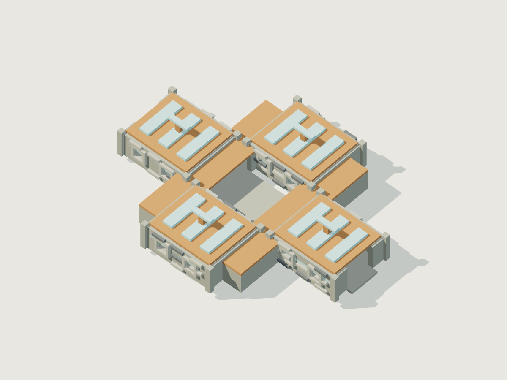

시각 원형 · [복셀 원본](../../design/assets/models/communal_archive.voxel.json) · [GLB](../../design/assets/exports/communal_archive.glb) · [지붕을 숨긴 내부](../../design/assets/previews/communal_archive-cutaway.png)

보스 없는 연구 유적. 발견 설계도는 자체 연구를 앞당기며 이곳만의 영구 독점 제작법 없음.

환경 `coast`, 블록 stone, glass, plank. 주민 상한: 없음.

| 방 | 중심 좌표 |
|---|---|
| 열린 현관 | [0, 0, 0] |
| 연구 열람실 | [16, 0, -12] |
| 모형 실험실 | [16, 0, 12] |
| 자료 저장실 | [32, 0, 0] |

연결: room_0↔room_1↔room_3↔room_2↔room_0. 각 통로 폭·높이 4m; 정확한 꺾임 좌표는 JSON 참조. 제공 기능: research_acceleration, salvage. 재고와 수리 자원은 유한하고 거래·기여 보상은 성장 원장으로 처리한다.

표면 블록 배정: wall=`stone`, floor=`stone`, roof=`plank`, trim=`glass`.

### 순례 보급소 — `pilgrimage_waystation`

<!-- asset:pilgrimage_waystation -->
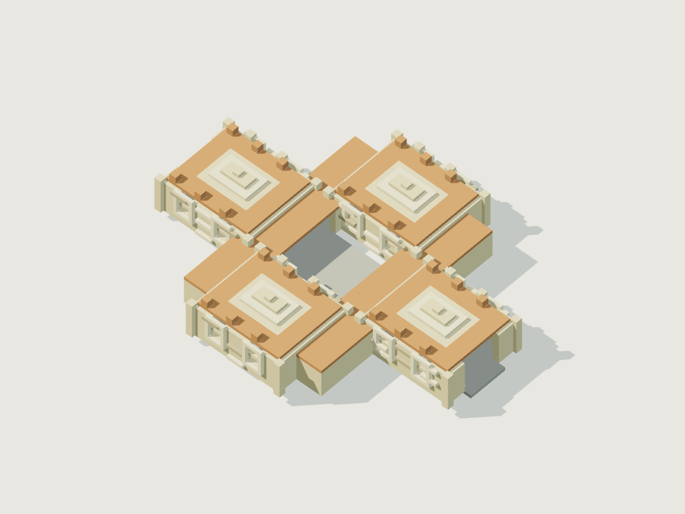

시각 원형 · [복셀 원본](../../design/assets/models/pilgrimage_waystation.voxel.json) · [GLB](../../design/assets/exports/pilgrimage_waystation.glb) · [지붕을 숨긴 내부](../../design/assets/previews/pilgrimage_waystation-cutaway.png)

기본 환경 위 성역 중첩 지점에 배치. 최초 성물 이전에도 공동체 기여로 신성을 얻는 접근점. 봉사 보상 계산은 성장 데이터 소유.

환경 `sacred`, 블록 sacred_stone, stone, plank. 주민 상한: wayfarer_organic 4, custodian_inorganic 2.

| 방 | 중심 좌표 |
|---|---|
| 순례 마당 | [0, 0, 0] |
| 공동 식탁 | [16, 0, -12] |
| 봉사 접수실 | [16, 0, 12] |
| 휴식실 | [32, 0, 0] |

연결: room_0↔room_1↔room_3↔room_2↔room_0. 각 통로 폭·높이 4m; 정확한 꺾임 좌표는 JSON 참조. 제공 기능: contribution, rest, food_supply. 재고와 수리 자원은 유한하고 거래·기여 보상은 성장 원장으로 처리한다.

표면 블록 배정: wall=`sacred_stone`, floor=`stone`, roof=`plank`, trim=`sacred_stone`.

## 파괴·생태·보존 계약

- 초반 두 던전 일반개체 상한은 10(포식 2, 소형 소비 6, 초식 2), 나머지는 19(5/10/4). 보스 소환도 해당 종 슬롯을 예약·차감하며 이 상한을 넘기지 않는다. 무기 경비는 먹이사슬에서 제외한다.
- 생산실의 잔존 생산원·물·생존 번식 개체가 없으면 유기종을 자동 재생성하지 않는다. 무기 경비는 잔해·정비 시설·소모 자원이 필요하다. 개방된 출입구를 통한 이동은 새 개체 생성이 아닌 동일 ID의 이주다.
- 스폰 지점은 종별 minPlayerDistanceM과 건축 최소 거리 6m 중 큰 값 밖이며 가시선 밖일 때만 새 개체 출생·진입을 허용한다. 최초 생성도 플레이어가 점유한 복셀에 겹쳐 생성하지 않는다.
- 보스 기믹은 종류별 2개, 크기 2×2×2m. 보스 원점 좌표에 x+82를 적용해 건축물 좌표로 변환한다. 일반 엄폐와 겹치면 같은 복셀 구조로 병합하고 추가 차폐를 만들지 않는다. 좌표는 JSON gimmickSlots, 기능·스킬 타이밍은 BOSSES가 소유한다.
- 방 ID는 생태·연출 단위이지 무적 경계가 아니다. 벽 파괴에 따른 유체 흐름·시야·이동을 갱신하되 자원·개체를 경계마다 복제하지 않는다.
- 인스턴스 키는 월드 시드+생성 버전+절대 앵커 셀+템플릿 ID. 복셀 델타·분리 사물 ID·컴포넌트·유체·생태 재고·주민·스폰 원장·보스·보상·공동체·방문 정보를 저장한다.
- 보상 수령은 가방 반영과 원장 기록을 원자적으로 처리. 부분 수령 잔량 보존, 분리한 상자는 동일 저장 ID 유지. 재접속·보스 초기화·건물 파괴·템플릿 변경으로 보상 재생성 금지.
- 사망 아이템은 건물 보상과 별도 영구 원장. 사망 위치 10m 접근 시 원래 통로·시체 시야·보스 처치·바닥 보존과 무관하게 요정 회수 가능. 가방 부족분은 보관 유지.
- 기존 인스턴스를 새 템플릿으로 덮어쓰지 않는다. 배치한 기계의 사망 손실은 사용자 미확정이므로 이 문서에서 자동 파괴·보존을 결정하지 않는다.

## 검증과 구현 전 남은 작업

데이터 생성 후 방/문/통로 그래프와 좌표 격자를 검증한다. 이것은 실제 충돌·가림·물리·몬스터 AI 검증을 대체하지 않는다.

- Validate every reference and all positions at 0.5m cell grid.
- Rasterize shells and corridors; flood-fill a 0.8m-wide 1.8m-high person from both entrances to every reward anchor.
- Sweep 5m-wide 4.5m-high machine envelope along main entrance/workshop/antechamber/arena route, including bends and exterior bypass; side corridors intentionally allow smaller machines only.
- Verify boss room permanent escape strip and two exterior escape paths remain after all encounter phases; no combat locks.
- Disable puzzle route and confirm an alternate route through the template-specific graph or exterior bypass; breach arbitrary wall and verify identical loot ledger and correct population boundaries.
- Save/reload after container detached, partial loot, flooded corridor, broken producer, displaced moving platform and death; no duplication/reset.
- Boss adds share species population cap; clear occupied or reserved slots before spawning.
- Check room/corridor geometry collision and occlusion in actual voxel engine; design data validation alone does not establish runtime navigation.

- 환경의 건축 후보 부지 안에서 여덟 던전과 주변 고난도 지역의 외부 우회로를 함께 검증해야 한다. 건물의 퇴로만 통과해도 세계의 우회 조건이 자동 충족되는 것은 아니다.
- 먹이는 1단위=100CP로 연결했다. 생산량이 기초대사의 2배라도 포식자의 실제 먹이 공급·번식·사체 분배가 지속된다는 뜻은 아니다. 초기 먹이 재고 이후 2시간 생태 시뮬레이션과 유체 범람·휴면 진행 검증은 구현 전 필수다.
- 대표 단층 외 다층 건물·장거리 비행체 내부 도킹·중첩 건축물은 이 데이터의 완료 범위가 아니다.

## 변수 사전과 현재 구현 대응

아래 경로는 `structures.json` 기준이다. 신규 데이터는 현재 런타임에 연결되지 않았다. 누락 값에 암묵적인 0을 대입하지 않으며 `dungeon` 전용 항목은 다른 건축물에 없는 것이 정상이다. 좌표·크기 배열의 순서는 x,y,z, 부지는 x,z다. 분포를 가진 임의 값은 없고 모든 치수·개체 상한·앵커는 템플릿 고정값이다. 환경 후보 선택 시드와 회전은 환경 생성기가 소유하며, 건물 인스턴스 변환을 저장한다.

| 개념/분류 | 현재 변수·위치 | 새 데이터 경로 | 상태 | 타입·단위 | 허용 범위/열거형 | 제안 기본값/항목별 값 | 결정 근거·연관 규칙 | 검증·이전 방식 |
|---|---|---|---|---|---|---|---|---|
| 버전 | `info.terrainVersion`, frontier/terrain.js:54 | `schemaVersion`, `status` | 신규 | int / enum | >=1; proposed | 1 / proposed | 앱 버전과 분리 | 기존 terrainVersion 자동 치환 금지 |
| 건물 종류 | 별도 없음; `info.villages/info.dungeon/info.boss`, terrain.js:29,42,49 | `entries[].kind/environmentId/id` | 신규 | string | dungeon/community/ruin/supply; 환경 참조 | 항목별 | 구 코드의 boss 패드와 내부 arena는 다른 개념 | ID 유일성·환경 참조 검증 |
| 티어 변형 | 현재 건물별 없음 | `prototypeTier`, `tierVariantPolicy.*` | 신규 | int/bool | 티어1..10; bool | 대표2,3,4,5,5,6,7,8; 범위1..10, 활성화 false | 같은 환경의 다른 난도 지원 | 검증한 변형만 생성 |
| 구조 격자 | 기존 world 셀 기반 `put`, terrain.js:7 | `units.cellSizeM`, `cellSizeM` | 신규 단위 계약 | number/m | >0; 좌표와 호환 | 0.5 | 기존 생물 표현 해상도와 별도 | 모든 좌표·크기 셀 정렬 검사; 기존 좌표 자동 절반 금지 |
| 벽·바닥·천장 | terrain.js:32~37의 고정 반복문 | `wallThicknessM/floorThicknessM/roofThicknessM` | 신규 | number/m | >0; 격자 배수 | 1/0.5/0.5 | 통로는 셸을 제거, 바닥 보존 | 복셀화·관통검사 |
| 층 | 기존 정수 y 반복문 | `floorCount`, `rooms[].floorIndex` | 신규 | int | count>=1; 0<=index<count | 대표1층/index0 | 검증 가능한 단층 프로토타입 | 추후 다층 템플릿은 신규 버전 |
| 부지·지형 | `pad(x,z,r)`, terrain.js:11 | `footprintM.*`, `foundationMaxSlopeDegrees` | 신규 | vec2 m / number degree | min<max; 0..90 | 던전별 부지; 경사8..18 | 방·벽·통로·외부 우회 폭과 여유1 포함 | 합성 AABB 포함검사; 기존 pad로 덮어쓰기 금지 |
| 블록 팔레트 | `B.*`, terrain.js:34~37,50~53 | `palette[]` | 신규 참조 | string[] | blocks.json 존재 ID | 항목별3~4종 | 실제 재질·물성을 따름 | 기존 B 정수와 별도 registry 매핑 필요 |
| 방 경계 | 현재 없음 | `rooms[].centerM/clearSizeM/minM/maxM` | 신규 | vec3/m | size>0; 셀 정렬 | 표/JSON 개별값 | 중심 y는 바닥; min/max는 내부 유효 체적 | 경계 일관성·포털 접촉·범위 검사 |
| 통로 | `origin/target`, terrain.js:94~99 | `connections[].centerlineM/clearWidthM/clearHeightM/floorSlopeMaxDegrees` | 신규 | vec3[] / m / degree | 경로>=2점; 폭·높이>0; 경사0..90 | 던전폭3/4/6, 높이4/5, 내부0도 | 개인과 소형/시제품 기계 접근 구분 | 셸 carving과 캡슐·기계 sweep; 그래프만으로 충돌 보장하지 않음 |
| 연결 상태 | 없음 | `connections[].from/to/state/bidirectional/doorCloseDuringCombat` | 신규 | ID/enum/bool | 존재 방; open/physical_puzzle | 양방향, 전투닫힘 false | 파괴로 통과할 때 논리문이 남지 않음 | 퍼즐 경로 제거 후 대체 연결 검사 |
| 기계 통과 | 없음 | `connections[].machineEnvelopeM`, `machineParking.*` | 신규 | vec2/vec3 m | >0 | 통로폭-1, 높이-0.5; 주차12×6×10, 진입6 | 전체 자유 제작 크기 무제한 진입 보장 아님 | 현재 기계 실제 충돌체로 별도 시험 |
| 출입·외곽 | 기존 보급 trail, terrain.js:92 | `entrances[].positionM/clearSizeM`, `exteriorBypass.*` | 신규 | vec3 m, vec2 m, bool | 양수 폭·높이; 경사0..90 | 출입6×5, 외곽폭6, 경사10 | 철수와 고난도 회피 | 퇴로·부지 AABB와 외부 환경 접속 검증 |
| 일반 스폰 | 건축에 없음 | `rooms[].spawnGroups[].initialCount/maxCount/anchorM/spawnExclusionRadiusM/onlyWhenUnobserved`, `rooms[].maxPopulation` | 신규 | int/vec3 m/number m/bool | 0<=initial<=max; 합<=방cap | 초기/상한 표; 거리 max(6,종별값) | 생태 데이터의 종 원형 참조 | 종 ID·합계·시야·겹침·저장 검증 |
| 생태 상한 | 없음 | `ecology.populationMaxExcludingBoss/predatorMax/consumerMax/grazerMax/bossAddsSharePopulationCap` | 신규 | int/bool | >=0; 역할 합=총합 | 10=2+6+2 또는19=5+10+4; true | 보스소환도 실제 슬롯 예약 | 생물 예산과 같은 원장 사용 |
| 생산원 | 없음 | `ecology.producers[].footprintM/waterConsumptionLPerHour/foodUnitsPerHour/requires*` | 신규 | vec2 m, number L/h, number BU/h, bool | 양수 면적; 비음수 생산·소비 | 면적4×4/3×3, 물4/2; 먹이 항목별 | 기본 생태 에너지원 분리 | 생산원 파괴·단수·마나 단절 시험 |
| 먹이 환산·재고 | 없음 | `ecology.foodUnitCp/basalDemandCpPerHour/producerBudgetMultiplier/initialStockHours/initialPlantFoodUnits/initialCarrionCp` | 신규 | number CP/BU, CP/h, ratio, h, BU, CP | >0 환산; 나머지>=0 | 100CP/BU, 대사 합계,2배,2h,개별값 | 생물 calories 기초대사 합×2/100 올림; 식물과 사체 별개 | 2시간 수용력·포식 먹이 지속성은 미검증, 출시 차단 조건 |
| 저수조 | `world.fluids`, terrain.js:9에서 건축 셀 삭제 | `ecology.water.*` | 신규 | vec3 m, L, enum | 부피=가로×깊이×높이×1000 | 중심[24,-1,22],8×1×6,48000L,water,보행3 | 식수조는 산·마나 위험조와 분리 | 체적·누수·범람·재접속 검사 |
| 보스방 | `info.boss`, terrain.js:42 | `bossArena.bossId/roomId/clearAreaM2/clearHeightM/bossSpawnM` | 신규 | ref / m² / m / vec3 | 면적·높이>0; 방내 스폰 | 면적576..1600, 높이10..20, [82,0,4] | 보스 데이터 경기장 원점을x+82변환 | boss arena 사이즈 대응·범위검사 |
| 엄폐·기믹 | terrain.js:44~47 기둥 | `bossArena.obstacles[]`, `gimmickSlots[]` | 신규 | ID, vec3 m, bool | 방내 셀 정렬; size>0 | 엄폐4개2³, 기믹2개2³; 항목별 좌표 | 겹친 기믹은 같은 엄폐에 통합 | boss ID/기믹 좌표 일치; 복셀 중복 생성 금지 |
| 퇴로 보호 | 없음 | `bossArena.reservedEscapeStrip.*`, `clearCrossWidthM`, `flightAllowed/vehicleAllowed/bossResetDoesNotRestoreVoxelsOrRewards` | 신규 | enum, m, bool | axis=x/z; width>0 | x축,z=0,폭6; 중앙 십자폭8; 모두true | 영구 위험 금지, 날기·기계 허용 | 전 페이즈 탈출·리셋 보상 검사 |
| 보상 앵커 | `RUINS.bonus`, content.js:58~73; region.studies:111 | `rewardAnchors[].positionM/rewardPoolId/channel/requiresActualBossDefeat` | 신규 | vec3 m/ref/enum/bool | 방내; salvage/archive/boss | 위치 표; 보스만 처치 조건 | 물건 목록은 성장 데이터 소유 | 원자 수령·가방 포화·분리 상자 ID 검증; 기존 보상 자동 중복지급 금지 |
| 주민·서비스 | `CONTRACTS`, content.js:41~56 | `community.residentBudget[].maxCount/actions`, `serviceAnchors[]` | 신규 | int/ref/vec3 m | >=0; 문명 종 참조 | 주민 표, 서비스 앵커 방 중심 | 주민·건물·공동체 ID 분리 | 관계·유한 재고 보존, 자동 NPC 재생성 금지 |
| 기능 배치·표면 | 기존 B 반복문, 별도 컴포넌트 배치 없음 | `blockAssignments.*`, `puzzle.componentAnchors[]`, `puzzle.physicalGate.*` | 신규 | block/component 참조, vec3 m, bool | 존재 ID; 양수 설치크기 | 장치2×2×2, 장애1×4×5, 개방6×5, 위치 항목별 | 외형만으로 기능을 만들지 않으며 기능카탈로그를 연결 | 앵커·재질·컴포넌트 참조 검사; 실제 assembly 설계 필요 |
| 영속 상태 | `region.resources/contracts/studies/relays`, content.js:108~112 | `persistenceContract.*` | 신규 | string 계약/필드목록 | worldSeed+generatorVersion+anchor+template 키 | 본문 계약 | 방문·파괴·사망 원장 분리 | 구 저장 미이전, 인스턴스 버전 고정 |

외부 참조 미존재는 조용히 기본값으로 대체하지 않고 검증 실패로 처리한다. JSON 수치가 유효해도 실제 전투 체감·유체 비용·폐쇄생태 지속성이 검증된 것은 아니다.

### 이번 작성에서 수행한 정적 검증

12개 건축물·84개 방에 대해 JSON 파싱, 블록·일반종·보스 참조, 각 연결의 시작/끝 포털이 소속 방 경계 안에 있는지, 양쪽 입구에서 전체 방 그래프 도달 여부, 방별 스폰 상한 합계와 던전 상한 일치, 보상 앵커의 소속 방 범위, 보스 문서와 경기장 가로·높이·깊이 일치를 검사해 오류 0건을 확인했다. 실제 복셀 충돌·가림·기계 sweep·장시간 생태는 아직 실행하지 않았다.
