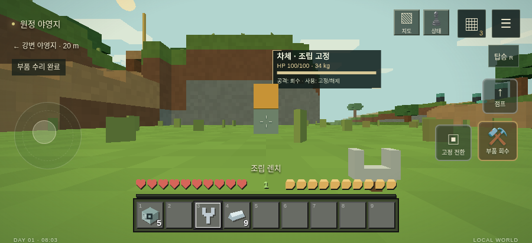
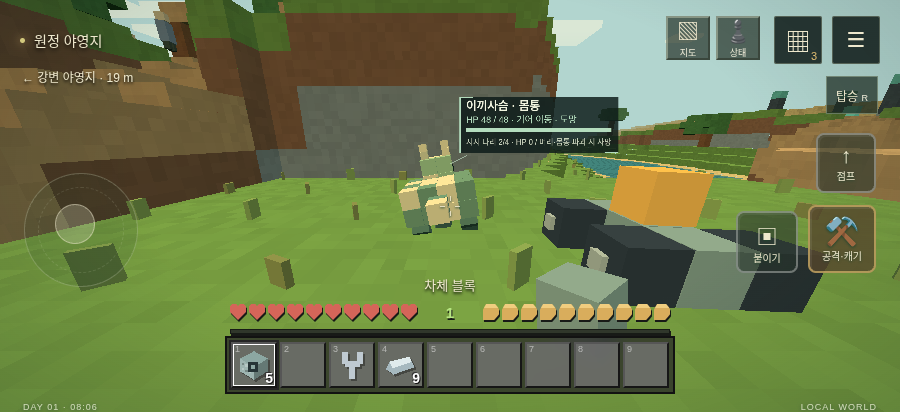

# 게임 0.6.0 검증 — 2026-10-17

게임 600, 앱/최소 앱 302, 저장 스키마 2. 상세 결과와 APK/업데이트 SHA-256은 [results.json](0.6.0/results.json)에 기록했다.

- `node --test tests/*.test.js`: **89/89 통과**. 새 구조 테스트는 발/관절 손상, 지지 배치별 속도, 이동 불가, 사망 직후 정지, 자세/피격 좌표 왕복, 구 저장의 끊어진 부착점 이전, 중력/착지, 동력 손상, 반복 파편 분리, 질량, 지형 제거, 보행 충돌/발판, 회전익 불균형, 잘못된 물리 저장 거절을 포함한다.
- **브라우저 9종 통과**: interface-editor, survival-ui, world-ui, progression, equipment, machine, updates-ui, structural, frontier. Chromium + SwiftShader. 모바일 가로/세로 UI와 터치 입력 포함. 원본 결과는 [0.6.0 디렉터리](0.6.0/)의 각 로그에 기록했다.
- 새 `structural-check.cjs`: 실제 모바일 사용/공격 버튼으로 차체·모터 부착, 렌치 회수, 합금 수리, 고정 해제, 무고정 배치 거절, 탑승/주행/하차, 독립된 위치 저장과 재시작 복원, 손상 동물의 월드 정보창 확인. 부품/합금 소비량과 가방 상태를 검증한다.
- 수정한 `frontier-check.cjs`: 실제 제작한 회전익을 모터 양면에 직접 부착하고, 비행 버튼과 상승 입력으로 강체 비행 확인. 지역 왕복 저장 및 저장 실패 원자성, 기존 전투/교역/동맹 검사 유지.
- `bash build-apk.sh`: 통과. APK v2/v3 서명 검증 통과. `build/Feral-0.6.0-game-native-0.3.2.apk` 생성.
- `python3 tools/build-update.py`: 통과. 서명 업데이트 패키지 44개 파일, 약 2.75MB. 기존 네이티브 압축 8MiB/확장 32MiB 제한 내. 실제 패키지/해시/네이티브 검증 테스트 포함.
- `git diff --check`: 통과.

Android 실기기의 성능·WebView 생명주기·OTA 설치 검증은 이번 환경에서 실행하지 않았다. APK 빌드 성공을 실기기 검증으로 간주하지 않는다. 공개 stable 배포는 PR 병합 후 별도 릴리스 작업이며 이 기록은 로컬 검증이다.
